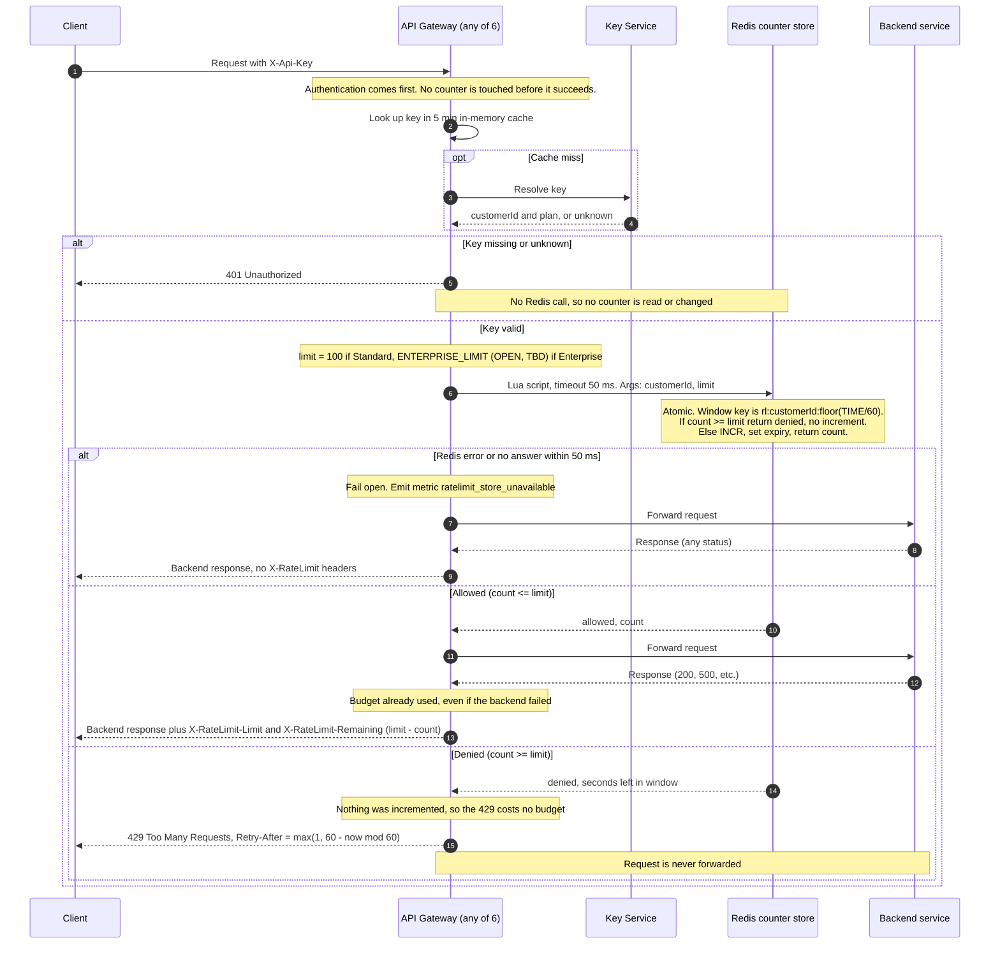

# Per-customer rate limiting on the public API

## Decisions

- **Store:** a single shared Redis (primary with a replica) holds the counters. All 6 gateway instances use it, so counts are shared (requirement 7). It is used only for rate-limit counters.
- **Window:** a fixed one-minute window aligned to the clock. The key is `rl:{customerId}:{floor(redisTime / 60)}`. The key expires about 60 seconds after its window ends. The key uses the customer ID, so all of a customer's API keys share one budget (requirement 1).
- **No overshoot:** the gateway runs one Lua script on Redis per request, and Redis runs a script atomically. The script does the following:
  - It reads the count.
  - If the count is at or above the limit, it returns "denied" and does not increment.
  - Otherwise it increments the count and returns the new count.

  Instances on different machines cannot interleave a read and a write. A denied request changes nothing, so a 429 uses no budget (requirement 4). An allowed request is counted before forwarding, so a backend 500 still counts (requirement 5).
- **Limit:** the Standard limit is 100 per minute. The **Enterprise limit is OPEN (TBD, Product)**. It is a config value with no default. See the open item below.
- **Retry-After:** the script uses Redis `TIME`, not the gateway clock, so instance clock skew doesn't matter. `Retry-After = max(1, 60 - (now mod 60))`, in whole seconds. This is when the current window ends, and the budget resets then.
- **Headers:**
  - `X-RateLimit-Limit` is the plan limit.
  - `X-RateLimit-Remaining` is `limit - count`, never below 0.
  - The gateway adds both to every response for a request that passed the check, including backend errors.
- **Fail open:** the gateway calls Redis with a 50 ms timeout. On an error or a timeout, it forwards the request and emits the `ratelimit_store_unavailable` metric. A fail-open response is the normal backend response with **no** `X-RateLimit-*` headers, because the gateway doesn't know the count. A reply that arrives after the timeout is ignored. The late script may still have counted the request, which is acceptable.

## Diagram

## Notes

- **Open item, Enterprise limit:** Product has not set it. `ENTERPRISE_LIMIT` has no default. Until it is set, deploy with Enterprise customers either not rate limited or limited to a number Product explicitly approves. Don't ship a guessed value. The gateway should log a warning if it loads an Enterprise plan with no limit configured.
- **Fixed-window trade-off:** a customer can send up to 100 requests at the end of one window and 100 at the start of the next. That is up to 200 in a short burst around the boundary. This is accepted for v1 because it is simple and cheap. A sliding window can replace it later without changing the API behavior.
- **Redis failure modes:**
  - Fail-open means a Redis outage removes limiting but not availability.
  - Redis failover can lose up to a few seconds of counts, so customers could get a little extra budget. That is acceptable.
  - Alert on `ratelimit_store_unavailable`, because an unnoticed outage means no limiting.
- **Not covered:** a Key Service outage is existing behavior and is unchanged by this design. 429 responses carry only `Retry-After` (the requirements ask for nothing more there).
