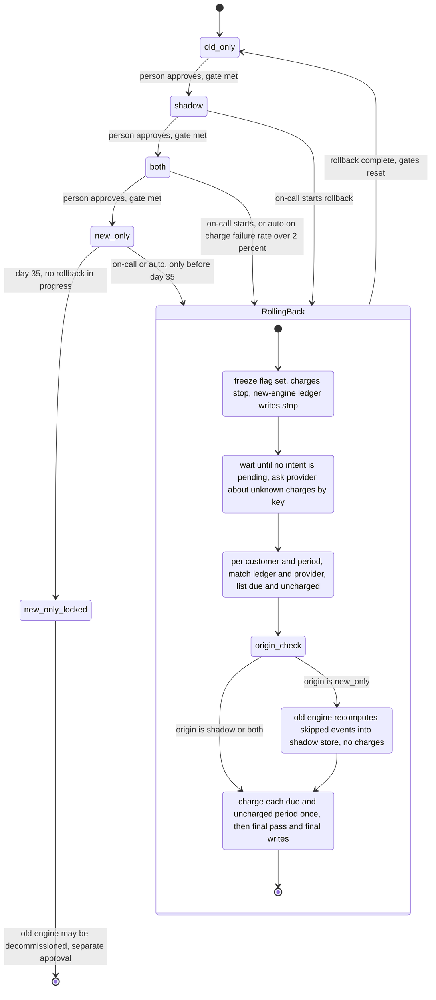

# Billing engine rollout: state machine

Today the old billing engine does all billing. Each run, it reads usage events, computes invoices, writes them to the billing ledger (the system of record) and charges customers through the payment provider. This plan replaces the old engine in small steps that can be undone. One config flag, `billing_mode`, holds the current mode. The mode moves forward one step at a time: `old_only`, then `shadow`, then `both`, then `new_only`. A person approves each forward move, and only when its gate is met. In `shadow`, the new engine computes invoices but never charges. In `both`, the new engine charges, and the old engine keeps computing invoices as a backup. Rollback can start from `shadow`, `both` or `new_only`, and it always ends in `old_only`. Rollback first freezes all charges, waits for charges already in progress, checks the provider for unclear charges, and then charges only what is still due. Every charge uses one key per customer and billing period, so a period is never charged twice, even when a step is retried.

## Terms

- **Mode**: one of the four values of `billing_mode`: `old_only`, `shadow`, `both`, `new_only`.
- **`billing_mode`**: the config-service flag that holds only the mode. Workers read it.
- **`new_only_locked`**: a sub-state of `new_only`, stored in the rollout record. It is set from day 35 on, when rollback is no longer possible. It is not a fifth value of the flag.
- **Rollout record**: data stored beside the flag. It holds the gate counters, the nightly results, Finance sign-off, the rollback origin, the current rollback step, the freeze flag, the date the rollout entered `new_only`, the `new_only_locked` sub-state, and a version number.
- **Compare-and-set (CAS)**: a write to the rollout record that succeeds only if the record's version is still the version the writer read. If it fails, the writer re-reads the record and decides again.
- **Gate**: the condition that must be true before a forward move.
- **Controller**: the process that applies approved mode changes, sets `new_only_locked` on day 35, starts the automatic rollback trigger and runs the rollback steps. It is not built yet.
- **Nightly job**: compares the two engines' invoices for each customer. It writes each night's results and the gate counters to the rollout record in one CAS. It only counts. It never changes the mode.
- **Usage event log**: keeps usage events for 35 days.
- **Billing ledger**: the system of record. It holds at most one charge row per billing period key.
- **Shadow store**: one store for the invoices of the engine that is not charging. It has a separate partition for each engine. Rows are keyed by engine, customer and billing period.
- **Payment provider**: the outside service that actually charges cards. It can be asked whether a charge with a given key exists.
- **Billing period key**: the pair (customer, billing period). The same key is sent to the provider as the idempotency key.
- **Idempotency key**: an ID the provider uses to recognize a repeated charge request, so the same charge is never made twice.
- **Ledger intent**: a ledger row with the key, marked pending, written before a charge. Recording the result changes it to succeeded or failed.
- **Mismatch**: the two engines' invoice totals for one customer differ by more than one cent.
- **Resolved mismatch**: a mismatch that a person has marked resolved in the rollout record, with a note, and whose next nightly comparison for that customer shows no mismatch.
- **Due and uncharged**: a period whose due date has passed under the existing billing terms and that has no succeeded ledger row.
- **Freeze flag**: a field in the rollout record. While it is set, neither engine starts a new charge, and the new engine does not write to the ledger.
- **Rollback origin**: the mode the rollout was in when rollback started.

## Mode diagram

## What each mode does

- **old_only**: The old engine computes, charges and writes the ledger. The new engine is off.
- **shadow**: The old engine still charges and writes the ledger. The new engine reads the same usage events and writes its invoices to the shadow store. It never charges and never writes the ledger. The nightly job compares the two engines for each customer. New-engine errors are recorded but never trigger a rollback.
- **both**: The new engine charges, and its invoice is written to the ledger. The old engine keeps computing every invoice into the shadow store without charging. So if rollback starts here, the old engine's invoice for every period is already in the shadow store. Mismatches do not trigger a rollback. They block the move to `new_only` until they are resolved.
- **new_only**: The new engine does everything. The old engine stops, so it skips usage events from this point on. The 35-day clock runs. Rollback is open until day 35.
- **new_only_locked**: Still `new_only`, but rollback is no longer possible. Decommissioning the old engine is a separate approval, outside this model.

## Where the state lives

- **`billing_mode`** holds the mode and nothing else.
- **Rollout record** holds everything else: gate counters, approvals, the origin, the step, the freeze flag and the lock. Every write to it is a CAS on its version. Three rules keep writes from undoing each other:
  - An approval applies only to the mode the person saw. Approvals are refused during rollback and on an old version.
  - The nightly job writes only counters, so it cannot undo a rollback step.
  - If a rollback step's write hits a version conflict, the step re-reads the record. It retries only if the record is still `RollingBack`. It never overwrites a newer version blindly.
- **Billing ledger** holds charges. A unique key on (customer, billing period) allows one charge row per period.
- **Shadow store** holds the invoices of the engine that is not charging. The nightly job compares the new engine's invoice with the old engine's invoice for each customer. One of them is in the ledger and the other is in the shadow store, depending on the mode. The store is one table with a partition per engine, so the comparison is one query.
- **Usage event log** keeps events for 35 days. This sets the deadline for reprocessing in rollback.

## Forward moves

Forward moves go one step at a time, and a person always makes them.

1. The controller reads the rollout record and the gate counters the nightly job wrote. It does not recount invoices.
2. A person approves the move. The approval names the record version the person saw.
3. The controller checks three things: the gate is met, the version is still current, and the record is not `RollingBack`. If any check fails, the move is refused and nothing changes.
4. If all checks pass, the controller writes the new mode into the record with a CAS. Then it sets `billing_mode` to match.
5. If the record write fails, the mode stays the same, and the person can approve again on the current version. If the `billing_mode` write fails, the controller retries it. Workers keep the old mode until it succeeds.

### Gate for shadow to both

The gate needs 7 consecutive matching days, and at least 5,000 invoices compared on each day. A day matches when its mismatch rate is under 0.1 percent. Each night, the nightly job adds one to the count on a matching day. On any other day it resets the count to zero. A night when the comparison does not run or fails counts as a failed day. The gate for `both` to `new_only` is 14 days in `both` with no unresolved mismatches, plus Finance sign-off.

### Day 35

While the rollout is in `new_only`, the controller sets `new_only_locked` in the record once 35 days have passed since the rollout entered `new_only`, if no rollback is in progress. This changes only the record. `billing_mode` stays `new_only`. Rollback start also checks the date, so a rollback is refused from day 35 on, even before the lock is written.

## Rollback

### When it starts

- On-call can start it by hand at any time before day 35.
- The controller starts it automatically when, in `both` or `new_only`, the new engine's charge failure rate is above 2 percent in any 10-minute window. In `new_only`, this is allowed only before day 35.

The start is one CAS. In the same write, it saves the origin mode, sets `RollingBack` and sets the freeze flag. So no new charge can begin once the write takes effect. A charge that passed the freeze check just before the write already has a pending intent, and drain waits for it. If the start write loses a version race, the start re-reads the record and retries, unless the record is already `RollingBack`. If it is already `RollingBack`, a second start or trigger does nothing and is logged. `billing_mode` keeps the origin value until the final writes.

### Steps

The controller runs the five steps in order. It stores the current step in the rollout record. A restarted controller reads that step and continues from it. Each step keeps its state in the record or the ledger, so each step can be retried safely. Every charge is keyed, so a retried charge cannot be made twice. A step has failed when its call returns an error. A call that is still running is slow, and the step keeps waiting.

1. **Freeze.** Starts with the start write. The freeze flag is set. Both engines check the flag before each charge. The new engine stops writing to the ledger. The freeze lasts until the final writes in resume. Keeps its state in: the rollout record.

2. **Drain.** Starts when freeze is set. It waits until no ledger intent is pending. Freeze stops new charges, so the set of pending intents only shrinks. In `shadow`, the pending intents are the old engine's normal charges, and drain waits for them to finish. For each pending intent:
   - If the charge is still waiting for the provider's answer, it is slow. Drain keeps waiting.
   - If the provider call timed out or errored, the outcome is unknown. Drain asks the provider about that key first. It never sends the charge again without this check.
   - If the provider cannot answer, drain stays in this step.
   Keeps its state in: the ledger intents.

3. **Reconcile.** Starts when drain is done. For each customer and billing period:
   - If the ledger has a succeeded charge, the period is charged. Leave it alone.
   - If the ledger has an intent with no result, ask the provider about the key. If the provider shows a charge, record it as succeeded. If not, the period is uncharged.
   - A period that is due and uncharged goes on the resume list. A period with a declined row does not, because a decline is final for rollback (see resume).
   - If the provider cannot answer, reconcile stays in this step.
   Keeps its state in: the ledger.

4. **Reprocess.** Runs only when the origin is `new_only`. Otherwise, skip it.
   - The old engine recomputes the usage events it skipped, from the day the rollout entered `new_only`, into the shadow store. It charges nothing.
   - It works in passes. Each pass covers the events that arrived since the previous pass started. It stops when a pass finds no new events. This catches up with events that keep arriving while the old engine is off.
   - The invoices it writes are the amounts that resume will charge. The old engine's rules applied to the same usage events give the amount it would have charged.
   - If it fails, retry. Events are deleted after 35 days, so reprocess must finish before then.
   Keeps its state in: the shadow store.

5. **Resume.** The old engine charges the periods on the resume list. Where the amount comes from depends on the origin:
   - Origin `both`: the old engine's invoice already in the shadow store.
   - Origin `new_only`: the invoice that reprocess wrote.
   - Origin `shadow`: the old engine computes the period's invoice from the usage events, as its normal run does. In `shadow`, the old engine's invoices are not in the shadow store, so resume must compute them. The list is usually short. It holds only due periods that the normal run did not reach, for example because the freeze stopped it.

   For each period on the list:
   - It writes the ledger intent first, using the row for that key. Then it charges with the key. Then it records the result. If the intent write fails, it does not charge.
   - A period that already has a succeeded row is skipped. The check is on the ledger row, not on the amount, so a charge the new engine already made is never repeated.
   - A declined card is recorded as failed. The period stays due, so the charge is not dropped. Rollback counts the period as handled and does not wait for it or retry it. Any later retry follows the existing billing terms (see open questions).
   - A provider error or timeout is checked by key before any retry. The retry reuses the same key.
   - Periods not yet due are not on the list. The old engine bills them after rollback, in `old_only`, through its normal run.

   **Final pass.** Before the final writes, resume runs reconcile again. This pass adds to the list only the periods that became due during rollback, that have no succeeded or declined row, and that are not already on an earlier list. Resume charges them as above, and repeats the pass. The loop ends when a pass adds no period. A period that falls due after the last pass is billed by the old engine's normal run, once `billing_mode` is `old_only` and the freeze is cleared.

   **Final writes**, in this order:
   - Set `billing_mode` to `old_only`.
   - Make one CAS on the record. It clears the freeze flag and `RollingBack`, clears the origin and the step, and sets the gate counters to zero.

   The freeze stays set until the record write succeeds, so charging cannot restart early. If either write fails, charging stays frozen and the write is retried. The rollout returns to `shadow` only through forward moves, and its 7-day count starts at zero.

## What happens when things fail

| Failure | What happens |
| --- | --- |
| New-engine charge failure rate above 2 percent in any 10-minute window, in `both`, or in `new_only` before day 35 | Rollback starts automatically, and on-call is paged. In `new_only` from day 35 on, there is no rollback. The failure still pages on-call, and the rollback option stays closed. |
| Second rollback start or trigger while `RollingBack` | Does nothing. It is logged. |
| Forward-move approval while `RollingBack`, or on an old record version | Refused. Nothing changes. After rollback ends in `old_only`, a person must approve again on the current version. |
| Start write loses a version race | The start re-reads the record and retries, unless the record is already `RollingBack`. |
| Start write cannot set the freeze flag | Retry. Do not start drain. |
| Any rollback step fails | The rollout stays in `RollingBack` with charging frozen. `billing_mode` is set to `old_only` only at the end of resume. Retry the step. A stuck step pages on-call. |
| Provider timeout or unknown charge outcome | Ask the provider about the key before anything else. Never resend the charge without this check. |
| Provider cannot answer during drain or reconcile | Stay in that step. |
| Ledger intent write fails | Do not charge. |
| Charge succeeds but recording the result fails | The intent stays pending. The next reconcile asks the provider about the key and records the result. |
| Declined card during resume | Recorded as failed. The period stays due. Rollback counts it as handled and does not list or retry it. |
| Final write fails (`billing_mode`, or the record CAS) | Charging stays frozen. Retry the write. Charging restarts only after the record write succeeds. |
| Rollback still running on day 35, origin `new_only` | Reprocess cannot finish after the events age out. The record stays `RollingBack` with charging frozen, and on-call is paged. |
| New-engine errors in `shadow` | Recorded. No rollback. |
| Mismatches in `both` | No rollback. They block the move to `new_only` until resolved. |
| Nightly comparison does not run or fails | Counts as a failed day, and the 7-day count resets. This is an assumption. |

## How this is built and rolled out

- Decide where the rollout record lives and what fields it has before the controller is written.
- Write the controller after this model is approved.
- Decide the open questions below before the first move from `old_only` to `shadow`.

## Open questions

- Who approves forward moves, and through which interface or command? Who may mark a mismatch resolved?
- Which process runs the controller, and how often? Day 35 and the automatic trigger are only checked as often as this schedule runs.
- What counts as a charge failure (a declined card, a provider error), and where do the results come from?
- Is the 5,000-invoice threshold per day or a total over the 7 days? The plan reads it as per day.
- Day 35 is counted from entering `new_only`, because the skipped events age out from that point. The plan assumes this.
- What happens to a rollback still running on day 35? Reprocess needs events that age out then, and the plan has no path for this case.
- The freeze flag is a proposal. The brief does not say how workers learn to stop charging, or whether the old engine may charge during reconcile.
- Who tells customers and Finance that due charges are delayed while charging is frozen?
- A freeze delays due charges. Reconcile and resume must finish before the next due date, or due charges are at risk. The brief sets no limit.
- How long may a charge stay pending before drain treats it as unknown? The brief sets no timeout.
- How long may a step retry, and after how long is on-call paged for a stuck step? The brief sets no limit.
- Mismatches in `both` do not trigger a rollback. Should they?
- A failed nightly comparison resets the 7-day count. This is an assumption.
- What happens to the shadow store after a rollback: is it kept or cleared?
- The fields of the ledger intent row are not defined yet.
- A declined card is recorded as failed, but the ledger allows one row per key. Under the existing billing terms, which key or attempt does a later retry use? The brief does not say, and the plan does not decide it.
- Reprocess passes stop when a pass finds no new events. A period that is due while events are still arriving may be only partly billed. Events that arrive after the last pass are billed by the old engine's normal run in `old_only`. The plan does not check how this interacts with due periods.