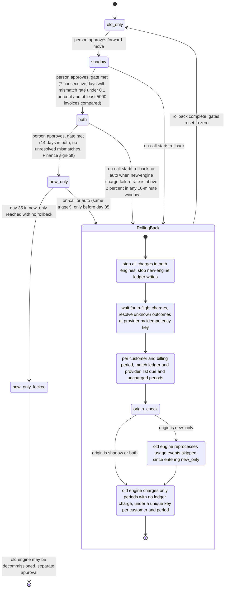

# Billing engine rollout: state machine

## What each mode does

- **old_only**: The old engine computes, charges and writes the ledger. The new engine is off.
- **shadow**: The old engine still charges and writes the ledger. The new engine reads the same usage events and writes invoices to the shadow store. It never charges and never writes the ledger. A nightly job compares the two engines per customer. A mismatch is any invoice total that differs by more than one cent. New-engine errors are recorded here and never trigger rollback.
- **both**: The new engine charges and writes the ledger. The old engine keeps computing every invoice into the shadow store without charging, so it stays current and a rollback needs no reprocessing. The comparison continues.
- **new_only**: The new engine does everything. The old engine stops computing, so usage events from this point are skipped by it. The 35-day clock runs. Rollback is open until day 35.
- **new_only_locked**: Still `new_only`, but past day 35 there is no rollback edge. The old engine may be decommissioned, which is a separate approval outside this machine.

## Where the rollout state lives

- **`billing_mode`** in the config service holds only the mode. Workers read it. The brief fixes its four values, so it cannot also hold rollback progress.
- **Rollout record (no home in the brief; needs one)**: gate counters (consecutive shadow days, 14-day count in `both`), nightly comparison results, Finance sign-off, rollback origin and current step, and the date the rollout entered `new_only`. Store it beside the flag, and make each approval or mode change a compare-and-set on the record's version, so an approval applies only to the mode the person saw.
- **Billing ledger** is the system of record for charges. A unique key on (customer, billing period) allows one charge per period. The payment provider gets the same key as its idempotency key.
- **Shadow store** holds invoices from the engine that is not charging.
- **Usage event log** keeps events for 35 days. This is the limit on reprocessing after a rollback from `new_only`.

## Rollback steps and the no-double-charge rule

1. **Freeze**: stop charges from both engines and stop new-engine ledger writes. Nothing charges while reconciliation runs, so no period can be charged twice by the two engines.
2. **Drain**: let in-flight charges finish. For any charge with an unknown outcome (for example, a timeout), query the provider by idempotency key before doing anything else. Never reissue a charge without that check.
3. **Reconcile**: for each customer and billing period, compare the ledger with the provider. Periods already charged are left alone. Due periods with no successful charge are listed.
4. **Reprocess** (only when the origin is `new_only`): the old engine recomputes the usage events it skipped, from entering `new_only` onward, into the shadow store.
5. **Resume**: the old engine charges only the periods that have no ledger charge, using the unique key. Only after this succeeds is `billing_mode` set to `old_only`, and the gates reset.

Order matters within each charge: write the ledger intent first, then charge with the key, then record the result. If the ledger write fails, do not charge.

## What happens when something fails

- **Charge failure rate above 2 percent in any 10-minute window, in `both` or `new_only`**: rollback starts automatically. In `new_only` after day 35 there is no rollback path, so the failure pages on-call and the rollback option stays closed.
- **A rollback step fails**: the rollout stays in `RollingBack` with charging frozen. `billing_mode` is not set to `old_only` until reconciliation passes. Retries are safe because every step is keyed.
- **Provider timeout or unknown outcome**: resolve by idempotency key first (see step 2).
- **Nightly comparison does not run or fails**: treat that night as a failed day, so the 7-day count resets. This is an assumption; the brief does not say.
- **Mismatches in `both`**: the brief does not trigger rollback on them. They only block the `both` to `new_only` gate. This is an open question.

## Open questions and assumptions

- The 5,000-invoice threshold is read as per day. The brief could also mean a cumulative count over the 7 days.
- Day 35 is counted from entering `new_only`, because the skipped events age out from that point.
- Freezing the old engine during rollback is a proposal. The brief does not say whether the old engine may charge during reconciliation.
- A freeze delays due charges. The reconcile must finish before the next due date, or due charges are at risk. The brief does not set a limit on this.
- The rollout record and its location are not specified and need a decision before the controller is written.