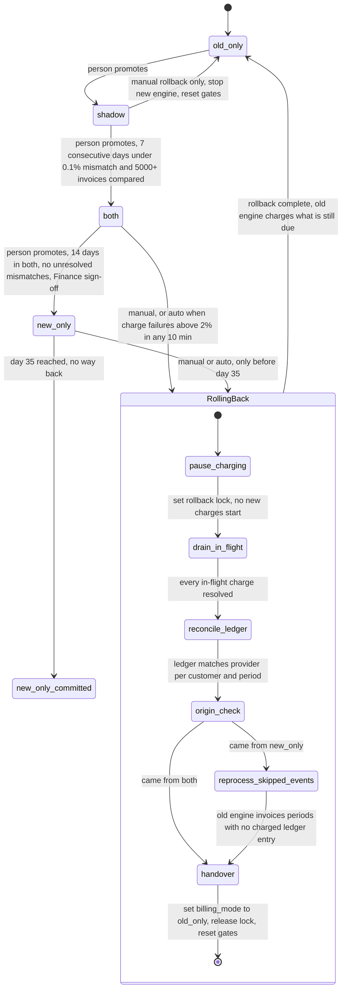

# Billing engine rollout: state machine

Today, billing workers run the old engine. Each billing period, it reads usage events from the usage event log, computes invoices, writes them to the billing ledger and charges customers through the payment provider. We are replacing it with a new engine. The switch must be gradual, reversible, and must never charge a customer twice.

This models the rollout as four modes (`old_only`, `shadow`, `both`, `new_only`), one rollback path and one point of no return. A person moves the rollout forward one mode at a time, once a gate is met. A rollback, started by hand or by a failure spike, always returns to `old_only`. Where the brief leaves a gap, I made an assumption. Those are listed at the end.

## Terms

- **Usage event log:** The existing log of usage events, kept for 35 days. Both engines only read it.
- **Billing period:** The span a customer is invoiced for. The old engine computes and charges each period once, after it closes (assumed). A charge is "due" when its period has closed and has no charged ledger entry.
- **Billing ledger:** The system of record for what customers were invoiced and charged. Each entry is marked charged or not charged. Whichever engine is charging writes it. During a rollback, reprocessing and reconcile_ledger write it too.
- **Shadow store:** A separate store for invoices that must never be charged. It is not the ledger.
- **Payment provider:** The outside service that takes the money.
- **Config service:** Holds the `billing_mode` flag and the rollback record. Workers read both.
- **Gate:** A condition that must be true before a person may promote to the next mode.
- **Promote:** A person changes `billing_mode` forward by one step. Nothing promotes itself.
- **Mismatch:** An invoice total that differs by more than 1 cent between the two engines for the same customer and billing period.
- **Charge failure:** A charge attempt that ends in a decline, an error or a timeout (assumed).
- **Charge key:** `(customer, billing_period)`. Every charge uses it as a unique ledger key and as the provider's idempotency key, so a repeat is rejected.

## Diagram

`RollingBack` and `new_only_committed` are diagram states only. Neither is a value of `billing_mode`, which is only ever one of the four modes.

- During a rollback the flag keeps its origin value (`both` or `new_only`) until `handover` sets it to `old_only`. The rollback record says charging is paused.
- `new_only_committed` is derived. The mode is `new_only` and the flag's change history shows it entered `new_only` 35 or more days ago. Workers, the rollback tool and on-call all use this same check, and a rollback request is refused when it is true.

## What each mode does

| Mode | Old engine | New engine | Notes |
|---|---|---|---|
| `old_only` | Computes, writes the ledger, charges | Off | The start, and the end of every rollback. |
| `shadow` | Computes, writes the ledger, charges | Reads the same usage events, writes to the shadow store. Never charges or writes the ledger. | A nightly job compares the engines' invoices per customer and period. |
| `both` | Computes every invoice into the shadow store. Never charges. | Computes, writes the ledger, charges | The comparison continues. A mismatch never blocks a charge. It stays unresolved until someone resolves it, and unresolved mismatches block the move to `new_only`. The old engine stays current, so rollback needs no reprocessing. |
| `new_only` | Stopped | Does everything | Usage events the old engine skips pile up in the 35-day log. |
| `new_only_committed` | May be decommissioned | Does everything | Rollback is not available. |

## Steps: moving forward

1. **Gate check.** The nightly comparison job runs each night. It counts consecutive qualifying days and invoices compared, using only results from the current rollout epoch (see state below). When a gate is met, it notifies the rollout owners. If the job fails or runs late, that day does not count, so the streak breaks.
2. **Promote.** A person changes `billing_mode` in the config service, one step only. Skipping is not allowed. Promotion is blocked while a rollback is running. Nothing promotes itself, and how a person does it (button or command) is not specified.
3. **Day 35.** Once the flag has been `new_only` for 35 days, rollback is refused (see the derived state above).

## Steps: rollback

A rollback always ends in `old_only`. It can start from `shadow`, `both` or `new_only`.

- **From `shadow`:** The new engine never charged. A manual rollback stops the new engine and resets the gates. Nothing needs reconciling. Errors in `shadow` are recorded and never start a rollback.
- **From `both` or `new_only`:** On-call can start it by hand at any time before day 35. It also starts automatically. A charge monitor counts failed charges against attempts in every 10-minute window. When the failure rate is above 2%, it writes the rollback record: the lock, the origin mode and the current step (`pause_charging`) and start time. A manual start writes the same record. The record starts the rollback runner, which runs these steps in order:
  1. **pause_charging:** Set the lock. Every charging worker reads the rollback record and starts no new charge while it is set. Charges that fall due now wait and are not dropped.
  2. **drain_in_flight:** A charge is in flight when it was sent to the provider and no result is recorded yet. Wait until every one has succeeded or failed.
  3. **reconcile_ledger:** Ask the provider for its charges by charge key and match them to the ledger. If the provider shows a charge with no ledger entry (for example, the new engine crashed after charging), add the entry as charged. If an entry exists but the charge was not made, mark it not charged so the period is still due, and alert on-call. The rollback does not wait for a person.
  4. **reprocess_skipped_events (`new_only` only):** The old engine, in reprocessing mode and not charging, reads the usage events it skipped and computes invoices. It writes each to the ledger marked not charged. It skips any period that already has a charged entry.
  5. **handover:** Set `billing_mode` to `old_only`, release the lock and reset the gates. The old engine now runs as in `old_only`. For every period with no charged ledger entry, including those deferred during the pause and those reprocessing marked not charged, it computes the invoice from the usage events, writes the ledger and charges, once. The charge key stops any repeat, so nothing is charged twice and no due charge is dropped.

The rollout is then in `old_only` with fresh gates. It must go through `shadow` again, and the 7-day count starts at zero.

## Where the rollout state lives

- **Mode:** The `billing_mode` flag in the config service is the only source of truth for the mode.
- **Rollback progress:** A rollback record, a second key next to the flag, holds the lock, origin mode, current step and start time. Workers read it to know charging is paused. A crashed rollback resumes from the recorded step.
- **Time in mode:** The flag's change history gives each mode's entry time. It drives the 14-day gate and the day-35 cutoff.
- **Gate counters:** Nightly comparison results are stored with the shadow store, tagged with a rollout epoch that goes up on every rollback. Only current-epoch results count, which is what resets the gates.
- **Money:** The billing ledger remains the system of record.

## When something fails

| Failure | What happens |
|---|---|
| New-engine errors in `shadow` | Recorded. No rollback, no mode change. |
| Charge failure rate above 2% over 10 minutes, in `both` or `new_only` before day 35 | Automatic rollback starts and on-call is paged. Ignored if one is already running. |
| Same breach in `new_only_committed` | No rollback. On-call is paged and the fix is forward only. |
| A rollback step fails, including a provider that never answers during drain | The rollback stays in that step and retries. Steps are idempotent. Charging stays paused and the flag is unchanged. On-call is paged if it takes too long. It never skips a step. |
| Nightly comparison job fails or is late | That day does not count toward a gate. |
| Mismatch rate at or above 0.1% on a day in `shadow` | The 7-day streak restarts. |
| Config service unreachable | Workers keep their last known mode. On-call is paged. No forward move or rollback can start until it returns. |

## Assumptions and open questions

1. Is 5,000 invoices a total or a daily minimum? I assumed the total across the 7-day window.
2. Does an unresolved mismatch restart the 14-day clock in `both`? I assumed only that none are open at promotion time.
3. Is day 35 a hard cutoff? The log keeps 35 days, so a rollback started on day 34 may have its reprocessing run into event expiry. Either stop rollbacks earlier (for example day 30) or hold the log for the length of a rollback.
4. There is no minimum volume for the 2% trigger, so a few failures in a quiet window could cause a rollback.
5. After day 35 nothing handles a failure spike automatically. Someone should own that.
6. The payment provider must support idempotency keys and lookup of its charges by key. Otherwise the double-charge guard and reconcile_ledger rest on the ledger alone.
7. The rollback record as a second config key needs approval, because the brief says "one global flag".
8. How fast do workers notice the lock? No polling interval is given. Until it is set, drain_in_flight must also wait out charges started just before a worker saw the lock.
9. Where in-flight charges are tracked, and how long to wait for a silent provider. I assumed a pending attempt is recorded under the charge key before sending. The timeout before paging is not set.
10. How a person promotes (button or command) is not specified.
11. What starts invoicing and charging is not stated. I assumed a run after each period closes, not per usage event.
12. What counts as a charge failure, and who runs the monitor, is not stated. I assumed declines, errors and timeouts all count, and a monitor over charge attempts writes the rollback record.
