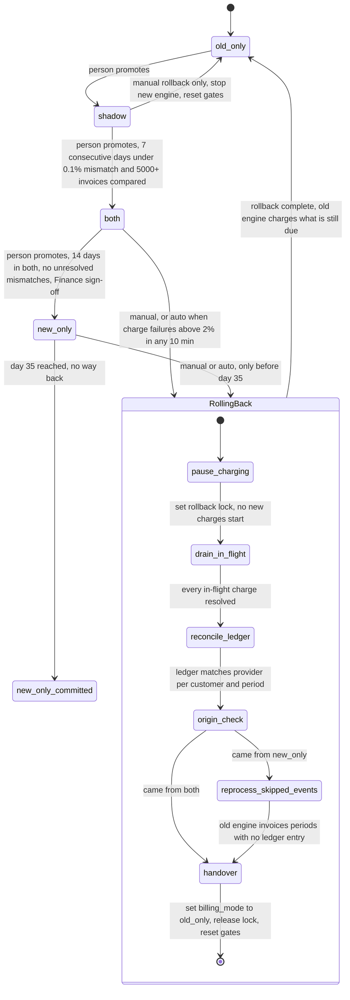

# Billing engine rollout: state machine

This models the rollout as four modes, one rollback path and one point of no return. The model follows the fixed rules in the brief. Where the brief leaves a gap, I made an assumption and listed it at the end.

## Diagram

## What each mode does

| Mode | Old engine | New engine | Notes |
|---|---|---|---|
| `old_only` | Computes, writes the ledger, charges | Off | The starting state and the end of every rollback. |
| `shadow` | Computes, writes the ledger, charges | Reads the same usage events and writes to the shadow store. Never charges or writes the ledger. | The nightly job compares invoices per customer. A mismatch is a total that differs by more than 1 cent. |
| `both` | Computes every invoice into the shadow store. Never charges. | Computes, writes the ledger, charges | The comparison continues. The old engine stays current, so rollback needs no reprocessing. |
| `new_only` | Stopped | Does everything | Usage events that the old engine skips pile up in the 35-day log. |
| `new_only_committed` | May be decommissioned | Does everything | This is not a new flag value. It is `new_only` once 35 days have passed. Rollback is not available. |

Forward moves go one step at a time, with no skipping. A person makes each one. Meeting a gate only makes the move available and raises an alert. Nothing promotes itself. Forward moves are blocked while a rollback is running.

## Rollback path

A rollback always ends in `old_only`. It can start from `shadow`, `both` or `new_only`.

- **From `shadow`:** The new engine never charged. A manual rollback stops the new engine and resets the gates. There is nothing to reconcile. Errors in `shadow` never start a rollback.
- **From `both` or `new_only`:** A rollback starts either by hand (on-call, at any time within the 35-day limit) or automatically when the charge failure rate is above 2% over any 10-minute window. It runs these steps in order:
  1. **pause_charging:** Set the rollback lock. No new charge starts. Charges that fall due now wait and are not dropped.
  2. **drain_in_flight:** Wait until every in-flight charge has succeeded or failed at the payment provider.
  3. **reconcile_ledger:** Match the ledger to the provider's charges for each customer and billing period. Add any ledger entry that is missing for a charge that was made. Flag any charge that was recorded but not made.
  4. **reprocess_skipped_events (`new_only` only):** The old engine reads the usage events it skipped and computes invoices. It skips any period that already has a ledger entry, because the ledger is the record of what was charged.
  5. **handover:** Set `billing_mode` to `old_only`, release the lock and reset the gates. The old engine then charges whatever is still due.

**No double charge:** Every charge, from either engine, uses one key, `(customer, billing_period)`. The ledger enforces the key as unique, and it is sent to the payment provider as an idempotency key. Before charging, an engine checks the ledger and the provider. Charges that were deferred during the pause are picked up exactly once after handover, so none are dropped.

**After a rollback:** The rollout is in `old_only` and the gates are reset. It must go through `shadow` again, and the 7-day count starts at zero.

## Where the rollout state lives

- **Mode:** The `billing_mode` flag in the config service is the only source of truth for the mode. It is never set to a fifth value.
- **Rollback progress:** A rollback record sits next to the flag in the config service. It holds the lock, the origin mode, the current step and the start time. This is a second key. It is not a mode. Workers read it to know that charging is paused. A crashed rollback resumes from the recorded step.
- **Time in mode:** The entry time of each mode comes from the flag's change history. It drives the 14-day gate and the day-35 cutoff.
- **Gate counters:** The nightly comparison results are stored with the shadow store. They are tagged with a rollout epoch that goes up on every rollback. The consecutive-day count and the invoices-compared count only use results from the current epoch. This is what resets the gates.
- **Money:** The billing ledger remains the system of record.

## When something fails

| Failure | What happens |
|---|---|
| New-engine errors in `shadow` | They are recorded. No rollback and no change of mode. |
| Charge failure rate above 2% over any 10 minutes, in `both` or `new_only` | An automatic rollback starts. It is ignored if one is already running. Before day 35 it is safe, and it pages on-call. |
| Same breach in `new_only_committed` | There is no rollback. It pages on-call, and the fix is forward only. |
| A rollback step fails | The rollback stays in that step and retries. Steps are idempotent. Charging stays paused and the flag is unchanged. It pages on-call if it does not finish in time. It never skips a step. |
| Nightly comparison job fails or is late | That day does not count toward a gate, so the consecutive-day count breaks. |
| Mismatch rate at or above 0.1% on a day in `shadow` | The 7-day streak restarts. |
| Config service unreachable | Workers keep their last known mode and pause new mode changes. On-call is paged. No forward move or rollback can start until it returns. |

## Assumptions and open questions

1. **Is 5,000 invoices a total or a daily minimum?** I assumed it is the total across the 7-day window.
2. **Does an unresolved mismatch restart the 14-day clock in `both`?** I assumed only that none are open at promotion time.
3. **Is day 35 the cutoff, or do the final rollback days need a margin?** I treated day 35 as a hard boundary. The usage log keeps 35 days of events, so the earliest events from `new_only` expire around day 35. A rollback started on day 34 may have its reprocessing run into that expiry. Either rollbacks should stop earlier (for example day 30), or the log should be held for the length of a rollback.
4. **No minimum volume for the 2% trigger.** A few failed charges in a quiet 10-minute window could cause a rollback.
5. **After day 35 nothing handles a failure spike automatically.** Someone should decide who owns that.
6. **The payment provider must support idempotency keys.** Otherwise the double-charge guard rests on the ledger check alone.
7. **The rollback record as a second config key** needs approval, because the brief says "one global flag".
