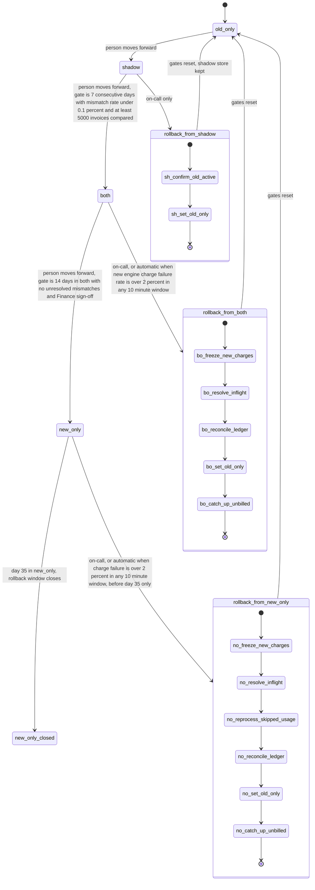

# Billing engine rollout: state machine

## Summary

We are replacing the old billing engine with a new one. The rollout moves through four modes in a fixed order: `old_only`, `shadow`, `both`, `new_only`. It starts in `old_only`, where the old engine does all the billing. A person moves the rollout forward one mode at a time, and each move must pass a gate, which is a set of checks. The old engine keeps running until the new one has proven itself, so the rollout can always go back. Rollback returns to `old_only` from `shadow`, `both` or `new_only`. It starts by hand, or automatically when the new engine's charges fail too often. Each charge is tied to one invoice, so a customer is never charged twice.

## Terms

- **Usage event**: a record of what a customer used. The usage event log keeps these for 35 days, then deletes them.
- **Invoice**: the bill for one customer for one billing period. It is worked out from usage events.
- **Ledger**: the billing database. It is the system of record, so when it and another system disagree, the ledger is right.
- **Payment provider**: the outside service that actually takes the money.
- **Charge**: a request to the payment provider to take money for one invoice.
- **Old engine, new engine**: the two programs that compute invoices and charges.
- **Shadow store**: a separate store where the engines write invoices without charging anyone or touching the ledger.
- **`billing_mode`**: the one config flag that says which mode the rollout is in. Workers read it to decide which engine charges.
- **Gate**: the conditions that must be met before a forward move.
- **Mismatch**: an invoice where the old and new totals differ by more than one cent.
- **Freeze**: stop the new engine from starting any new charges.
- **In-flight charge**: a charge the new engine started but whose result is not yet known.
- **Reconcile**: check charges against the ledger and the payment provider, and fix any differences.
- **Compare-and-set**: change `billing_mode` only if it still holds the value we expect. A stale request therefore fails, so it cannot skip a step or apply twice.
- **Idempotency key**: an ID sent with a charge. If the same ID is sent again, the provider treats it as the same charge.
- **Sliding window**: a time window that always means "the last 10 minutes" at the moment it is checked, not a fixed block of time.
- **Day 35**: 35 days after the rollout entered `new_only`. By then the usage events the old engine skipped have been deleted, so rollback is no longer possible.

## Diagram

## What each mode does

- **`old_only`.** The old engine computes invoices, charges customers and writes the ledger. The new engine is off. The only way out is a person moving the rollout forward to `shadow`.
- **`shadow`.** The old engine still charges and writes the ledger. The new engine reads the same usage events and writes its invoices to the shadow store. It never charges and never writes the ledger. A nightly job compares the two engines' invoices for each customer. New-engine errors are recorded here, but they never trigger a rollback.
- **`both`.** The new engine charges and writes the ledger. The old engine keeps computing every invoice into the shadow store without charging. This keeps it ready for rollback. The nightly comparison continues, and automatic rollback is armed.
- **`new_only`.** The new engine does everything. The old engine stops computing, so the usage events it skips are kept only for 35 days. Rollback is possible only until day 35.
- **`new_only_closed`.** This is reached on day 35 in `new_only`. There is no way back, and the old engine may be decommissioned. Automatic rollback stops, and an alert takes its place.

## How the rollout moves forward

1. A person asks to move to the next mode.
2. The controller checks the gate for the current mode. The gates are:
   - `shadow` to `both`: 7 consecutive days with a mismatch rate under 0.1% and at least 5,000 invoices compared.
   - `both` to `new_only`: 14 days in `both` with no unresolved mismatches, plus Finance sign-off.
   - `old_only` to `shadow`: no gate is set (see Open questions).
3. If the gate passes, the controller sets `billing_mode` to the next mode with compare-and-set. If the value has changed, the move fails.
4. Workers read the new `billing_mode` and act on it. The controller never skips a mode.

## Rollback steps

A rollback always ends in `old_only`. It must never charge the same invoice twice, and it must never drop a charge that is due. Each step can be repeated safely. If a step fails, the mode stays at its last applied value.

**From `shadow`.** Nothing is charged differently, so this is short.

1. Confirm that the old engine is active.
2. Set `billing_mode` to `old_only`.
3. Reset the gate counters. The shadow store is kept.

**From `both`.**

1. Freeze new-engine charging. Confirm the freeze before any old-engine charge runs.
2. Ask the payment provider for the status of every in-flight charge the new engine started. Do not retry them blindly.
3. Reconcile those results against the ledger, which is the record of truth.
4. Set `billing_mode` to `old_only`.
5. The old engine charges only invoices that are due and have no ledger charge. Its invoices in the shadow store are already current, so nothing is recomputed.
6. Reset the gate counters.

**From `new_only`.** The steps are the same as for `both`, with one extra step.

1. Freeze new-engine charging. Confirm the freeze before any old-engine charge runs.
2. Ask the payment provider for the status of every in-flight charge. Do not retry them blindly.
3. The old engine recomputes invoices for the usage events it skipped. Those events must still be inside the 35-day log. If they have expired, the rollback is blocked and escalated, and no partial rollback starts.
4. Reconcile against the ledger.
5. Set `billing_mode` to `old_only`.
6. The old engine charges invoices that are due and have no ledger charge.
7. Reset the gate counters.

## Where the rollout state lives

- **`billing_mode`** lives in the config service. Workers read only this value to decide which engine charges.
- **The controller** is the only writer of `billing_mode`. Every change uses compare-and-set.
- **The rollout record** holds the gate counters, the Finance sign-off, the rollback log and the day-35 timestamp. The brief does not say where this lives. *Proposal:* keep it in the config service, next to `billing_mode`, so the flag and the gate state are read together.
- **Per-invoice comparison results** live in the shadow store.
- **Double-charge protection.** *Proposal:* each invoice gets one charge, keyed by its invoice ID. The ledger enforces this with a unique constraint, and the provider receives the same ID as its idempotency key. Both engines use the same key scheme, so a second charge for the same invoice is blocked at two points.

## What happens when something fails

| When this fails | What happens |
|---|---|
| Config service unreachable | No mode change happens. Workers keep the last applied mode. The rollback request is queued and retried. On-call is alerted. A worker still in `both` cannot double charge, because the ledger and provider keys block a second charge (proposal above). |
| Nightly comparison fails or misses a day | That day does not count toward the 7-day or 14-day gate. Alert. |
| Mismatch on a day | Assumed to reset the consecutive-day count. This is not yet confirmed (see Open questions). |
| Shadow store write fails | The new engine's shadow error is recorded. If the comparison cannot run, the day does not count. |
| New-engine errors in `shadow` | Recorded only. They never trigger a rollback. |
| Charge failure above 2% in any 10-minute sliding window, in `both` or `new_only` | Automatic rollback starts. In `new_only`, this applies only before day 35. |
| Rollback step fails midway | The step is repeated safely. The mode stays at its last applied value. A half-finished rollback never moves back to `both` or `new_only` on its own. The new-engine freeze must be confirmed before any old-engine charge runs. |
| Usage events expire before reprocessing ends (`new_only`) | The rollback is blocked and escalated. No partial rollback starts. |
| Day 35 is reached in `new_only` | The rollback window closes. The old engine may be decommissioned. Automatic rollback stops, and an alert replaces it. |

## Open questions

1. The brief sets no gate for `old_only` to `shadow`. Is it a person's decision alone?
2. Does a bad day reset the consecutive-day count, or pause it?
3. What time zone defines a "day"?
4. Does the 35-day limit apply only to rollback from `new_only`? This document assumes it does, because `shadow` and `both` keep the old engine current. The day-35 count is assumed to start when the rollout enters `new_only`.
5. Where does the rollout record, including the Finance sign-off, live?