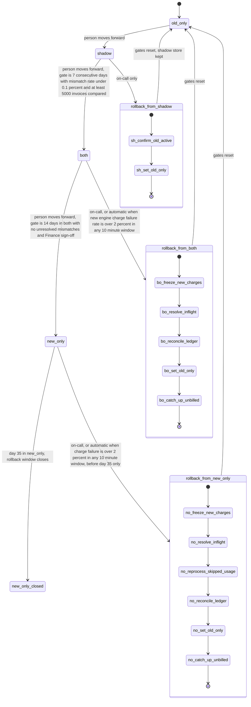

# Billing engine rollout: state machine

## What each mode does

- **old_only.** The old engine computes, charges and writes the ledger. The new engine is off. The only exit is a person moving the rollout forward to `shadow`.
- **shadow.** The old engine still charges and writes the ledger. The new engine reads the same usage events and writes invoices to the shadow store. It never charges and never writes the ledger. A nightly job compares invoices per customer, and a mismatch is any total differing by more than one cent. New-engine errors are recorded here but never trigger a rollback.
- **both.** The new engine charges and writes the ledger. The old engine keeps computing every invoice into the shadow store without charging, so it stays ready for rollback. The nightly comparison continues. Automatic rollback is armed.
- **new_only.** The new engine does everything and the old engine stops computing. Usage events it skipped are kept only for 35 days, so rollback is possible only until day 35 in this mode.
- **new_only_closed.** Entered at day 35 in `new_only`. There is no way back, and the old engine may be decommissioned. Automatic rollback no longer applies, so an alert replaces it.

## Where the rollout state lives

- `billing_mode` lives in the config service. It is the only value that workers read to decide which engine charges.
- The controller is the only writer of `billing_mode`. Every change is a compare-and-set against the expected current mode, so a stale request cannot skip a step or apply twice.
- The rollout record (gate counters, sign-off, rollback log, day-35 timestamp) is not specified in the brief. Proposal: keep it in the config service next to the flag, so the flag and gate state are read together.
- Per-invoice comparison results live in the shadow store.
- No double charges rely on the ledger. Proposal: one charge per invoice, keyed by invoice ID, both as a unique constraint in the ledger and as the payment provider's idempotency key. Both engines use the same key scheme.

## Rollback steps

- **From shadow.** Nothing charges differently. Confirm the old engine is active, set `old_only`, and reset the gate counter. The shadow store is kept.
- **From both.**
  1. Freeze new-engine charging.
  2. Ask the payment provider for the status of every charge the new engine started. Do not retry blindly.
  3. Reconcile against the ledger, which is the record of truth.
  4. Set `old_only`.
  5. The old engine charges only due invoices that have no ledger charge. The shadow store already has its invoices, so nothing is reprocessed.
- **From new_only.** Same as `both`, plus step 3a: the old engine recomputes invoices from the usage events it skipped, which must still be inside the 35-day log. If that is no longer possible, the rollback is blocked and escalated.
- **Gates after any rollback.** The rollout goes back through `shadow`, and the 7-day count starts over.

## What happens when something fails

- **Config service unreachable.** No mode change happens. Workers keep the last-applied mode, and the rollback request is queued and retried. A worker still in `both` cannot double charge, because the ledger and provider keys block a second charge. Alert on-call.
- **Nightly comparison fails or misses a day.** That day does not count toward the 7-day or 14-day gates. Alert.
- **Mismatch in a day.** Assumed to reset the consecutive-day count. This needs confirmation.
- **Shadow store write fails.** The new engine's shadow error is recorded. If the comparison cannot run, the day does not count.
- **Charge failure spike in `both` or `new_only`.** Automatic rollback starts. The check is over any 10 minute window, so it is a sliding window, not a fixed bucket.
- **Rollback step fails midway.** Each step is idempotent and resumable. The mode stays at the last applied value. A half-finished rollback never moves back to `both` or `new_only` on its own. The new-engine freeze must be confirmed before any old-engine charge runs.
- **Usage events expire before reprocessing ends (new_only).** Rollback is blocked and escalated. Do not start a partial rollback.

## Open questions

1. The brief gives no gate for `old_only` to `shadow`. Is it a person's decision alone?
2. Does a bad day reset the consecutive-day count, or pause it?
3. What time zone defines a "day"?
4. Does the 35-day limit apply only to rollback from `new_only`? This note assumes it does, because shadow and both keep the old engine current.
5. Where does the rollout record, including the Finance sign-off, live?