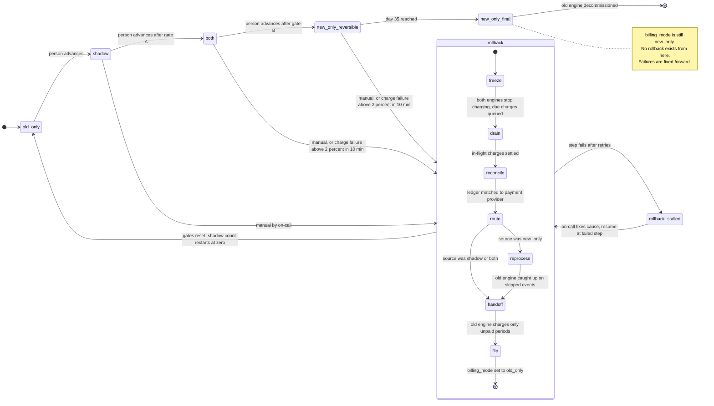

# Billing engine rollout: state machine

## Summary

Today the old billing engine does everything. Workers read usage events, compute invoices, write them to the billing ledger and charge customers through the payment provider. We are replacing it with a new engine. The switch must be gradual, reversible and never charge a customer twice.

A single flag, `billing_mode`, moves through four modes in order: `old_only`, `shadow`, `both`, `new_only`. A person makes each forward move, one step at a time, and only after a gate is met. Rollback can start from `shadow`, `both` or `new_only`. It always ends in `old_only`, and it runs as a fixed sequence of steps so that no charge is doubled or dropped. After 35 days in `new_only` there is no way back, because the usage events the old engine skipped have expired.

## Terms

- **Usage event log:** the record of customer usage that both engines read. It keeps events for 35 days.
- **Billing ledger:** the system of record for what was invoiced and charged.
- **Shadow store:** a separate place where an engine writes invoices for comparison only. It is never a record of what was charged.
- **Payment provider:** the outside service that actually charges customers.
- **`billing_mode`:** the one global flag, in the config service, that says which mode is active.
- **Rollout controller:** the program that writes `billing_mode`, checks the gates and runs rollback.
- **Billing period:** the span a customer is billed for. Each (customer, billing period) may be charged at most once.
- **Idempotency key:** the pair (customer, billing period), attached to every charge. It lets the ledger and the payment provider refuse a repeat charge.
- **Mismatch:** an invoice where the two engines' totals differ by more than 1 cent. A nightly job compares them per customer.
- **Gate A:** 7 consecutive days with a mismatch rate under 0.1%, and at least 5,000 invoices compared.
- **Gate B:** 14 days in `both` with no unresolved mismatches, plus Finance sign-off.

## Diagram

`new_only_reversible` and `new_only_final` are one `billing_mode` value (`new_only`). They are two diagram states because only the first allows rollback. The day-35 clock starts when `billing_mode` becomes `new_only`.

## What each mode does

| Mode | Old engine | New engine | Charges and ledger |
|---|---|---|---|
| `old_only` | Computes, charges, writes the ledger | Off | Old engine |
| `shadow` | Computes, charges, writes the ledger | Reads the same usage events, writes invoices to the shadow store, never charges | Old engine only. The nightly comparison runs. |
| `both` | Computes every invoice into the shadow store, no charging, so it stays current | Charges and writes the ledger | New engine. The comparison continues. |
| `new_only`, days 0 to 34 | Stopped | Does everything | New engine. Reversible, because the log still holds every event the old engine skipped. |
| `new_only`, day 35 onward | May be decommissioned | Does everything | New engine. One-way door: the log no longer covers the skipped events. |

## Where the rollout state lives

- **Mode:** `billing_mode` in the config service is the single source of truth. Only the rollout controller writes it. It rejects any skipped step or any move whose gate is not met.
- **Everything else** (my assumption, to confirm): the controller keeps its own durable record outside the flag. It holds when the current mode was entered, the gate counters, the Finance sign-off, and the rollback step and source mode. The flag cannot say "rollback in progress", and the 35-day clock needs the entry time.
- **Financial truth:** the billing ledger.

## Rollback steps

Rollback starts when on-call triggers it by hand, or automatically when, in `both` or `new_only`, the new engine's charge failure rate is above 2% over any 10-minute window. Each step below is safe to repeat.

1. **Freeze.** Both engines stop issuing charges. Charges that fall due are queued, not dropped. The controller blocks forward moves.
2. **Drain.** Wait for in-flight payment provider calls to settle.
3. **Reconcile.** Match the ledger to the payment provider, so every (customer, billing period) is known as charged or not charged.
4. **Reprocess (from `new_only` only).** The old engine computes invoices from the usage events it skipped. Retention on those events is held from the start of rollback, so they cannot expire mid-run. From `both` this step is skipped, because the old engine was kept current. From `shadow` the new engine never charged, so steps 1 to 3 pass quickly and the new engine is switched off.
5. **Hand off.** The old engine charges only periods that are due and not already charged, including the queued ones. Every charge carries the idempotency key, checked against the ledger and the payment provider.
6. **Flip.** Set `billing_mode` to `old_only` and reset all gate counters and the Finance sign-off. The rollout must pass through `shadow` again, and the 7-day count starts at zero. The flag flips last because flipping it first would let the old engine charge before the new engine's charges were reconciled.

## When something fails

| Failure | Behavior |
|---|---|
| New-engine errors in `shadow` | Recorded, never a rollback trigger. They still count toward the mismatch rate. |
| Charge failure rate above 2% in a 10-minute window, in `both` or `new_only_reversible` | Automatic rollback. The same rate in `shadow` or `old_only` does nothing. |
| Same failure rate in `new_only_final` | No rollback is possible. Page on-call and fix forward. |
| On-call starts a rollback by hand | Allowed from `shadow`, `both` and `new_only_reversible`. A second trigger while one runs is ignored. |
| A rollback step fails | Retry. After the retry limit, go to `rollback_stalled` and page on-call. Charging stays frozen, so charges are delayed but never dropped or doubled. Resume continues at the failed step. |
| Usage events needed for reprocess are missing | Stall and escalate. A person repairs from the ledger and shadow store. |
| Config service unreachable | Workers keep the last known mode. With no known mode they hold charging. Forward moves and the final flip wait. |
| Workers briefly disagree on the mode | The idempotency key stops a double charge. |
| Nightly comparison job fails | That day counts as not compared and breaks the 7-day streak. |
| Unresolved mismatch in `both` | Blocks Gate B. It is not an automatic rollback trigger. On-call may roll back by hand. |

## Open questions and assumptions

- **Gate A volume:** I read the 5,000-invoice minimum as the total across the 7 days, not per day.
- **Rate window:** the 2% rule has no minimum volume, so a quiet window could trip it on very few charges. Is a floor wanted?
- **Retention at the edge:** a rollback started near day 34 depends on the retention hold. Without it, early events could expire before reprocessing finishes.
