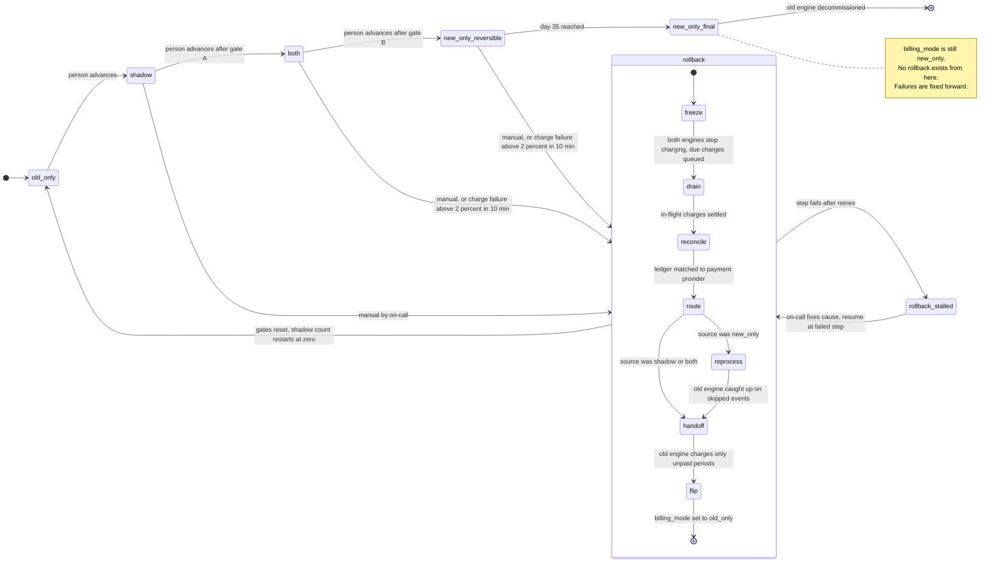

# Billing engine rollout: state machine

## Diagram

Gate A: 7 consecutive days with a mismatch rate under 0.1%, and at least 5,000 invoices compared.
Gate B: 14 days in `both` with no unresolved mismatches, plus Finance sign-off.

## What each mode does

| Mode | Old engine | New engine | Charges and ledger |
|---|---|---|---|
| `old_only` | Computes, charges, writes the ledger | Off | Old engine |
| `shadow` | Computes, charges, writes the ledger | Reads the same usage events and writes invoices to the shadow store | Old engine only. The nightly job compares the two engines' invoices per customer. A mismatch is a total that differs by more than 1 cent. |
| `both` | Computes every invoice into the shadow store, no charging | Charges and writes the ledger | New engine. The comparison continues. |
| `new_only`, days 0 to 34 | Stopped | Does everything | New engine. This is reversible, because the usage event log still holds every event the old engine skipped. |
| `new_only`, day 35 onward | May be decommissioned | Does everything | New engine. The log no longer covers the skipped events, so this is a one-way door. |

`new_only_reversible` and `new_only_final` are one `billing_mode` value. They are separate diagram states because only one of them allows rollback.

## Where the rollout state lives

- **Mode:** `billing_mode` in the config service is the single source of truth. Only the rollout controller writes it. Forward moves are one step at a time and need a person. The controller rejects any skip or any move that doesn't satisfy its gate.
- **Everything else the brief does not place** (my assumption, to confirm): the controller keeps its own durable record outside the flag. It holds the time the current mode was entered, the gate counters, the Finance sign-off, and the rollback step and source mode. The flag cannot express "rollback in progress", and the 35-day clock needs the entry time.
- **Financial truth:** the billing ledger. The shadow store is never a record of what was charged.
- **Why the flag flips last:** the flag changes to `old_only` only in the final rollback step. If it flipped first, the old engine would start charging before the new engine's charges had been reconciled.

## Rollback steps

1. **Freeze.** Both engines stop issuing charges. Charges that fall due are queued, not dropped. The controller blocks forward moves.
2. **Drain.** Wait for in-flight payment provider calls to settle.
3. **Reconcile.** Match the ledger to the payment provider so every (customer, billing period) is known as charged or not charged.
4. **Reprocess, from `new_only` only.** The old engine computes invoices from the usage events it skipped. Retention on those events is held from the start of rollback so they can't expire mid-run.
5. **Hand off.** The old engine charges only the periods that are due and not already charged, including the queued ones. It never charges a period the ledger already shows as paid. Every charge uses an idempotency key of (customer, billing period), checked against the ledger and the payment provider.
6. **Flip.** Set `billing_mode` to `old_only` and reset the gates. The rollout must go through `shadow` again, and its 7-day count starts at zero. The `both` 14-day count and the sign-off also reset.

Rollback from `shadow` has nothing to reconcile, because the new engine never charged. Steps 1 to 3 pass quickly and the new engine is switched off. Rollback from `both` skips step 4, because the old engine was kept current in the shadow store.

## When something fails

| Failure | Behavior |
|---|---|
| New-engine errors in `shadow` | Recorded. They never trigger a rollback. They still count toward the mismatch rate. |
| Charge failure rate above 2% over any 10-minute window in `both` or `new_only_reversible` | Automatic rollback. The same trigger in `shadow` or `old_only` does nothing. |
| Same failure rate in `new_only_final` | Rollback is not possible. Page on-call and fix forward. |
| On-call starts a rollback by hand | Allowed from `shadow`, `both` and `new_only_reversible`. A second trigger while one is running is ignored. |
| A rollback step fails | Retry. After the retry limit, go to `rollback_stalled` and page on-call. Charging stays frozen, so the failure delays charges and never drops or doubles them. Resume continues at the failed step. Steps are idempotent. |
| Usage events needed for step 4 are missing | Stall and escalate. Repair from the ledger and the shadow store with a person. |
| Config service unreachable | Workers keep the last known mode. With no known mode they hold charging. Forward moves and the final flip wait. |
| Workers briefly disagree on the mode | The (customer, billing period) idempotency key is the backstop against a double charge. |
| Nightly comparison job fails | That day counts as not compared and breaks the 7-day streak. |
| Unresolved mismatch in `both` | It blocks Gate B and is not an automatic rollback trigger. On-call may roll back by hand. |

## Open questions and assumptions

- **Gate A volume:** I read the 5,000-invoice minimum as the total across the 7 days, not per day.
- **Rate window:** the 2% rule has no minimum volume, so a quiet 10-minute window could trip it on very few charges. Confirm whether a floor is wanted.
- **Day 35 clock:** it starts when `billing_mode` becomes `new_only`.
- **Retention at the edge:** a rollback started near day 34 relies on the retention hold. Without the hold, early events could expire before reprocessing finishes.
