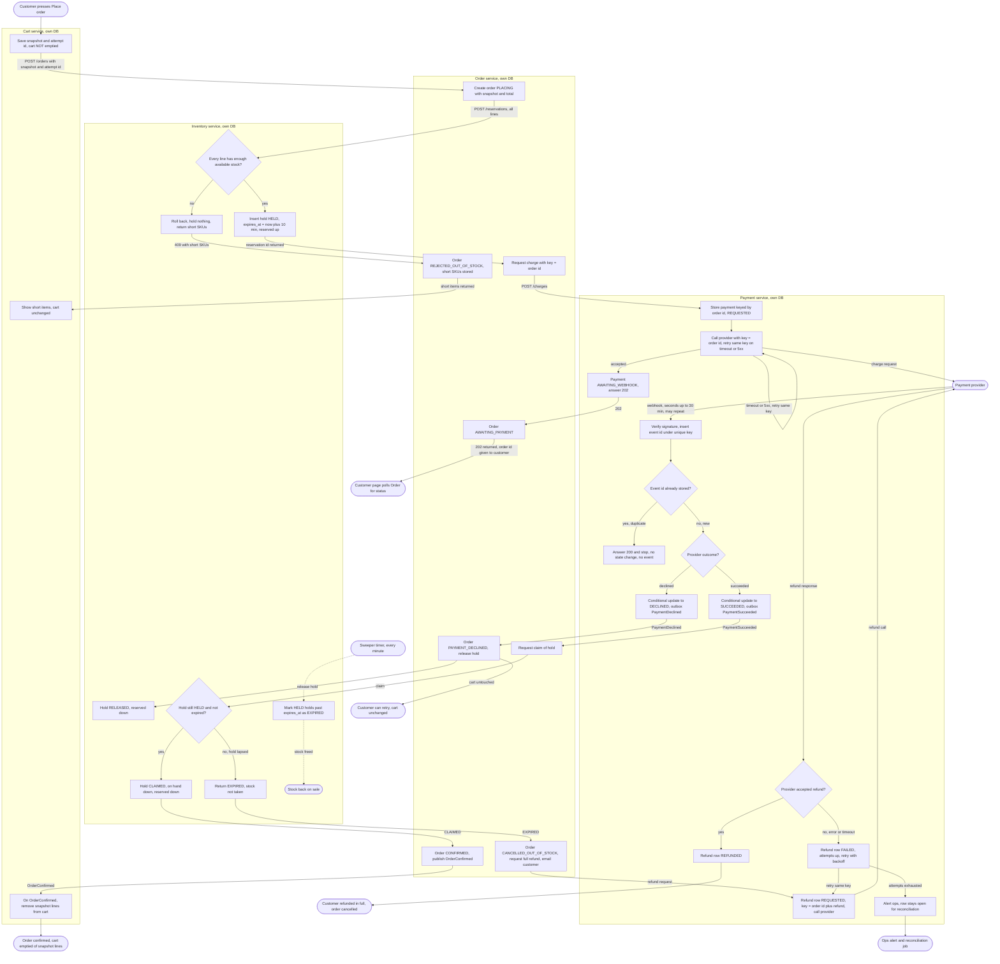

# Checkout across Cart, Inventory, Payment and Order

## Summary

Checkout is one saga across four services: Cart, Order, Inventory and Payment. A saga is a chain of steps in separate services, where each step has a defined way to end when it fails. Today checkout runs inside the monolith. This design moves it into the four services. The brief does not describe how the monolith does it, so this document does not either.

The main flow goes like this. The customer presses Place order. Cart saves a snapshot of the cart and asks Order to create an order. Order asks Inventory to hold stock for 10 minutes. If every line has stock, Order asks Payment to charge the customer. The payment provider reports the result later, by webhook. If the payment succeeds while the hold is still open, Inventory turns the hold into a sale, Order confirms the order, and Cart removes the bought lines. If the hold has already lapsed, the full payment is refunded and the order is cancelled.

The shape is chosen for two reasons. Stock is held before any charge is requested, so a charge is only asked for stock that is already held. Only Payment talks to the provider, so the idempotency key rule has one place to be enforced.

Every failure either leaves the cart unchanged or ends in a refund. A refund that fails is retried. If the retries run out, ops is alerted and the refund stays open until it succeeds. Two failures are still open: a webhook that never arrives, and a charge that the provider never accepts. See Open questions.

## Terms

- **Service:** a separate program with its own database. No service reads another service's tables. Services talk over HTTP or through broker events.
- **Saga:** a chain of steps across services, where each failure has a defined ending.
- **Snapshot:** a copy of the cart's lines and prices, taken when the customer presses Place order. Later cart edits and price changes do not change it.
- **Checkout attempt id:** a new id for each press of Place order. A retry with the same id returns the same order.
- **Order id:** the id Order creates for each attempt. Payment uses it as the idempotency key.
- **Idempotency key:** an id sent with a request. A repeat with the same key does nothing new.
- **On hand:** the stock the warehouse holds for a SKU.
- **Reserved:** the stock set aside by holds that are still open.
- **Available stock:** on hand minus reserved. A line can be held only if there is enough available stock.
- **Hold (reservation):** stock set aside for one order. It expires 10 minutes after it is made.
- **Claim:** turning a hold into a sale. The stock leaves on hand.
- **Sweeper:** a timer job that runs every minute and frees holds past their expiry.
- **Conditional update:** an update that changes a row only if the row is still in the expected state. When two workers race, only one update matches.
- **Webhook:** an HTTP call the provider sends to Payment when the outcome of a charge is known. It may arrive more than once.
- **Event id:** the provider's id for a webhook event. Payment stores it under a unique key, so a repeat is spotted.
- **Unique key:** a database rule that rejects a second row with the same value.
- **Refund key:** the idempotency key for a refund. It is the order id plus the word "refund", so a refund never shares a key with a charge.
- **Broker:** the shared message queue. Services publish events to it and read events from it.
- **Event:** a broker message that says something has happened, such as PaymentDeclined.
- **Outbox:** a row written in the same database transaction as a state change. A relay publishes it to the broker afterwards. The event is never lost, and never sent without its state change.

## Flowchart

Solid arrows are HTTP calls, broker events or webhooks. Each label says which. The dotted arrows are the sweeper timer. The diagram does not draw the two open branches (a charge never accepted, a webhook never arrives) or a failed claim call. They are in the failure table and in Open questions.

## Steps

1. **Place order (Cart).** Starts when the customer presses Place order. Cart saves a checkout row with the snapshot and a new checkout attempt id. It then calls Order at POST /orders. Cart does not empty the cart. The customer's request stays open until Order returns either a short-stock answer or the order id after the charge is accepted (step 4). It does not wait for the webhook. If the response is lost, the retry uses the same attempt id and gets the same order (step 2).

2. **Create order (Order).** Starts with Cart's POST /orders. Order creates an order with status PLACING, a new order id, the snapshot lines and the total. Then it calls Inventory at POST /reservations for all lines. If the same attempt id comes again, Order returns the existing order. No second order is made.

3. **Hold stock (Inventory).** Starts with POST /reservations. In one transaction, Inventory checks every line against available stock.
   - If every line has enough, Inventory inserts a HELD hold with expires_at set to 10 minutes from now. It raises the reserved count and returns the reservation id.
   - If any line is short, Inventory holds nothing and returns 409 with the short SKUs.

   On a short answer, Order sets REJECTED_OUT_OF_STOCK, stores the short SKUs and returns them to Cart. Cart marks its checkout row as rejected and shows the customer the short items on the Place order screen. The cart is unchanged. The customer edits the cart and presses Place order again. That is a new attempt with a new order. The rejected order and checkout rows stay as a record.

4. **Request charge (Order, Payment, provider).** Order calls Payment at POST /charges, with the order id as the idempotency key. Payment first writes a payment row with status REQUESTED. Then it calls the provider with the same key. On a timeout or 5xx, Payment retries with the same key, so the provider cannot charge twice. When the provider accepts, Payment sets AWAITING_WEBHOOK and answers 202. Order sets AWAITING_PAYMENT and returns the order id through Cart. The customer's request ends here, with the payment pending. The customer's page then polls Order for the order's status.
   If the provider never accepts the charge, the order stays PLACING. This path does not release the hold. The hold lapses 10 minutes after it was made, and the sweeper frees the stock. The final order state is open.

5. **Receive outcome (Payment).** Starts with a webhook from the provider. It usually takes seconds, and can take up to 30 minutes. It may arrive more than once.
   - Payment verifies the signature and inserts the event id under a unique key.
   - If that event id is already stored, Payment answers 200 and stops. Nothing changes and no event is published.
   - If the event id is new, Payment runs one transaction with three writes. It makes a conditional update from AWAITING_WEBHOOK to DECLINED or SUCCEEDED. It inserts the event id. It writes an outbox row.
   - After the commit, the relay publishes PaymentDeclined or PaymentSucceeded.

   A repeated success finds the row no longer in AWAITING_WEBHOOK. The update matches nothing, so no second event is published.

6. **Declined (Order, Inventory).** Starts with PaymentDeclined. Order sets PAYMENT_DECLINED and calls Inventory to release the hold. Inventory sets the hold to RELEASED and lowers the reserved count, so the stock is on sale again. The cart is untouched. The customer sees "declined" on the status poll and can try again.
   If the release call fails or is slow, Order retries it. How long it retries is open. If the release never succeeds, the hold still expires 10 minutes after it was made, and the sweeper frees the stock.

7. **Confirm (Order, Inventory, Cart).** Starts with PaymentSucceeded. Order calls Inventory to claim the hold. Inventory changes it to CLAIMED only if it is still HELD and not expired. It also lowers the on-hand and reserved counts.
   - If the claim succeeds, Order sets CONFIRMED and publishes OrderConfirmed. Cart removes the snapshot lines, matched by line id and quantity. Items added during checkout stay in the cart. The hold is not extended while the customer pays.
   - If the hold has already lapsed, go to step 8.

8. **Late success (Inventory, Order, Payment).** Starts when the claim finds the hold EXPIRED. This happens when the payment succeeds after the hold lapsed, and the stock may have been sold to someone else. We never keep money for an order we cannot fulfil, and we do not ship partial orders. So Order sets CANCELLED_OUT_OF_STOCK. It asks Payment for a full refund and emails the customer that the refund is in progress.
   Payment writes a refund row with status REQUESTED, keyed by the refund key. It then calls the provider.
   - If the provider accepts, the row becomes REFUNDED.
   - If the provider refuses, errors or times out, the row becomes FAILED. The attempt count goes up, and the next attempt is set with backoff. The retry uses the same refund key.
   - The refund row is never deleted.
   - When the attempts run out, ops is alerted and the row stays open for a reconciliation job.

9. **Sweeper (Inventory).** Every minute, a timer marks HELD holds past expires_at as EXPIRED. Their stock goes back on sale, at most about a minute after expiry. The sweeper and the claim use the same conditional update, so only one of them can change a hold. A claim also checks expires_at itself. So a hold that has lapsed cannot be claimed, even before the sweeper has run.

## How the services talk

- **HTTP** for calls that need an answer now: reserve, claim, release, charge, refund, and the customer's status poll.
- **Broker events** for facts that other services act on: PaymentDeclined, PaymentSucceeded, OrderConfirmed.
- **Webhooks** from the provider to Payment, for the charge outcome.
- Delivery is at least once. Each receiver ignores an event it has already acted on, by event id. It acts only when the row is in the expected state. Each sender writes its event through the outbox.

## Who stores what

| Service | Stores | Triggered by |
|---|---|---|
| Cart | Carts, cart lines, checkout rows (snapshot, attempt id, order id, status) | Customer presses Place order; OrderConfirmed |
| Order | Orders with status, order line snapshot, short SKUs, outbox | Cart request; Inventory replies; Payment events |
| Inventory | Stock per SKU (on hand, reserved); holds (HELD, CLAIMED, RELEASED, EXPIRED, with expires_at) | Order reserve, release and claim calls; minute sweeper |
| Payment | Payments keyed by order id; provider event ids; refunds with attempts and next attempt time; outbox | Order charge call; provider webhooks; Order refund call; retry job |

## What happens when things fail

| Branch | Where | Result |
|---|---|---|
| Short stock | Steps 3, 1 | Nothing held, no charge, cart unchanged, short items shown. Order keeps a REJECTED_OUT_OF_STOCK record. |
| Declined payment | Step 6 | Hold released, cart unchanged, customer can retry |
| Release call fails or is slow | Step 6 | Order retries. The hold expires after 10 minutes anyway, and the sweeper frees the stock. |
| Charge call timeout or 5xx | Step 4 | Retried with the same key. The provider does not charge twice. |
| Charge never accepted | Step 4 | Order stays PLACING. The hold is not released and lapses after 10 minutes. Final state open. |
| Webhook never arrives | Step 5 | Payment stays AWAITING_WEBHOOK and the order stays AWAITING_PAYMENT. No poll and no timeout yet. Open. |
| Late success after the hold lapsed | Steps 7, 8 | Full refund, order cancelled as out of stock, customer emailed |
| Refund refused, errors or times out | Step 8 | Retried with the same refund key. Never dropped. Ops alerted and reconciled when attempts run out. |
| Duplicate webhook | Step 5 | Ignored at the unique event id. No state change, no second event. |
| Duplicate event on the broker | Consumers | Ignored by event id. Acts only from the expected state. |
| Lost response to Place order | Steps 1, 2 | The checkout attempt id returns the existing order. |
| Claim call fails | Step 7 | Not specified. Open. |

## Open questions

- How many times the charge call is retried, the backoff, and the final order state when the charge is never accepted.
- What to do when a webhook never arrives. Poll the provider, or time out. No time limit is set.
- How often late success will happen. Webhooks usually take seconds, but there is no data yet. Late success is the designed path for any webhook that arrives after the hold lapses, so the frequency matters.
- How long Cart's Place order request may stay open. It depends on the charge retry count.
- How the customer learns the result after leaving the page: the poll interval, and whether a success email is sent.
- Whether the charge call should be skipped if the hold has already lapsed.
- What happens when the claim call to Inventory fails. The brief does not say.
- Maximum refund attempts, backoff values, and how often ops reconciles refunds left open.
- How long Order retries a failed release call.
- Exact wording and timing of the late-success email.