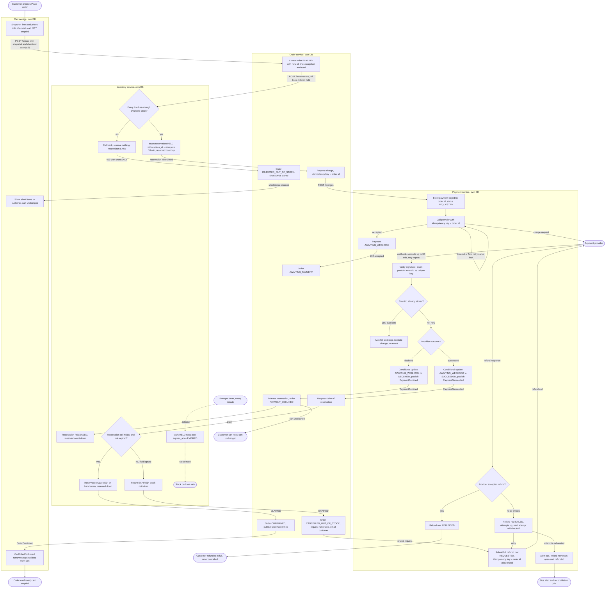

# Checkout across Cart, Inventory, Payment and Order

## Summary

Checkout runs as one saga across four services. Order owns the saga and mints the order id. Inventory holds stock for 10 minutes. Payment is the only service that talks to the provider and uses the order id as its idempotency key. Cart empties only after the order is confirmed. Every failure branch either ends with the cart unchanged, or ends with a full automatic refund that is tracked until it succeeds.

## Flowchart

## Notes on the flowchart

1. **Order id.** The Order service mints the id when it creates the order, and every later call uses it. The charge key is the order id. The refund key is the order id plus a refund suffix. Cart sends a checkout attempt id with `POST /orders`, so a retried call after a lost response returns the same order.
2. **Snapshot.** Cart sends the lines and prices at the moment of Place order. Order stores them. Later cart edits and price changes never reach the order.
3. **Short stock.** The availability check and the insert of the reservation run in one Inventory transaction. A short line rejects the whole request. Nothing is reserved, no payment is requested, and the short SKUs go back to Cart synchronously, so the customer sees them at once.
4. **Claim versus expiry.** The claim and the sweeper both use the same conditional update: only a row that is HELD and not yet expired changes state. Whichever runs first wins, so stock cannot be claimed after it has been freed. The hold is not extended during payment. Instead, a payment that lands after the hold lapses goes down the refund path. This is a design decision.
5. **Payment row first.** Payment writes its row before calling the provider. A fast webhook then always finds a row to update. Retries to the provider reuse the order id as the key, so the provider never creates a second charge.
6. **Duplicate webhooks.** Payment inserts the provider event id under a unique key. A repeat hits the key, is acknowledged, and stops. The state change, the event insert and the outbox row for the broker commit in one transaction. A repeated success also finds the row no longer AWAITING_WEBHOOK, so the conditional update matches nothing and no second event is published. Order's handlers dedupe on event id and act only from their expected state, so a duplicate event is harmless too.
7. **Declined.** Order releases the reservation and ends with the cart untouched. The customer can try again.
8. **Late success.** The order is cancelled as out of stock, a full refund is requested, and the customer is emailed. The email states that the refund is in progress. The refund row is never deleted. It is retried with backoff and stays open until the provider confirms. When attempts run out, ops is alerted and a reconciliation job keeps the row open.
9. **Cart empties only on confirmation.** Cart removes only the snapshot lines, matched by line id and quantity. Items added during checkout survive. This is a design decision.
10. **Broker.** Delivery is at least once. Every consumer dedupes on event id. Every publisher writes its event through a transactional outbox, so a crash cannot lose an event or send one without its state change.

## Who stores what

| Service | Stores | Triggered by |
|---|---|---|
| Cart | Carts, cart lines, checkout rows (snapshot, checkout attempt id, order id) | Customer presses Place order; OrderConfirmed |
| Order | Orders with status, order lines snapshot, short SKUs, outbox | Cart request; Inventory replies; Payment events |
| Inventory | Stock per SKU (on hand, reserved), reservations (HELD, CLAIMED, RELEASED, EXPIRED, with expires_at) | Order reserve, release and claim calls; minute sweeper |
| Payment | Payments keyed by order id, provider event ids, refunds with attempts and next attempt time, outbox | Order charge call; provider webhooks; Order refund call; retry job |

## Failure branches covered

| Branch | Where | Result |
|---|---|---|
| Short stock | I2, O3, C2 | Nothing reserved, no payment, cart unchanged, short items shown |
| Declined payment | P6, O6, I4 | Reservation released, cart unchanged, customer can retry |
| Late success after lapse | I6, O9, P8, P9 | Full refund, order cancelled as out of stock, customer emailed |
| Failed refund | P10, P11 | Retried with the same key, never dropped, ops alerted and reconciled |
| Duplicate webhook | PD, P5 | Ignored at the unique event key, no state change, no second event |
| Duplicate event on broker | Order handlers | Dedupe on event id, act only from the expected state |
| Charge call timeout | P2 loop | Retried with the same key, provider dedupes |
| Lost response to Place order | O1 | Checkout attempt id returns the existing order |

## Open questions

- Maximum refund attempts and backoff values.
- Whether the charge call should be skipped if the reservation has already lapsed. The current design sends it and relies on the late-success path.
- Exact wording and timing of the customer email on late success.
- Reconciliation cadence for refunds left open by ops.