# Checkout across Cart, Inventory, Payment and Order

Today checkout lives inside the monolith. This design moves it into four services: Cart, Inventory, Payment and Order. The customer presses Place order. Order takes a snapshot of the cart and saves an order. Inventory reserves all the stock or none of it. Only then does Payment charge the customer, through the payment provider. The provider reports the result later by webhook, which can take up to 30 minutes. If the money arrives after the 10 minute stock hold has lapsed and the stock is gone, we refund everything, cancel the order and email the customer. The cart is emptied only when the order is confirmed. Reserving before charging means a short-stock order never touches the customer's money. Sending everything after the first call as events means no service reads another's data and a service that is down simply catches up later.

## Terms

- **Service**: one of Cart, Inventory, Payment, Order. Each owns its own database. No service reads another's tables.
- **Event**: a message on the shared broker, written in `CamelCase` on the diagram arrows. The broker keeps an event until its consumer takes it. A consumer acknowledges an event only after it has finished handling it, so a crash means the broker delivers it again.
- **HTTP**: used only once, when Order asks Cart for the snapshot. The customer's page also uses it to read Order's status.
- **Outbox**: a service writes its database change and the events it publishes in one local transaction. A sender then publishes the outbox entries and retries until the broker accepts them. Every event in this design is published this way.
- **Inbox**: a table of ids of events (or webhooks) already handled. A repeat is ignored. Together with the outbox this gives at-least-once delivery without double effects. Payment uses the unique order id on its payment row as the inbox for `ChargeRequested`, and on its refund row for `RefundRequested`.
- **Snapshot**: the cart's lines and prices copied into the order at the moment of Place order. Later cart edits or price changes do not affect the order. The order total is computed from it.
- **Order id**: created by Order when it saves the order. It ties together the reservation, the charge (as the idempotency key and as the reference the provider echoes back in its webhook), the refund and the emails.
- **Hold**: a reservation row in Inventory that keeps stock for an order for 10 minutes. Stock is only decremented when the order claims it.
- **Claim**: Inventory turns a hold into a real stock decrement, once payment has succeeded.
- **Idempotency key**: a value sent to the provider so that a retried request is treated as the same request and never charges twice.
- **Webhook**: the provider's call to Payment reporting that a charge succeeded or was declined. It carries the order id and the provider's own event id. It may arrive in seconds or after 30 minutes, and may be delivered more than once.

## How the system runs

Each box in the diagram is one step. The coloured lane around it is the service that performs it. Red marks a failure or no-op branch, green a success outcome, yellow a timer.

```mermaid
flowchart TD
  START(["Customer presses Place order"])

  subgraph ORD["ORDER service - stores: orders, order_lines (snapshot of lines and prices), order total, order status, outbox, inbox"]
    O1["1. Receive Place order.<br/>Ask Cart for the current lines and prices (HTTP).<br/>If the call fails, times out or the cart is empty: create no order, tell the customer to try again"]
    O2["2. Create the order id. Save order with the snapshot and total.<br/>Status PENDING_STOCK.<br/>Publish ReserveStock.<br/>Reply at once with order id and status;<br/>the page then polls the order status until it is an end state"]
    O3["Status REJECTED_OUT_OF_STOCK.<br/>Tell customer which items are short.<br/>No payment was requested"]
    O4["Status AWAITING_PAYMENT.<br/>Publish ChargeRequested (order id and total)"]
    O5["Status PAYMENT_DECLINED.<br/>Tell customer, who can try again"]
    O6["Status PAID.<br/>Publish ClaimStock"]
    O7["Status CONFIRMED.<br/>Email order confirmation.<br/>Publish OrderConfirmed"]
    O8["Status CANCELLED_OUT_OF_STOCK.<br/>Email customer: cancelled, full refund on its way.<br/>Publish RefundRequested (order id)"]
    O9["Record refund as done on the order.<br/>Email customer: refund issued"]
  end

  subgraph CART["CART service - stores: carts, cart lines, current prices"]
    C1["Return lines and prices as they are now.<br/>Cart is not changed"]
    C2["Empty the cart.<br/>Only ever triggered by OrderConfirmed"]
  end

  subgraph INV["INVENTORY service - stores: stock levels, reservations (order id, lines, status, expires_at), inbox"]
    I1["3. In ONE database transaction, check every line"]
    I2{"Is every line in stock?"}
    I3["Reserve nothing.<br/>Publish StockShort with the list of short items"]
    I4["Save reservation HELD for the order.<br/>expires_at = now + 10 minutes.<br/>Publish StockReserved"]
    I5["Release the hold, stock goes back on sale.<br/>Does nothing if already released or EXPIRED"]
    I6{"Claim: is the hold still HELD,<br/>or lapsed but all lines still free?"}
    I7["Reservation CLAIMED, stock decremented.<br/>Publish StockClaimed"]
    I8["Publish ClaimFailed.<br/>Stock was sold to someone else"]
    I9["TIMER every minute:<br/>HELD reservations past expires_at become EXPIRED.<br/>Stock goes back on sale.<br/>Order is not notified, because payment may still succeed"]
  end

  subgraph PAY["PAYMENT service - stores: payments (order id unique, amount, charged_at, provider charge reference, status), refunds (order id unique, amount, status, attempts), webhook inbox of provider event ids, outbox"]
    P1["4. On ChargeRequested: insert payment PENDING for the order id with the amount and charged_at (if the row exists already, reuse it).<br/>Call provider to charge. The call only acknowledges the request; the outcome comes by webhook.<br/>Idempotency key = order id. Keep the provider charge reference from the reply.<br/>Acknowledge the event only after the provider call has answered; a crash means redelivery and the same key is sent again.<br/>On timeout retry with the SAME key; if retries run out, leave PENDING for the timer below.<br/>If the provider rejects the request outright (not a card decline), treat it as declined"]
    P2["Webhook arrives.<br/>Bad signature: reply 401, do nothing.<br/>Verify signature. Find the payment by the order id in the webhook;<br/>none found: reply 200, log and alert a person.<br/>Insert provider event id in inbox,<br/>in the same transaction as the update and the outbox entry"]
    P3{"Event id already in inbox,<br/>or payment no longer PENDING?"}
    P4["Duplicate or already handled: reply 200 and do nothing"]
    P5{"Outcome reported?"}
    P6["Payment DECLINED.<br/>Outbox entry PaymentDeclined"]
    P7["Payment SUCCEEDED.<br/>Outbox entry PaymentSucceeded"]
    P8["Save refund REFUND_PENDING for the payment's full amount (order id unique, so a repeat finds it).<br/>Call provider to refund that charge reference.<br/>Idempotency key = refund + order id"]
    P9{"Provider accepted the refund?"}
    P10["Refund REFUNDED.<br/>Publish Refunded"]
    P11["Keep REFUND_PENDING and record the attempt.<br/>Retry with growing delay, never give up.<br/>After 5 failures raise an alert for a person"]
    P12["TIMER every minute: any payment still PENDING 35 minutes after charged_at?<br/>Ask provider for the charge status using the order id,<br/>then handle it as if a webhook arrived.<br/>If still pending or the query fails, leave it and check again next run"]
  end

  PROV(["Payment provider<br/>(only Payment talks to it)"])

  START --> O1
  O1 -->|"HTTP get cart"| C1
  C1 -->|"lines and prices"| O2
  O2 -->|"ReserveStock"| I1
  I1 --> I2
  I2 -->|"No, any line short"| I3
  I3 -->|"StockShort"| O3
  I2 -->|"Yes, all lines"| I4
  I4 -->|"StockReserved"| O4
  I4 -.->|"starts 10 minute hold"| I9
  O4 -->|"ChargeRequested"| P1
  P1 -->|"charge request"| PROV
  P1 -.->|"arms"| P12
  P1 -->|"rejected outright"| P6

  PROV -->|"webhook: succeeded or declined, 2 seconds to 30 minutes, may repeat"| P2
  P12 -.-> P2
  P2 --> P3
  P3 -->|"Yes"| P4
  P3 -->|"No"| P5
  P5 -->|"Declined"| P6
  P5 -->|"Succeeded"| P7

  P6 -->|"PaymentDeclined"| O5
  P6 -->|"PaymentDeclined"| I5
  P7 -->|"PaymentSucceeded"| O6
  O6 -->|"ClaimStock"| I6
  I6 -->|"Yes"| I7
  I7 -->|"StockClaimed"| O7
  O7 -->|"OrderConfirmed"| C2
  I6 -->|"No, late success"| I8
  I8 -->|"ClaimFailed"| O8
  O8 -->|"RefundRequested"| P8
  P8 -->|"refund request"| PROV
  P8 --> P9
  P9 -->|"Yes"| P10
  P9 -->|"No, failed"| P11
  P11 -->|"retry"| P8
  P10 -->|"Refunded"| O9

  classDef fail fill:#fde2e2,stroke:#b42318,color:#000;
  classDef ok fill:#e0f4e3,stroke:#1a7f37,color:#000;
  classDef timer fill:#fff4cc,stroke:#9a6700,color:#000;
  class O3,O5,O8,I3,I8,P4,P6,P11 fail;
  class O7,C2,I7,P10,O9 ok;
  class I9,P12 timer;
```

### Notes on the steps

1. **Place order (Order, HTTP to Cart).** Order asks Cart for the current lines and prices. Cart does not change. Order keeps nothing yet, so there is no order id. If the call fails, times out or the cart is empty, Order creates no order and publishes nothing, and the customer is told to try again.
2. **Save the order (Order).** Order creates the order id and saves the order with its snapshot, its total and status `PENDING_STOCK`. In the same transaction it writes the `ReserveStock` outbox entry. It replies at once with the order id and status. The page then polls Order's status every few seconds (HTTP, reading Order's own table) until an end state, so no request stays open for up to 35 minutes. One open checkout per cart is enforced by a unique constraint. A second press returns the existing order. Every end state closes the checkout, so a customer who retries gets a new order id and a fresh snapshot.
3. **Reserve (Inventory, on `ReserveStock`).** In one transaction Inventory checks every line. If any line is short it reserves nothing and publishes `StockShort`, and Order marks the order rejected and tells the customer which items are short. No payment is ever requested. Otherwise Inventory saves a `HELD` reservation that expires in 10 minutes and publishes `StockReserved`. Order moves to `AWAITING_PAYMENT` and publishes `ChargeRequested`, which carries the order id and the order total. A timer in Inventory marks holds past their expiry `EXPIRED` and puts the stock back on sale. It does not tell Order, because payment may still succeed.
4. **Charge (Payment, on `ChargeRequested`).** Payment inserts a `PENDING` payment (order id is unique) with the amount from the event and the time of the charge, then asks the provider to charge, with the order id as the idempotency key. If the row already exists, because the event was delivered twice or Payment crashed earlier, Payment reuses it and does not insert another. Payment acknowledges the event only after the provider has answered. So a crash between the save and the call means the broker redelivers the event, and Payment makes the call again with the same key. The provider sees one charge either way. The call only confirms the provider received the request, and its reply gives a charge reference that Payment stores. The outcome always arrives by webhook. On a timeout Payment retries with the same key, which cannot double charge.
5. **Webhook (Payment).** If the signature check fails, Payment replies 401 and does nothing. The webhook carries the order id, so Payment finds the payment by it. If none exists, Payment replies 200 (so the provider stops retrying), logs it and alerts a person. Otherwise Payment inserts the provider event id in its inbox, changes the payment status and writes the outbox entry for the outcome event, all in one transaction. The sender then publishes it, with retries, so the event is never lost. If the event id is already in the inbox, or the payment is no longer `PENDING` (for example the timer below already settled it), Payment replies 200 and does nothing. A decline publishes `PaymentDeclined`: Order marks `PAYMENT_DECLINED` and Inventory releases the hold. Releasing a hold that is already expired or released does nothing. A success publishes `PaymentSucceeded`.
6. **Stuck payments (Payment timer).** Every minute, a payment still `PENDING` 35 minutes after its stored charge time (the 30 minute maximum plus a margin) is checked: Payment asks the provider for the charge status by order id and handles the answer as if it were a webhook. If the answer is still pending or the query fails, it checks again next run. So `AWAITING_PAYMENT` always ends.
7. **Claim (Order, then Inventory).** On `PaymentSucceeded` Order sets `PAID` and publishes `ClaimStock`. In one transaction Inventory checks that the hold is still `HELD`, or, if it lapsed, that for every line stock on hand minus other live holds still covers the quantity. If so it decrements stock, marks the reservation `CLAIMED` and publishes `StockClaimed`. If any line is short it claims nothing and publishes `ClaimFailed`. The timer and the claim change the same row inside a transaction, so exactly one wins.
8. **Confirm (Order, then Cart).** On `StockClaimed` Order sets `CONFIRMED`, emails the customer and publishes `OrderConfirmed`. Cart empties the cart on that event and at no other time.
9. **Late success (Order, then Payment).** On `ClaimFailed` Order sets `CANCELLED_OUT_OF_STOCK`, emails the customer that a full refund is coming, and publishes `RefundRequested` with the order id. Payment already holds the amount and the charge reference, so it saves a refund for the full amount as `REFUND_PENDING` (order id is unique, so a repeated event finds the same refund) and asks the provider to refund that charge, with idempotency key refund plus order id. If the provider accepts, the refund is `REFUNDED` and `Refunded` reaches Order, which emails "refund issued". If it fails, the refund stays `REFUND_PENDING` and is retried with growing delay and the same key, never dropped. After 5 failures a person is alerted, and retries continue. We never ship partial orders and a refund is always for the full amount.

Emails are sent by Order through the existing mailer, which avoids a fifth service. Order writes each email as an outbox entry in the same transaction as the status change, and a sender delivers it with retries. A failed email never changes the order status.

### What each service stores

| Service | Stores | Does |
|---|---|---|
| **Cart** | Carts, lines, current prices | Gives Order a snapshot on request. Empties the cart on `OrderConfirmed`. |
| **Order** | Orders, snapshot, total, status, outbox, inbox | Steers checkout, decides the final outcome, answers the page's status checks, sends emails. |
| **Inventory** | Stock levels, reservations with expiry, inbox | Reserves all-or-nothing, expires holds, claims, releases. |
| **Payment** | Payments (amount, charge time, charge reference), refunds (amount), webhook inbox, outbox | Only caller of the provider. Charges, refunds, de-duplicates webhooks. |

### Order statuses

Happy path: `PENDING_STOCK`, then `AWAITING_PAYMENT`, then `PAID`, then `CONFIRMED`. Other end states:
- `REJECTED_OUT_OF_STOCK`: the reservation was short.
- `PAYMENT_DECLINED`: the provider declined, or rejected the charge request outright.
- `CANCELLED_OUT_OF_STOCK`: payment succeeded but the stock was gone.

## What happens when things fail

The cart is emptied only on `OrderConfirmed`. So in every case below, including late success, the cart stays exactly as it was.

| Case | What happens | What the customer sees |
|---|---|---|
| Cart call fails or cart empty | No order, nothing published. | Told to try again. |
| Short stock | Nothing reserved, no charge requested. Order rejected. | Told which items are short. |
| Inventory slow or down | Nothing reserved yet, so nothing to undo. `ReserveStock` waits in the broker. Order stays `PENDING_STOCK`. No timeout yet. | Order still processing. |
| Payment slow or down | `ChargeRequested` waits in the broker. The hold may lapse, which is safe because the claim re-checks stock. Order stays `AWAITING_PAYMENT`. | Order still processing. |
| Payment crashes after saving the payment, before or during the provider call | Event not acknowledged, so it is redelivered. Payment reuses the saved row and calls the provider with the same key. One charge. | Nothing extra. |
| `ChargeRequested` delivered twice | The unique order id finds the existing payment. Same key, so the provider sees one charge. | Nothing extra. |
| Charge request retried | Same idempotency key, so the provider sees one charge. | Nothing extra. |
| Provider rejects the request outright | Not a card decline, but treated as one: `PaymentDeclined`. | Told the payment could not be taken. |
| Declined payment | Order fails the order, Inventory releases the hold. | Told the payment was declined. |
| Webhook with a bad signature | Reply 401, nothing processed. | Nothing extra. |
| Webhook for an order id with no payment | Reply 200, log and alert a person. | Nothing extra. |
| Late success (hold lapsed, stock sold) | Claim fails, order cancelled, full refund. | Email: cancelled, full refund. |
| Failed refund | Stays `REFUND_PENDING`, retried forever, alert after 5 failures. | Refund-issued email only when it succeeds. |
| Duplicate webhook, or webhook after the timer settled the payment | Inbox unique constraint or payment no longer `PENDING`: 200 reply, nothing processed. | Nothing extra. |
| Event that does not fit the current status (for example `PaymentSucceeded` for an order already declined or rejected) | Order and Inventory ignore it, log it and alert a person. No automatic refund today. | Nothing extra. |

## Open questions

- What interface does the existing mailer offer, and does it support idempotent sends?
- What should happen if the provider status query keeps reporting pending for a very long time? Today it is checked every minute with no limit.
- Should an unexpected `PaymentSucceeded` for an already declined order trigger an automatic refund? Today it only raises an alert.
- `OrderConfirmed` empties the whole cart, so items added after Place order are lost. Should Cart remove only the snapshot's lines instead?
- Does the provider report a refund's final result by webhook, or is the refund call's answer final? Today "accepted" means the response says the refund was created, and Payment then marks it `REFUNDED`.
- Should an order stuck in `PENDING_STOCK` (Inventory down for a long time) time out? Today it waits, and the one-open-checkout rule stops the customer starting another.
