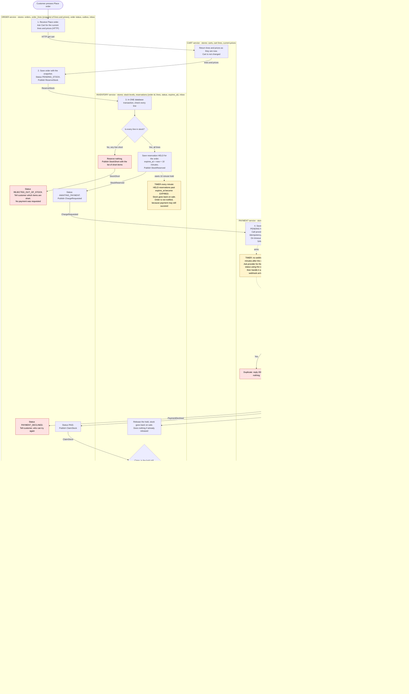

# Checkout across Cart, Inventory, Payment and Order

## How to read this

- Each box in the diagram is one step. The coloured lane around it is the service that performs it.
- Services never touch each other's databases. They talk in two ways:
  - **HTTP**, used only for the first call, where Order asks Cart for a snapshot.
  - **Events** on the shared broker, used for everything else. In the diagram, events are written in `CamelCase` on the arrows.
- Each service writes its database change and the event it publishes in the **same local transaction** (a transactional outbox). Consumers record the id of every event they handle (an inbox) and ignore repeats. This makes event delivery at-least-once without double effects.
- Order ids are created by the Order service. They are the key that ties together the reservation, the charge, the refund and the emails.

## Flowchart

Colour key: red marks a failure or no-op branch, green marks a success outcome, and yellow marks a timer.

## What each service owns

| Service | Stores | Does |
|---|---|---|
| **Cart** | Carts, lines, current prices | Gives Order a snapshot on request. Empties the cart on `OrderConfirmed` and at no other time. |
| **Order** | Orders, the line and price snapshot, status history | Starts and steers checkout. Decides the final outcome. Sends the customer emails. |
| **Inventory** | Stock levels, reservations with expiry time | Reserves all-or-nothing, expires holds, claims reserved stock, releases stock. |
| **Payment** | Payments, refunds, webhook inbox | Is the only caller of the provider. Charges, refunds, and de-duplicates webhooks. |

I assumed the Order service sends the emails through the existing mailer. That avoids a fifth service.

## Order statuses

`PENDING_STOCK` then `AWAITING_PAYMENT` then `PAID` then `CONFIRMED` is the happy path.

The other end states are:
- `REJECTED_OUT_OF_STOCK`: the reservation was short.
- `PAYMENT_DECLINED`: the provider declined the charge.
- `CANCELLED_OUT_OF_STOCK`: the payment succeeded but the stock was gone.

## Failure branches

| Case | What happens | What the customer sees | Cart |
|---|---|---|---|
| **Short stock** | Inventory reserves nothing and publishes `StockShort`. Order rejects the order. No `ChargeRequested` is ever sent, so Payment is never involved. | Told which items are short. | Unchanged |
| **Declined payment** | Payment publishes `PaymentDeclined`. Order marks the order failed. Inventory releases the hold. | Told the payment was declined. | Unchanged |
| **Late success (hold lapsed, stock sold)** | The timer expires the hold but Order does nothing, because payment may still succeed. When `PaymentSucceeded` arrives, Inventory cannot claim. It publishes `ClaimFailed`. Order cancels as out of stock, and Payment refunds the full amount. | Email: cancelled, full refund. | Unchanged |
| **Failed refund** | The refund stays `REFUND_PENDING` in Payment's database and is retried with the same idempotency key. It is never deleted, and it is retried even after the alert is raised. After 5 failures a person is alerted. | Order is already cancelled. The refund-issued email goes out only when the refund succeeds. | Unchanged |
| **Duplicate webhook** | The provider event id is inserted into the inbox, which has a unique constraint, in the same transaction as the status change. A repeat hits the constraint and gets a 200 reply with no further processing. | Nothing extra. | n/a |
| **Retried charge request** | Every charge carries the order id as the idempotency key, so the provider treats a retry as the same charge. | Nothing extra. | n/a |

## Design decisions to know about

1. **Hold versus payment delay.** The hold lasts 10 minutes and the webhook can take 30. The two are deliberately not linked. A payment that succeeds after the hold lapsed first tries to claim again. The claim still succeeds if all lines are still free. Only if any line is gone does the refund path run. This keeps refunds to the cases that need them.
2. **Claim versus expiry race.** The timer and the claim both change the same reservation row in Inventory's database, inside a transaction. Exactly one of them wins, so stock is never both released and claimed.
3. **No partial orders.** A claim covers all lines or none. A refund is always for the full amount.
4. **Stuck payments.** If no webhook arrives within 35 minutes of the charge (the 30 minute maximum plus a margin), Payment asks the provider for the charge status and handles the answer as if it were a webhook.
5. **Double-press of Place order.** Order allows one open checkout per cart. A second press returns the existing order.
6. **Cart edits during checkout.** Edits after Place order do not affect the order, which uses its snapshot. Open question: `OrderConfirmed` empties the whole cart, so any items added after Place order would be lost. If that is not wanted, Cart could remove only the snapshot's lines instead.
