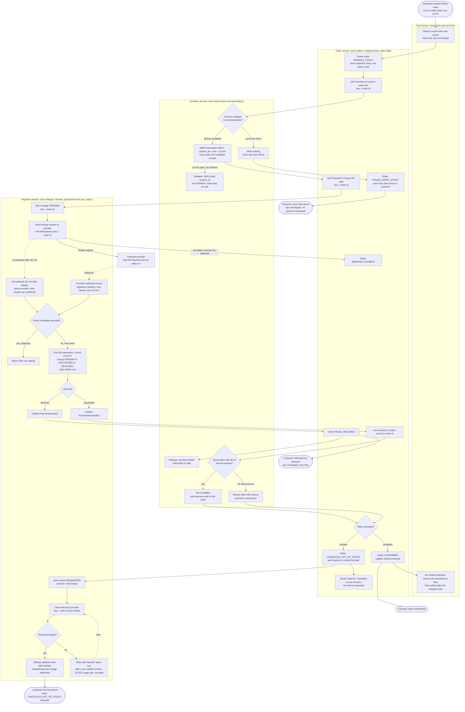

# Checkout across Cart, Inventory, Payment and Order: flow design

## What this is

Checkout moves out of the monolith into four services: **Cart**, **Inventory**, **Payment** and **Order**. Each service has its own database and no service reads another's tables. Services talk to each other with HTTP calls or with events on a shared message broker.

Today checkout runs inside the monolith as one step. In the new design, the **Order** service drives checkout as a series of steps across the other three. Each service records its own state. A step that fails leads to a clear end state, and the customer's cart is never changed unless the order is confirmed.

The flow runs in this order. First, Inventory holds the stock for 10 minutes. Then Payment charges the customer. The hold is turned into a sale only when the payment succeeds while the hold is still valid. A payment can arrive late, after the hold has expired and the stock has gone to someone else. In that case the order is cancelled and the customer is refunded in full. Money is never kept for an order that cannot be filled.

Two rules hold everywhere:
- **Hold, then claim.** Stock is first held. It is sold (claimed) only after a successful payment, and only if the hold is still valid.
- **Idempotency keys.** The order id is the key for the reservation, the charge and the claim. If the same request or event arrives again, the work is not done a second time.

## Terms

- **Service**: a separate program with its own database. Each of the four services is one.
- **Order service**: the service that runs the checkout steps in order and records the order's status.
- **Snapshot**: a copy of the cart lines and prices, saved on the order when the customer presses Place order. Later cart changes do not touch it.
- **Hold (reservation)**: stock set aside for one order for 10 minutes. The units are not sold yet.
- **Claim**: turning a valid hold into sold stock.
- **Release**: giving held units back so they can be sold again.
- **Sweeper**: a background job in Inventory. It finds holds past their expiry time and releases them.
- **Payment provider**: the outside company that moves the money. Only the Payment service talks to it.
- **Charge**: a request to the provider to take the order total from the customer.
- **Refund**: a request to the provider to give money back.
- **Webhook**: a message the provider sends to Payment when the outcome of a charge or refund is known. It can take up to 30 minutes. It can arrive more than once.
- **Idempotency key**: an id sent with a request. If the same key comes again, the receiver does not repeat the work.
- **Event**: a message that says something happened, such as PaymentSucceeded. Services publish events to the broker, and other services react to them.
- **Outbox**: a table in Payment's database. An event is written there in the same transaction as the state change, so the event is not lost. A background job then publishes it.
- **Processed event ids**: the list of webhook ids Payment has already handled.
- **STUCK**: the state of a refund that has failed too many times. Operations staff are paged, and the row is kept.

## Flowchart

## The steps

1. **Start.** The customer presses Place order. The Cart UI calls Order over HTTP. Order asks Cart for the current lines and prices. Cart only reads them. The cart does not change.
2. **Order saves the snapshot.** Order creates the order in state PENDING_STOCK. It stores the lines, unit prices and total. Nothing later changes these values.
3. **Reserve stock.** Order asks Inventory to reserve every line, using the order id as the key.
4. **Inventory checks all lines at once.** If any line is short, Inventory writes nothing and returns the short items. Order moves to FAILED_SHORT_STOCK. The customer sees the short items. The cart is unchanged. No payment is requested.
5. **Hold the stock.** If every line is available, Inventory writes a HELD reservation that expires 10 minutes from now. It moves those units from available to held. If nothing claims the hold in 10 minutes, the sweeper sets it to EXPIRED and puts the units back on sale.
6. **Charge the customer.** Order asks Payment to charge the total, using the order id as the key. Once Payment accepts, Order moves to AWAITING_PAYMENT.
7. **Send the charge.** Payment saves the charge as PENDING. It sends the charge request to the provider with the order id as the idempotency key. The provider accepts it and reports the outcome later by webhook.
8. **Receive the outcome.** The webhook can take up to 30 minutes and can arrive twice. Payment checks the signature, then checks the event id against its processed list.
   - If the event id is already there, Payment returns 200 and does nothing.
   - If it is new, Payment, in one database transaction, records the event id, sets the charge to SUCCEEDED or DECLINED, and writes an outbox row.
   - If no webhook arrives 30 minutes after the charge, Payment asks the provider for the outcome and treats the answer as a webhook.
9. **Declined.** Payment publishes PaymentDeclined. Order moves to FAILED_DECLINED and asks Inventory to release the hold. The customer is told the payment was declined. The cart is unchanged and the customer may try again.
10. **Succeeded: claim the stock.** Payment publishes PaymentSucceeded. Order asks Inventory to claim the stock. Inventory checks that the hold is still HELD and not expired.
    - If it is, Inventory sets the reservation to CLAIMED. The units become sold to this order. Go to step 11.
    - If it is not (a late success), Inventory refuses the claim and gives the reason. Go to step 12.
11. **Confirmed.** Order moves to CONFIRMED and publishes OrderConfirmed. Cart removes the lines that were checked out. Lines added after the snapshot stay in the cart. The customer sees the confirmation.
12. **Cancelled: refund in full.** Order moves to CANCELLED_OUT_OF_STOCK. It asks Payment to refund the full total and emails the customer that the order was cancelled as out of stock and a full refund was requested.
    - Payment saves the refund as REQUESTED for the full charge amount. It sends the refund to the provider with the key "order id plus refund".
    - When the provider accepts, a refund webhook sets the refund to REFUNDED. Repeat webhooks are ignored, as in step 8.
    - If the provider does not accept, Payment retries with backoff and the same key. After a set number of tries, the refund becomes STUCK. Operations staff are paged. The row is kept until it is resolved.

We never ship partial orders. A paid order is either confirmed in full or refunded in full.

## What happens when things fail

| Failure | What happens | Customer sees |
|---|---|---|
| A line is short | Inventory reserves nothing. No payment is requested. | The short items. Cart unchanged. |
| The payment is declined | Order releases the hold. | "Payment declined." Cart unchanged. May retry. |
| The payment succeeds after the hold has expired | Claim is refused. The order is cancelled and refunded in full. | A cancellation email and a full refund. |
| The same webhook arrives twice | The second copy is recognised by its event id and ignored. | Nothing extra. |
| The provider never sends the webhook | After 30 minutes Payment asks the provider for the outcome. | Delayed confirmation. |
| A retried charge request | The same idempotency key means the provider does not charge twice. | Nothing extra. |
| The refund is not accepted | Payment retries with the same key. After a set number of tries it marks the refund STUCK, pages operations and keeps the row. | A refund is still owed. Operations resolves it. The refund is never dropped. |
| Checkout fails for any reason | The cart is not changed. | The cart exactly as it was. |

## Open questions

- How many refund tries happen before a refund becomes STUCK, and how long is the backoff between them?
- What happens if Payment cannot reach the provider when it sends the charge? The brief does not say.
- What happens if Order's claim call to Inventory gets no reply? The stock may or may not have been claimed.
- What happens if Cart fails to remove the checked-out lines after the order is confirmed?

## Notes on the flowchart

- Dashed arrows are events that happen later: the 10-minute expiry, the webhook, the 30-minute check and the refund retries.
- Solid arrows are steps that happen right away.
- Each box is labelled with the service that owns it. Each service writes only to its own database.
- The end boxes show what the customer sees in each outcome.