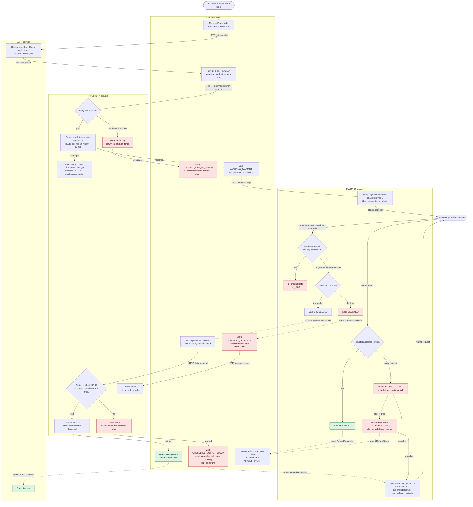

# Checkout design: Cart, Inventory, Payment, Order

## Summary

Today checkout runs inside the monolith. This design moves it into four services: Cart, Inventory, Payment and Order. Each service owns its own database, and no service reads another's tables.

The flow goes like this. The customer presses Place order. Order takes a snapshot of the cart and creates the order. Inventory then reserves all the stock, or nothing. Only after stock is held does Payment ask the provider to charge the customer. The provider answers later, by webhook. If the payment succeeds, Order tells Inventory to claim the held stock and the order is confirmed. Only then is the cart emptied. If the payment succeeds but the stock is gone, we refund the full amount, cancel the order and email the customer.

It is shaped this way so that we never charge for stock we do not hold, and never keep money for an order we cannot fulfil. Order acts as the coordinator. After each reply or event it decides the next step.

## Terms

- **Service**: a separate program with its own database. Services talk by HTTP or by events.
- **HTTP call (solid arrow)**: one service asks another and waits for the reply.
- **Event (dotted arrow)**: a message sent through the shared message broker. The sender does not wait.
- **Broker**: the shared message system that carries events between services.
- **Outbox**: a table in the sender's own database. A state change and its event are saved together in one local transaction, and a relay then publishes the outbox rows to the broker. This way an event is never lost when a service crashes between saving and sending.
- **Duplicate-safe consumer**: the broker may deliver a message twice, so every receiver records the message ids it has handled (in `processed_events`) and ignores repeats.
- **Reservation (hold)**: stock set aside for one order. It is HELD for 10 minutes, then it lapses (EXPIRED) and the stock goes back on sale, unless the order claimed it first.
- **Claim**: turning a hold into a permanent stock deduction (CLAIMED), once payment has succeeded.
- **Payment provider**: the external company that charges cards. Only Payment talks to it.
- **Idempotency key**: an id sent with a request so the provider treats a retry as the same request. For charges the key is the order id. For refunds it is "refund + order id".
- **Webhook**: the provider calls us back with the result of a charge. It takes seconds to 30 minutes and can arrive more than once.

Colours in the diagram: red nodes are failure branches, green nodes are the happy ending. Each box sits in the lane of the one service that does it.

## Steps

Each step says what starts it, what it does, who stores the data, and what happens if it goes wrong.

1. **Snapshot the cart.** The customer presses Place order. Order asks Cart for a read-only snapshot of the lines and prices, and saves them in its own order record. From now on, cart edits and price changes cannot touch this order. The cart itself is left unchanged. If Cart cannot answer, Order returns an error and nothing else has happened.
2. **Reserve the stock.** Order makes an HTTP call to Inventory with the order id. In one transaction, Inventory checks every line and reserves all of them, or none. The reply is synchronous so the customer is told at once which items are short. Inventory stores a reservation row that is HELD with `expires_at` = now + 10 minutes. If any line is short, nothing is reserved, no payment is requested, and the order becomes REJECTED_OUT_OF_STOCK.
3. **Request the charge.** Order marks the order AWAITING_PAYMENT and makes an HTTP call to Payment. Payment saves the payment as PENDING, then asks the provider to charge. The key is the order id, so a retried request cannot charge twice. Payment is the only service that talks to the provider. If the call to the provider fails, Payment retries with the same key.
4. **Receive the webhook.** The provider calls Payment with the outcome. Payment checks the signature. Then, in one transaction, it inserts the provider event id into `processed_webhooks` (unique) and updates the payment. A repeat hits the unique constraint and is acknowledged with 200 and ignored. Only a PENDING payment can become SUCCEEDED or DECLINED. Payment then sends a PaymentSucceeded or PaymentDeclined event through its outbox.
5. **If declined.** Order marks the order PAYMENT_DECLINED, emails the customer, and tells Inventory to release the hold. Releasing is safe even if the hold has already expired. The cart is untouched. The customer can try again, which creates a new order id and so a new charge. (Reusing the declined id would just return the declined result.)
6. **If succeeded, claim the stock.** Order asks Inventory to claim. Inventory accepts if the hold is still HELD, or if it lapsed but every line can be reserved again right now. The check and the status change happen in one row transaction, so a claim and the expiry timer cannot both win. Accepting means CLAIMED, and the stock is permanently deducted. Re-reserving a lapsed hold avoids refunding a customer needlessly.
7. **Confirm.** Order marks the order CONFIRMED and emails the customer. It emits OrderConfirmed through its outbox, and Cart empties the cart on that event and only then.
8. **Late success, stock gone.** If the claim is refused, Order marks the order CANCELLED_OUT_OF_STOCK, emails the customer, and emits RefundRequested. We never ship partial orders. Any PaymentSucceeded for an order that is not awaiting payment is treated the same way: refund it.
9. **Refund.** Payment saves a refund record REQUESTED for the full amount before calling the provider, so the intent survives a crash. It then calls the provider with the key "refund + order id". If the provider accepts, the refund is REFUNDED. If the call fails or times out, the refund stays REFUND_PENDING and is retried with backoff using the same key, so it can never refund twice. After N tries it becomes REFUND_STUCK, on-call is alerted, and it keeps retrying on a slow schedule until it succeeds or a person resolves it. Payment emits RefundCompleted or RefundStuck, and Order shows the refund status on the order record.

Separately, a timer in Inventory runs every minute and marks holds past `expires_at` as EXPIRED, putting the stock back on sale.

## What each service stores

| Service | Tables (private to it) |
|---|---|
| **Cart** | `carts`, `cart_lines` (sku, qty, unit price), `processed_events`. |
| **Inventory** | `stock` (sku, on_hand, reserved). `reservations` (order id unique, lines, status HELD, CLAIMED, RELEASED or EXPIRED, `expires_at`). `processed_events`. |
| **Order** | `orders` (id, customer, status, total, refund_status). `order_lines` (the snapshot: sku, qty, price at Place order). `outbox`, `processed_events`. |
| **Payment** | `payments` (order id unique, amount, status PENDING, SUCCEEDED or DECLINED, provider ref). `refunds` (order id unique, status REQUESTED, REFUND_PENDING, REFUNDED or REFUND_STUCK, attempts, next_retry_at). `processed_webhooks` (provider event id unique). `outbox`. |

## What happens when things fail

| Failure | What happens |
|---|---|
| Short stock | Inventory reserves nothing. Order marks REJECTED_OUT_OF_STOCK and shows the short items. No payment is requested. Cart unchanged. |
| Payment declined | Payment marks DECLINED. Order closes the order and releases the hold. Cart unchanged. A retry uses a new order id. |
| Success after the hold lapsed, stock sold | Claim is refused. Order cancels as out of stock, emails the customer and requests a full refund. |
| Refund fails or times out | Stays REFUND_PENDING and retries with backoff on the same key. After N tries REFUND_STUCK, on-call alerted, retries continue. Never dropped. |
| Duplicate webhook | Dropped by the unique provider event id, in the same transaction as the state change. Status guards also stop a second transition. |
| Duplicate broker message | Dropped by `processed_events` in the consumer. |
| Any failure before CONFIRMED | The cart is never emptied, so the customer can try again. |

## Open questions and decisions to confirm

- **Lapsed hold, stock still free.** Step 6 lets a late payment claim anyway if every line can be re-reserved. For a strict rule, where a lapsed hold always means refund, remove the second half of the claim condition.
- **No webhook after 30 minutes.** Proposed, not drawn: a Payment reconciler checks payments still PENDING after about 35 minutes, asks the provider for the status by order id, and handles the answer like a webhook.
- **Email sender.** Order sends all emails, to avoid a fifth service. Move this to a notification service later if one appears.
- **Customer status page.** After Place order the page polls `GET /orders/{id}`. It shows processing, confirmed, rejected for stock, payment declined, or cancelled out of stock with refund coming.
