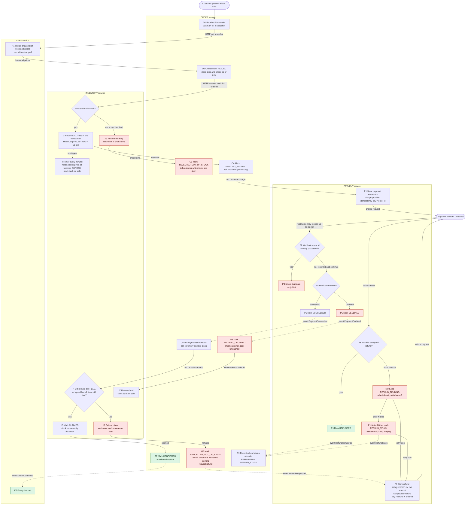

# Checkout design: Cart, Inventory, Payment, Order

## How to read this

- **Solid arrows** are synchronous HTTP calls. **Dotted arrows** are events on the shared broker.
- **Red nodes** are failure branches. The **green nodes** are the happy ending.
- Each box sits in the lane of the one service that does it. Each service writes only to its own database.
- Order is the coordinator (an orchestrated saga). It decides the next step after each reply or event.
- Every state change that also emits an event is written in one local transaction together with an **outbox** row. A relay publishes the outbox to the broker. Delivery is at-least-once, so every consumer ignores message ids it has already processed.

## Step by step

| Step | Service | Triggered by | What happens |
|---|---|---|---|
| O1, K1, O2 | Order, Cart | Customer presses Place order | Order asks Cart for a read-only snapshot. Order stores the lines and prices in its own order record. From now on cart edits and price changes cannot touch this order. |
| I1 to I3 | Inventory | HTTP reserve call from Order | In one transaction, check every line and reserve all of them, or none. The reply is synchronous so the customer is told at once which items are short. No payment is requested on this branch. |
| I2 | Inventory | Same call | Reservation row is HELD with `expires_at = now + 10 min`. |
| P1 | Payment | HTTP charge call from Order | Store the payment as PENDING, then charge the provider. The idempotency key is the order id, so a retried request cannot charge twice. Payment is the only service that talks to the provider. |
| P2 to P6 | Payment | Provider webhook | Check the signature. Then, in one transaction, insert the provider event id into `processed_webhooks` (unique) and update the payment. A repeat hits the unique constraint and is acknowledged with 200 and ignored (P3). |
| O5, I7 | Order, Inventory | PaymentDeclined | The order is closed. The hold is released, and releasing is safe if the hold has already expired. The cart is untouched, so the customer can try again. |
| O6, I4, I5 | Order, Inventory | PaymentSucceeded | Order asks Inventory to claim. The check and the status change happen in one row transaction, so the claim and the expiry timer (I8) cannot both win. |
| O7, K2 | Order, Cart | Claim OK | Order is CONFIRMED and the customer is emailed. Cart empties on the OrderConfirmed event and only then. |
| I6, O8 | Inventory, Order | Claim refused | This is the late-success case. Order cancels as out of stock, emails the customer, and requests a refund. No partial shipment. |
| P7 to P11 | Payment | RefundRequested | Refund the full amount. A failed or timed-out refund is never dropped. See "Failed refund". |

## What each service stores

| Service | Tables (owned privately) |
|---|---|
| **Cart** | `carts`, `cart_lines` (sku, qty, unit price), `processed_events`. |
| **Inventory** | `stock` (sku, on_hand, reserved). `reservations` (order id unique, lines, status HELD, CLAIMED, RELEASED or EXPIRED, `expires_at`). `processed_events`. |
| **Order** | `orders` (id, customer, status, total, refund_status). `order_lines` (the snapshot: sku, qty, price at Place order). `outbox`, `processed_events`. |
| **Payment** | `payments` (order id unique, amount, status PENDING, SUCCEEDED or DECLINED, provider ref). `refunds` (order id unique, status REQUESTED, REFUND_PENDING, REFUNDED or REFUND_STUCK, attempts, next_retry_at). `processed_webhooks` (provider event id unique). `outbox`. |

## Failure branches

1. **Short stock.** I1 says no. Inventory reserves nothing. Order marks the order REJECTED_OUT_OF_STOCK and shows the short items. No payment is requested and the cart is unchanged.
2. **Declined payment.** The webhook says declined. The payment is DECLINED, and Order closes the order and releases the hold. The cart is unchanged.
   - Retrying creates a new order id, so the provider treats it as a new charge. Reusing the declined order id would return the declined result.
3. **Late success after the hold lapsed.** The webhook says succeeded but the hold is EXPIRED, and some line is no longer free.
   - I4 says no, so Order cancels as out of stock, emails the customer and requests a full refund.
   - Any PaymentSucceeded for an order that is not awaiting payment is handled the same way: refund it.
4. **Failed refund.** Payment stores the refund before calling the provider, so the intent survives a crash.
   - A failure or timeout leaves it REFUND_PENDING (P10). It is retried with backoff using the same refund key, so a retry cannot refund twice.
   - After N tries it becomes REFUND_STUCK, on-call is alerted, and it keeps retrying on a slow schedule until it succeeds or someone resolves it by hand (P11).
   - Order shows the refund status on the order record (O9).
5. **Duplicate webhooks.** P2 dedupes on the provider event id inside the same transaction as the state change. Status transitions are also guarded: only PENDING can become SUCCEEDED or DECLINED. Duplicate broker messages are dropped by `processed_events` in each consumer.

## Decisions to confirm

- **Lapsed hold, stock still free.** I4 lets a late payment claim anyway if every line can be re-reserved at that moment. This avoids refunding a customer needlessly. If you want a strict reading, where a lapsed hold always means refund, remove the second half of I4's condition.
- **No webhook after 30 minutes.** The design adds a Payment reconciler (not drawn). For payments still PENDING after about 35 minutes, it asks the provider for the status by order id and processes the answer like a webhook.
- **Email sender.** Order sends the emails, to avoid adding a fifth service. Move this to a notification service later if one appears.
- **Customer-facing status.** After Place order the page polls `GET /orders/{id}`. It shows processing, confirmed, rejected for stock, payment declined, or cancelled out of stock with refund coming.
