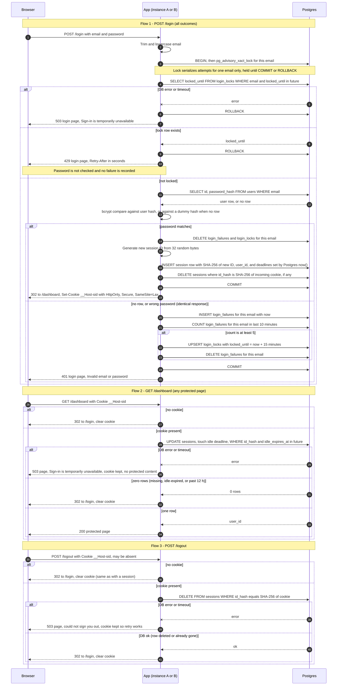

# Login with server-side sessions: design

## Summary

Today every page in the team-scheduling app is public. After this change, every page except `/login` needs a signed-in user.

The app is server-rendered. It serves HTML pages and handles form posts. It has no single-page app and no API clients. It runs as two identical instances behind a load balancer with no sticky sessions, so either instance can handle any request. Both instances share one Postgres database, which already holds the `users` table. That table does not change.

The browser holds only a random session ID in a cookie. The server stores each session in Postgres and checks it on every protected request. That check also restarts a 30-minute idle timer. A session ends after 30 minutes with no requests, or 12 hours after login, whichever comes first. Failed logins are counted per email. Five failures within 10 minutes lock that email for 15 minutes. Sign-up and password reset are out of scope.

## Terms

- **Session**: a server-side record that says which user is signed in and when the sign-in ends.
- **Session ID**: a random value of 32 bytes, shown as 43 characters. The browser receives it in the cookie.
- **Session ID hash**: the SHA-256 hash of the session ID. The database stores only this hash, so a leaked table does not reveal usable IDs.
- **Cookie**: a small value the browser stores and sends with each request to the site. Here it is named `__Host-sid`.
- **HttpOnly**: page scripts cannot read the cookie. **Secure**: the browser sends it only over HTTPS. **SameSite=Lax**: the browser does not send it on most cross-site POST requests.
- **`__Host-` prefix**: a cookie name rule. The browser accepts the name only with `Secure`, `Path=/` and no `Domain`.
- **Idle expiry**: the session ends after 30 minutes with no requests.
- **Absolute expiry**: the session ends 12 hours after login, whatever the activity.
- **Transaction**: a group of database statements that either all take effect (COMMIT) or are all undone (ROLLBACK).
- **Advisory lock**: a lock Postgres grants on a key the app chooses. Here the key is a hash of the email. Other attempts with the same key wait until the lock is released at COMMIT or ROLLBACK.
- **bcrypt**: a deliberately slow password hash. Comparing a password takes measurable time.
- **Dummy hash**: a fixed bcrypt hash of a random password. The app compares against it when an email has no account, so both cases do the same work.
- **Sliding window**: the 10 minutes before a given failure.
- **Lock row**: a row in `login_locks` that blocks one email until its `locked_until` time.
- **Sweep**: a periodic job that deletes expired rows to free storage. Reads never depend on it.
- **Statement timeout**: the longest a single database statement may run, about 2 seconds here. Waiting for a lock counts too.
- **Fail closed**: when the database cannot confirm a login or a session, the request is refused.
- **Retry-After**: a response header that tells the client how many seconds to wait.
- **UPSERT**: insert a row, or update it if its key already exists.
- **Foreign key**: a rule that `sessions.user_id` must match an existing `users.id`.

## Design choices

| Area | Choice |
|---|---|
| Session and failure storage | Postgres tables (`sessions`, `login_failures`, `login_locks`). No Redis. |
| Session ID | 32 bytes from a cryptographically secure random generator, base64url encoded (43 characters). The database stores only its SHA-256 hash. |
| Cookie | Name `__Host-sid`, `Path=/`, `HttpOnly`, `Secure`, `SameSite=Lax`, no `Domain`, no `Max-Age` or `Expires` (browser-session cookie). Contains only the opaque ID. Clearing it is described under Clearing the cookie. |
| Clock | Every expiry comparison uses Postgres `now()`. The app never compares times itself, so the two instances cannot disagree through clock skew. |
| Idle expiry | `sessions.idle_expires_at`. Each protected request sets it to `LEAST(now() + 30 min, absolute_expires_at)`. |
| Absolute expiry | `sessions.absolute_expires_at = created_at + 12 h`. Never extended. |
| Expiry check | Done inside the single `UPDATE` that touches the session. No separate read. |
| Brute-force counting | One row per failed attempt in `login_failures`. A 10-minute sliding window is counted at each failure. |
| Lock | `login_locks` row with `locked_until = now() + 15 min`. Set on the 5th failure in any 10-minute window. |
| Concurrency | `pg_advisory_xact_lock(hashtext(email))` held for the whole login transaction. Serializes attempts for one email only. |
| Abandoned-session removal | Sweep every 10 minutes on each instance. The sweep is idempotent and only reclaims storage. Correctness never depends on it. |
| Storage failure | Fail closed. Never log in, never clear a cookie that might still be valid, never claim a logout that did not happen. See the failure table. |

### Why Postgres and not Redis

- The app already depends on the one Postgres database both instances share. Adding Redis adds a second stateful service, its own failure modes, and its own backups and monitoring.
- Lockout needs exact counting across two instances. A Postgres transaction with an advisory lock gives that directly. Redis would need Lua scripts or careful `INCR` and `EXPIRE` logic to get the same guarantee.
- Volume is small: one indexed read or write per protected request, and a few statements per login.
- Redis would be the right choice if request volume or latency demanded it, or if sessions had to survive a database outage. Neither applies today. Revisit if either changes.

## How data is stored

```sql
CREATE TABLE sessions (
  id_hash             bytea PRIMARY KEY,      -- SHA-256 of the session ID; the raw ID is never stored
  user_id             bigint NOT NULL REFERENCES users(id),
  created_at          timestamptz NOT NULL DEFAULT now(),
  idle_expires_at     timestamptz NOT NULL,   -- always <= absolute_expires_at
  absolute_expires_at timestamptz NOT NULL    -- created_at + 12 h
);
CREATE INDEX ON sessions (idle_expires_at);

CREATE TABLE login_failures (
  email     text NOT NULL,                    -- normalized; recorded for unknown emails too
  failed_at timestamptz NOT NULL DEFAULT now()
);
CREATE INDEX ON login_failures (email, failed_at);

CREATE TABLE login_locks (
  email        text PRIMARY KEY,
  locked_until timestamptz NOT NULL
);
```

Create a session on successful login. This is one statement, run inside the login transaction. The app passes only the hash and the user ID. Postgres sets both deadlines:

```sql
INSERT INTO sessions (id_hash, user_id, idle_expires_at, absolute_expires_at)
VALUES ($1, $2,
        LEAST(now() + interval '30 minutes', now() + interval '12 hours'),
        now() + interval '12 hours');
```

`now()` is the time the transaction started. So a wait for the advisory lock does not move the deadlines. `created_at` takes the same default, so the 12-hour cap runs from it.

Touch and check a session on each protected request. This is one statement:

```sql
UPDATE sessions
SET idle_expires_at = LEAST(now() + interval '30 minutes', absolute_expires_at)
WHERE id_hash = $1 AND idle_expires_at > now()
RETURNING user_id;
```

Zero rows means the session is missing, idle-expired, or past the 12-hour cap. Because `idle_expires_at` is always capped at `absolute_expires_at`, one condition covers both rules.

## How the flows run



### Login (POST /login)

1. The browser posts the email and password. The app trims spaces at both ends and lowercases the email. Every later step uses that normalized string.
2. The app opens a transaction and takes the advisory lock for that email. If another attempt for the same email holds the lock, this attempt waits. The wait is covered under Waiting for the lock.
3. The app reads the lock row. If `locked_until` is in the future, the app rolls back and returns 429 with the login page. It does not check the password and records no failure.
4. The app reads the user row for that email. It runs bcrypt against the user's hash, or against the dummy hash when there is no row. Both cases run the same statements.
5. If the password matches:
   1. Delete this email's failure rows and lock row.
   2. Generate a new session ID from 32 random bytes. Insert its hash, the user ID and the two deadlines.
   3. Delete the session the incoming cookie names, if any, whichever user owns it. This is intended: requirement 4 says to destroy that session. A missing, garbage or unknown cookie matches no row, so nothing is deleted.
   4. Commit. Reply 302 to `/dashboard` and set the new cookie.
6. If there is no row, or the password is wrong, the response is the same for both:
   1. Insert a failure row for this email with the current time.
   2. Count this email's failure rows in the last 10 minutes.
   3. If the count is 5 or more, upsert the lock row with `locked_until` = now + 15 minutes. Then delete this email's failure rows.
   4. Commit. Reply 401 with the login page: "Invalid email or password".

Any database error or timeout before commit makes the app roll back and return 503. A failed commit gets the same 503. The failure table lists each case.

### Protected page (GET, any page except /login)

1. The browser sends the request with the cookie. If there is no cookie, the app replies 302 to `/login` and clears the cookie.
2. The app hashes the cookie value and runs the touch-and-check `UPDATE`. This restarts the idle timer. It happens on GET requests too.
3. Zero rows means the session is missing, idle-expired, or past 12 hours. The app replies 302 to `/login` and clears the cookie. The sweep later removes any leftover row.
4. One row returns `user_id`. The app builds the page for that user. No second query is needed for the check. If the page needs user fields, it reads the `users` row by that ID. A live session cannot point to a missing user, because of the foreign key.
5. A database error or timeout gives a 503 with no protected content. The app keeps the cookie, because the session may still be valid.

### Logout (POST /logout)

1. The browser posts with the cookie, or without one.
2. With no cookie, the app replies 302 to `/login` and clears the cookie. The result is the same as with a session.
3. With a cookie, the app hashes it and deletes the matching session row. The server session is removed before any reply.
4. If the delete succeeded, or the row was already gone, the app replies 302 to `/login` and clears the cookie.
5. If the database errors or times out, the app replies 503 "We could not sign you out. Try again." It keeps the cookie, so retry works. The app never shows "signed out" while the server session still exists.

### Cleanup sweep

1. Each app instance runs a timer every 10 minutes. The timer runs inside the app process.
2. Each run deletes in batches of about 1000 rows, using these statements:

```sql
DELETE FROM sessions WHERE idle_expires_at <= now();
DELETE FROM login_failures WHERE failed_at < now() - interval '10 minutes';
DELETE FROM login_locks WHERE locked_until <= now();
```

3. Because the idle deadline never passes the 12-hour cap, the first statement also removes sessions past their absolute expiry.
4. If the previous run is still going when a tick arrives, that tick does nothing.
5. If an instance restarts, its timer starts again, and the next tick runs the sweep. A missed sweep leaves extra rows, which read-time checks ignore.
6. Running the sweep on both instances is safe, because the statements are idempotent.
7. If the sweep fails, the app logs it and retries on the next tick. Users see nothing.

## Rules

### Normalization

- The app trims whitespace at both ends and lowercases the email. This is the first step, before any query or lock.
- Every later step uses that normalized string: the lock key, the failure rows and the lock rows.
- Nothing else is normalized. `Ann@x.com` and ` ann@x.com ` are the same email. `ann+1@x.com` and `ann@x.com` are different emails.
- The trim goes beyond the brief's lowercase rule. It stops a stray space from creating a second counter.

### Login outcomes

- Attempts 1 to 5 for an email that fail return 401. The 5th failure sets the lock. Attempt 6 onward, while locked, returns 429.
- The 10-minute window slides. The count at each failure covers the 10 minutes before it. So any 10-minute span with 5 failures triggers the lock exactly.
- The lock lasts 15 minutes from the 5th failure. Failures during the lock are not recorded, so the lock ends on time.
- When the lock is set, the failure rows are deleted. The next window starts clean.
- A successful login deletes that email's failure rows and lock row. A success can happen only while unlocked, so it cannot shorten a lock.
- Throttling covers every normalized email, whether or not an account exists. A 429 therefore reveals nothing about account existence.
- Unknown and known emails run the same statements, including bcrypt. Response bodies, status codes and timing stay as close as possible.
- The 429 page says "Too many failed attempts for this email. Try again in 15 minutes." It sends `Retry-After` set to the remaining lock time in seconds.
- POST /login ignores any existing cookie, except to destroy its session on success. A 401 or 429 leaves the old session untouched.
- GET /login renders the form only. It does not check sessions.

### Dummy hash

- It is a constant bcrypt hash of a random password. It is created once and stored in app config. Both instances use the same value.
- Its cost factor matches the cost used for stored password hashes, so the compare takes the same time. The brief does not state that cost. See open questions.

### Waiting for the lock

- A second attempt for the same email waits inside Postgres at the advisory lock. That wait counts against the 2-second statement timeout. It also includes the first attempt's bcrypt time.
- If the wait runs past the timeout, Postgres cancels the statement. The app rolls back and returns 503.

### Session rules

- Every protected request restarts the 30-minute idle timer, including GET requests.
- The 12-hour cap runs from `created_at`. Activity does not extend it.
- The browser cookie has no expiry. A session the browser still holds past its deadline is rejected by the server, so the server alone decides.
- On success, a fresh ID is always issued, even if the browser sent one. The old session is deleted in the same transaction as the new insert. If the commit fails, the old session survives too.

### Clearing the cookie

- A clearing response sends `Set-Cookie: __Host-sid=; Path=/; Secure; HttpOnly; SameSite=Lax; Max-Age=0`.
- The `__Host-` prefix requires `Secure`, `Path=/` and no `Domain`. These attributes match the original cookie, so the browser replaces it and deletes it.
- `Max-Age=0` appears only in clearing headers. The live cookie has no expiry.

### Logging

- Never log passwords, session IDs or raw cookie values.
- Log outcomes with a hash of the email, not the email.

## What happens when things fail

| Situation | User sees | Reason |
|---|---|---|
| Login: lock check, user lookup, or any statement fails before commit | 503 login page: "Sign-in is temporarily unavailable. Try again in a moment." | Fail closed. No password check, no cookie, no lock bypass. |
| Login: commit fails after a password match | Same 503 | The transaction rolls back, so no session is created and the old session is not deleted. No half-logged-in state. |
| Login: commit fails on the wrong-password path | Same 503 | Nothing was recorded, so a 401 would misreport the failure count. |
| Protected request: DB unreachable or timed out | 503 page, no protected content | The session may still be valid, so the cookie is not cleared and the user is not sent to login. |
| Logout: delete fails | 503 page: "We could not sign you out. Try again." | The cookie is kept so retry works. The app never shows "signed out" while the server session exists. |
| Sweep fails | Nothing visible | Logged, retried on the next tick. Expired rows are still rejected at read time. |

Every connection in the pool has a statement timeout of about 2 seconds. Requests fail fast and do not queue behind a stalled database.

## Requirement coverage

| # | Requirement | Where it is met |
|---|---|---|
| 1 | POST /login, lowercase email match | Login step 1; Normalization |
| 2 | Identical 401 for unknown email and wrong password | Login step 6; Dummy hash; same statements in step 4 |
| 3 | 5 failures in 10 minutes, then 15-minute 429 without password check | Login steps 3 and 6; Login outcomes; success clears counts |
| 4 | New random ID on success, destroy old session | Login step 5; Session rules |
| 5 | Cookie holds only the opaque ID, HttpOnly, Secure, SameSite=Lax | Design choices (Cookie); Login step 5 |
| 6 | 30-minute idle, 12-hour absolute | Touch-and-check statement; How data is stored |
| 7 | Server check on every protected request; clear cookie and redirect when invalid | Protected page steps 2 to 4 |
| 8 | POST /logout destroys server session first; same result with no session | Logout steps 2 to 4 |

## Trade-offs

- **Targeted lockout:** anyone can lock any known email for 15 minutes at a time. The spec requires per-email lockout, so this is accepted. Per-IP limits or a challenge step would reduce it but are out of scope.
- **Distributed guessing:** the limit is per email. Guessing spread across many emails is not limited. Out of scope per the spec.
- **Per-email serialization:** attempts for one email queue behind the advisory lock, including its bcrypt time. This is fine at team scale and is also a brute-force brake.
- **Write per request:** each protected request performs one `UPDATE`. If load grows, throttling these updates would make idle expiry drift by up to the throttle interval. That would break requirement 6 as written, so it needs a decision first.
- **Login CSRF:** `SameSite=Lax` blocks cross-site POSTs that carry the cookie, which protects logout. It does not protect POST /login, which does not depend on a cookie. Decide whether to add a form token.
- **Revocation:** password change does not revoke sessions. This is out of scope. Adding it is one `DELETE` per user on the `sessions` table.

## Building and rolling out

- Add three new tables: `sessions`, `login_failures` and `login_locks`. The existing `users` table does not change.
- Create the dummy hash once, store it in app config, and give both instances the same value.
- Set the connection pool's statement timeout to about 2 seconds.
- Start the sweep timer in each app process.

## Open questions

- The brief does not state the bcrypt cost factor. The dummy hash must use the same cost as stored hashes. Confirm the value before building.
- No user-deletion flow exists. Because of the foreign key on `sessions.user_id`, a user with a live session cannot be deleted until a deletion rule is decided.
- `hashtext(email)` can map two different emails to the same lock. Those two emails then wait for each other. This affects speed, not correctness.
- Plus-addressed and dotted variants of one mailbox count as separate emails, so one person can have several counters. The per-email rule in the brief allows this.
- Not yet checked: that Postgres applies the statement timeout to advisory lock waits in this project's configuration. The wait behavior above assumes it does.