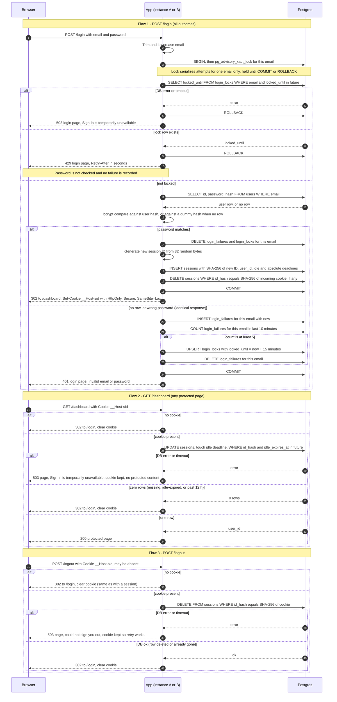

# Login with server-side sessions: design

## Decisions

| Area | Choice |
|---|---|
| Session and failure storage | Postgres tables (`sessions`, `login_failures`, `login_locks`). No Redis. |
| Session ID | 32 bytes from a CSPRNG, base64url encoded (43 characters). The database stores only its SHA-256 hash. |
| Cookie | Name `__Host-sid`, `Path=/`, `HttpOnly`, `Secure`, `SameSite=Lax`, no `Domain`, no `Max-Age` or `Expires` (browser-session cookie). Contains only the opaque ID. |
| Clock | Every expiry comparison uses Postgres `now()`. The app never compares times itself, so the two instances cannot disagree through clock skew. |
| Idle expiry | `sessions.idle_expires_at`. Each protected request sets it to `LEAST(now() + 30 min, absolute_expires_at)`. |
| Absolute expiry | `sessions.absolute_expires_at = created_at + 12 h`. Never extended. |
| Expiry check | Done inside the single `UPDATE` that touches the session. No separate read. |
| Brute-force counting | One row per failed attempt in `login_failures`. A 10-minute sliding window is counted at each failure. |
| Lock | `login_locks` row with `locked_until = now() + 15 min`. Set on the 5th failure in any 10-minute window. |
| Concurrency | `pg_advisory_xact_lock(hashtext(email))` held for the whole login transaction. Serializes attempts for one email only. |
| Abandoned-session removal | Sweep every 10 minutes on each instance. The sweep is idempotent and only reclaims storage. Correctness never depends on it. |
| Storage failure | Fail closed. Never log in, never clear a cookie that might still be valid, never claim a logout that did not happen. See the failure table. |

### Why Postgres and not Redis

- The app already depends on the one Postgres database both instances share. Adding Redis adds a second stateful service, its own failure modes, and its own backups and monitoring.
- Lockout needs exact counting across two instances. A Postgres transaction with an advisory lock gives that directly. Redis would need Lua scripts or careful `INCR` and `EXPIRE` logic to get the same guarantee.
- Volume is small: one indexed read or write per protected request, and a few statements per login.
- Redis would be the right choice if request volume or latency demanded it, or if sessions had to survive a database outage. Neither applies today. Revisit if either changes.

## Schema

```sql
CREATE TABLE sessions (
  id_hash             bytea PRIMARY KEY,      -- SHA-256 of the session ID; the raw ID is never stored
  user_id             bigint NOT NULL REFERENCES users(id),
  created_at          timestamptz NOT NULL DEFAULT now(),
  idle_expires_at     timestamptz NOT NULL,   -- always <= absolute_expires_at
  absolute_expires_at timestamptz NOT NULL    -- created_at + 12 h
);
CREATE INDEX ON sessions (idle_expires_at);

CREATE TABLE login_failures (
  email     text NOT NULL,                    -- normalized; recorded for unknown emails too
  failed_at timestamptz NOT NULL DEFAULT now()
);
CREATE INDEX ON login_failures (email, failed_at);

CREATE TABLE login_locks (
  email        text PRIMARY KEY,
  locked_until timestamptz NOT NULL
);
```

Touch and check, one statement per protected request:

```sql
UPDATE sessions
SET idle_expires_at = LEAST(now() + interval '30 minutes', absolute_expires_at)
WHERE id_hash = $1 AND idle_expires_at > now()
RETURNING user_id;
```

Zero rows means missing, idle-expired, or past the 12-hour cap. Because `idle_expires_at` is always capped at `absolute_expires_at`, one predicate covers both rules.

## Sequence diagram



## Rules that do not fit on the arrows

**Login outcomes**
- Attempts 1 to 5 for an email that fail return 401. The 5th failure is the one that sets the lock. Attempt 6 onward, within the lock, returns 429.
- The 10-minute window is sliding. The count at each failure covers the 10 minutes before it, so any 10-minute span containing 5 failures triggers the lock exactly.
- The lock lasts 15 minutes from the 5th failure. Failures during the lock are not recorded, so the lock ends on time.
- When the lock is set, the failure rows are deleted. The next window after the lock starts clean.
- A successful login deletes that email's failure rows and lock row. A success can only happen while unlocked, so it cannot shorten a lock.
- Throttling covers every normalized email string, whether or not an account exists. A 429 therefore reveals nothing about account existence.
- An unknown email runs the same statements as a known one, including bcrypt against a dummy hash of the same cost. Response bodies, status codes, and timing stay as close as possible.
- The 429 page says "Too many failed attempts for this email. Try again in 15 minutes." It sends `Retry-After` set to the remaining lock time.
- POST /login ignores any existing cookie except to destroy it on success. A 401 or 429 leaves the old session untouched.
- Plain GET /login renders the form and does not check sessions.

**Session rules**
- Every protected request restarts the 30-minute idle clock, including GET requests.
- The 12-hour cap comes from `created_at`. Activity does not extend it.
- A session the browser still holds past its deadline is rejected at the server. The browser cookie carries no expiry, so the server alone decides.
- On success, a fresh ID is always issued, even if the browser already sent one. The old session is destroyed in the same transaction as the new insert. If the commit fails, the old session survives too.

**Cleanup**
- Each instance runs this every 10 minutes, in batches of about 1000 rows:
  - `DELETE FROM sessions WHERE idle_expires_at <= now()`
  - `DELETE FROM login_failures WHERE failed_at < now() - interval '10 minutes'`
  - `DELETE FROM login_locks WHERE locked_until <= now()`
- Running it on both instances is safe because the statements are idempotent.
- Expired rows are filtered at read time. Sweep timing never changes whether a session or lock is honored.

**Logging**
- Never log passwords, session IDs, or raw cookie values.
- Log outcomes with a hash of the email, not the email.

## Storage failure behavior

| Situation | User sees | Reason |
|---|---|---|
| Login: lock check, user lookup, or any statement fails before commit | 503 login page: "Sign-in is temporarily unavailable. Try again in a moment." | Fail closed. No password check, no cookie, no lock bypass. |
| Login: commit fails after a password match | Same 503 | The transaction rolls back, so no session is created and the old session is not deleted. No half-logged-in state. |
| Protected request: DB unreachable or timed out | 503 page, no protected content | The session may still be valid, so the cookie is not cleared and the user is not sent to login. |
| Logout: delete fails | 503 page: "We could not sign you out. Try again." | The cookie is kept so retry works. The app never shows "signed out" while the server session exists. |
| Sweep fails | Nothing visible | Logged, retried on the next tick. Expired rows are still rejected at read time. |

Set a statement timeout of about 2 seconds on the connection pool so requests fail fast and do not queue behind a stalled database.

## Requirement coverage

| # | Requirement | Where it is met |
|---|---|---|
| 1 | POST /login, lowercase email match | Flow 1, step 2 |
| 2 | Identical 401 for unknown email and wrong password | Flow 1, "identical response" branch; dummy bcrypt; same statements |
| 3 | 5 failures in 10 minutes, then 15-minute 429 without password check | Flow 1 lock branch; sliding-window count; success clears counts |
| 4 | New random ID on success, destroy old session | Flow 1 success branch, same transaction |
| 5 | Cookie holds only the opaque ID, HttpOnly, Secure, SameSite=Lax | Decisions table; Set-Cookie on success |
| 6 | 30-minute idle, 12-hour absolute | `idle_expires_at` touch and cap; schema |
| 7 | Server check on every protected request; clear cookie and redirect when invalid | Flow 2 |
| 8 | POST /logout destroys server session first; same result with no session | Flow 3 |

## Trade-offs and open items

- **Targeted lockout:** anyone can lock any known email for 15 minutes at a time. The spec requires per-email lockout, so this is accepted. Per-IP limits or a challenge step would reduce it but are out of scope.
- **Distributed guessing:** the limit is per email. Guessing spread across many emails is not limited. Out of scope per the spec.
- **Per-email serialization:** attempts for one email queue behind the advisory lock, including its bcrypt time. This is fine at team scale and is also a brute-force brake.
- **Write per request:** each protected request performs one `UPDATE`. If load grows, throttling these updates would make idle expiry drift by up to the throttle interval. That would break requirement 6 as written, so it needs a decision first.
- **Login CSRF:** `SameSite=Lax` blocks cross-site POSTs that carry the cookie, which protects logout. It does not protect POST /login, which does not depend on a cookie. Decide whether to add a form token.
- **Revocation:** password change does not revoke sessions. This is out of scope. Adding it is one `DELETE` per user on the `sessions` table.
- **Migrations:** three new tables. The existing `users` table is unchanged.