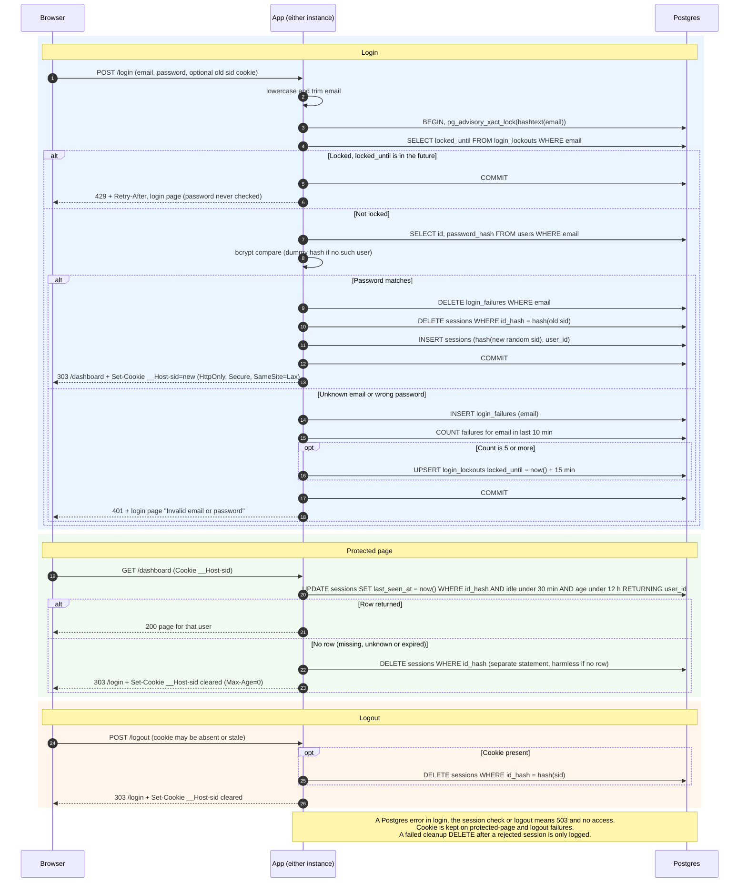

# Login with server-side sessions: design

## Overview

Today the app has no sign-in: every page is public. It is a server-rendered web app (HTML pages and form posts, no SPA or API clients). It runs as two identical instances behind a load balancer with no sticky sessions, and uses one Postgres database. That database already has a `users` table with `id`, `email` (stored lowercase, unique) and `password_hash` (bcrypt). Sign-up and password reset are out of scope.

After this change, every page except `/login` needs a signed-in user. A user posts email and password to `/login`. The app checks for a lockout, then checks the password. On success it creates a session row in Postgres and gives the browser a cookie holding only a random session ID. On every later page request the app looks that ID up in Postgres with one SQL statement, which also checks expiry. Logout deletes the row. Sessions and failure counts live in Postgres because both instances already share it, so no new service is needed.

## Terms

- **Session**: a row in the `sessions` table that says "this browser is signed in as this user".
- **Session ID**: 32 random bytes from a CSPRNG, base64url-encoded. It is the only thing in the cookie. The database stores only its SHA-256 hash, so a leaked dump or backup holds no usable tokens.
- **Cookie**: `__Host-sid=<id>; HttpOnly; Secure; SameSite=Lax; Path=/`, with no `Domain` and no `Max-Age`. The `__Host-` prefix stops other subdomains from overwriting it. No user data goes in it. The server, not the cookie, decides expiry.
- **Idle limit / absolute limit**: a session ends after 30 minutes with no requests (every request restarts that clock) or 12 hours after login, whichever comes first.
- **Lockout**: once an email has 5 failed attempts within any 10-minute period, logins for that email are refused for 15 minutes with HTTP 429, without checking the password. A successful login clears that email's failure count.
- **Advisory lock**: a Postgres lock on a number that the app picks. `pg_advisory_xact_lock(hashtext(email))` makes concurrent attempts for one email wait for each other, even across instances. Postgres releases it at COMMIT or ROLLBACK.
- **Dummy hash**: a fixed bcrypt hash. The app compares against it when the email is unknown, so timing does not reveal that the account is missing.
- **Middleware**: code that runs before page code and checks the session.
- **Sweep**: a background cleanup that deletes dead rows.
- **Fail closed**: when storage errors, never grant access, never skip the limiter, never pretend a logout worked.

## Diagram



## Schema

```sql
CREATE TABLE sessions (
  id_hash      bytea       PRIMARY KEY,           -- SHA-256 of the cookie value
  user_id      bigint      NOT NULL REFERENCES users(id) ON DELETE CASCADE,
  created_at   timestamptz NOT NULL DEFAULT now(), -- set at login, never changes
  last_seen_at timestamptz NOT NULL DEFAULT now()  -- set to now() on every accepted request
);
CREATE INDEX ON sessions (last_seen_at);
CREATE INDEX ON sessions (created_at);

CREATE TABLE login_failures (                     -- keyed by submitted email, no FK
  email     text        NOT NULL,                 -- lowercase
  failed_at timestamptz NOT NULL DEFAULT now()
);
CREATE INDEX ON login_failures (email, failed_at);

CREATE TABLE login_lockouts (
  email        text        PRIMARY KEY,
  locked_until timestamptz NOT NULL
);
```

## Steps

All time checks use the database clock (`now()`), which avoids skew between the two instances.

### 1. Login: `POST /login` with email and password

1. Lowercase and trim the email. Failures and lockouts are keyed on that string, not on a user row, so unknown emails are counted and locked exactly like real ones. A 429 therefore reveals nothing about whether an account exists.
2. If the email is over 254 characters, answer with the same 401 as a wrong password. This happens before any transaction, touches no table and is not counted as a failure. It keeps `login_failures` rows small.
3. Start one transaction and take the advisory lock. The lockout check, `users` lookup, bcrypt compare and every write below happen inside it. Parallel guesses cannot slip past the limit of 5.
4. Lockout check. A lockout is active only while `login_lockouts.locked_until > now()`. An expired row is ignored (the sweep removes it later). If active, answer 429 with a `Retry-After` header holding the whole seconds left, rounded up, and the page "Too many attempts. Try again later." (same text for every email). The password is never checked, so a correct password during lockout is still refused. These refused attempts are not recorded as failures.
5. Look up `id` and `password_hash` for the email. If there is no row, run bcrypt against the dummy hash and treat the result as "no match". Unknown email and wrong password follow the same path.
6. On failure: insert a `login_failures` row, then count that email's rows from the last 10 minutes (a sliding count, so it covers any 10-minute period). If the count is 5 or more, upsert `locked_until = now() + 15 min`; this overwrites any expired row. Commit and answer 401 with the login page and "Invalid email or password". The 5th failing attempt itself still returns 401. Every attempt after it, until the lock expires, returns 429. After 15 minutes the old failures are outside the 10-minute window, so counting starts from zero.
7. On success: delete that email's `login_failures` rows. Do not touch `login_lockouts`, since a login cannot succeed during an active lock. The request may carry an old `__Host-sid` cookie (absent, stale or someone else's). In the same transaction, delete the session that cookie points to, even if it belongs to another user (whatever session the browser presented is ended). Then insert a brand-new session with a fresh random ID and commit. An old ID is never reused or promoted. Answer `303 See Other` to `/dashboard` with the new cookie.
8. Failed logins and lockouts leave any existing session untouched.

`GET /login` always shows the login page, even if the browser holds a valid session. It does not redirect.

Data kept: `login_lockouts`, `login_failures`, `sessions`. If storage fails, the transaction rolls back and the user gets 503 (see failure table).

### 2. Protected request: any page except `GET /login`, `POST /login` and `POST /logout`

1. The middleware reads the `__Host-sid` cookie. With no cookie, it skips steps 2 and 3 and goes straight to the redirect in step 4.
2. It computes SHA-256 of the cookie value and runs this statement as `$1`. The `UPDATE` is its own auto-committed statement, not in a transaction with the page's queries. Every request restarts the idle clock; the 12-hour limit is never extended.

```sql
UPDATE sessions
   SET last_seen_at = now()
 WHERE id_hash = $1
   AND last_seen_at > now() - interval '30 minutes'
   AND created_at   > now() - interval '12 hours'
RETURNING user_id;
```

3. One row returned: the middleware puts `user_id` on the request and the page runs as that user.
4. Zero rows (session missing, unknown or expired): run a separate `DELETE FROM sessions WHERE id_hash = $1` before replying. Deleting zero rows is harmless, so the app need not know whether a row exists. A row that failed the check can never become valid again, so there is no race. If this delete fails, log the error and still redirect, because the session is already unusable and the sweep will remove the row. Then send `Set-Cookie: __Host-sid=; Max-Age=0` with the same attributes and redirect to `/login`.

Static files (CSS, images, scripts) are not pages. They are served with no session check, do not touch the session row and do not restart the idle clock. The login page needs its CSS while signed out.

Data kept: `sessions`. If the session check itself fails, the user gets 503 (see failure table).

### 3. Logout: `POST /logout`

It is exempt from the middleware because it must behave the same with or without a session.
1. With a cookie, run `DELETE FROM sessions WHERE id_hash = $1` before any reply. It deletes by hash whether or not the session has expired. With no cookie, skip it.
2. Reply `303` to `/login` with the cookie cleared. A request with no session gets exactly this response.

Because logout is a `POST` and the cookie is `SameSite=Lax`, a cross-site page cannot trigger it. Data kept: `sessions`. If the delete fails, see the failure table.

### 4. Sweep: a timer inside each app process, every 5 minutes

It deletes `sessions` where `last_seen_at < now() - 30 min` or `created_at < now() - 12 h`, `login_failures` rows older than 10 minutes, and `login_lockouts` rows whose `locked_until` has passed. If both instances run it at once, the deletes overlap harmlessly. If a run fails, it is logged and the next tick tries again. No external scheduler is needed. The sweep only reclaims space. Correctness never depends on it, because every request checks expiry itself.

## When storage fails

Every storage error is logged with a request ID. Policy is fail closed.

| Where | What the user gets | Why |
|---|---|---|
| Login | Transaction rolls back. 503 with "Sign-in is temporarily unavailable. Please try again." No session is issued and the limiter is never skipped. If the error comes after the failure insert but before commit, the rollback removes that insert, so the attempt does not count toward the 5. | A 503 shows no password verdict, so an attacker gains nothing from a database error. |
| Session check on a protected request | 503 with a "temporarily unavailable" page, no page content. No redirect to `/login`, cookie kept. This holds even if the session was really expired. | The app cannot tell while storage is down, and a transient error should not log anyone out. |
| Cleanup delete after a rejected session | Logged only. The user gets the normal redirect. | The session is already unusable. |
| Logout | 503 with "We couldn't sign you out. Please try again." Cookie kept. | Clearing it would show a signed-out state while the session is still live on the server. |
| Sweep | Logged, retried next tick. | Cleanup is not needed for correctness. |

## Choices and reasons

| Question | Choice | Why |
|---|---|---|
| Where sessions and failure counts live | Postgres tables above. | Both instances share it, so no sticky sessions. No new service. The limiter must be shared and exact, and Postgres gives transactions and advisory locks. One indexed write per request is fine for a small team app. |
| Redis | **Not added.** | It is another service to run, secure and monitor. Losing it would either log everyone out or disable the brute-force limit. Revisit only if per-request session writes become a measured bottleneck. |
| How expiry is checked | One SQL statement per protected request, combining check and touch. | No race, and an expired row can never be honored, whether or not cleanup has run. |
| How expiry is recorded | `created_at` fixed at login; `last_seen_at` set on every accepted request. | A request must pass both limits, so whichever comes first ends the session. |
| Abandoned sessions | Lazy delete on rejection plus the 5-minute sweep. | See Steps 2 and 4. |

## Trade-offs to review

- Every protected page request writes one row. This is fine at team scale. If it ever is not, move sessions to Redis, or throttle the `last_seen_at` write. Throttling would loosen the "every request restarts the clock" rule, so that is a requirement change, not a silent optimization.
- The advisory lock keeps a connection busy for one bcrypt compare (about 100 ms) per login attempt. This only affects concurrent attempts on the same email.
- `login_failures` can grow with junk emails from an attacker. The sweep bounds it to roughly 10 minutes of traffic.

## Open questions

- Does the app serve static files itself, and from which paths? The design assumes they are exempt from the session check.
- Should `GET /login` redirect to `/dashboard` for a user who is already signed in? The design says no, to keep the page simple. The brief does not say.
