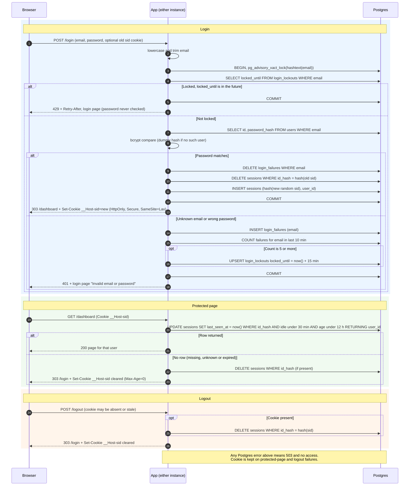

# Login with server-side sessions: design

## Decisions

| Question | Choice | Why |
|---|---|---|
| Where sessions live | A `sessions` table in the existing Postgres. | Both instances already share it, so no sticky sessions are needed. It adds no new service. A small team app can absorb one indexed write per request. |
| Where failure counts live | `login_failures` and `login_lockouts` tables in Postgres. | The limiter must be shared by both instances, and the lockout check must be exact. Postgres gives transactions and advisory locks. |
| Redis | **Not added.** | It would be another service to run, secure and monitor. Losing it would either log everyone out or disable the brute-force limit. Revisit only if per-request session writes become a measured bottleneck. |
| Session ID | 32 bytes from a CSPRNG, base64url-encoded. The database stores only `SHA-256(id)`. | A leaked database dump or backup then holds no usable session tokens. |
| Cookie | `__Host-sid=<id>; HttpOnly; Secure; SameSite=Lax; Path=/`, with no `Domain` and no `Max-Age`. | The `__Host-` prefix stops other subdomains from overwriting it. The cookie carries nothing but the opaque ID. The server decides expiry, not the cookie. |
| How expiry is checked | In a single SQL statement on every protected request, using the database clock (`now()`). | Using the database clock avoids skew between the two instances. Folding the check and the touch into one statement removes any race. An expired row can never be honored, whether or not cleanup has run. |
| How expiry is recorded | `created_at` is set once at login and never changes. `last_seen_at` is set to `now()` on every accepted request. | Idle limit: `last_seen_at > now() - 30 min`. Absolute limit: `created_at > now() - 12 h`. A request must satisfy both, so whichever comes first ends the session. |
| Removing abandoned sessions | Lazy delete when a request is rejected as expired, plus a sweep every 5 minutes. Both instances may run the sweep, because it is idempotent. | The sweep deletes sessions where `last_seen_at < now() - 30 min` or `created_at < now() - 12 h`. It also deletes `login_failures` rows older than 10 minutes and `login_lockouts` rows whose `locked_until` has passed. Cleanup only reclaims space. Correctness never depends on it. |
| Storage failure | Fail closed with a 503 page, as described in "When storage fails". | Never grant access, never skip the limiter, and never fake a logout. |

## Schema

```sql
CREATE TABLE sessions (
  id_hash      bytea       PRIMARY KEY,           -- SHA-256 of the cookie value
  user_id      bigint      NOT NULL REFERENCES users(id) ON DELETE CASCADE,
  created_at   timestamptz NOT NULL DEFAULT now(),
  last_seen_at timestamptz NOT NULL DEFAULT now()
);
CREATE INDEX ON sessions (last_seen_at);
CREATE INDEX ON sessions (created_at);

CREATE TABLE login_failures (                     -- keyed by submitted email, no FK
  email     text        NOT NULL,                 -- lowercase
  failed_at timestamptz NOT NULL DEFAULT now()
);
CREATE INDEX ON login_failures (email, failed_at);

CREATE TABLE login_lockouts (
  email        text        PRIMARY KEY,
  locked_until timestamptz NOT NULL
);
```

The state does not fit on the arrows, so these are the rules it follows.

## Rules

**Login (requirements 1 to 4)**
- The email is lowercased and trimmed, and `login_failures` and `login_lockouts` are keyed on that value.
- The limiter keys on the submitted string, not on a user row. Unknown emails are counted and locked exactly like real ones. A 429 therefore reveals nothing about whether an account exists.
- The whole attempt runs in one transaction that starts with `pg_advisory_xact_lock(hashtext(email))`. Concurrent attempts for one email, even on different instances, are serialized. Parallel guesses cannot slip past the limit of 5.
- If `login_lockouts.locked_until > now()`, the response is 429 with a `Retry-After` header. The password is never checked, so a correct password during lockout is still refused.
- An unknown email and a wrong password take the same path. For an unknown email the app runs bcrypt against a fixed dummy hash, so response time does not reveal which case occurred. Both get HTTP 401 and the login page with "Invalid email or password".
- On each failure, insert a `login_failures` row, then count that email's rows from the last 10 minutes. This sliding count covers any 10-minute period. If the count is 5 or more, upsert `locked_until = now() + 15 min`.
- The 5th failing attempt itself still returns 401. Every attempt after it, until the lock expires, returns 429.
- After 15 minutes the old failures are already outside the 10-minute window, so counting starts from zero.
- On success, delete that email's `login_failures` rows.
- The login `POST` also takes an incoming `__Host-sid` cookie, which may be absent, stale or someone else's. The same transaction deletes the session that cookie points to, inserts a brand-new session with a fresh random ID, and commits. An old ID is never reused or promoted.
- The success response is `303 See Other` to `/dashboard` with the new `Set-Cookie`.
- Failed logins and lockouts leave any existing session untouched.

**Protected requests (requirements 6 and 7)**
- A middleware runs the single statement below on every request except `GET /login` and `POST /login`.
- `POST /logout` is also exempt from the middleware, because it must behave the same with or without a session.

```sql
UPDATE sessions
   SET last_seen_at = now()
 WHERE id_hash = $1
   AND last_seen_at > now() - interval '30 minutes'
   AND created_at   > now() - interval '12 hours'
RETURNING user_id;
```

- One row returned means the request proceeds as that user.
- Zero rows means the session is missing, unknown or expired. The app deletes the row if one exists, sends `Set-Cookie: __Host-sid=; Max-Age=0` with the same attributes, and redirects to `/login`.
- Every request restarts the idle clock. The 12-hour limit is never extended.

**Logout (requirement 8)**
- `DELETE FROM sessions WHERE id_hash = $1` runs before any reply.
- It deletes by hash whether or not the session has expired. With no cookie, the statement is skipped.
- The reply is always the same: `303` to `/login` with the cookie cleared. A request with no session gets exactly this response.
- Because logout is a `POST` and the cookie is `SameSite=Lax`, a cross-site page cannot trigger it.

**When storage fails**
- Login: the transaction rolls back and the user gets 503 with a page saying "Sign-in is temporarily unavailable. Please try again." No session is issued. The limiter is never skipped, so a database error cannot be used to bypass it.
- Protected request: 503 with a "temporarily unavailable" page. The user is not redirected to `/login`, and the cookie is not cleared. The session may still be valid, and a transient error should not log anyone out. No page content is served.
- Logout: 503 with "We couldn't sign you out. Please try again." The cookie is kept. Clearing it would show the user a signed-out state while the session is still live on the server.
- Every storage error is logged with a request ID.

## Sequence diagram



## Trade-offs to review

- Every protected request writes one row. This is fine at team scale. If it ever isn't, move sessions to Redis, or throttle the `last_seen_at` write. Throttling would loosen the "every request restarts the clock" rule, so that is a requirement change, not a silent optimization.
- The advisory lock keeps a connection busy for the duration of one bcrypt compare (about 100 ms) per login attempt. This only affects concurrent attempts on the same email.
- The 429 page needs a message that says nothing about the account. It should read the same for every email, for example "Too many attempts. Try again later."
- `login_failures` can grow with junk emails from an attacker. The 5-minute sweep bounds it to roughly 10 minutes of traffic. Reject emails over 254 characters up front, with the same 401 response.
