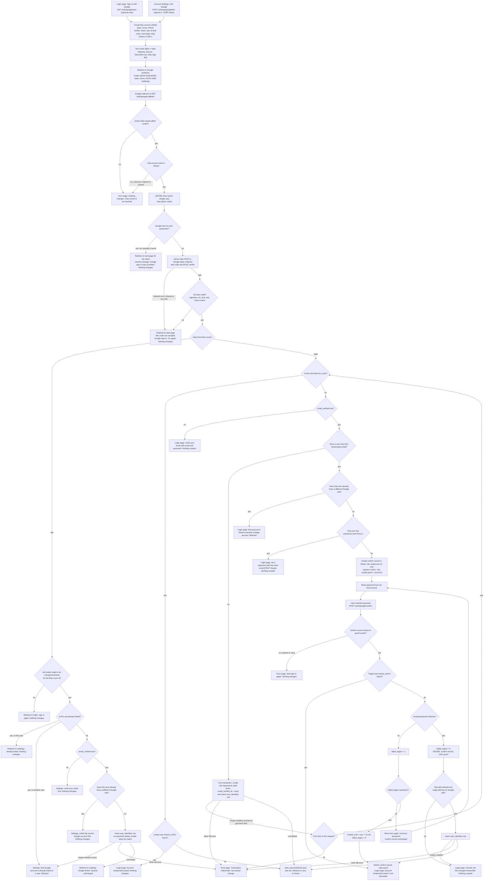

# Sign in with Google: flow, state and failures

## Summary

Today a user signs in with email and password. `POST /login` checks the password with bcrypt. It counts wrong tries on the user row and locks the account for 15 minutes after five wrong tries. A correct password calls `start_session`, which creates a session row and sets the `sid` cookie.

This change adds "Sign in with Google" next to that. It uses OpenID Connect, a standard way to sign in with an outside account. It runs the authorization-code flow with PKCE and a `state` and a `nonce` value, and it asks Google for the scopes `openid email profile`. Signed-in users can also link Google from Account Settings.

The main flow has three parts. The server starts a flow and sends the user to Google. Google sends the user back to our callback, which checks the flow and decides the outcome. A successful sign-in calls `start_session(user)`, exactly as password login does, so it ends in the same session. The whole Google round trip must finish within 10 minutes.

Two rules shape the design. A Google account is identified only by its `sub`, because emails can change. We never store Google tokens, and we never write Google's email into `users.email`.

## Terms

- **Redis**: a fast key-value store. Records can expire after a set time. It is already used for rate limits. We use it only for short-lived records.
- **Postgres**: the database that holds our permanent tables.
- **OpenID Connect**: a standard, built on OAuth 2.0, that lets an app learn who a user is from a provider such as Google.
- **sub**: Google's permanent ID for an account. It does not change when the user changes their email.
- **ID token**: a signed statement from Google saying who signed in. We check it in memory and keep only `sub`, `email` and `email_verified`.
- **Authorization code**: a one-time code that Google sends to our callback.
- **Code exchange**: our server's request to Google's token endpoint. It trades the code for tokens.
- **PKCE**: a proof that the code exchange comes from the flow that started it. We make a random verifier and send only its hash when the flow starts. We send the verifier itself with the code exchange.
- **state**: a random value that ties a callback to the flow we started.
- **nonce**: a random value that must appear inside the ID token. It blocks replayed tokens.
- **Flow record**: a Redis record for one sign-in attempt. It holds the state, nonce, PKCE verifier, intent, user id (link only) and next (login only). It can be read and deleted once. It expires after 600 seconds.
- **Intent**: either `login` or `link`. It decides where a failure sends the user: `/login` for login, `/settings` for link.
- **next**: an optional path from the login page. After a successful login we redirect there, but only if it is a relative path on our site.
- **Confirm record**: a Redis record made when a Google email matches an existing account. It holds the sub, the target user id and next. It expires 600 seconds after the callback.
- **gflow**: a browser cookie that holds the flow's state.
- **gconf**: a browser cookie that holds the confirm record's id.
- **Login CSRF**: an attack where the attacker starts a flow with their own Google account, then makes the victim's browser open the callback. The victim would be signed in as the attacker's account. The gflow cookie stops this.
- **user_identities row**: the permanent link from one user to one Google sub.
- **failed_logins and locked_until**: two columns on `users`. Password login and the confirm step share them and use the same rules.
- **bcrypt**: the slow hash used for passwords. We compare a password with it and never store plain text.
- **GETDEL**: a Redis command that reads a key and deletes it in one step. Only one request can get the value.
- **Session and sid**: a session is a row in `sessions`. The `sid` cookie holds its id.
- **start_session(user_id)**: the existing function that starts a login. It is described in the steps below.
- **Unique violation**: a database error raised when an insert would repeat a value that must be unique.

## Flowchart



## Steps

The steps below follow the diagram in order.

1. **Start.** Two things can start a flow. The login page's button calls `GET /auth/google/start`, with an optional `next`. Account Settings' "Link Google" calls `POST /settings/google/link`, for a signed-in user, with a CSRF token. The token stops a page on another site from starting a link. The server writes a flow record to Redis with a 600-second expiry. It sets `gflow` to the state, with Max-Age 600. It then redirects the browser to Google with scope `openid email profile`, the state, the nonce and the PKCE challenge. The nonce and the PKCE verifier are kept only in the flow record.

2. **Callback.** Google redirects the browser to `GET /auth/google/callback`. The server first compares the state in the query with the `gflow` cookie. If they differ, it shows an error page and leaves the flow record alone. The cookie check stops login CSRF. An attacker's callback carries the attacker's state, and the victim's browser has no matching cookie. Because the flow record is left alone, a stray or forged callback cannot use up the real user's flow. If they match, the server reads the flow record. If it is missing, because the state is unknown, expired or already used, the server shows an error page and changes nothing. If it exists, the server reads and deletes it in one step with GETDEL, and clears `gflow`. So each flow is honoured once.

3. **Google error.** If Google sends an error, for example because the user pressed Cancel, the server redirects to the start page for the flow's intent. It shows the neutral message "Google sign-in was cancelled." Nothing changes.

4. **Code exchange.** The server posts the code and the PKCE verifier to Google's token endpoint, from the server side. If that fails (network error, timeout or a non-200 response), the user goes to the start page with "We could not complete Google sign-in. Try again." The flow record is already deleted, so a retry starts a new flow. If the exchange succeeds, the server checks the ID token's signature, `iss`, `aud`, `exp` and `nonce`. A bad token gets the same "try again" message. The server keeps only `sub`, `email` and `email_verified`. It drops every token when the request ends. Google's access and refresh tokens are never kept.

5. **Link intent.** The flow record says the user started from Settings. The browser sends the `sid` cookie with this top-level GET, and `SameSite=Lax` allows that. The server looks for a session row with that sid. The row must be unexpired and belong to the flow's user id. If there is no such row, because there is no cookie, the user signed out, the session expired or it is a different user, the user is sent to `/login` to sign in again. Nothing changes. Otherwise the server checks the following, in order:
   - If this sub is already linked to this user, the user goes to Settings with "already linked". Nothing changes.
   - If this sub is linked to another user, the server refuses. Nothing changes.
   - If `email_verified` is false, the server asks the user to verify their email first.
   - If this user already has a different Google link, the server asks the user to unlink it first.
   - Otherwise it inserts the `user_identities` row. No password is asked for, and the two emails need not match. The user goes to Settings, and the session does not change.
   If the insert hits a unique violation, another request linked this sub or this user first, and the server refuses as in the second check. Any other database error shows an error page and rolls back.

6. **Login intent, linked sub.** The server looks up the user linked to this sub. Matching on `sub` means that a changed Google email still reaches the same account. If that user's `locked_until` is in the future, the login page shows "Account temporarily locked". Nothing changes. Otherwise the server calls `start_session(linked user)`. An expired lock is ignored and is not cleared.

7. **Login intent, unlinked sub.** If `email_verified` is false, the server refuses and points the user to email and password. Nothing is created. If `email_verified` is true, the server lowercases the Google email and looks it up in `users.email`. Stored emails are always lowercase, so the match is effectively case-insensitive. The value is not trimmed or changed in any other way.
   - No match: in one transaction the server creates the user (`password_hash` NULL, `email_verified_at` = now) and inserts the `user_identities` row. It then calls `start_session`. The new user has no password, so Google is their only way in until they set one with the reset email. That email reaches them because their address is already verified through Google.
   - Unique violation on that transaction: someone else created this email or linked this sub first. The server runs the linked-sub check from step 6 once more. If that second attempt also hits a unique violation, it shows an error page. Any other database error shows an error page, rolls back and creates no session.
   - Match: go on to step 8.

8. **Email match.** An existing account has this email, but this sub is not linked to it.
   - If that account already has a different Google link, the server refuses. Nothing is created.
   - If that account has no password (`password_hash` NULL), the server refuses and points the user to the reset email (`POST /forgot`). Nothing is created. Under these rules such an account should always have a Google link, so this check should not be reached. It is kept as a safety check.
   - Otherwise the server creates a confirm record in Redis (sub, target user id, next) with a 600-second expiry. It sets `gconf` to the record's id, with Max-Age 600. It shows the password form for that account. The user has 10 minutes to confirm.

9. **Password confirmation.** The user submits the password to `POST /auth/google/confirm`.
   - If the `gconf` cookie does not match a live confirm record, because it expired or was used, the server shows an error page. The user must start sign-in again. Nothing changes.
   - If the target user's `locked_until` is in the future, the server deletes the confirm record and clears `gconf`. It shows "Account temporarily locked" on the login page. The link is discarded. The password is not checked.
   - Otherwise the server checks the password with bcrypt.
     - Wrong password: add 1 to `failed_logins`. This is the same counter and rule as `/login`, so wrong tries here and at `/login` add up together. If `failed_logins` reaches 5, the server sets `locked_until` to now + 15 minutes and `failed_logins` to 0. It then deletes the confirm record, clears `gconf` and shows the lock message. Below 5, the form is shown again with "Incorrect password". The confirm record is not changed or extended on a wrong password, so it still expires 10 minutes after the callback. When it expires, the user starts again.
     - Right password: set `failed_logins` to 0. GETDEL the confirm record and clear `gconf`. Then check again that the sub is still unlinked and that the user still has no Google link. If either has changed, the server refuses and inserts nothing. Otherwise it inserts the `user_identities` row and calls `start_session`. A unique violation on that insert is refused the same way. Any other database error shows an error page and rolls back.

10. **Successful login.** Every successful Google login ends by calling `start_session(user_id)`, exactly as password login does. The function first deletes the old `sessions` row if the browser sent a `sid` cookie. It inserts a new `sessions` row that expires 14 days ahead. It sets the `sid` cookie (HttpOnly, Secure, SameSite=Lax). Then it redirects to `next` if that is a relative path on our site, and to `/home` if it is not. The `next` value comes from the flow record, or from the confirm record after the password step. A Google login never returns to the start page, and no new session type is introduced.

11. **Unlink.** `POST /settings/google/unlink` deletes the `user_identities` row only if the user has a password (`password_hash` is set). Without a password, the user is told to set one first with the reset email (`POST /forgot`). This keeps the user able to sign in. Unlink does not end sessions.

## Where new state lives

**Temporary**

| State | Where | Created | Removed by |
|---|---|---|---|
| Flow record `gauth:flow:{state}` (state, nonce, PKCE verifier, intent, user id for link, next for login) | Redis, TTL 600 s | Start, from either entry point | Callback GETDEL, or TTL expiry |
| Cookie `gflow` (holds state) | Browser, Max-Age 600 | Start | Cleared at callback, or Max-Age |
| Confirm record `gauth:confirm:{id}` (sub, target user id, next) | Redis, TTL 600 s from callback | Callback, when the email matches an existing user | Correct password (GETDEL), lock, or TTL. Wrong passwords do not extend it. |
| Cookie `gconf` (holds confirm id) | Browser, Max-Age 600 | Same time as the confirm record | Cleared with the record |
| Google tokens and ID token claims | Memory only | Code exchange | End of the callback request |

**Permanent**

| State | Where | Created | Removed by |
|---|---|---|---|
| `user_identities` row (one per user, one per sub) | Postgres | Google-created user, confirmed link, settings link | Settings unlink (password required), or user deletion (cascade) |
| `users.password_hash` set to NULL | Postgres | Google-created user | Password reset sets a hash |
| `users.email_verified_at` = now | Postgres | Google-created user | Not removed |

Not stored anywhere: the Google email as a separate value, a name, a picture, or any Google token.

## What happens when things fail

| Failure | Result | Changes |
|---|---|---|
| Unknown, expired or reused state | Error page | None |
| Query state does not match the `gflow` cookie | Error page | None. The flow record is not consumed, so the real user's flow still works. |
| Google error parameter (for example, Cancel) | Start page for the intent, neutral message | None |
| Code exchange fails (network, timeout, non-200) | Start page: try again | None. The flow record is already gone, so a retry starts a new flow. |
| ID token invalid (signature, iss, aud, exp or nonce) | Start page: try again | None |
| Unlinked sub, `email_verified` false | Login page: use email and password | None |
| Linked sub, account locked | Login page: Account temporarily locked | None |
| Email match, account has a different Google link | Login page: that account is linked to another Google account. Refused. | None |
| Email match, account has no password (`password_hash` NULL) | Login page: set a password with the reset email (POST /forgot) | None |
| Wrong password in the confirm step | Form shown again: Incorrect password | `failed_logins` + 1 |
| Lock reached in the confirm step | Login page: Account temporarily locked | Lock set. Confirm record and `gconf` removed. |
| Target account locked during the confirm step | Login page: Account temporarily locked | Confirm record and `gconf` removed. Link discarded. |
| Confirm record missing or expired | Error page: start sign-in again | None |
| Link taken, or sub linked, when the correct password is checked again | Login page: refused | None. Nothing inserted. |
| Two concurrent creates or links (same email or same sub) | First one commits. Second one runs the linked-sub check once more. A second violation is an error page. | Second transaction rolled back |
| DB error during create or link | Error page | Transaction rolled back. No session. |
| Settings: sub belongs to another user (or the insert conflicts) | Settings: refused | None |
| Settings: this user already has a different Google link | Settings: unlink the current Google account first | None |
| Settings: this sub is already linked to this user | Settings: already linked | None |
| Settings: `email_verified` false | Settings: verify your email first | None |
| Session missing, expired or signed out at the link callback | Login page: sign in again | None |
| Redis unavailable or restarted | Treated as missing state: error page | Pending flows and confirm records are lost. Users start again. |
| Unlink with no password set | Settings: set a password first, using the reset email (POST /forgot) | None |

## Build and rollout

Schema change:

```sql
ALTER TABLE users ALTER COLUMN password_hash DROP NOT NULL;

CREATE TABLE user_identities (
  user_id    BIGINT PRIMARY KEY REFERENCES users(id) ON DELETE CASCADE, -- at most one Google account per user
  google_sub TEXT NOT NULL UNIQUE,                                     -- at most one user per Google account
  linked_at  TIMESTAMPTZ NOT NULL DEFAULT now()
);
```

Code change: `POST /login` must treat a NULL `password_hash` as the generic invalid-login message. It must not run bcrypt against NULL.

## Open questions and assumptions

1. A linked account that is locked (`locked_until` in the future) is also refused for Google sign-in. The brief does not say this.
2. The `email_verified` rule also applies to the Settings link. The brief states it for sign-in only.
3. The `gflow` cookie is an addition beyond the brief. It stops login CSRF, where an attacker starts a flow and sends the victim to its callback.
4. An email match to a passwordless account is refused with a pointer to the reset email. Under these rules such an account should always have a Google link, because creating a Google user links it and unlink needs a password. So this check should not be reachable. It is kept as a safety check. Please confirm this.
5. The Settings link starts as a POST with a CSRF token, so a cross-site page cannot start a link.
6. Sessions are not ended on unlink, and no new session type is introduced.