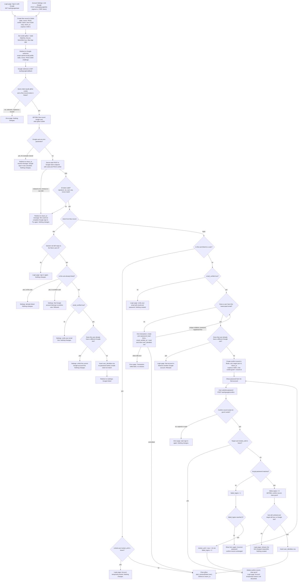

# Sign in with Google: flow, state and failures

## Notes

- Google sign-in is added beside password sign-in. It uses the authorization-code flow with PKCE, `state`, `nonce` and scopes `openid email profile`.
- A Google account is identified only by `sub`. The Google email is read for matching and is never written to `users.email`.
- Every successful Google sign-in calls `start_session(user_id)` exactly as password login does. It uses the same `sid` cookie and the same `next` handling.
- Redis holds the short-lived flow and confirmation records. Postgres holds the permanent link.
- `return_to` is the page the user started from (`/login` or `/settings`). It is stored in the flow record and checked again before any redirect.
- Google's access token, refresh token and ID token are never stored. The ID token is validated in memory and only `sub`, `email` and `email_verified` are kept for that request.

## Flowchart



## Where new state lives

**Temporary**

| State | Where | Created | Removed by |
|---|---|---|---|
| Flow record `gauth:flow:{state}` (state, nonce, PKCE verifier, intent, user id for link, return_to) | Redis, TTL 600 s | Start, from either entry point | Callback GETDEL, or TTL expiry |
| Cookie `gflow` (holds state) | Browser, Max-Age 600 | Start | Cleared at callback, or Max-Age |
| Confirm record `gauth:confirm:{id}` (sub, target user id, return_to) | Redis, TTL 600 s from callback | Callback, when the email matches an existing user | Correct password (GETDEL), lock, or TTL |
| Cookie `gconf` (holds confirm id) | Browser, Max-Age 600 | Same time as the confirm record | Cleared with the record |
| Google tokens and ID token claims | Memory only | Code exchange | End of the callback request |

**Permanent**

| State | Where | Created | Removed by |
|---|---|---|---|
| `user_identities` row (one per user, one per sub) | Postgres | Google-created user, confirmed link, settings link | Settings unlink (password required), or user deletion (cascade) |
| `users.password_hash` set to NULL for Google-created users | Postgres | Google-created user | Password reset sets a hash |
| `users.email_verified_at` = now for Google-created users | Postgres | Google-created user | Not removed |

Not stored anywhere: the Google email as a separate value, name, picture, or any Google token.

Schema change:

```sql
ALTER TABLE users ALTER COLUMN password_hash DROP NOT NULL;

CREATE TABLE user_identities (
  user_id    BIGINT PRIMARY KEY REFERENCES users(id) ON DELETE CASCADE, -- at most one Google account per user
  google_sub TEXT NOT NULL UNIQUE,                                     -- at most one user per Google account
  linked_at  TIMESTAMPTZ NOT NULL DEFAULT now()
);
```

`POST /login` must treat a NULL `password_hash` as the generic invalid-login message. It must not run bcrypt against NULL.

## Password confirmation loop

- The confirm step checks `locked_until` before the password, as `/login` does. A locked account never has its password checked.
- A wrong password adds 1 to `failed_logins`, using the existing rules. At 5, the account locks for 15 minutes. The confirm record is then deleted, so the link is thrown away.
- A correct password resets `failed_logins`, deletes the confirm record, and re-checks that the link is still possible before inserting the row.
- The confirm record does not extend its 10-minute life on wrong passwords. When it expires, the user starts again.

## Failure outcomes

| Failure | Result | Changes |
|---|---|---|
| Unknown, expired or reused state, or cookie mismatch | Error page | None. The flow record is not consumed on a cookie mismatch. |
| Google error parameter | Return to return_to with a neutral message | None |
| Code exchange fails (network, timeout, non-200) | Return to return_to: try again | None. The flow record is already consumed, so a retry starts a new flow. |
| ID token invalid (signature, iss, aud, exp or nonce) | Return to return_to: try again | None |
| Unlinked sub, email_verified false | Login page: use email and password | None |
| Linked sub, account locked | Login page: Account temporarily locked | None |
| Wrong password in confirm step | Form shown again: Incorrect password | failed_logins + 1 |
| Lock reached in confirm step | Login page: Account temporarily locked | Lock set, confirm record and gconf removed |
| Confirm record missing or expired | Error page: start sign-in again | None |
| Target account already has a different Google link | Refused at callback | None |
| Link already taken when password is correct | Login page: refused | None. Nothing inserted. |
| Settings: sub belongs to another user | Settings: refused | None |
| Settings: this user already has a different Google link | Settings: unlink first | None |
| Session no longer maps to the flow's user | Login page: sign in again | None |
| Two concurrent creates for the same email | Second one re-runs the email lookup | First transaction committed, second rolled back |
| DB error during create or link | Error page | Transaction rolled back, no session |
| Redis unavailable or restarted | Treated as missing state: error page | Pending flows are lost, so users start again |
| Unlink with no password set | Settings: set a password first, using the reset email (POST /forgot) | None |

**Unlink:** `POST /settings/google/unlink` deletes the `user_identities` row only when `password_hash` is set. It does not end sessions.

## Assumptions to confirm

1. A linked account that is locked (`locked_until` in future) is also refused for Google sign-in. The brief does not say.
2. The email_verified rule also applies to the settings link. The brief states it for sign-in only.
3. The `gflow` cookie is an addition beyond the brief. It stops login CSRF, where an attacker starts a flow and sends the victim to its callback.
4. An email match to a passwordless account (`password_hash` NULL) cannot be confirmed. It is refused with a pointer to the reset email.
5. Settings link starts as a POST with a CSRF token, so a cross-site page cannot start a link.
6. Sessions are not ended on unlink, and no new session type is introduced.