# Google sign-in beside email and password: flow and state

Today the app is one server-rendered backend. Users sign in with `POST /login`: it checks the password with bcrypt, counts wrong passwords, locks the account for 15 minutes after 5 failures, and calls `start_session` to create the session. This change adds "Sign in with Google" (OpenID Connect, authorization-code flow, PKCE S256, `state`, `nonce`, scopes `openid email profile`) beside that flow and does not replace it. The browser goes to Google and comes back to one callback. The server then exchanges the code, reads only `sub`, `email` and `email_verified` from the ID token, and discards all tokens (no Google access or refresh tokens are kept). Depending on what it finds, the server signs the user in, creates a user, asks for the existing account's password before linking, or refuses. Every successful Google sign-in ends in the same `start_session` as a password login, so there is no new session type. Signed-in users can also link or unlink Google from Account Settings. The flow keeps its short-lived state in Redis and its permanent state in PostgreSQL, so that the round trip is bounded to 10 minutes and each callback is honoured once.

## Terms

- **`sub`**: Google's permanent ID for a Google account. We identify a Google account by `sub`, never by email.
- **`state`**: a random value sent to Google and returned unchanged. It names the Redis attempt record. An unknown, expired or used `state` is rejected.
- **`nonce`**: a random value that Google puts inside the ID token. We check it matches, so a token cannot be replayed.
- **PKCE verifier**: a random secret kept on the server. Google only accepts the code exchange from whoever holds it.
- **Attempt**: one trip to Google, stored in Redis as `goog:attempt:STATE`. It has an **origin**: `login` (login page) or `settings` (Account Settings).
- **Bind value / `g_bind` cookie**: a random value stored in the attempt and set as a cookie in the starting browser. At the callback the cookie must equal the stored value. This stops a callback URL from someone else's Google login being fed to a victim's browser.
- **Pending link**: a half-finished link, held in Redis as `goog:pending:ID`, waiting for the user to prove they own the matching account by password. The `g_pending` cookie holds its ID.
- **Confirm token**: an HMAC of the pending ID made with a server secret. The confirm form carries it, because a user with no session has no session-bound CSRF token.
- **`start_session(user_id)`**: existing function. It deletes the `sessions` row named by the `sid` cookie the browser sent (if any), inserts a `sessions` row, sets the `sid` cookie (HttpOnly, Secure, SameSite=Lax) and redirects to `next` if that is a relative path on our site, else `/home`. It does not touch `failed_logins` or `locked_until`; `POST /login` resets `failed_logins` itself before calling it, and the Google path never does that reset.
- **Lockout**: existing rule. If `locked_until` is in the future, reject without checking the password. A wrong password adds 1 to `failed_logins`. At 5, set `locked_until` to now plus 15 minutes and reset `failed_logins` to 0. A correct password resets `failed_logins` to 0.
- **`check_password_with_lockout(user, password)`**: the lockout and bcrypt check from `POST /login`, refactored into one shared function that `/login` and the Google confirmation both call, so the two cannot drift apart. A NULL `password_hash` counts as a wrong password (it still runs a bcrypt compare against a dummy hash).
- **`POST /forgot`**: existing password reset. It emails a one-hour link that sets `password_hash`, marks the email verified and deletes all of the user's sessions.
- **`next`**: where to send the user after sign-in. It must be a relative path on our site.

Existing storage: PostgreSQL holds `users`, `sessions` and `password_reset_tokens`. Redis exists and today holds only short-lived data such as rate limits. `users.email` is lowercased on every write.

## Endpoints

| Endpoint | Purpose |
|---|---|
| `GET /auth/google/start?next=` | Login page entry. Anonymous. |
| `POST /settings/google/link` | Settings entry. Needs a session and the app's normal CSRF check. |
| `GET /auth/google/callback` | Google redirects here. One fixed registered redirect URI. |
| `POST /auth/google/confirm` | Password confirmation for the "email matches an existing user" case. The user has no session yet, so the session-bound CSRF token cannot be used. It needs the `g_pending` cookie and the confirm token in the form. |
| `POST /settings/google/unlink` | Remove the link. Needs a session and CSRF check. |

## Flowchart

```mermaid
flowchart TD
  %% ---------- Entry points ----------
  L0["Login page: click Sign in with Google<br/>GET /auth/google/start?next=..."]
  S0["Account Settings: click Link Google<br/>POST /settings/google/link"]
  S0 --> S1{"Signed in?"}
  S1 -->|no| S2["Redirect to login page"]
  S1 -->|yes| A
  L0 --> A["Create attempt:<br/>random state, nonce, PKCE verifier, random bind value<br/>origin = login or settings, next validated as relative path,<br/>user_id of signed-in user if origin = settings<br/>Store in Redis goog:attempt:STATE, TTL 600s (bind value stored in the record)<br/>Set g_bind cookie = same bind value, redirect to Google"]
  A -->|Redis down| E0["Error page: try again later. Nothing changed"]
  A --> G["Google consent screen"]

  %% ---------- Callback ----------
  G --> CB["GET /auth/google/callback"]
  CB --> C1{"state present and Redis GETDEL finds it?<br/>unknown, expired or used all fail here"}
  C1 -->|no| E1["Error page. Nothing changed"]
  C1 -->|yes, record now deleted| C2{"g_bind cookie equals record's bind value?<br/>origin settings: session user = record user_id?"}
  C2 -->|no| E1
  C2 -->|yes| C3{"Google sent error param?<br/>for example user pressed Cancel"}
  C3 -->|yes| R1["Back to origin page with neutral message:<br/>Google sign-in was not completed. Nothing changed"]
  C3 -->|no| C4["Server-to-server code exchange with PKCE verifier and client secret<br/>Endpoints and signing keys from Google's discovery document, cached in memory<br/>5s timeout on each call to Google<br/>Validate ID token: signature via Google keys, iss, aud, exp, nonce, sub present<br/>Read sub, email, email_verified. Discard all tokens"]
  C4 -->|"exchange or validation fails"| R2["Back to origin page with message:<br/>Could not complete Google sign-in, try again. Log reason. Nothing changed"]
  C4 -->|ok| C5{"origin?"}
  C5 -->|login| LG
  C5 -->|settings| ST

  %% ---------- Login origin ----------
  LG{"sub in user_google_accounts?"}
  LG -->|"yes, linked"| SS
  LG -->|no| V{"email_verified true?"}
  V -->|no| R3["Back to login page: Google email not verified,<br/>use email and password. Nothing created"]
  V -->|yes| M{"Lowercased Google email equals users.email?<br/>(stored emails are always lowercased)"}
  M -->|no| CR["One DB transaction:<br/>insert user with password_hash NULL, email_verified_at now,<br/>insert user_google_accounts row"]
  CR -->|ok| SS
  CR -->|"unique violation on email, lost a race"| M2["Roll back, re-run the email match once"]
  M2 --> M
  M -->|yes| D{"Matched user already has a Google link?<br/>it must be a different sub"}
  D -->|yes| R4["Back to login page: this account is linked to a different Google account. Refuse"]
  D -->|no| P["Create pending link:<br/>random pending ID (32 random bytes, base64url)<br/>Redis goog:pending:ID = sub, target user_id, next, TTL 600s<br/>Set g_pending cookie = ID, clear g_bind<br/>Show password form naming the matched account's email,<br/>with confirm token = HMAC of ID, computed when the form is rendered<br/>(Redis failure here: error page, nothing written)"]

  %% ---------- Password confirmation loop ----------
  P --> PF["POST /auth/google/confirm with password and confirm token"]
  PF --> P1{"Confirm token matches the g_pending ID,<br/>and g_pending cookie and Redis record exist?"}
  P1 -->|"no, expired, gone or bad token"| E2["Error page: confirmation expired or invalid, start again from login. Nothing changed"]
  P1 -->|yes| P2{"Target user locked_until in future?"}
  P2 -->|yes| X
  P2 -->|no| P3{"bcrypt matches? (NULL hash counts as no)"}
  P3 -->|no| W["failed_logins + 1<br/>at 5: locked_until = now + 15 min, failed_logins = 0"]
  W --> W1{"Account now locked?"}
  W1 -->|yes| X["Delete pending record, clear g_pending<br/>Show Account temporarily locked<br/>Half-finished link is discarded"]
  W1 -->|no| PF2["Re-show form with generic wrong-password message<br/>pending record kept until its TTL"]
  PF2 --> PF
  P3 -->|yes| OK["failed_logins = 0<br/>Redis GETDEL pending, nil means double submit, treat as expired<br/>Insert user_google_accounts row"]
  OK -->|"unique violation, linked meanwhile"| R5["Back to login page: refuse, nothing linked"]
  OK -->|ok| SS

  %% ---------- Settings origin ----------
  ST{"sub already linked to any user?"}
  ST -->|yes| R6["Back to Settings: this Google account is already linked<br/>to a user. Nothing changed"]
  ST -->|no| ST2{"This user already has a Google link?"}
  ST2 -->|yes| R7["Back to Settings: Google already linked. Nothing changed"]
  ST2 -->|no| ST3["Insert user_google_accounts row<br/>No password asked, emails need not match<br/>Session stays as is"]
  ST3 -->|"unique violation, race"| R6
  ST3 -->|ok| R8["Back to Settings: Google linked"]

  %% ---------- Shared ending ----------
  SS["start_session(user_id), same as password login<br/>delete the session row named by the sid cookie sent, if any; insert sessions row, set sid cookie<br/>No other database change (no failed_logins reset, no last-login field)<br/>clear g_bind and g_pending, redirect to stored next or /home"]

  %% ---------- Unlink ----------
  U0["Settings: click Unlink Google<br/>POST /settings/google/unlink"] --> U1{"Signed in and has a link?"}
  U1 -->|no| U4["Settings: nothing to unlink"]
  U1 -->|yes| U2{"users.password_hash is not NULL?"}
  U2 -->|no| U3["Refuse: set a password first<br/>using the existing reset email, POST /forgot"]
  U2 -->|yes| U5["Delete user_google_accounts row<br/>Sessions untouched. Settings: Google unlinked"]
```



## Reading the flow, step by step

1. **Start.** Triggered by a click on the login page (anonymous) or on Settings (needs a session; otherwise redirect to login). The server makes the attempt record in Redis (TTL 600 s, which bounds the round trip to 10 minutes), sets `g_bind`, and redirects to Google. If Redis is down: error page, nothing written.
2. **Callback.** Google redirects to `/auth/google/callback`. The server does `GETDEL` on the attempt, so a callback is honoured once and the record is gone whatever happens next. No record (unknown, expired, used): error page, nothing changes. Then it checks `g_bind` equals the stored bind value; for a Settings attempt, it also checks the signed-in user is the one who started it. A mismatch gives the error page.
3. **Google error.** If Google sent an `error` (for example Cancel), return to the origin page (login keeps `next`) with a neutral message. Nothing changes.
4. **Code exchange and ID token check.** The server exchanges the code (with the PKCE verifier and client secret) and validates the ID token: signature, `iss`, `aud`, `exp`, `nonce`, `sub` present. Endpoints and signing keys come from Google's discovery document, cached in memory; each call to Google has a 5 s timeout. Any failure: back to the origin page with "could not complete, try again", reason logged, nothing written. The attempt is already consumed, so the user restarts.
5. **Login origin, by outcome.**
   - Linked `sub`: sign in (step 6).
   - Unlinked `sub`, `email_verified` false: refuse, point to email and password, nothing created.
   - Unlinked `sub`, verified email matches no user: in one transaction create a user with `password_hash` NULL and `email_verified_at` now, link it, and sign in. If another request creates the same email first (unique violation), roll back and re-run the match once.
   - Unlinked `sub`, verified email matches a user who already has a (necessarily different) Google link: refuse, no pending record.
   - Unlinked `sub`, verified email matches a user with no Google link: create the pending link (TTL 600 s from the callback, which is the 10-minute confirmation window), set `g_pending`, clear `g_bind`, and show a password form naming the matched account's email.
6. **Password confirmation loop** (`POST /auth/google/confirm`). The server checks the confirm token, the `g_pending` cookie and the Redis record; any missing or bad: error page, start again from login. If the target is locked, or the password is wrong and now triggers lockout, the pending record is deleted and "Account temporarily locked" is shown, so the half-finished link is discarded. A wrong password short of lockout re-shows the form with the generic message; the pending record and its original TTL stay. A correct password resets `failed_logins`, deletes the pending record with `GETDEL` (nil means a double submit, treated as expired), inserts the link, and signs in. A unique violation (linked meanwhile) refuses and links nothing.
7. **Sign in.** `start_session(user_id)`, as for a password login. The `g_bind` and `g_pending` cookies are cleared and the user is redirected to the stored `next` or `/home`.
8. **Settings origin.** If the `sub` is linked to anyone, or the user already has a Google link: back to Settings, nothing changed. Otherwise insert the link. No password is asked and the emails need not match. The session stays as is. A unique violation from a race is handled as "already linked".
9. **Unlink.** Needs a session and CSRF check. Allowed only if `password_hash` is not NULL; then the link row is deleted and sessions are untouched. Otherwise refuse and tell the user to set a password with the existing reset email (`POST /forgot`).

The error page is a plain page showing the short message from the failure table, with no technical detail. The "back to origin page" messages are shown once on the login or Settings page after the redirect.

## Where state lives

### Permanent (PostgreSQL)

New table, plus one column change:

```sql
CREATE TABLE user_google_accounts (
  user_id   BIGINT PRIMARY KEY REFERENCES users(id) ON DELETE CASCADE, -- a user has at most one Google account
  sub       TEXT NOT NULL UNIQUE,                                      -- a Google account links to at most one user
  linked_at TIMESTAMPTZ NOT NULL DEFAULT now()
);
ALTER TABLE users ALTER COLUMN password_hash DROP NOT NULL; -- NULL means no password
```

- We store `sub` only. We never store the Google email, so a changed Google email changes nothing (a linked user still reaches the same account), and Google never rewrites `users.email`.
- `users.email` is lowercased on every write, so comparing the lowercased Google email to it is an exact match.
- The database constraints enforce both uniqueness rules. The code checks first for friendly messages, but the unique violation is the real guard against races.
- Removal: unlink deletes the row. Deleting the user cascades. Nothing else removes it.
- Users created through Google have `password_hash` NULL and `email_verified_at` set to now. "Has a password" means `password_hash IS NOT NULL`.
- A Google-created user can sign in only with Google until they set a password through `POST /forgot`. If they later use a different Google account with the same email, that `sub` is unlinked and the email matches their user, which already has a Google link, so it is refused.
- A user with a NULL hash and no Google link cannot exist: Google-created users are linked at creation, and unlink is refused without a password. If it ever happened, the confirmation form would never accept a password and lockout would apply.
- `POST /login` must treat a NULL hash as a wrong password, still running a bcrypt compare against a dummy hash, so the generic message and timing match unknown emails.

### Temporary (Redis, never PostgreSQL)

| Item | Contents | Created | Removed by |
|---|---|---|---|
| `goog:attempt:STATE` | nonce, PKCE verifier, bind value, origin, validated `next`, and `user_id` for settings | At start | Deleted atomically (GETDEL) at the first callback, whatever the outcome. Otherwise TTL 600s. This makes the callback honoured once and bounds the round trip to 10 minutes. |
| `goog:pending:ID` | `sub`, target `user_id`, `next` (nothing else; no Google email, since it equals the matched user's email) | When a verified email matches an existing user | Deleted on success, on lockout, or on a double submit. Otherwise TTL 600s from the callback. This is the 10-minute confirmation window. |

Wrong passwords do not reset the window. Failure counts live in `users.failed_logins`, not in Redis, so the lockout rules stay shared with `/login`.

### Cookies

- `g_bind`: the random bind value, also stored in the attempt record. Flags: HttpOnly, Secure, SameSite=Lax. Cleared at the callback.
- `g_pending`: the pending ID (32 random bytes, base64url), made when the pending record is created. Same flags, scoped to `/auth/google/confirm`. Cleared when the confirmation ends.
- Neither cookie is a session. The only session artefact remains the existing `sid` row and cookie.

## Failure behaviour

| Failure | Result |
|---|---|
| State unknown, expired or already used; bind cookie mismatch; settings callback by a different or signed-out user | Error page. Nothing changes. |
| Google returns `error` (Cancel, access denied) | Valid state: return to the origin page (login keeps `next`, or Settings) with a neutral message. Nothing changes. |
| Code exchange fails (network error, timeout, `invalid_grant`, Google 5xx) | The attempt is already consumed, so there is no retry with the same code. Return to the origin page with "could not complete, try again". Nothing is written, and the user restarts. |
| ID token invalid (signature, `iss`, `aud`, `exp`, nonce mismatch, missing `sub`) | Handled the same as a failed exchange. Log the specific reason, but do not show it to the user. |
| Unlinked `sub` with `email_verified` false or no email | Refuse, point to email and password. Nothing created. |
| Matched account already has a different Google account | Refuse. No pending record is created. |
| Wrong password at confirmation | Same generic message as `/login`. Lockout rules apply. The form is re-shown while the pending record lives. |
| Account locks, or is already locked, during confirmation | Delete the pending record and show "Account temporarily locked". The link is discarded. |
| Confirmation expired, pending record missing, or confirm token invalid | Error page. Start again from login. |
| Link insert hits a unique violation (concurrent link) | Refuse with the matching message. Nothing half-written, because the insert is a single statement or one transaction. |
| Redis unavailable at start or at the callback | Error page. Nothing is written. In-flight attempts lost to a Redis restart are simply retried. |
| Redis fails after the attempt was consumed (creating the pending record, or at confirmation) | Error page "try again later". Nothing is linked and no session starts; the user restarts from login. Failed-password counts already written to PostgreSQL stay. |
| Unlink without a password | Refuse and tell the user to set one with the reset email. |

## Decisions I made where the brief was silent

1. **A linked user whose account is locked can still sign in with Google.** Lockout exists to stop password guessing, and Google proves identity separately. To make lockout block Google too, add a `locked_until` check after the `sub` lookup.
2. **A linked `sub` signs in even if `email_verified` is false or the email has changed.** We identify by `sub` only. The verified-email rule applies only to unlinked `sub` values.
3. **Linking from Settings does not require `email_verified`.** We read only `sub` there, and the user is already authenticated.
4. **Linking from Settings does not create a new session.** It is not a sign-in, so the current `sid` stays.
5. **Password reset deletes all sessions, as today.** A reset by a Google-created user signs them out everywhere, including a Google-started session.
6. **The `next` target is validated at start and again at `start_session`**, with the same relative-path rule as `/login`. The stored value cannot be tampered with, because it sits in Redis, not in the URL back from Google.
7. **Starting Google sign-in while already signed in is allowed.** On success `start_session` replaces the session named by the browser's `sid` cookie, as a second password login does, even if the Google account belongs to a different user.
8. **Confirmation is protected by the confirm token plus the `g_pending` cookie.** The token is an HMAC of the pending ID, so it needs no session and cannot be reused for another pending record. The cookie is SameSite=Lax, so it is not sent on cross-site POSTs. An attacker would also need the account's password.
9. **Lockout is shared across `/login` and confirmation.** Both use `check_password_with_lockout` on the same `users` columns, so failures at confirmation also lock `/login`. The only limits on confirmation are the lockout and the 10-minute window. The locked check exists at confirmation because that step is password guessing; linked Google sign-in skips it because Google proves identity (decision 1). Reaching the confirm form needs a Google account with a verified email equal to the victim's, so it adds no new way to lock someone out beyond what anyone who knows the email can already do at `/login`.

## Open questions

- The cache lifetime for Google's discovery document and signing keys is not specified. Suggested: follow Google's cache headers and refetch on an unknown key ID.
- The existing files do not describe the app's session-bound CSRF mechanism used on the Settings endpoints. It is assumed to exist.
- The existing files do not describe how the app shows a one-time message after a redirect (flash message), or what its error page looks like. Reuse what the app does today. If it has nothing, a one-time message held in the `sid` session for Settings and a query code for the login page would do, but this is not decided.
- Whether the existing Redis rate limits on `/login` also apply to `POST /auth/google/confirm` is not known.
