# Google sign-in beside email and password: flow and state

Google sign-in uses OpenID Connect with the authorization-code flow, PKCE (S256), `state`, `nonce` and scopes `openid email profile`. It is added to the existing `/login` flow and does not replace it. From the ID token we read only `sub`, `email` and `email_verified`. We keep no Google access or refresh tokens.

## What already exists

- One server-rendered backend. PostgreSQL holds `users`, `sessions` and `password_reset_tokens`. Redis exists and is used only for short-lived data.
- `start_session(user_id)` deletes any old `sid` row, inserts a `sessions` row, sets the `sid` cookie and redirects to a validated relative `next` (default `/home`). Every successful Google sign-in ends in this function and nowhere else, so there is no new session type.
- Password lockout: if `locked_until` is in the future, reject without checking the password. A wrong password adds 1 to `failed_logins`. At 5, set `locked_until` to now plus 15 minutes and reset `failed_logins` to 0. A correct password resets `failed_logins` to 0.
- `POST /forgot` emails a one-hour link that sets `password_hash`, marks the email verified and deletes all of the user's sessions.

Refactor the lockout and bcrypt check in `POST /login` into one shared function, `check_password_with_lockout(user, password)`. The Google confirmation step calls it too, so the two paths cannot drift apart.

## Endpoints

| Endpoint | Purpose |
|---|---|
| `GET /auth/google/start?next=` | Login page entry. Anonymous. |
| `POST /settings/google/link` | Settings entry. Needs a session and the app's normal CSRF check. |
| `GET /auth/google/callback` | Google redirects here. One fixed registered redirect URI. |
| `POST /auth/google/confirm` | Password confirmation for the "email matches an existing user" case. |
| `POST /settings/google/unlink` | Remove the link. Needs a session and CSRF check. |

## Flowchart

```mermaid
flowchart TD
  %% ---------- Entry points ----------
  L0["Login page: click Sign in with Google<br/>GET /auth/google/start?next=..."]
  S0["Account Settings: click Link Google<br/>POST /settings/google/link"]
  S0 --> S1{"Signed in?"}
  S1 -->|no| S2["Redirect to login page"]
  S1 -->|yes| A
  L0 --> A["Create attempt:<br/>random state, nonce, PKCE verifier, bind cookie value<br/>origin = login or settings, next validated as relative path,<br/>user_id of signed-in user if origin = settings<br/>Store in Redis goog:attempt:STATE, TTL 600s<br/>Set g_bind cookie, redirect to Google"]
  A -->|Redis down| E0["Error page: try again later. Nothing changed"]
  A --> G["Google consent screen"]

  %% ---------- Callback ----------
  G --> CB["GET /auth/google/callback"]
  CB --> C1{"state present and Redis GETDEL finds it?<br/>unknown, expired or used all fail here"}
  C1 -->|no| E1["Error page. Nothing changed"]
  C1 -->|yes, record now deleted| C2{"g_bind cookie matches record?<br/>origin settings: session user = record user_id?"}
  C2 -->|no| E1
  C2 -->|yes| C3{"Google sent error param?<br/>for example user pressed Cancel"}
  C3 -->|yes| R1["Back to origin page with neutral message:<br/>Google sign-in was not completed. Nothing changed"]
  C3 -->|no| C4["Server-to-server code exchange with PKCE verifier and client secret, 5s timeout<br/>Validate ID token: signature via Google keys, iss, aud, exp, nonce, sub present<br/>Read sub, email, email_verified. Discard all tokens"]
  C4 -->|"exchange or validation fails"| R2["Back to origin page with message:<br/>Could not complete Google sign-in, try again. Log reason. Nothing changed"]
  C4 -->|ok| C5{"origin?"}
  C5 -->|login| LG
  C5 -->|settings| ST

  %% ---------- Login origin ----------
  LG{"sub in user_google_accounts?"}
  LG -->|"yes, linked"| SS
  LG -->|no| V{"email_verified true?"}
  V -->|no| R3["Back to login page: Google email not verified,<br/>use email and password. Nothing created"]
  V -->|yes| M{"Lowercased Google email equals users.email?"}
  M -->|no| CR["One DB transaction:<br/>insert user with password_hash NULL, email_verified_at now,<br/>insert user_google_accounts row"]
  CR -->|ok| SS
  CR -->|"unique violation on email, lost a race"| M2["Roll back, re-run the email match once"]
  M2 --> M
  M -->|yes| D{"Matched user already has a Google link?<br/>it must be a different sub"}
  D -->|yes| R4["Back to login page: this account is linked to a different Google account. Refuse"]
  D -->|no| P["Create pending link:<br/>Redis goog:pending:ID = sub, target user_id, next, TTL 600s<br/>Set g_pending cookie, clear g_bind<br/>Show password form"]

  %% ---------- Password confirmation loop ----------
  P --> PF["POST /auth/google/confirm with password"]
  PF --> P1{"g_pending cookie and Redis record exist?"}
  P1 -->|"no, expired or gone"| E2["Error page: confirmation expired, start again from login. Nothing changed"]
  P1 -->|yes| P2{"Target user locked_until in future?"}
  P2 -->|yes| X
  P2 -->|no| P3{"bcrypt matches?"}
  P3 -->|no| W["failed_logins + 1<br/>at 5: locked_until = now + 15 min, failed_logins = 0"]
  W --> W1{"Account now locked?"}
  W1 -->|yes| X["Delete pending record, clear g_pending<br/>Show Account temporarily locked<br/>Half-finished link is discarded"]
  W1 -->|no| PF2["Re-show form with generic wrong-password message<br/>pending record kept until its TTL"]
  PF2 --> PF
  P3 -->|yes| OK["failed_logins = 0<br/>Redis GETDEL pending, nil means double submit, treat as expired<br/>Insert user_google_accounts row"]
  OK -->|"unique violation, linked meanwhile"| R5["Back to login page: refuse, nothing linked"]
  OK -->|ok| SS

  %% ---------- Settings origin ----------
  ST{"sub already linked to any user?"}
  ST -->|yes| R6["Back to Settings: this Google account is already linked<br/>to a user. Nothing changed"]
  ST -->|no| ST2{"This user already has a Google link?"}
  ST2 -->|yes| R7["Back to Settings: Google already linked. Nothing changed"]
  ST2 -->|no| ST3["Insert user_google_accounts row<br/>No password asked, emails need not match<br/>Session stays as is"]
  ST3 -->|"unique violation, race"| R6
  ST3 -->|ok| R8["Back to Settings: Google linked"]

  %% ---------- Shared ending ----------
  SS["start_session(user_id), same as password login<br/>delete old sid row, insert sessions row, set sid cookie<br/>clear g_bind and g_pending, redirect to stored next or /home"]

  %% ---------- Unlink ----------
  U0["Settings: click Unlink Google<br/>POST /settings/google/unlink"] --> U1{"Signed in and has a link?"}
  U1 -->|no| U4["Settings: nothing to unlink"]
  U1 -->|yes| U2{"users.password_hash is not NULL?"}
  U2 -->|no| U3["Refuse: set a password first<br/>using the existing reset email, POST /forgot"]
  U2 -->|yes| U5["Delete user_google_accounts row<br/>Sessions untouched. Settings: Google unlinked"]
```



## Where state lives

### Permanent (PostgreSQL)

New table, plus one column change:

```sql
CREATE TABLE user_google_accounts (
  user_id   BIGINT PRIMARY KEY REFERENCES users(id) ON DELETE CASCADE, -- a user has at most one Google account
  sub       TEXT NOT NULL UNIQUE,                                      -- a Google account links to at most one user
  linked_at TIMESTAMPTZ NOT NULL DEFAULT now()
);
ALTER TABLE users ALTER COLUMN password_hash DROP NOT NULL; -- NULL means no password
```

- We store `sub` only. We never store the Google email, so a changed Google email changes nothing, and Google never rewrites `users.email`.
- The database constraints enforce both uniqueness rules. The code checks first for friendly messages, but the unique violation is the real guard against races.
- Removal: unlink deletes the row. Deleting the user cascades. Nothing else removes it.
- Users created through Google have `password_hash` NULL and `email_verified_at` set to now. "Has a password" means `password_hash IS NOT NULL`.
- `POST /login` must treat a NULL hash as a wrong password. It should still run a bcrypt compare against a dummy hash, so the generic message and the timing match unknown emails. The existing password reset already gives such a user a password.

### Temporary (Redis, never PostgreSQL)

| Item | Contents | Created | Removed by |
|---|---|---|---|
| `goog:attempt:STATE` | nonce, PKCE verifier, bind value, origin, validated `next`, and `user_id` for settings | At start | Deleted atomically (GETDEL) at the first callback, whatever the outcome. Otherwise TTL 600s. This makes the callback honoured once and bounds the round trip to 10 minutes. |
| `goog:pending:ID` | `sub`, target `user_id`, `next` | When a verified email matches an existing user | Deleted on success, on lockout, or on a double submit. Otherwise TTL 600s from the callback. This is the 10-minute confirmation window. |

Wrong passwords do not reset the window. Failure counts live in `users.failed_logins`, not in Redis, so the lockout rules stay shared with `/login`.

### Cookies

- `g_bind` is a random value, HttpOnly, Secure, SameSite=Lax. It ties the callback to the browser that started the attempt. It is cleared at the callback.
- `g_pending` is the pending ID, with the same flags, scoped to `/auth/google/confirm`. It is cleared when the confirmation ends.
- Neither cookie is a session. The only session artefact remains the existing `sid` row and cookie.

## Failure behaviour

| Failure | Result |
|---|---|
| State unknown, expired or already used; bind cookie mismatch; settings callback by a different or signed-out user | Error page. Nothing changes. |
| Google returns `error` (Cancel, access denied) | Valid state: return to the origin page (login keeps `next`, or Settings) with a neutral message. Nothing changes. |
| Code exchange fails (network error, timeout, `invalid_grant`, Google 5xx) | The attempt is already consumed, so there is no retry with the same code. Return to the origin page with "could not complete, try again". Nothing is written, and the user restarts. |
| ID token invalid (signature, `iss`, `aud`, `exp`, nonce mismatch, missing `sub`) | Handled the same as a failed exchange. Log the specific reason, but do not show it to the user. |
| Unlinked `sub` with `email_verified` false or no email | Refuse, point to email and password. Nothing created. |
| Matched account already has a different Google account | Refuse. No pending record is created. |
| Wrong password at confirmation | Same generic message as `/login`. Lockout rules apply. The form is re-shown while the pending record lives. |
| Account locks, or is already locked, during confirmation | Delete the pending record and show "Account temporarily locked". The link is discarded. |
| Confirmation expired or pending record missing | Error page. Start again from login. |
| Link insert hits a unique violation (concurrent link) | Refuse with the matching message. Nothing half-written, because the insert is a single statement or one transaction. |
| Redis unavailable | Start fails with an error page. A callback fails with an error page. Nothing is written. In-flight attempts lost to a Redis restart are simply retried. |
| Unlink without a password | Refuse and tell the user to set one with the reset email. |

## Decisions I made where the brief was silent

1. **A linked user whose account is locked can still sign in with Google.** Lockout exists to stop password guessing, and Google proves identity separately. If you want lockout to block Google too, add a `locked_until` check after the `sub` lookup.
2. **A linked `sub` signs in even if `email_verified` is false or the email has changed.** We identify by `sub` only. The verified-email rule applies only to unlinked `sub` values.
3. **Linking from Settings does not require `email_verified`.** We read only `sub` there, and the user is already authenticated.
4. **Linking from Settings does not create a new session.** It is not a sign-in, so the current `sid` stays.
5. **Password reset deletes all sessions, as today.** A reset by a Google-created user therefore signs them out everywhere, including a Google-started session.
6. **The `next` target is validated at start and again at `start_session`.** The same relative-path rule as `/login` applies. The stored value cannot be tampered with, because it sits in Redis, not in the URL back from Google.
