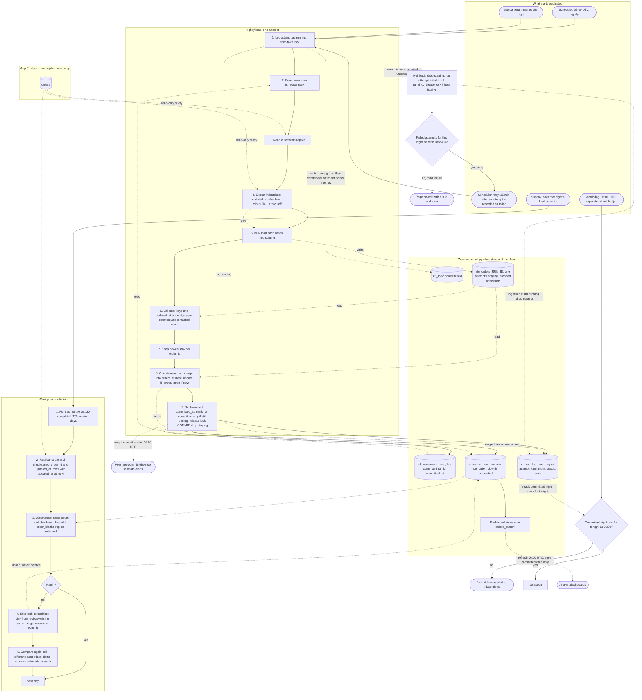

# Nightly orders ETL into the warehouse: pipeline plan

## What this is

Each night at 02:00 UTC, a job copies the `orders` table from the app's Postgres read replica into the warehouse table `orders_current`. That table holds one row per order: its latest version, with an `is_deleted` flag. The job never writes to the app database. All of its bookkeeping lives in the warehouse.

The job keeps a high-water mark (hwm) in the warehouse. The hwm is the cutoff of the last night that committed. Each night the job reads the rows changed since the hwm minus 2 hours, up to a cutoff. It stages them, checks them, keeps the newest version of each order, and merges them into `orders_current`. The hwm moves in the same warehouse transaction as the merge, so it moves only when that night's data commits.

The flow, start to finish: take the lock, read the hwm and the cutoff, extract, stage, validate, keep the newest row per order, merge, and commit. The commit moves the hwm, marks the attempt committed and releases the lock.

Why it is shaped this way: a bulk import can make a row visible up to 90 minutes after its `updated_at`. So the job reads 2 hours further back than the hwm. Some rows are therefore read twice. That is safe, because the merge replaces a stored row only with a newer one. Rows that become visible even later than the overlap are caught by a weekly reconciliation against the replica.

## Terms

- **Replica**: a read-only copy of the app's Postgres database. The job reads only from it.
- **Warehouse**: the analytics database. All pipeline state and all loaded data live here.
- **Warehouse session**: one connection to the warehouse. Ending a session rolls back any transaction it has open.
- **Scheduler**: the service that starts each attempt (the 02:00 run, retries and manual reruns). It enforces the attempt timeout, owns the retry timer and keeps the night for each retry.
- **Watchdog**: a separate scheduled job that runs at 06:00 UTC and checks whether tonight's load committed. It runs even if the pipeline hangs.
- **Attempt timeout**: the longest one attempt may run, counting its wait for the lock. Its length is not set yet (see Open questions).
- **updated_at**: the time the app last wrote an order row. It is set when the row is written, not when the transaction commits. Every write sets it, and a delete is a write.
- **deleted_at**: set when the app soft-deletes an order. The app never removes rows.
- **Bulk import**: a large app write whose transaction can stay open for up to 90 minutes. Its rows become visible on the replica up to 90 minutes after their `updated_at`.
- **Lookback**: the 2-hour overlap before the hwm. It covers bulk-imported rows that become visible late.
- **hwm (high-water mark)**: the cutoff of the last committed night. The next window starts from it. It is stored in `etl_watermark`.
- **Replay timestamp**: `pg_last_xact_replay_timestamp()`, a replica function. It gives the commit time of the last transaction the replica has applied.
- **Cutoff**: the replay timestamp, read from the replica at step 3. It is the upper bound of the window.
- **Window**: the rows one attempt extracts. Their `updated_at` is after the hwm minus 2 hours, and up to the cutoff.
- **Night**: the UTC date of its 02:00 scheduled start. All attempts for that night are counted together.
- **Attempt**: one run of the load. A night has at most three failed attempts before on-call is paged.
- **Run id**: a unique id for one attempt.
- **Pipeline lock**: one row, in `etl_lock`. Its **holder** is the run id of the only attempt allowed to load. The holder is empty when the lock is free.
- **Conditional write**: a write that changes a row only if a stated condition is true. The database checks the condition and makes the change in one step, so two attempts cannot both succeed.
- **Staging**: `stg_orders_RUN_ID`, a temporary table for one attempt. It holds that attempt's extract and is dropped when the attempt ends.
- **Bulk load**: a warehouse command that writes many rows at once. The tool is not chosen yet (see Open questions).
- **Merge**: an upsert keyed on `order_id`. An upsert updates a row if it exists and inserts it if not. Here it updates a matching row only when the incoming `updated_at` is newer.
- **Warehouse transaction**: the writes that commit or roll back together. It opens at the start of step 8 and ends at the COMMIT in step 9.
- **etl_watermark**: one row with `hwm`, `last_committed_run_id` and `committed_at`.
- **etl_run_log**: one row per attempt, with its kind, night, run id, status (`running`, `committed` or `failed`) and error. Kind is `night` for a load attempt or `reconcile` for a reconciliation day. A row can also record an anomaly.
- **Anomaly**: a logged warning that two rows have the same `updated_at` but different content.
- **Checksum**: one number computed from many rows, so two sets of rows can be compared without copying them.
- **Dashboard views**: the analyst views over `orders_current`. They refresh at 06:00 UTC.
- **On-call**: the engineer paged when a problem needs a person.

## Diagram

**Notes on the diagram.** Solid arrows show the order of steps. Dotted arrows show reads and writes. Nothing is written to the app database. All pipeline state lives in the warehouse. Dashboards read only committed data, so they see all of a night or none of it. The watchdog checks `etl_run_log`, not `committed_at`, so a rerun for an earlier night cannot pass tonight's check. Reconciliation rows are logged in `etl_run_log` with kind `reconcile`. The timeout path is described in "Stopping an attempt that times out".

## How one night's load works

Each step says what starts it, what it does, which data it keeps, and what happens when it fails. The job itself runs steps 1 to 9. Any error in those steps fails the attempt. The failure path is in the failure table.

1. **Log the attempt, then take the lock.**
   - *Starts when:* the scheduler starts an attempt. That is 02:00 UTC, a retry, or a manual rerun. All three use this same entry point.
   - *What it does:* first writes an `etl_run_log` row with kind `night`, status `running`, its night and its run id, committed at once. The row comes first so that an attempt that waits, times out or dies is still visible. Then it runs one conditional write: it sets `holder` in `etl_lock` to this run id, but only where `holder` is empty. If one row changed, the lock is taken and the attempt goes on. If no row changed, another attempt holds the lock. This attempt then waits and runs the same conditional write again once a minute. The lock stops two attempts from loading at once.
   - *Data kept:* `etl_lock` and `etl_run_log`.
   - *If it goes wrong:* if the attempt timeout passes while it waits, the attempt counts as failed and the stopping steps run. The wait counts toward the timeout (see Lock).

2. **Read the hwm.**
   - *Starts when:* step 1 is done.
   - *What it does:* reads `hwm` from `etl_watermark`. On the first run there is no hwm (see First run).
   - *Data kept:* none. The value is held for this attempt only.
   - *If it goes wrong:* the attempt fails.

3. **Read the cutoff.**
   - *Starts when:* step 2 is done.
   - *What it does:* reads `pg_last_xact_replay_timestamp()` from the replica. This is the cutoff, the upper bound of the window. The cutoff is the replay time, not the wall clock, because the wall clock can run ahead of the replica. A row that has committed but is not yet replayed could then be skipped.
   - *Data kept:* none.
   - *If it goes wrong:* a null cutoff fails the attempt.

4. **Extract.**
   - *Starts when:* step 3 is done.
   - *What it does:* the job reads from the replica the rows with `updated_at` after hwm minus 2 hours and up to the cutoff. It reads in batches, ordered by `updated_at` and then `order_id`. One read returns one row per order, so duplicates appear only across batches: a row can change between two batches and come back twice. Step 7 handles that. Rows that an earlier night already loaded also come back. The merge in step 8 leaves them unchanged.
   - *Data kept:* none. The replica is read only.
   - *If it goes wrong:* the attempt fails.

5. **Bulk load into staging.**
   - *Starts when:* each batch is read in step 4.
   - *What it does:* the job passes each batch to the warehouse bulk-load facility, which writes it into `stg_orders_RUN_ID`. Staging holds the whole extract before anything touches `orders_current`. That lets validation reject a bad extract before the merge.
   - *Data kept:* the staging table, for this attempt only. These writes commit on their own, outside the warehouse transaction.
   - *If it goes wrong:* the attempt fails. Staging is dropped in the failure path.

6. **Validate.**
   - *Starts when:* the last batch is staged.
   - *What it does:* checks that `order_id` and `updated_at` are not null, and that the staged count equals the extracted count.
   - *Data kept:* none extra.
   - *If it goes wrong:* a failed check fails the attempt before any merge. Nothing reaches `orders_current` or the hwm.

7. **Keep the newest row per order_id.**
   - *Starts when:* step 8 opens the warehouse transaction. This step is its first part.
   - *What it does:* keeps, for each `order_id`, the row with the highest `updated_at`. If two rows tie, a row hash decides, so the choice is always the same. If the tie has different content, it logs an anomaly in `etl_run_log`. This step is needed because a merge fails when two source rows match one target row.
   - *Data kept:* none.
   - *If it goes wrong:* the transaction rolls back.

8. **Merge into orders_current.**
   - *Starts when:* step 7 hands over the newest rows. This step opens the warehouse transaction.
   - *What it does:* merges into `orders_current` on `order_id`.
     - A matched row is updated only when the incoming `updated_at` is strictly newer. `is_deleted` is set from `deleted_at IS NOT NULL`.
     - An unmatched row is inserted.
     - A soft delete is a write that bumps `updated_at`, so it follows the same rule. The row stays, flagged `is_deleted`.
     - An older bulk-imported version cannot overwrite a newer one that was loaded earlier.
     - Re-running a window is a no-op for unchanged rows.
   - *Data kept:* `orders_current`, uncommitted until step 9.
   - *If it goes wrong:* the transaction rolls back.

9. **Commit.**
   - *Starts when:* step 8 finishes without error.
   - *What it does:* in one warehouse transaction it finishes the merge, sets `hwm = cutoff` and `committed_at`, sets `last_committed_run_id`, and marks this attempt's run log row `committed`, but only if that row still says `running`. It then clears the holder of `etl_lock` only where it equals this run id, and COMMITs. The merge, the watermark and the run log commit together, so the hwm moves only with the data it covers. If the run log row no longer says `running` (the scheduler has already recorded the attempt as failed), no row changes, the transaction rolls back, and the attempt fails. After a successful COMMIT, staging is dropped. If the commit is after 06:00 UTC, the job posts a late-commit follow-up to #data-alerts.
   - *Data kept:* `orders_current`, `etl_watermark`, `etl_run_log`.
   - *If it goes wrong:* if the COMMIT fails, the transaction rolls back and the attempt fails.

## Stopping an attempt that times out

This runs when an attempt reaches the attempt timeout with no end recorded, or when its host dies. The scheduler does these steps in this order:

1. Sets the attempt's run log row to `failed` with the error "attempt timeout", but only where the row still says `running`.
2. Stops the job process and ends the job's warehouse sessions. Ending a session rolls back any transaction it has open.
3. Clears the lock, only where `holder` equals this run id.
4. Waits 15 minutes, then starts the retry.

Why this order makes the commit safe. Step 1 is a conditional write, and step 9 also requires the row to say `running`, inside the same transaction. The database lets only one of the two win:

- If the commit won, the row says `committed`. The scheduler sees a finished attempt, counts no failure and does not retry.
- If the scheduler won, the commit's status update matches no row, so the whole commit rolls back. The hwm does not move, and the run log says `failed`, never `committed`.

Once step 1 has recorded `failed`, the stopped job cannot merge or move the hwm. Its staging writes use its own run id, which the retry does not use, and staging is dropped. If the host is unreachable so that steps 2 and 3 cannot run, the lock stays set. This is the same as the host-dies case.

## Rules the steps rely on

**Window and why there is no gap.** Replay applies commits in commit order. So every transaction committed at or before the cutoff is visible on the replica. A row that is not yet visible at read time committed after the cutoff. Its `updated_at` is at most 90 minutes before its commit time. So its `updated_at` is later than the cutoff minus 90 minutes. That is inside the 2-hour lookback, so the next run picks it up. Replica lag therefore does not open a gap.

Two risks remain. A transaction open longer than 90 minutes breaks this bound. App clocks that drift from the database clock can also break it. The Sunday reconciliation is the backstop for both. This reasoning is analytical. It has not been tested against a live replica.

Two other cases:
- A replica that is far behind has an old cutoff. The window moves less, and the run does not wait.
- On a quiet primary the replay timestamp can stay old. The window then stops moving, but nothing is lost.

**Lock.** The lock is one row, so only one attempt loads at a time. The take-lock write is conditional, so the database lets exactly one attempt set the holder. The competitors are the 02:00 run, retries, manual reruns and the Sunday reconciliation. The lock is released at commit, or by the stopping steps (or the failure path) only for the run id that holds it. It has no expiry. If it cannot be released, on-call clears it by hand.

The wait for the lock counts toward the attempt timeout. The timeout starts at step 1, so the scheduler keeps one clock per attempt. A waiting attempt usually finds another attempt still running: the 02:00 run during a manual rerun, an overlapping retry, or the reconciliation. A scheduled retry normally finds the lock free, because the failed attempt has released it.

**Retry and counting.**
- Each attempt starts from the same hwm, so a retry covers the same window and leaves no gap.
- The scheduler owns the retry timer, not the job. It starts each attempt and waits for it to end.
- The scheduler learns an attempt has ended from that attempt's `etl_run_log` row, which the attempt sets to `committed` or `failed`. If no end is recorded before the attempt timeout, it follows the stopping steps above.
- It starts the next attempt 15 minutes after the `failed` status is recorded.
- If the host dies, the scheduler sees no end and treats the attempt as timed out. It records the attempt as failed and starts the retry 15 minutes later.
- If attempts fail quickly, they run at 02:00, 02:15 and 02:30.
- The count of failed attempts is the number of `failed` rows with kind `night` in `etl_run_log` for the same night. Fewer than three means retry. The third failure pages on-call.
- The scheduler keeps the night with each retry and passes it to the new attempt, which writes it into its run log row. A retry therefore copies the night of the attempt that failed.

**Manual reruns.**
- A manual rerun uses the same entry point and the same lock as any attempt.
- It names its night. The night defaults to the latest 02:00 start. Naming a night only sets which night its failures count toward. It does not reload that night.
- Its window still starts at the current hwm. It re-reads the overlap, and the merge leaves unchanged rows alone.
- A rerun for a night that already committed is allowed and harmless, because the window comes from the current hwm.
- It writes its own `etl_run_log` row with kind `night` and the night it names.
- A failed manual rerun counts toward its night. A manual rerun after the page is allowed. If it fails, on-call is paged again.

**First run.** The first run has no hwm. Its window starts at the configured start date, with no lookback, and ends at the cutoff. It runs as one attempt through steps 1 to 9. Step 9 sets the hwm to the cutoff, as on any night. Its extract can take much longer than an ordinary night, so the attempt timeout must allow for it. The start date is not set yet (see Open questions).

**Dashboards and the 06:00 check.**
- Dashboard views read `orders_current`. It changes only at a commit. So the 06:00 refresh shows the last committed state. If tonight's load is still running or has failed, analysts see the previous committed night. Nothing half-loaded is visible.
- The watchdog runs at 06:00 UTC. It looks in `etl_run_log` for a row with kind `night`, night equal to tonight, and status `committed`. If there is none, it posts a staleness alert to #data-alerts. It does not use `etl_watermark.committed_at`, because any commit sets that, including a rerun for an earlier night.
- A load that commits after 06:00 posts a follow-up to #data-alerts. The job makes this post itself, by comparing its commit time with 06:00 UTC. The follow-up names the night and the commit time. It says dashboards show the data from the next 06:00 refresh.

**Fallback if the warehouse cannot commit a MERGE with a table update.** Build `orders_current_next` from the merge, and swap it in with one atomic rename in the same transaction. The rest of the flow stays the same.

## Weekly reconciliation

It starts after that Sunday night's load commits. The scheduler sees the commit as a `committed` row for that night in `etl_run_log`. Let `H` be the hwm that load committed. If the Sunday load does not commit, the reconciliation waits for the next successful load. The reconciliation does not move the hwm.

Its log is the set of `etl_run_log` rows with kind `reconcile`. Each day it checks gets one row with the day, both counts and checksums, and the result.

1. **Pick the days.** Take each of the last 30 complete UTC creation days, by `created_at`.
2. **Replica side.** Compute a count and a checksum over `order_id|updated_at`, in UTC microseconds, for the day's rows with `updated_at <= H`.
3. **Warehouse side.** Compute the same count and checksum over the same rows. Limit it to the `order_id`s that the replica returned. Without that limit, a row edited after `H` would look like a mismatch. The replica would drop its new version while the warehouse still held the old one.
4. **Compare.** The checksum is the sum, modulo 2^64, of a 64-bit hash of each `order_id|updated_at` string. Both sides compute it the same way. It does not depend on row order. If the day matches, go to the next day. If not, reload it.
5. **Reload the day.** Take the pipeline lock with the same conditional write as step 1. Reload the day's rows with `updated_at <= H` from the replica with the same merge. The merge is an upsert and never deletes. Release the lock at that day's commit. If the lock cannot be taken within the attempt timeout, the reconciliation stops. That day and the later days wait for the next Sunday, and the job alerts #data-alerts.
6. **Compare again.** If the day still differs, alert #data-alerts. The job makes no more automatic reloads.

## What happens when things fail

| Failure | What happens | Who sees it |
| --- | --- | --- |
| Error, validation failure, or attempt timeout in steps 1 to 9 | The scheduler stops the attempt by the stopping steps. Any open warehouse transaction rolls back. Staging is dropped. The run log row is marked failed with the error. The lock is released for this run id, if the host is still alive. The attempt counts toward the three. | The run log. |
| Commit refused because the run log row already says failed | Nothing merges and the hwm does not move. The transaction rolls back. | The run log. |
| Host dies mid-attempt | The scheduler sees no end and treats the attempt as timed out. It records the attempt as failed and starts the retry 15 minutes later. The lock stays set, because the stopping steps could not run. Later attempts wait for the lock, time out and fail. | The run log. On-call clears the lock row by hand after the third failure. |
| Warehouse unreachable when the failure is recorded | The failed row cannot be written, so the attempt is not counted. The retry still starts 15 minutes later from the same hwm. How on-call learns of this case is not decided (see Open questions). | Not decided (see Open questions). |
| First or second failed attempt for a night | The scheduler retries 15 minutes later from the same hwm. | The run log. |
| Third failed attempt for a night | Page on-call with the run id and error. The hwm does not move. | On-call. |
| Manual rerun after a page | Allowed, through the same entry point and lock. If it fails, on-call is paged again. | On-call. |
| Replica cutoff is null | The attempt fails at step 3. | The run log. |
| Replica is far behind | The cutoff is old, the window moves less, and nothing is lost. | Nobody, unless the lag persists. |
| Third failure on one night, then a good night | The next 02:00 run starts from the same hwm, so its window covers the missed period. No manual step is needed. | On-call, who may rerun manually through the same entry point and lock. |
| Night not committed by 06:00 | The watchdog posts a staleness alert. | #data-alerts. |
| Load commits after 06:00 | The job posts a follow-up with the commit time. Dashboards show the data from the next 06:00 refresh. | #data-alerts. |
| Dashboards refresh at 06:00 while a load is running or has failed | Dashboards show the last committed night. | Analysts. |
| Sunday load does not commit | The reconciliation waits for the next successful load. | The run log. |
| Rows visible later than the lookback covers, a long transaction, or clock skew | The Sunday reconciliation finds the mismatch and reloads that day. | The reconciliation rows in the run log. |
| Reconciliation cannot get the lock | It stops. That day and later days wait for the next Sunday. | #data-alerts. |
| A day still differs after reload | Alert #data-alerts. No more automatic reloads. | #data-alerts. |

## Build and rollout

Assumptions to confirm:

- `orders` has `created_at` (needed for creation-day reconciliation), `deleted_at`, and a non-null `updated_at` that is set on every write. `orders_current` keeps `created_at` too.
- The app database is PostgreSQL, so the replica exposes `pg_last_xact_replay_timestamp()`.
- The warehouse supports a multi-statement transaction with MERGE. If not, use the swap fallback above.
- The warehouse supports a conditional write that reports how many rows it changed, for the lock.
- App and database clocks are synchronized to within a few minutes.
- Bulk-import transactions stay open for at most 90 minutes.
- The window reasoning is analytical and has not been tested against a live replica.

## Open questions

- How long is the attempt timeout? It is not set yet. It must cover the first full extract and the wait for the lock.
- Which warehouse bulk-load tool and file format does step 5 use? The brief does not name one.
- What is the configured start date for the first full extract?
- Do dashboards read live views between 06:00 refreshes, or only at 06:00? The brief says they refresh at 06:00.
- Should a stuck lock expire on its own, or stay a manual on-call fix?
- If the warehouse is unreachable, a failed attempt cannot be logged, so the failure count can be short by one. Should the scheduler keep its own count?
- If the warehouse is unreachable, how does on-call find out? The plan does not say yet.