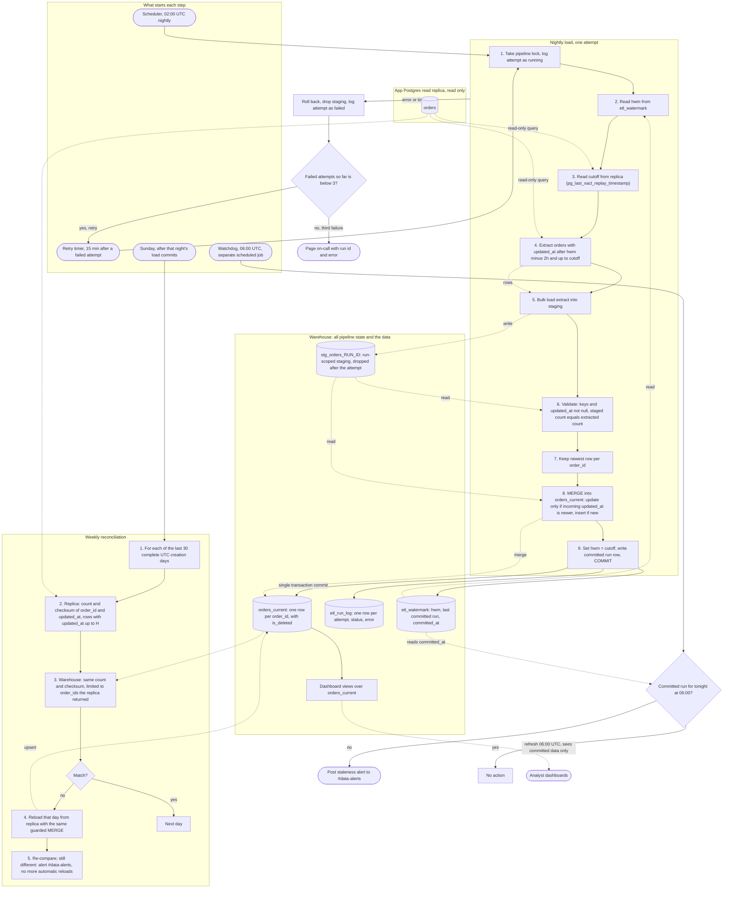

# Nightly orders ETL into the warehouse: pipeline plan

## Diagram

## Notes

**Start and schedule.** The nightly run starts at 02:00 UTC from the scheduler. A retry starts 15 minutes after the failed attempt is logged. The 06:00 watchdog is a separate scheduled job, so it still fires if the pipeline hangs. The weekly reconciliation starts after the Sunday night load commits. If that load does not commit, the reconciliation waits for the next successful load.

**Window and high-water mark.** Each run reads `hwm - 2h` through `cutoff`. The cutoff is the replica's replay timestamp (`pg_last_xact_replay_timestamp()`), not the wall clock, and a null value fails the attempt. Replay order means every transaction committed at or before the cutoff is already visible on the replica. A row not yet visible has an `updated_at` at least 90 minutes before its commit time, so it is later than `cutoff - 90min`, which is inside the 2-hour lookback. Replica lag therefore does not open a gap. The residual risks are a transaction open longer than 90 minutes, which breaks the bound, and app clocks that skew from the database clock. Reconciliation is the backstop for both. On a quiet primary the replay timestamp can stay old. The window then stops moving but nothing is lost. The first run has no watermark, so it does a one-time full extract from a configured start date.

**Staging.** Each attempt creates its own staging table, `stg_orders_RUN_ID`, in the warehouse. Staging is rebuilt on every attempt and dropped afterwards. Validation rejects null keys or timestamps, and it rejects a staged count that differs from the extracted count. Deduplication keeps one row per `order_id`, chosen by the highest `updated_at`, with a row hash as the tie-breaker. An equal `updated_at` with different content is logged as an anomaly.

**Merge.** The merge is keyed on `order_id`. A matched row is updated only when the incoming `updated_at` is strictly newer, and `is_deleted` is set from `deleted_at IS NOT NULL`. An unmatched row is inserted. Because deletes are writes that bump `updated_at`, a soft delete flows through the same rule and the row stays. Re-running a window is a no-op for unchanged rows. An older bulk-imported version cannot overwrite a newer one that was loaded earlier.

**State location.** All state lives in the warehouse. `etl_watermark` holds `hwm`, `last_committed_run_id` and `committed_at`. `etl_run_log` holds one row per attempt, with its status and error. The pipeline lock is a row in the warehouse too. The app database is read only.

**Atomic visibility.** The merge, the watermark update and the run-log commit happen in one warehouse transaction. Dashboards read committed state only, so they never see a half-loaded night. If the warehouse cannot commit a MERGE together with a table update, build `orders_current_next` from the merge and swap it in with one atomic rename in the same transaction.

**Failure, retry and alerts.** Any error or timeout rolls back the transaction, drops staging, and logs the attempt as failed. Each attempt starts from the same `hwm`, so a retry covers the same window and leaves no gap. Attempts run at 02:00, 02:15 and 02:30 if each fails quickly. A hung attempt is cut by an attempt timeout, and the next attempt waits for the lock. After the third failed attempt the on-call page goes out with the run id and error. At 06:00 the watchdog checks `etl_watermark.committed_at` for a commit since 02:00. If there is none, it posts a staleness alert to #data-alerts. A load that commits after 06:00 is visible at the next dashboard refresh, and the alert needs a follow-up message in the same channel. Manual reruns use the same entry point and the same lock.

**Reconciliation (Sunday).** Let `H` be the high-water mark committed by that night's load. For each of the last 30 complete UTC creation days, the replica and the warehouse each compute a count and an order-independent checksum over `order_id|updated_at` in UTC microseconds, using rows with `updated_at <= H`. For example, the checksum is the sum of a 64-bit hash of each string, modulo 2^64, computed the same way on both sides. The warehouse side is limited to the `order_id`s the replica returned. Without that limit, a row edited after `H` would look like a mismatch: the replica would drop its new version while the warehouse still held the old one. A mismatched day is reloaded from the replica with the same guarded MERGE, which is an upsert and never deletes. The day is then compared again. If it still differs, the job alerts #data-alerts and does not reload again automatically. The reconciliation does not move the watermark.

## Assumptions to confirm

- `orders` has `created_at` (needed for creation-day reconciliation), `deleted_at`, and a non-null `updated_at` that is set on every write.
- The app database is PostgreSQL, so the replica exposes `pg_last_xact_replay_timestamp()`.
- The warehouse supports a multi-statement transaction with MERGE. If not, use the swap fallback above.
- App and database clocks are synchronized to within a few minutes.
- Bulk-import transactions stay open for at most 90 minutes.
- The reasoning in the window section is analytical and has not been tested against a live replica.