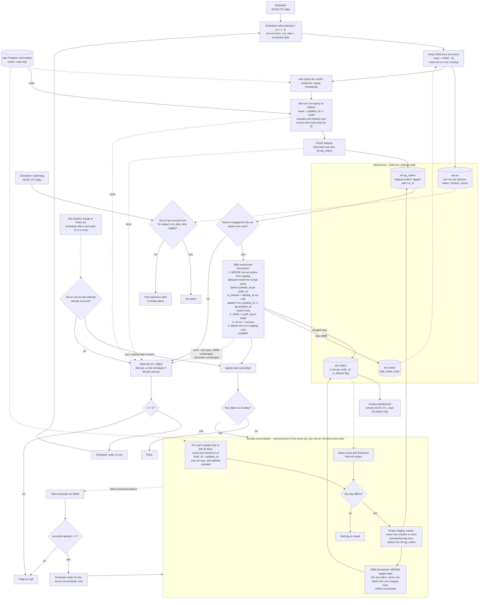

# Nightly orders ETL into the warehouse

This job copies the app's `orders` table into the analytics warehouse every night and keeps the copy correct when rows arrive late or change after export. There is no such job today. Every night the scheduler starts a load at 02:00 UTC. The load reads rows changed since the last successful run from the app's Postgres read replica and puts them in a staging table. It then merges them into the warehouse table in one transaction that also moves the high-water mark. Each night re-reads the last 2 hours, so the same order can arrive twice, and the merge is built so that this is harmless. On Sundays, after the nightly load, a reconciliation compares the last 30 days against the replica and reloads days that do not match. It catches rows that become visible later than the 2-hour overlap covers, for example when the replica falls behind. All pipeline bookkeeping lives in the warehouse, because we have no write access to the app database.

## Terms

- **Replica**: the app's Postgres read replica. We only read from it.
- **Warehouse**: the analytics database. It holds the pipeline's tables and state.
- **`updated_at`**: set to the write time on every write to an order, including soft deletes. It is stamped at write time, not at commit time.
- **Soft delete**: the app never hard-deletes. It sets `deleted_at`, which is also a write, so `updated_at` changes.
- **Bulk import**: an app transaction that can stay open up to 90 minutes. Its rows become visible up to 90 minutes after their `updated_at`.
- **High-water mark (HWM)**: the cutoff of the last successful load. The next load starts from it.
- **Lookback**: the 2 hours subtracted from the HWM when choosing where to start reading. It covers the 90-minute bulk-import delay with margin.
- **Cutoff**: the upper end of one attempt's read window, taken from the replica once per attempt.
- **Attempt**: one try at the nightly load. There are at most 3 per night.
- **Run date**: the UTC date of the scheduled 02:00 start. All attempts of that night keep it, even after midnight.
- **Staging**: `etl.stg_orders`, a scratch table that dashboards never read.
- **Scheduler**: the system that starts the job, kills it on timeout, runs the retries and the watchdog, and pages on-call.
- **Watchdog**: a separate scheduler task at 06:00 UTC that checks whether tonight's load committed.
- **Reconciliation**: the Sunday comparison and reload described below.

## Flowchart

## How it runs

### Tables (all in the warehouse)

- `etl.control`: one row per pipeline: `pipeline` (PK), `high_water_mark timestamptz`, `last_run_id`. The HWM is stored here and nowhere else.
- `etl.run`: one row per attempt: `run_id`, `run_date`, `attempt`, `kind` (nightly or reconcile), `status` (running, success or failed), `window_lower`, `cutoff`, `row_counts`, `error`, timestamps. The scheduler and the watchdog both read it.
- `etl.stg_orders`: same shape as the source plus a `run_id` column. Scratch only.
- `wh.orders`: the target, one row per `order_id`, carrying `is_deleted`. The only table dashboards read. It is only ever changed by the merge transaction.

### What starts what

1. The scheduler starts attempt 1 at 02:00 UTC. This is the only scheduled start of the load.
2. If an attempt fails, the scheduler waits 15 minutes and starts the next one, up to 3 attempts. After the third failure it pages on-call. The scheduler owns the retries and the wait. The job only runs one attempt and exits.
3. The scheduler judges an attempt by its `etl.run` row, not by how the process exited. If the row says `success`, the attempt succeeded, even if the process crashed afterwards: no retry, and the Sunday step proceeds. Otherwise the attempt failed.
4. On timeout the scheduler kills the job process and its warehouse session, and waits until it has ended. It starts attempt n+1 only after attempt n has ended, so two attempts never overlap and a dead attempt cannot merge later. If it cannot confirm the process has ended, it starts no new attempt and pages on-call.
5. At 06:00 UTC the watchdog runs on its own, independent of the retries.
6. When the nightly load has committed and the run date is a Sunday, the job continues into reconciliation. Reconciliation has no clock of its own. If all three nightly attempts fail, it does not run.

### Extract window

1. The attempt inserts an `etl.run` row with status running and reads the HWM. The lower bound is `HWM - 2 hours`.
2. It reads the cutoff once from the replica as `least(now(), pg_last_xact_replay_timestamp())`. If the replica lags, the cutoff is its replay point, so we never claim data the replica has not replayed.
3. The job runs one query, `updated_at > lower AND updated_at <= cutoff`, and counts the rows it reads. Soft deletes are ordinary writes, so they arrive through this query.
4. A failed attempt does not change the HWM. The next attempt reads the same HWM and takes a fresh cutoff. This is safe because the load is idempotent.
5. Rows with `updated_at <= cutoff` that were not yet visible at extract time (bulk imports, up to 90 minutes late) are picked up the next night, because the next lower bound is this cutoff minus 2 hours. Rows later than that are left to Sunday's reconciliation.
6. If the replica has stalled so that its replay point is older than the HWM, the cutoff is below the HWM. The window is small or empty, the load still succeeds, and the HWM does not move, because it only moves forward.

### Staging and merge

1. The job deletes all rows in `etl.stg_orders` (attempts and reconciliation run one at a time, so nothing else uses it), bulk-loads the extracted rows tagged with this `run_id`, and compares the staged row count for this run with the number of rows it read. Zero read and zero staged counts as equal.
2. Dedup is part of the merge query. The merge reads staging through a select that keeps the highest `updated_at` per `order_id` and sets `is_deleted = (deleted_at IS NOT NULL)`. Staging itself is not changed.
3. One warehouse transaction then commits all of the following:
   - `MERGE INTO wh.orders` from that select. When matched and `src.updated_at >= tgt.updated_at`, update. When not matched, insert.
   - `UPDATE etl.control SET high_water_mark = :cutoff WHERE pipeline='orders' AND high_water_mark < :cutoff`. This never moves the HWM backwards.
   - Mark the run `success`.
   - Delete this run's staging rows.

### Why this is safe

- Reprocessing the overlap is harmless. The `>=` guard stops an older version overwriting a newer one, and re-merging an identical version changes nothing. Re-running a night does no harm, and `wh.orders` holds one row per `order_id`, its latest version.
- Dashboards never see a half-loaded night. `wh.orders` changes only in the single merge transaction, so a 06:00 refresh sees the whole night or none of it.
- The HWM advances only if the data loaded, because both commit in the same transaction. An empty extract still advances the HWM to the cutoff.
- Deleted orders are updated in place with `is_deleted = true`, never removed.

### Staleness alert

- At 06:00 the watchdog looks in `etl.run` for a `success` row with `kind = nightly` and `run_date` equal to today's UTC date. If there is none, it posts to #data-alerts. This covers an attempt still running, a failed attempt waiting to retry, and a night out of retries.
- Dashboards refresh at 06:00 regardless and show the previous committed state. Nothing stops an attempt still running at 06:00 except the timeout. If it commits later, the data appears then.
- The on-call page after the third failure is separate. Both can happen on the same night.

### Sunday reconciliation

1. It runs as a second phase of the nightly job, after that night's load committed, with its own `etl.run` row of kind `reconcile`.
2. For each order-creation day (by `created_at`) in the last 30 days, it computes the row count and an order-independent checksum of `order_id` + `updated_at` on both the replica and `wh.orders`. Each side has one row per order, its latest version. Soft-deleted rows are counted like any other, and the checksum uses each row's latest `updated_at` (for a soft-deleted order, the delete time). The checksum is a sum of a hash of the concatenated pair per row, computed identically on both sides.
3. For every day that differs, it empties staging and extracts all rows created that day from the replica into staging, tagged with the reconcile run's id.
4. One transaction merges all mismatched days into `wh.orders` with the same merge rule and deletes the run's staging rows. There is no partially reconciled state. The HWM is not touched.
5. A day can mismatch for two reasons. Real misses are rows that became visible later than the 2-hour overlap covers, such as after replica lag. These are what reconciliation exists to fix. Harmless mismatches are rows written between the nightly cutoff and the reconciliation query. Reloading such a day does no harm, and the next nightly picks up the same rows anyway.

## What happens when things fail

| Failure | Result |
|---|---|
| Extract, staging load or count check fails | Run marked failed. HWM and `wh.orders` unchanged. Scheduler retries after 15 minutes. |
| Merge transaction errors | Rolls back whole. HWM and `wh.orders` unchanged. Same retry. |
| Job hangs or times out | The scheduler kills it, waits for it to end, marks the `running` row failed if the job could not, and retries. |
| Job crashes after the merge committed | The run row says success, so the attempt counts as succeeded. No retry. |
| Job crashes before the merge committed | The run row is not success, so the attempt counts as failed and is retried. |
| Scheduler cannot confirm a killed job has ended | No new attempt starts. On-call is paged. |
| Third nightly attempt fails | Page on-call. Reconciliation does not run. Staleness alert at 06:00 if not committed by then. |
| Reconciliation fails | Assumed: marks the reconcile run failed and reruns only reconciliation, 3 attempts 15 minutes apart, then page. The nightly load is not undone. |
| Replica lags | Cutoff is the replay point, so the window is shorter. The next night's overlap covers the rest. |
| Replica fully stalled (replay point older than the HWM) | Window small or empty. Run succeeds, HWM stays where it is. No alert fires. See open questions. |

## Setup and rollout

- `etl.control` is seeded once with a backfill start time as the HWM.
- The first night loads everything from that time to its cutoff in one query. There is no separate backfill.

## Open questions

- Reconciliation failure policy: the brief is silent. The assumption above (same as nightly) needs confirming.
- Attempt timeout length and typical run time are not known. They decide whether a late attempt can run past 06:00.
- A fully stalled replica gives a "successful" load with no new data, and the watchdog does not notice. Whether to alert on replica lag is not decided.
- The first night's size depends on the seeded backfill start time. If it is too large for one query, a separate backfill would be needed. Not decided.
- Which tool bulk-copies rows from the replica to staging is not chosen.
- Does `orders` have an immutable `created_at`? Assumed yes.
- Does the warehouse support `MERGE` and transactions? Assumed yes.
- Do the replica and the app DB share the same clock source? Assumed yes.
