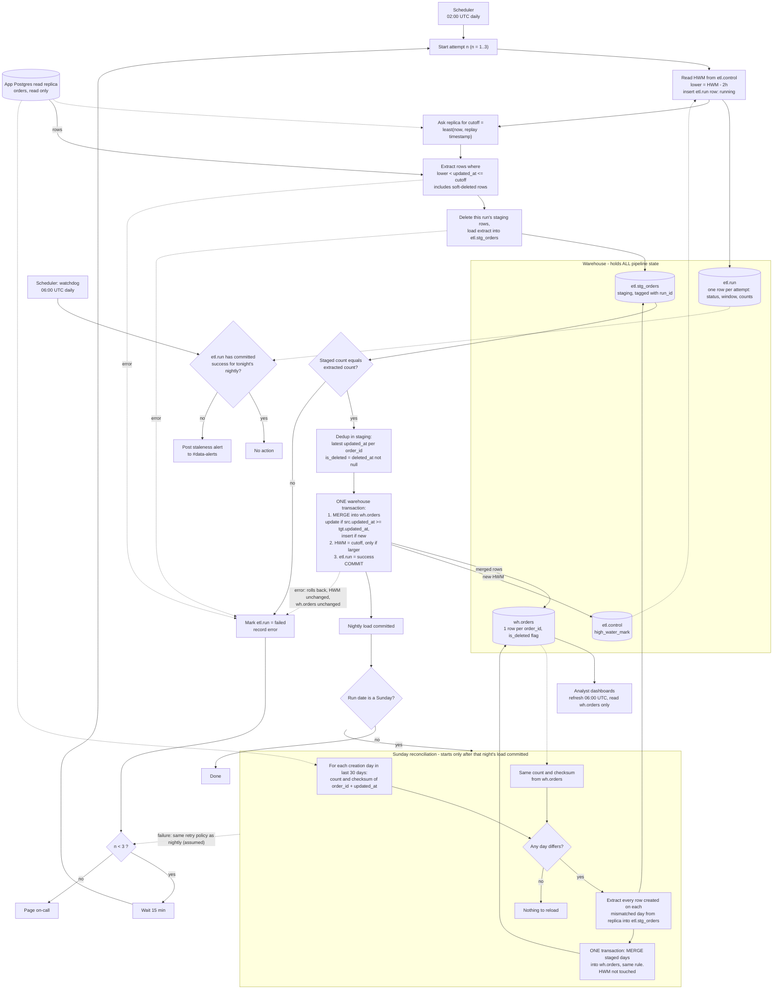

# Nightly orders ETL into the warehouse

## Notes

**What starts what**
- The scheduler starts the load at 02:00 UTC every day. This is attempt 1 and the only scheduled start.
- A failed attempt makes the scheduler start the next one 15 minutes later. There are at most 3 attempts. After the third failure it pages on-call.
- A separate scheduler task fires at 06:00 UTC. It is a watchdog, independent of the retries.
- The Sunday reconciliation is not on its own clock. The nightly job starts it only after its own load has committed, and only when the run date is a Sunday. If all three attempts fail, reconciliation does not run.

**Where state lives (all in the warehouse, since the app DB is read-only to us)**
- `etl.control` has one row per pipeline: `pipeline` (PK), `high_water_mark timestamptz`, `last_run_id`. It is seeded once with the backfill start time. The high-water mark (HWM) is stored here and nowhere else.
- `etl.run` has one row per attempt: `run_id`, `run_date`, `attempt`, `kind` (nightly or reconcile), `status` (running, success or failed), `window_lower`, `cutoff`, `row_counts`, `error`, timestamps. The 06:00 watchdog and the Sunday trigger both read this table.
- `etl.stg_orders` is the staging table. It is the same shape as the source plus a `run_id` column. Each attempt deletes any staging rows for its own run and reloads them from scratch, so a retry never sees leftovers from an earlier attempt.
- `wh.orders` is the target, with one row per `order_id`. It is the only table dashboards read. It carries `is_deleted`.

**Extract window**
- The cutoff is read once per attempt from the replica as `least(now(), pg_last_xact_replay_timestamp())`. If the replica is lagging, the cutoff is the replica's replay point, so we do not claim to have seen data it has not yet replayed.
- The lower bound is `HWM - 2 hours`. This covers the 90-minute bulk-import visibility delay with margin.
- The query is `updated_at > lower AND updated_at <= cutoff`. Soft deletes are ordinary writes, so they arrive through the same query.
- A failed attempt does not change the HWM. The next attempt reads the same HWM and takes a fresh cutoff. The window is re-derived rather than reused, which is safe because the load is idempotent.

**Staging and merge**
1. Extract into `etl.stg_orders` and check the loaded row count against the extracted count.
2. Dedup inside staging, keeping the row with the highest `updated_at` per `order_id`. Set `is_deleted = (deleted_at IS NOT NULL)`.
3. Run one warehouse transaction that does all of the following and then commits:
   - `MERGE INTO wh.orders` using the deduped staging rows. When matched and `src.updated_at >= tgt.updated_at`, update the row. When not matched, insert it.
   - `UPDATE etl.control SET high_water_mark = :cutoff WHERE pipeline='orders' AND high_water_mark < :cutoff`. This is monotonic, so the HWM can never move backwards.
   - Mark the run `success`.

**Why this is safe**
- Reprocessing the overlap is harmless. The `updated_at >=` guard means an older version can never overwrite a newer one, and re-merging an identical version changes nothing. Re-running a night therefore does no harm.
- Dashboards never see a half-loaded night. Staging is a separate table that dashboards do not read, and `wh.orders` changes only in the single merge transaction. A 06:00 refresh sees either the whole night or none of it.
- The HWM advances only if the data loaded. It commits in the same transaction as the merge, so it cannot move without the data and the data cannot land without it. An empty extract still advances the HWM to the cutoff.
- Deleted orders stay in the warehouse. They are updated in place with `is_deleted = true`, never removed.

**Staleness alert**
- At 06:00 the watchdog checks whether `etl.run` has a `success` row for tonight's nightly run. If not, it posts to #data-alerts. This covers an attempt still running, a failed attempt waiting to retry, and a night that is out of retries.
- Dashboards still refresh and show the previous committed state.
- Paging on-call after the third failure is separate from this alert. Both can happen on the same night.

**Sunday reconciliation**
- It runs after Sunday's nightly load has committed.
- For each order-creation day (by `created_at`) in the last 30 days, it computes the row count and an order-independent checksum of `order_id` + `updated_at` on both the replica and `wh.orders`. The checksum is a sum of a hash of the concatenated pair per row, computed identically on both sides.
- Any day whose count or checksum differs is reloaded. That means extracting every row created that day from the replica into staging and merging it with the same merge rule.
- All mismatched days are reloaded in a single transaction, so there is no partially reconciled state.
- Reconciliation does not touch the HWM.
- A day can mismatch only because rows were written between the nightly cutoff and the reconciliation query. Reloading such a day is harmless, and the next nightly picks up the same rows anyway.
- The brief does not say what happens if reconciliation fails. My assumption is that it follows the same policy as the nightly, with 3 attempts 15 minutes apart and then a page. That needs confirming.

**Assumptions to confirm**
- `orders` has an immutable `created_at`.
- The warehouse supports `MERGE` and transactions.
- The replica and the app DB share the same clock source.

## Flowchart

