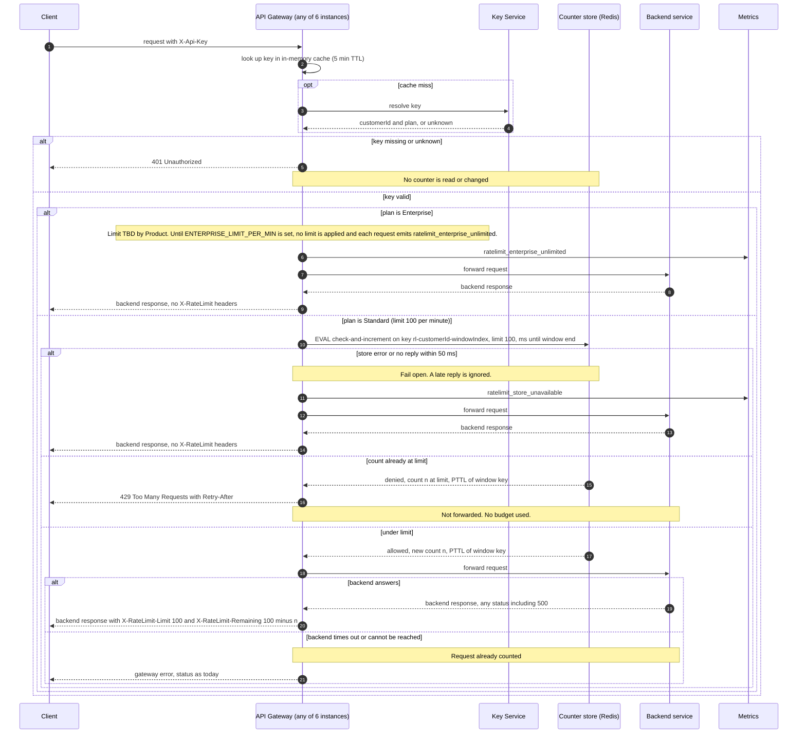

# Per-customer rate limiting for the public API (v1 design)

## What this is

Today every public API request goes to the API Gateway. The gateway runs as 6 stateless instances behind a load balancer, and any instance can take any request. For each request, the gateway reads the `X-Api-Key` header and asks the Key Service to turn the key into a customer ID and a plan (Standard or Enterprise). It caches that answer in memory for 5 minutes. Then it forwards the request to the backend service that owns the route and passes the backend's response back. There is no per-customer limit today.

This change limits each customer, so one noisy customer cannot slow down everyone else. A customer has one budget, shared by all of its keys. Standard customers get 100 requests per minute. The Enterprise limit is not decided yet, so Enterprise is not limited in v1. All six instances count against one shared Redis, so a customer's traffic spread across six instances still counts against one limit.

The main flow: the gateway checks the key first. A missing or unknown key gets 401, and no counter is touched. For a Standard customer, the gateway adds one to the customer's count for the current minute, in one atomic Redis step. If the count is still within 100, the gateway forwards the request and returns the backend's response with rate-limit headers. If the count is already at 100, the gateway returns 429 and does not forward.

The order is fixed for three reasons. Authentication comes first, so bad keys never touch a counter. The count goes up before forwarding, so a request that fails at the backend (for example, with a 500) still uses budget. If the counter store fails or is slow, the gateway forwards anyway, so a counter outage does not take the API down.

## Terms

- **API Gateway**: the 6 stateless instances that receive all public API traffic.
- **API key**: a secret the client sends in the `X-Api-Key` header.
- **Key Service**: the existing service that turns an API key into a customer ID and a plan, or into "unknown".
- **Customer**: the owner of one or more API keys. All keys of one customer share one budget.
- **Plan**: Standard or Enterprise. Each customer has one plan.
- **Key cache**: the gateway's in-memory copy of a key's answer from the Key Service. Entries last 5 minutes. Each gateway instance has its own cache.
- **Counter store**: one shared Redis in the gateway's region. It holds the counts.
- **Window**: a fixed one-minute period, from :00 to :59 of each minute.
- **windowIndex**: the number of whole minutes since the Unix epoch, floor(now / 60 s).
- **Counter key**: `rl-customerId-windowIndex`. Each customer has one per window. It holds one integer.
- **Lua script (EVAL)**: a short program that Redis runs as one step. No other command runs in the middle of it.
- **PTTL**: the time left before a Redis key expires, in milliseconds.
- **Fail open**: when the rate-limit check cannot be done, forward the request anyway.

## Diagram



## How the steps run

1. The client sends a request with `X-Api-Key` to any gateway instance.
2. The gateway looks the key up in its key cache. On a miss, it asks the Key Service. The answer is a customer ID and plan, or "unknown". The key cache keeps the answer for 5 minutes.
3. If the key is missing or unknown, the gateway returns 401. It does not read or change any counter.
4. If the plan is Enterprise, the gateway emits `ratelimit_enterprise_unlimited`, forwards the request, and returns the backend's response with no X-RateLimit headers. This continues until `ENTERPRISE_LIMIT_PER_MIN` is set.
5. If the plan is Standard, the gateway runs the counter script on the customer's counter key. It passes the limit (100) and the milliseconds left in the current window. The counter store keeps the count.
6. If the store errors, or does not reply within 50 ms, the gateway fails open (see Fail open below).
7. If the script denies the request (the count is already at 100), the gateway returns 429 with `Retry-After`. The request is not forwarded.
8. If the script allows the request, the gateway forwards it. When the backend answers with any status, including 500, the gateway returns that response with `X-RateLimit-Limit` and `X-RateLimit-Remaining`.
9. If the backend times out or cannot be reached, the gateway returns its existing error for that case. The request still counts.

## Notes on the diagram

**Store and atomicity.** Counters live in one shared Redis. Each check is one Lua script on one key, so the read, the compare and the increment happen as one step. Six instances cannot overshoot the limit by racing each other. The script sets the expiry in the same step as the first increment. So no key it creates lacks an expiry, even if the gateway gave up before the reply.

```lua
-- KEYS[1] = rl-customerId-windowIndex
-- ARGV[1] = limit (100); ARGV[2] = ms until the window ends
local n = tonumber(redis.call('GET', KEYS[1]) or '0')
if n >= tonumber(ARGV[1]) then
  return {0, n, redis.call('PTTL', KEYS[1])}   -- denied; budget untouched
end
n = redis.call('INCR', KEYS[1])
if n == 1 then redis.call('PEXPIRE', KEYS[1], ARGV[2]) end
return {1, n, redis.call('PTTL', KEYS[1])}     -- allowed
```

The script returns three values: 1 (allowed) or 0 (denied), the count n, and the PTTL of the counter key. A rejected request never increments, so a 429 does not use budget. The increment happens before forwarding, so a backend 500 still counts.

**Window.** The gateway computes windowIndex, and the milliseconds left in the window, from its own clock. It does this on every call and passes both to the script. The script uses the milliseconds only when it creates the key. The key expires when its window ends, so it holds one integer and disappears at that moment. Small clock differences between gateway instances can move a window boundary by that amount. Accepted for v1.

**Retry-After.** Taken from the PTTL of the counter key, rounded up to whole seconds, with a minimum of 1. The PTTL is the time until the current window ends. That is when the next window starts and a new count begins, so the client can send again then. PTTL is measured by Redis, so `Retry-After` does not depend on the gateway instances' clocks. The script denies only when the key already exists, so the PTTL is positive. If it is ever not positive, the gateway sends `Retry-After: 60`.

**Fail open.** The 50 ms deadline covers the whole store call, including waiting for a pooled connection. If the call errors, or has no reply by the deadline, the gateway stops waiting and ignores any reply that arrives later. It emits `ratelimit_store_unavailable`, forwards the request, and returns the backend's response with no X-RateLimit headers, because the remaining count is unknown. The script may still run on Redis and count the request after the gateway gave up. That is acceptable. There is no circuit breaker in v1. Each request tries the store again. So while the store is slow, each request waits up to 50 ms before it is forwarded. Accepted for v1.

**Headers.** Allowed requests carry `X-RateLimit-Limit` (100) and `X-RateLimit-Remaining` (100 minus n, the count after this request). A 429 may also carry `X-RateLimit-Limit` and `X-RateLimit-Remaining: 0`. This is our choice, not a requirement.

**Customer, not key.** The key cache is keyed by API key. Each entry holds the customer ID and plan that the key resolved to. The counter key uses the customer ID, not the API key. So all keys of one customer share one budget.

**Enterprise.** The Enterprise limit comes from the setting `ENTERPRISE_LIMIT_PER_MIN`. It is unset in v1. The gateway treats it as not set when it is empty or absent. While it is not set, Enterprise requests are not limited. Each one emits `ratelimit_enterprise_unlimited`, and responses carry no X-RateLimit headers, because there is no number to report. Once the setting has a number, Enterprise requests use the same check as Standard, with that number.

**Metrics.** A 429 is counted in `ratelimit_denied`, with the plan as a label. Each fail-open request emits `ratelimit_store_unavailable`. An alert on the rate of `ratelimit_store_unavailable` makes fail-open periods visible.

**Settings in v1.**
- Standard limit: 100 requests per minute.
- Store deadline: 50 ms, for the whole store call.
- Key cache lifetime: 5 minutes.
- `ENTERPRISE_LIMIT_PER_MIN`: unset.

## What happens when things fail

| Failure | What the client gets | Counter |
|---|---|---|
| Key missing or unknown | 401 Unauthorized | Not read or changed |
| Key Service error or slow on a cache miss | Not defined in v1 (see open questions) | Not reached |
| Counter store error, or no reply within 50 ms | Backend response, no X-RateLimit headers | May count |
| Over the limit | 429 with Retry-After, not forwarded | Not counted |
| Backend returns 500 or any other status | Backend response, with headers | Counted |
| Backend times out or cannot be reached | Gateway's existing error for this case | Counted |
| Enterprise limit not set | Backend response, no headers | Not used |

## Open questions

- **Enterprise limit: OPEN.** Product has not decided it. Until `ENTERPRISE_LIMIT_PER_MIN` is set, Enterprise is unlimited and emits a metric. This is a temporary gap in the rule that over-limit requests get 429. It is not a chosen limit.
- **Alert owner and threshold: OPEN.** The brief does not say who watches the `ratelimit_store_unavailable` alert, or at what rate it should fire. Decide both before launch.
- **Key Service down or slow on a cache miss: unknown.** The brief does not say what the gateway does today in this case. Confirm with the existing gateway behaviour. Do not assume a 401, a 5xx or a pass-through.
- **Unknown answers in the key cache: unknown.** The brief does not say whether an "unknown" answer from the Key Service is cached. Confirm with the existing gateway behaviour.
- **Client status on backend timeout: unknown.** The status is the gateway's existing error, which the brief does not name.
- **Plan change or revoked key.** The cache holds the customer ID and plan for 5 minutes. A change takes effect when the cached entry expires, up to 5 minutes later. Each instance has its own cache, so instances can switch at different times within those 5 minutes. This is existing cache behaviour, accepted for v1.
- **Fixed-window boundary burst.** A customer can send up to about 200 requests in a few seconds across a window boundary. Accepted for v1. A sliding-window or token-bucket script can replace the Lua body later without changing the gateway's contract.
- **Store failover.** If Redis fails over with asynchronous replication, a few recent increments can be lost. A customer may then get slightly more than 100 in that window. Accepted for v1.