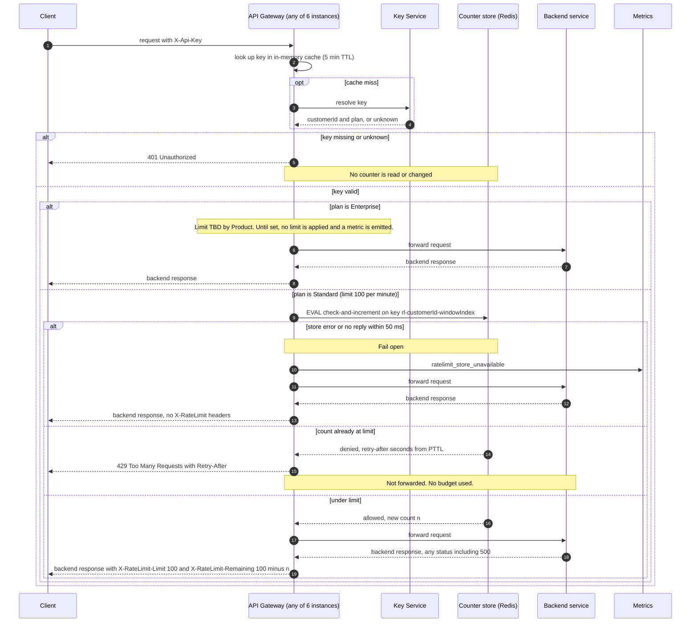

# Per-customer rate limiting for the public API (v1 design)

## Sequence



## Notes on the diagram

**Store and atomicity.** Counters live in one shared Redis (in the gateway's region). Each check is a single Lua script (`EVAL`) on one key, so the read, compare and increment run atomically. Six gateway instances cannot overshoot the limit by racing each other:

```lua
-- KEYS[1] = rl-customerId-windowIndex; ARGV: limit, windowMs
local n = tonumber(redis.call('GET', KEYS[1]) or '0')
if n >= tonumber(ARGV[1]) then
  return {0, n, redis.call('PTTL', KEYS[1])}   -- denied; budget untouched
end
n = redis.call('INCR', KEYS[1])
if n == 1 then redis.call('PEXPIRE', KEYS[1], ARGV[2]) end
return {1, n, redis.call('PTTL', KEYS[1])}     -- allowed
```

A rejected request never increments, which satisfies the rule that 429s do not use budget. The increment happens before forwarding, so a backend 500 still counts.

**Window.** Fixed one-minute windows, one key per customer per window (`rl-customerId-windowIndex`, windowIndex = floor(now / 60 s)). The key expires with its window. Per-key data is one integer, and the script is one round trip.

**Retry-After.** Taken from the store's PTTL for the current window key, rounded up to whole seconds, minimum 1. Using the store's clock avoids depending on the clocks of the six gateway instances.

**Fail open.** The 50 ms budget covers the whole store call, including waiting for a pooled connection. On error or timeout the gateway forwards the request and emits `ratelimit_store_unavailable`. It omits the X-RateLimit headers because the remaining count is unknown. A timed-out script may still run on Redis and count, which is acceptable.

**Headers.** On passed requests, `X-RateLimit-Limit` is the plan limit and `X-RateLimit-Remaining` is limit minus the count after this request. The 429 may also carry `X-RateLimit-Limit` and `X-RateLimit-Remaining: 0` (our choice, not required).

**Authentication first.** The 401 path returns before any store call, so unknown or missing keys never touch a counter.

**Customer, not key.** The key resolves to a customerId, and the counter key uses the customerId. All keys of one customer share one budget.

## Open items and accepted risks

- **Enterprise limit: OPEN.** Product has not decided it. The gateway reads it from config (`ENTERPRISE_LIMIT_PER_MIN`), which is unset in v1, so Enterprise is unlimited and emits a metric until a number is set. This is a temporary gap in requirement 4, not a chosen limit.
- **Fixed-window boundary burst.** A customer can send up to about 200 requests in a few seconds across a window boundary. Accepted for v1. A sliding-window or token-bucket script can replace the Lua body later without changing the gateway's contract.
- **Store failover.** If Redis fails over with asynchronous replication, a few recent increments can be lost, so a customer may get slightly more than 100 in that window. Accepted for v1.
- **Key Service failure.** The diagram covers a cache miss that resolves to a key or to unknown. What happens when the Key Service itself is down is outside this change and should be confirmed with the existing gateway behaviour.
- **Metrics.** Emit a counter for 429s per plan, and an alert on `ratelimit_store_unavailable` rate, so fail-open periods are visible.