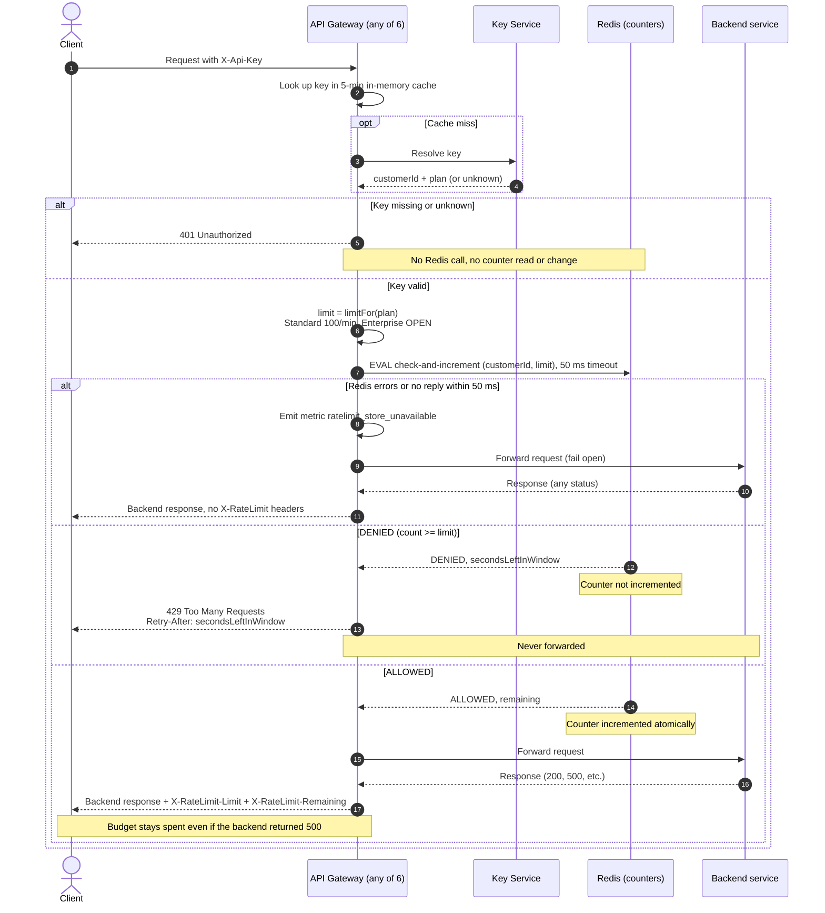

# Per-customer rate limiting on the public API

Today every public request goes through the API Gateway: 6 stateless instances behind a load balancer, any of which can take any request. The gateway reads the `X-Api-Key` header and asks the Key Service which customer and plan the key belongs to. It caches that answer in memory for 5 minutes. It then forwards the request to the backend that owns the route and returns the backend's response.

This change adds a per-customer limit so one noisy customer cannot degrade service for others. The flow is: authenticate the key, ask a shared Redis counter whether the customer still has budget, then either reject with `429` or forward. Redis is shared because otherwise each of the 6 gateways would count separately and give a customer 6x the limit.

## Terms

- **Customer:** the account that owns one or more API keys. Limits belong to the customer, so all of its keys share one budget.
- **Plan:** Standard or Enterprise. It decides the limit. The Key Service returns it with the customer ID.
- **Key Service:** the existing service that turns an API key into a customer ID and plan, or says the key is unknown.
- **Redis:** the shared in-memory store that holds the counters. One instance, with a replica for availability.
- **Lua script:** a small program that Redis runs as one uninterrupted step. Nothing else runs on that Redis in the middle of it.
- **Window:** one clock minute (for example 12:01:00 to 12:01:59). The count resets when a new minute starts.
- **Fail open:** if the counter store is broken, let the request through instead of blocking it.

## Diagram

## Steps in order

1. **Authenticate (diagram steps 1 to 5).** The gateway looks the key up in its own 5-minute cache and asks the Key Service only on a miss. A missing or unknown key gets `401`. The gateway makes no Redis call, so a bad key cannot read or change any counter. If the Key Service errors or times out on a miss, the gateway cannot authenticate, so it returns `503`, does not retry and does not forward.
2. **Cache effects.** A resolved key is trusted for 5 minutes, so a plan change or a revoked key can take up to 5 minutes to take effect. Each gateway has its own cache, so for that time two gateways may hold different limits for one customer. Each call passes its own limit and the script stores none, so each request is judged against its own gateway's limit. This is accepted for v1.
3. **Pick the limit.** The plan decides it from a plan-to-limit config. Standard is 100 per minute. **Enterprise is OPEN: Product has not decided the number.** The config has no Enterprise entry and the code must not guess one. Recommended: a startup check refuses to start the gateway while any plan has no limit, so the gap is caught before launch.
4. **Check and increment (one Lua script on Redis, 50 ms timeout).** Because the script runs as one step, two gateways cannot both take the last slot. The gateway sends only `customerId` and `limit`. The script:
   1. Reads Redis's own clock (`TIME`) and sets `windowStart` to the start of the current clock minute. Gateway clocks are never used, which avoids skew between instances.
   2. Builds the counter key `rl:{customerId}:{windowStart}`. It uses the customer ID, not the API key, so all of a customer's keys share one budget.
   3. Reads the count. A missing key counts as 0, which is the first request of a new window.
   4. If `count >= limit`, returns `DENIED` and the seconds left in the window. It does not increment, so rejected requests use no budget.
   5. Otherwise it runs `INCR`, which creates the key at 1 on the first request. When the new count is 1, the same script sets a 120 s expiry. It returns `ALLOWED` and `remaining = limit - newCount`.
5. **If DENIED.** The gateway returns `429 Too Many Requests` with `Retry-After` and never forwards. `Retry-After` is `windowStart + 60 - now`, computed in the script from the Redis clock, rounded up to whole seconds, minimum 1. It is a plain integer.
6. **If ALLOWED.** The gateway forwards the request. The counter was already incremented and is never rolled back, so the request counts even if the backend then fails. The gateway copies the backend's response and adds `X-RateLimit-Limit` (the limit it sent) and `X-RateLimit-Remaining` (the `remaining` the script returned). Both are plain integers and appear on every response to a request that passed the check, including backend errors. The request that takes the last slot sees `Remaining: 0`, and the next one gets `429`. `401` and `429` responses carry no `X-RateLimit-*` headers. No reset-time header is added, since the brief does not ask for one.
7. **If Redis fails (fail open).** On an error or no reply in 50 ms, the gateway forwards the request, emits the `ratelimit_store_unavailable` metric, and adds no `X-RateLimit-*` headers, because the remaining count is unknown and a made-up value would mislead. The response otherwise looks normal. It does not retry. If Redis ran the script just before the timeout, that one increment stays counted. This small overcount is accepted.

## When things fail

| What fails | What happens |
|---|---|
| Key missing or unknown | `401`, no counter touched |
| Key Service down or slow on a cache miss | `503`, not forwarded, no retry |
| Redis error or no reply in 50 ms | Forwarded, metric emitted, no rate-limit headers, no retry |
| Over the limit | `429` with `Retry-After`, not forwarded, no budget used |
| Backend returns 500 | Passed through with headers, request stays counted |
| Backend refuses or resets the connection | `502` with headers, request stays counted, no retry |
| Backend gives no answer in time | `504` with headers, request stays counted, no retry |
| Redis loses its keys (for example a restart) | Customers briefly get a fresh budget |

The gateway's existing backend timeout is unchanged. Backend requests are not retried because a retry could repeat a non-idempotent request.

## Known trade-offs (v1)

- **Window-edge burst:** a fixed window allows up to 2x the limit across a boundary, for example 100 requests at 12:00:59 and 100 more at 12:01:00. A sliding window would fix it at higher cost, so it is left out of v1.
- **Fail-open window:** while Redis is down, limits are not enforced. The metric should alert on-call.
- **Latency:** every authenticated request adds one Redis round trip, capped at 50 ms.

## Open questions

- **Enterprise limit:** TBD by Product. Decide before launch whether a plan with no configured limit is unlimited (skip Redis) or blocks startup. Recommended: block startup. Until a number is set, no Enterprise traffic can be served.
- **Key Service outage:** `503` with no retry is my choice, not from the brief. Confirm it. The Key Service timeout is not known: reuse the timeout of the gateway's existing Key Service call and confirm the value.
- **Backend failure codes:** `502` and `504` are my choice, not from the brief. Confirm them.
- **Unknown keys in the cache:** it is not known whether the existing cache also stores "unknown key" answers. If it does not, a flood of bad keys reaches the Key Service on every request.
- **Redis failover:** it is not decided whether the replica takes over automatically or how. Replication may lose the latest increments, which has the same effect as lost keys (a brief fresh budget).
- **Alerting:** no alert on `ratelimit_store_unavailable` is known to exist, and no owner is named. Someone must set one up and own it before launch.
