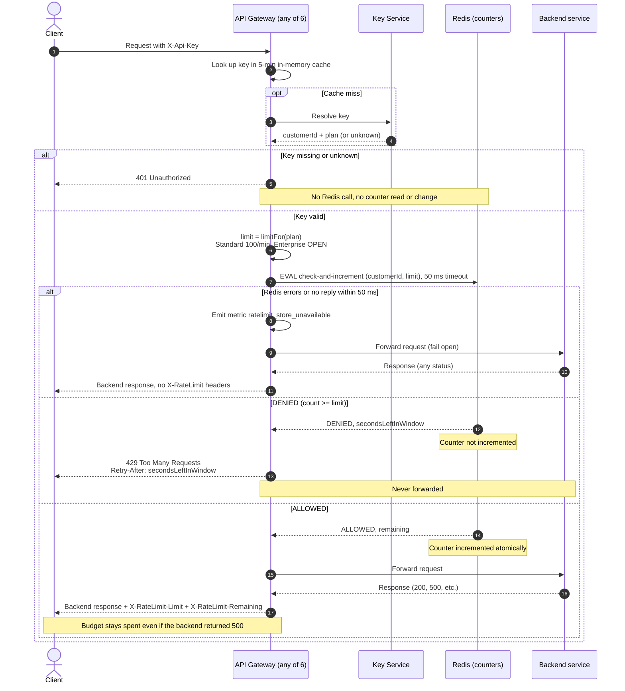

# Per-customer rate limiting on the public API

## Decisions

- **Store:** Redis, one shared instance (primary plus replica for availability). All 6 gateway instances use the same counters, so a customer's traffic spread over instances cannot exceed the limit (req 7).
- **Window:** fixed one-minute window, aligned to the clock minute. The counter key is `rl:{customerId}:{windowStartEpochSeconds}`, and it expires after 120 s. The key uses the customer ID, not the API key, so all of a customer's keys share one budget (req 1).
- **No overshoot:** the gateway runs a single Lua script on Redis. Redis runs scripts one at a time, so the check and the increment happen as one atomic step. Concurrent requests on different instances cannot both take the last slot. The script does the following:
  1. Read the current count, using the Redis server clock (`TIME`) to pick the window.
  2. If `count >= limit`, return `DENIED` and the seconds left in the window. It does **not** increment, so 429s use no budget (req 4).
  3. Otherwise `INCR`, set the expiry on the first hit, and return `ALLOWED` with `remaining = limit - newCount`.
- **Retry-After:** `windowStart + 60 - now`, computed inside the script from the Redis clock. This avoids clock skew between gateways. The value is rounded up to whole seconds, with a minimum of 1.
- **Limit source:** the plan from the cached Key Service answer. Standard is 100 per minute. **Enterprise is OPEN: product has not decided the number.** The gateway reads the limit from a plan-to-limit config, and Enterprise has no value there yet. See the open question below.
- **Fail-open:** the gateway calls Redis with a 50 ms timeout. On an error or timeout, it forwards the request, emits the `ratelimit_store_unavailable` metric, and adds **no** `X-RateLimit-*` headers. The remaining count is unknown, and a made-up value would be misleading. The response otherwise looks like a normal one.

## Diagram

## Notes

- **Order of checks (req 3):** authentication happens first. The 401 branch never reaches Redis, so a bad key cannot read or change any counter.
- **Backend failures (req 5):** the counter is incremented before forwarding and is never rolled back. A 500 from the backend is passed through with the rate-limit headers, and the request stays counted.
- **Headers (req 6):** `X-RateLimit-Limit` is the plan limit. `X-RateLimit-Remaining` is `limit - count` after this request's increment. Both appear on every response to a request that passed the check, including backend errors. They do not appear on 401 or 429 responses. A fail-open response also omits them, as explained under Decisions.
- **Plan changes:** the plan comes from the 5-minute Key Service cache. A plan upgrade or downgrade can take up to 5 minutes to affect the limit. This is accepted for v1.

## Known trade-offs (v1)

- **Window-edge burst:** a fixed window allows up to 2x the limit across a window boundary. For example, 100 requests at 12:00:59 and 100 more at 12:01:00. A sliding window would fix this at higher cost. It is out of scope for a first version.
- **Fail-open window:** while Redis is down, limits are not enforced. The metric should alert on-call. If the counter keys are lost (for example, a Redis restart), customers briefly get a fresh budget.
- **Latency:** every authenticated request adds one Redis round trip, capped at 50 ms by the timeout.

## Open question

- **Enterprise limit:** TBD by Product. Until it is set, the plan-to-limit config has no Enterprise entry, and the code must not default it to a guess. Decide before launch whether an Enterprise customer with no configured limit is treated as unlimited (skip the Redis call) or rejected at startup by a config check. I recommend the startup check, so a missing number is caught before launch.
