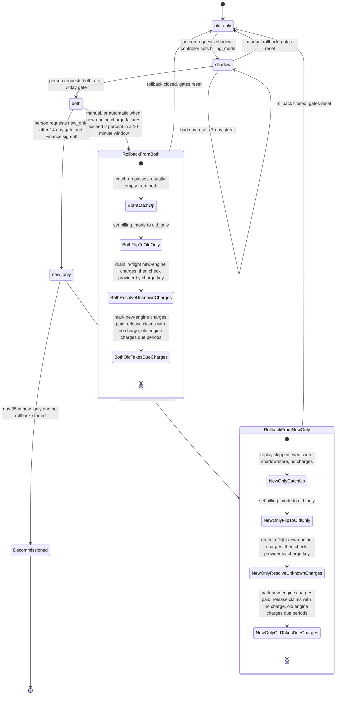

# Billing engine rollout: state machine

## Summary

Today the old billing engine does all the billing work. It reads usage events from the usage event log, computes invoices, writes them to the billing ledger, and charges customers through the payment provider.

We are replacing it with a new engine. The switch is gradual and reversible. It must never charge a customer twice for a billing period, and it must never drop a charge that is due.

The switch runs through four modes, chosen by one config flag, `billing_mode`: `old_only`, `shadow`, `both` and `new_only`. The rollout starts in `old_only`. Each forward move goes one step in that order, and no mode is skipped. A person asks for the next mode through the rollout controller. The controller checks that the request is the next mode and that its gate is met. It writes the flag only if both checks pass.

In `shadow`, the new engine runs without charging, and each night its invoices are compared with the old engine's. In `both`, the new engine charges, and the old engine keeps computing invoices so it stays ready. In `new_only`, the old engine stops.

Rollback can start from `shadow`, `both` or `new_only`. It always ends in `old_only`, and it resets the gates. Each charge is claimed by one engine only, in a row in the ledger's database. That claim stops a double charge, including during a mode change or a rollback. A rollback then lets the old engine charge every period that is due and not yet charged.

The rollout controller is not built yet. This document is the model it will be built from.

## Terms

- **Usage event log.** Keeps usage events for 35 days. Both engines read from it.
- **Skipped events.** Usage events that arrived while the rollout was in `new_only`. The old engine never computed their invoices.
- **Billing ledger.** The system of record for charges. Its database also holds the charge claims.
- **Shadow store.** A store separate from the ledger. It holds the new engine's invoices, and from `both` on, the old engine's invoices too.
- **Config service.** Holds `billing_mode`. Workers read it before each charge decision.
- **billing_mode.** The one flag that selects the mode.
- **Payment provider.** Charges customers. It takes an idempotency key. For a key it has already seen, it returns the first result and does not charge again.
- **Invoice mismatch.** For one customer, the two engines' totals differ by more than 1 cent, or an invoice exists in one engine but not the other. Totals are compared in integer cents.
- **Mismatch rate.** The share of one day's compared invoices that are mismatches.
- **Gate.** The conditions a forward move must meet. The controller checks them and records the result.
- **Charge key.** The customer and the billing period. Both engines use the same key. It is sent to the provider as the idempotency key.
- **Charge claim.** A row in the ledger's database, keyed by the charge key. Its state is `claimed`, `charged` or `released`. The key has a unique constraint, so only one insert succeeds. Rows are never deleted.
- **Unknown charge.** A charge whose result is not known, because it timed out or its worker crashed. Its claim stays `claimed`.
- **Held period.** A period with an unknown charge that no provider check has settled. Neither engine charges it.
- **Paid.** A period whose claim is `charged` and whose charge is in the ledger.
- **Due period.** A period that the existing billing schedule marks to be charged. The brief does not define "due", so this is assumed.
- **Drain.** Waiting until no new-engine charge is between its mode check and its outcome.
- **Catch-up.** The old engine computes usage events it has not yet computed, into the shadow store, without charging. It runs in passes, as described under Rollback from new_only.
- **Replay.** A catch-up run from `new_only`. It covers the skipped events.
- **Rollout controller.** The service that checks gates, records them, writes `billing_mode` after a valid move, measures the new engine's charge failure rate, and runs the rollback steps.
- **Rollout record.** An append-only log of gate counts, comparison results, approvals and rollback steps. This is a proposal, to confirm.

## Diagram

## Notes on the diagram

### What each mode does

- **old_only (start).** The old engine reads usage events, computes invoices, writes the ledger and charges customers. The new engine is off.
- **shadow.** The old engine is unchanged. It still charges and writes the ledger. The new engine reads the same usage events and writes its invoices to the shadow store. It never charges and never writes the ledger. It writes no claims, because it stops at the mode check before any charge. A nightly job compares the two engines' invoices per customer. The old invoice is read from the ledger and the new one from the shadow store. New-engine errors are recorded but never start a rollback.
- **both.** The new engine charges and writes the ledger. The old engine stops charging but keeps computing every invoice into the shadow store, so it stays current. The nightly comparison continues. It reads the new invoice from the ledger and the old one from the shadow store.
- **new_only.** The new engine does everything. The old engine stops computing. Usage events keep arriving in the log. They are the input for any rollback until day 35. The 35-day clock starts when the rollout enters `new_only`.
- **Decommissioned.** Reached at day 35 in `new_only` if no rollback has started. From here there is no way back to `old_only`.

The nightly job only reports. It never changes a charge.

### Where the rollout state lives

- **billing_mode in the config service.** The only rollout switch and the one source of truth for which engine is in charge. Workers read it before each charge decision.
- **Usage event log.** The input to both engines. It is also the source for the replay from `new_only`.
- **Shadow store.** Kept separate from the ledger. It holds the new engine's invoices, and from `both` on, the old engine's invoices.
- **Billing ledger.** The system of record for charges and charge claims. In `shadow`, it also holds the old engine's invoices, because the old engine charges from them.
- **Rollout record (proposal, to confirm).** Gate counts, comparison results, approvals and rollback history are not in the brief. The plan keeps them in an append-only record next to the comparison results.

## Steps

### Moving forward

Each forward move is one step, and a person asks for it by submitting the next mode through the rollout controller. The controller refuses any value that is not the next mode, and any move whose gate is not met. A refused move leaves `billing_mode` unchanged. The gates only report eligibility. The controller writes the flag only after a valid move.

1. **old_only to shadow.** Starts when a person requests `shadow`. There is no gate. The controller records the request and writes `billing_mode`. The new engine then starts reading usage events and writing invoices to the shadow store. If the config write fails, the mode stays unchanged and the move is not recorded as done.
2. **shadow to both.** Starts when a person requests `both`. The gate needs 7 consecutive days, each with a mismatch rate under 0.1 percent, and at least 5,000 invoices compared in total over those days. A day at or above 0.1 percent resets the streak. A day with no complete comparison does not count. The controller records each day's counts.
3. **both to new_only.** Starts when a person requests `new_only`. The gate needs 14 days in `both` with no unresolved mismatches, and Finance sign-off recorded. An unresolved mismatch blocks the move. It does not start a rollback.
4. **new_only to Decommissioned.** Not a person's move. At day 35 in `new_only`, if no rollback has started, the old engine is retired. The brief does not say what retiring involves. See the open questions.

### Each charge

Both engines charge the same way. The new engine charges only in `both` and `new_only`. The old engine charges in `shadow` and `old_only`. In `old_only`, it also charges due periods during the rollback described below.

1. **Read the mode.** Read `billing_mode`. An engine whose mode does not allow charging stops here. The new engine reports its charge start to the controller. In `shadow`, the new engine stops here, so it writes no claim.
2. **Insert the claim.** Insert a claim for the charge key with state `claimed`. If the insert fails with a duplicate-key error, skip the charge. The one exception is the old engine in rollback step 5, which may take over a `released` claim.
3. **Send the charge.** Send it to the provider with the charge key as the idempotency key.
4. **On success.** Set the claim to `charged` and write the charge to the ledger. The new engine reports its outcome to the controller.
5. **On timeout or crash.** Leave the claim as `claimed`. It is now an unknown charge, and its period is held until a provider check settles it. Outside a rollback, nothing in this plan says who runs that check. See the open questions.

Rules that apply to every charge:

- The claim is checked before every charge. This covers mode flips during a run and the handoff during a rollback.
- If the new engine read `both` before a flip and inserts its claim after it, the claim still decides. Whichever engine inserts first charges. The other gets a duplicate-key error and skips.
- A claim is never deleted. Only rollback step 3 changes a claim to `released`, and only after the provider shows no charge.

### Rollback

On-call can start a rollback at any time from `shadow` or `both`, and up to day 35 from `new_only`. On-call asks the rollout controller. The controller also starts one itself from `both` or `new_only` when the new engine's charge failure rate is above 2 percent over any 10-minute window. New-engine errors in `shadow` never start a rollback.

The controller runs the same steps however the rollback started. It records the rollback in the rollout record. The rollback stays open until its last step, and the gates are not reset until then. Every rollback ends in `old_only`.

**From shadow.** The new engine has charged nothing. Set `billing_mode` to `old_only`, and reset the gates.

**From both.**

1. **Catch-up.** Run catch-up passes until a pass finds no new events. The old engine has been current in `both`, so this usually finds nothing.
2. **Set `billing_mode` to `old_only`.** The new engine's charge runs stop at their next mode check. Charges already sent finish or time out. The old engine's normal run may now charge, but it skips any period whose claim is `claimed` or `charged`. A period with an in-flight new-engine claim is therefore skipped.
3. **Drain, then settle unknown charges.** Wait until no new-engine charge is between its mode check and its outcome. A charge that has a start report and no outcome report counts as in flight, and the drain waits for it. Then, for each period with an unknown charge, check the provider by charge key. Do not retry blind. If the provider shows a charge, set the claim to `charged` and write the charge to the ledger. If it shows no charge, set the claim to `released`. Until the check settles, the period stays held.
4. **Mark new-engine charges paid.** Every period the ledger shows as charged by the new engine is paid. Its claim is `charged`, so the old engine skips it. The claim row is kept. No separate paid marker is written.
5. **Old engine charges due periods.** Once `billing_mode` is `old_only`, the old engine's normal charge run charges each due period that has no charge. It uses invoices in the shadow store. For each such period, if the claim is `released`, it takes over the claim with a conditional update that succeeds only if the state is still `released`. The update sets the state to `claimed`. If no claim exists, it inserts one as `claimed`. Then it charges as in steps 3 and 4 of Each charge, and sets the claim to `charged` on success. It skips any period whose claim is `claimed` or `charged`. No special pass runs.
6. **Close.** Record the close in the rollout record and reset the gates. The 7-day count starts again the next time the rollout enters `shadow`.

**From new_only.** Run the replay first, then steps 2 to 6 above.

- **Replay.** The old engine recomputes the skipped events into the shadow store, without charging. The new engine keeps charging during the replay.
- **Passes.** The replay runs in passes. Each pass computes the events that arrived after the last event the previous pass computed. It is caught up when a pass finds no new events. Events that arrive after that are computed and charged by the old engine's normal run after the flip, because `old_only` computes every event it reads.
- **Deadline.** The replay must finish before the oldest skipped event leaves the 35-day usage event log. If it cannot, the rollback fails. `billing_mode` stays `new_only`, because the flip has not happened. Decommissioning is blocked and on-call is alerted.

## What happens when something fails

| When | What happens |
|---|---|
| Config service unreachable, for workers | Workers keep the last mode they applied, change nothing and raise an alert. They never fall back to a default mode. |
| Config service unreachable, for a forward move | The write fails. `billing_mode` is unchanged and the move is not recorded as done. |
| Mode flips during a run | Each charge reads the mode when it is made. A flip does not cancel charges already sent. Rollback steps 2 and 3 handle them. |
| Charge timeout or crash (unknown charge) | The claim stays `claimed`. Neither engine charges that period until a provider check by charge key settles it. |
| Drain waits on a stuck new-engine charge | The rollback waits. The charge is treated as unknown, so its period is held. |
| Provider unreachable during the key check | The period stays unknown and held. No charge and no blind retry. The rollback stays open in the rollout record. Alert on-call. |
| New-engine charge failures above 2 percent in a 10-minute window, in `both` or `new_only` | The controller starts an automatic rollback. |
| Controller down | No automatic rollback happens, and a manual rollback cannot start either. See the open questions. |
| New-engine errors in `shadow` | Recorded only. No rollback. |
| Comparison job or shadow store fails | That day does not count toward the 7-day streak. No rollback. Alert. |
| Unresolved mismatch in `both` | Blocks the move to `new_only`. No rollback. |
| Old engine behind in `both` | Catch-up runs before the flip, so the old engine is current before it charges. The 35-day clock still applies. |
| Replay from `new_only` cannot finish before the log expires | The rollback fails. `billing_mode` stays `new_only`. Decommissioning is blocked and on-call is alerted. |
| Rollback still open at day 35 in `new_only` | Decommissioning is blocked, and a rollback that cannot finish its replay in time is treated as failed. This is a proposal, to confirm. |

## Open questions

1. The 2 percent trigger has no minimum sample size. A single failed charge in a quiet 10-minute window could start a rollback.
2. The controller measures the trigger and runs rollbacks. If it is down, no automatic rollback happens, and a manual rollback also needs it. Does it need a second watcher, or an alert-only fallback?
3. In `new_only`, the new engine keeps charging during the replay. Flipping early would let the old engine charge from stale invoices. The brief gives no way to hold charging. Is a hold needed?
4. How long may a period stay held while the provider is unreachable? A held charge is delayed, not dropped, but the brief sets no limit. Outside a rollback, nothing settles an unknown charge in `both` or `old_only`, and nobody is named to run the provider check there.
5. How do the charge start and outcome reports reach the controller, and where are they stored? The drain and the 10-minute failure rate both need them. What happens to a charge whose outcome report never arrives? How long does the drain wait for a charge that has a start report and no outcome report before treating it as unknown, and who sets that limit? The brief gives neither.
6. Can the config service be written directly, bypassing the controller? The controller can refuse a bad value only if moves must go through it.
7. The replay's length is not known, so the last day a rollback from `new_only` can still finish is not known. A rollback started near day 34 has about a day for the replay. The plan sets no safe last start day.
8. If the new engine's charge for a period differs from the old engine's invoice, does the customer get a refund or credit? The brief does not say. The plan keeps the amount that was charged.
9. Proposals to confirm: block decommissioning while a rollback is open, and treat a replay that misses its deadline as a failed rollback.
10. The brief does not define "due". The plan assumes a period is due when the existing billing schedule marks it to be charged.
11. What retiring the old engine at day 35 involves is not in the brief. It does not say which jobs stop or what code or data is removed. The plan only says there is no way back to `old_only`.
12. Assumptions to confirm:
    - The 5,000-invoice threshold is a total over the 7-day window. The mismatch rate is computed per day.
    - An invoice that exists in one engine and not the other counts as a mismatch.
    - Totals are compared in integer cents. A mismatch is a difference of more than 1 cent.
    - The 35-day clock starts when the rollout enters `new_only`.
    - The same customer-and-period charge key applies across both engines.
    - The brief does not name the tables the nightly job reads. The plan assumes the sources given above.