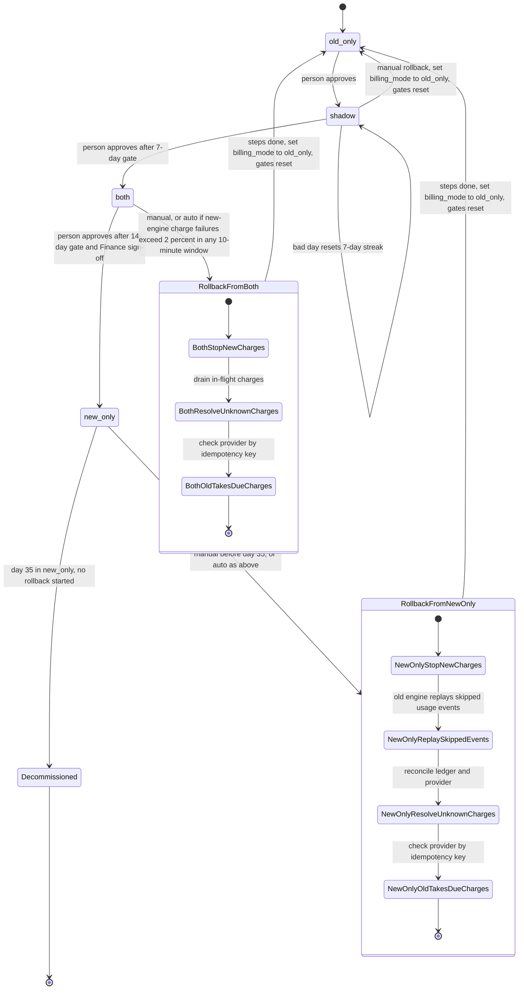

# Billing engine rollout: state machine

## Diagram

## Modes

- **old_only (start state).** The old engine reads usage events, computes invoices, writes the ledger and charges customers. The new engine is off.
- **shadow.** The old engine is unchanged. The new engine reads the same usage events and writes its invoices to the shadow store. It never charges and never writes the ledger. A nightly job compares the two engines' invoices per customer. A mismatch is an invoice total that differs by more than one cent. New-engine errors are recorded but never trigger a rollback.
- **both.** The new engine charges and writes the ledger. The old engine keeps computing every invoice into the shadow store without charging, so it stays current for rollback. The comparison continues.
- **new_only.** The new engine does everything. The old engine stops computing. Its last shadow-store state is the base for any rollback until day 35.
- **Decommissioned.** Reached at day 35 in new_only if no rollback has started. There is no path back to old_only.

## Gates and moves

Every forward move is one step, made by a person. The gates below report eligibility; they do not move the mode.

- old_only to shadow: person approves.
- shadow to both: 7 consecutive days with a mismatch rate under 0.1 percent, and at least 5,000 invoices compared. A day at or above 0.1 percent resets the streak.
- both to new_only: 14 days in both with no unresolved mismatches, plus Finance sign-off.
- new_only to Decommissioned: the old engine is retired at day 35 in new_only. This is the only system-driven move that is not a rollback.

The only system-initiated rollback is the automatic one: in both or new_only, the new engine's charge failure rate is above 2 percent over any 10-minute window.

## Rollback

Rollback can start from shadow, both or new_only. It always ends in old_only, and it resets the gates. The 7-day count restarts from zero on the next entry into shadow.

**From shadow.** The new engine has charged nothing, so the step is only to set billing_mode to old_only.

**From both.**
1. Stop new-engine charge runs and let in-flight charges finish or time out.
2. For every customer and billing period with an unknown charge outcome (timeout, crash), query the payment provider by idempotency key. Do not retry blind.
3. Treat any period the ledger shows as charged by the new engine as paid. The old engine must not charge it again.
4. The old engine charges every period that is due and not yet charged, using invoices already current in the shadow store. No due charge is dropped.
5. Set billing_mode to old_only.

**From new_only.** Steps 1 to 5 apply, with one addition before step 4. The old engine must first replay the usage events it skipped while the rollout was in new_only. That replay must finish before the oldest skipped event leaves the 35-day usage event log.

**Double-charge guard.** Every charge is keyed by customer and billing period, and that key is shared by both engines. An engine claims the key before it charges. Whichever engine claims first charges, and the other skips. This guard covers mode flips during a run and the handoff during rollback. The brief implies it but does not specify it, so the rollout controller must enforce it.

## Where the rollout state lives

- **billing_mode in the config service** is the only rollout switch. Workers read it. It is the single source of truth for which engine is in charge.
- **Usage event log** (35-day retention) is the input to both engines. It is also the source for the rollback replay from new_only.
- **Shadow store** holds the new engine's invoices and, in both, the old engine's shadow invoices. It is kept separate from the ledger.
- **Billing ledger** is the system of record for charges.
- **Gate counters, comparison results, approvals and rollback history** are not specified in the brief. Proposal: keep them in an append-only rollout record next to the comparison results. This needs a decision.

## What happens when something fails

- **Config service unreachable.** Workers keep the last mode they applied, do not change mode and raise an alert. They never fall back to a default mode.
- **Mode flips during a run.** Each charge decision reads the mode when it is made. A flip does not cancel in-flight charges, and rollback step 1 handles them.
- **Charge timeout or unknown result.** Treat the charge as possibly made. Check the provider by idempotency key before anyone retries.
- **New-engine charge failures above 2 percent in a 10-minute window (both or new_only).** Automatic rollback starts.
- **New-engine errors in shadow.** Recorded only. No rollback.
- **Comparison job or shadow-store failure.** A day without a complete comparison does not count toward the 7-day streak. It does not trigger a rollback. Alert.
- **Unresolved mismatch in both.** Blocks both to new_only. Does not trigger a rollback, as the brief states.
- **Old engine falls behind in both.** Rollback from both needs the old engine to be current. If it lags, rollback needs a catch-up from the usage log, and the 35-day clock still applies.
- **Rollback still running at day 35 in new_only.** Not covered by the brief. Proposal: block decommissioning while a rollback is in progress, and treat a rollback that cannot finish replay before the log expires as a failed rollback.

## Assumptions to confirm

1. The 5,000-invoice threshold is a total over the 7-day window. The mismatch rate is computed per day.
2. An invoice that exists in one engine and not the other counts as a mismatch.
3. Totals are compared in integer cents, and a mismatch is a difference of more than 1 cent.
4. The 35-day clock starts when the rollout enters new_only.
5. The 2 percent auto-rollback needs a minimum sample size per window. Without one, a single failed charge in a quiet 10-minute window could trigger a rollback.
6. The same customer-and-period charge key applies across both engines, as described above.