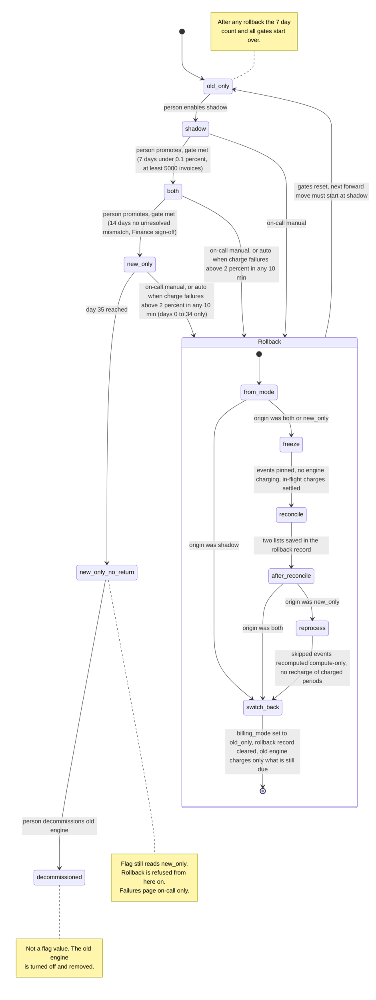

# Billing engine rollout: state machine

## Summary

Today the old billing engine does everything. Billing workers read usage events from the usage event log (kept 35 days), compute invoices, write them to the billing ledger (the system of record) and charge customers through the payment provider. We are replacing it with a new engine. The switch must be gradual and reversible, and it must never charge a customer twice for a billing period.

The rollout has four modes, selected by one global flag, `billing_mode`: `old_only`, `shadow`, `both`, `new_only`. A person moves forward one mode at a time, with no skipping. A rollback is a separate procedure with its own steps. It can start from `shadow`, `both` or `new_only`, and it always ends in `old_only`. The flag has only four values, so rollback progress lives in a separate durable rollback record. Two decisions for you to confirm: (1) the rollback record instead of a fifth flag value; (2) `new_only` splits into a reversible part (days 0 to 34) and a no-return part (day 35 on).

## Terms

- **Old engine / new engine.** The two billing implementations. Both compute invoices from usage events.
- **Usage event log.** The record of customer usage that engines read. Events expire after 35 days.
- **Billing ledger.** The system of record for what was charged.
- **Shadow store.** A separate store for non-authoritative invoices. Nothing is charged from it and the ledger never reads it. It lets the two engines' invoices be compared safely.
- **Charge.** One payment provider call plus one ledger write, for one customer and one billing period. Each charge is keyed by customer and billing period. The key is checked in the ledger and at the provider before every charge, so a second charge for the same key is not made.
- **Config service.** Holds `billing_mode`. How workers learn of a change and how stale a value can be are unknown (open questions).
- **Rollback record.** A durable record with the origin mode, the current rollback step, the pinned event range and the two reconcile lists. A trigger creates it only if none exists, which is how a second rollback is refused. It is cleared at the end.
- **Rollback controller.** An automated job that runs the rollback steps. It moves on when a step succeeds and pages on-call when a step fails.
- **Pin.** Exempting a range of usage events from the 35-day expiry.
- **Affected window.** The billing periods the new engine could have charged: from entry into `both` up to `freeze`.
- **Gate.** A precondition for a forward move. A person checks it by hand. The system does not enforce it.
- **Mismatch.** An invoice total that differs between the two engines by more than one cent. It is unresolved until a person marks it resolved.

## Diagram

## What each mode does

| Mode | Old engine | New engine | Who charges and writes the ledger |
|---|---|---|---|
| `old_only` | Computes, charges, writes ledger | Off | Old |
| `shadow` | Same as `old_only` | Reads the same usage events and writes invoices to the shadow store. It never charges and never writes the ledger. | Old |
| `both` | Computes every invoice into the shadow store, no charging, so it stays current | Computes, charges, writes ledger | New |
| `new_only` | Stopped | Does everything | New |

Each engine reads `billing_mode` at the moment it is about to charge, and only the engine the mode names as charger may charge. The per-key check is a second safeguard.

- **Comparison.** A nightly job compares the two engines' invoices per customer. It runs in `shadow` and `both`, and stops after a rollback. Past results are kept for audit. The gate counters reset.
- **Forward moves.** A person changes `billing_mode` in the config service, one step at a time. The tool (command or UI) is not decided. The mode read at charge time decides who charges, so a period the previous charger computed but did not charge is charged by the new charger, found by key. Periods already in the ledger are skipped by key.
- **Gate `shadow` to `both`.** 7 consecutive days with a mismatch rate under 0.1% and at least 5,000 invoices compared.
- **Gate `both` to `new_only`.** 14 days in `both` with no unresolved mismatches, plus Finance sign-off.
- **Missed comparison runs.** A day on which the comparison did not run does not count toward a gate.
- **Rollback triggers.** On-call can start a rollback by hand at any time before day 35 in `new_only`. It starts automatically when, in `both` or `new_only`, the new engine's charge failure rate is above 2% over any 10-minute window. New-engine errors in `shadow` are recorded but never trigger a rollback.
- **Day 35.** After 35 days in `new_only` without a rollback, the old engine may be decommissioned: a person turns it off and removes it. From day 35 on there is no way back.

## Rollback steps

The rollback controller runs these in order. A person (or the automatic trigger) only starts it. Each step starts when the previous one succeeds. If a step fails, the controller stays in it, keeps retrying and pages on-call. Progress and the reconcile lists are saved in the rollback record, so a restarted controller reloads them and resumes at the saved step.

1. **Trigger.** Must be accepted before day 35 in `new_only`. Accepting it creates the rollback record with the origin mode, only if none exists. If one exists, the trigger is ignored, so a manual and an automatic trigger at the same moment give one rollback. The controller then starts. Workers read the record with the flag. While it exists, no engine issues charges, except in a rollback from `shadow` (the record is then only the one-at-a-time guard).
2. **`freeze`** (from `both` or `new_only`). First, pin usage events and store the range in the record. From `new_only`, pin from entry into `new_only` up to now. From `both`, pin everything still in the log, because the periods still to charge are recent. The pin is released when the record is cleared. Then in-flight charges get time to settle or time out (how long is not decided). Anything still unknown is resolved in `reconcile`. Nothing is lost, because charges are only delayed.
3. **`reconcile`** (from `both` or `new_only`). For each period in the affected window, compare the ledger with the payment provider by key. Resolve any unknown outcome by asking the provider. If the provider is slow or down, keep retrying here and page on-call. Never guess. Save two lists in the record: periods already charged (never charge again) and periods due but uncharged.
4. **`reprocess`** (from `new_only` only). The controller runs the old engine in a compute-only mode that cannot charge. It recomputes the invoices it skipped from the pinned events and writes them to the shadow store. Periods on the already-charged list are skipped. Nothing is charged. From `both` this step is skipped, because the old engine kept computing every invoice in `both`.
5. **`switch_back`.** Set `billing_mode` to `old_only`, turn the new engine off, and only then clear the record. Charging resumes when the record is gone. The old engine finds what is still due by ledger key, recomputes each due period from the usage events and charges it. It never charges from shadow-store invoices. Periods that came due during the pause were computed by nobody, so the old engine computes and charges them now from events still in the log.
6. **Rollback from `shadow`.** The new engine never charged, so there is no `freeze`, `reconcile` or `reprocess`. `switch_back` sets `old_only`, turns the new engine off (ending its shadow writes) and clears the record. The shadow store is kept for audit.
7. **After rollback.** All gates reset. The next forward move must go from `old_only` to `shadow`, and the 7-day count starts at zero.

## Where the state lives

- **`billing_mode`**: in the config service, the only source for the active mode. It keeps its old value during a rollback until `switch_back`.
- **Rollback record**: stored durably next to the config service (my assumption). It holds origin, current step, pinned range and reconcile lists.
- **Billing ledger**: records what was charged, and decides what is still due after a rollback.
- **Gate counters**: consecutive days, mismatch rate, invoices compared and days in `both`. Derived from the nightly comparison results. Reset on rollback.
- **Entry time into `new_only`**: recorded next to `billing_mode` when the person moves the flag. A scheduled check marks day 35, and the rollback trigger reads this time and refuses once 35 days have passed, though the flag still reads `new_only`.

## When something fails

| What fails | What happens |
|---|---|
| New-engine errors in `shadow` | Recorded, never a rollback. |
| Charge failures above 2% in `both` or `new_only` | Automatic rollback starts, on-call is paged. |
| A rollback step fails | Stays in that step with charging paused, retries, pages on-call. Due charges wait and are not dropped. There is no stated limit on the pause. |
| Controller restarts mid-rollback | Reloads the record, resumes at the saved step with the saved lists. |
| Provider cannot answer in `reconcile` | Keeps retrying, pages on-call, no charge on a guess. |
| Unknown payment outcome | Ask the provider by key. Charge only if it reports no charge. |
| Nightly comparison does not run | That day does not count toward a gate. |
| Day 35 in `new_only` | Rollback is refused. A charge failure pages on-call, but no rollback runs. |
| Day 35 arrives during a rollback | The rollback finishes, because events were pinned at the start of `freeze`. |

## Open questions

1. Must a rollback also finish before day 35? I assumed not, because of the pin. A small gap remains between accepting the trigger and the pin.
2. Does a new unresolved mismatch restart the 14-day count, or must none be open at approval time? The brief does not say. I assumed the count restarts.
3. Can a person cancel a rollback once started? I assumed not, since it always ends in `old_only`.
4. How do workers learn of a change to the flag or record (poll or push), and how stale can it be? Unknown. Until known, the per-key check is the safeguard against two engines charging.
5. What measures the charge failure rate, and do card declines count? Unknown. A wave of declines could trigger a rollback if they do.
6. What tool moves the flag, and does anything check the gate? I assumed a person checks by hand.
7. How is the pin done in the usage event log? Unknown. The plan only needs the range kept until the rollback ends.
8. Is there a limit on how long charging may stay paused, and can on-call skip a step? Unknown. The brief gives neither.
9. Who marks a mismatch resolved, and where is that recorded? Unknown.
10. How long do in-flight charges get to settle in `freeze`? Unknown.
11. Is `reprocess` needed, since `switch_back` recomputes due periods anyway? I kept it as a compute-only check that skipped events can be recomputed before charging resumes. My choice, not from the brief.
12. In a rollback from `both`, I assume the uncharged periods are recent, so the pin covers them. Not verified if charges failed for a long time.
