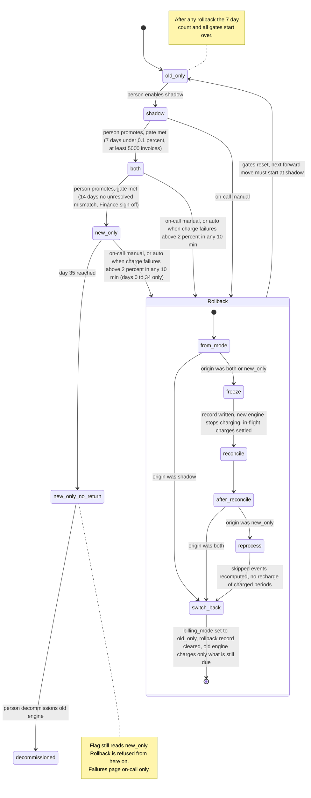

# Billing engine rollout: state machine

## Summary

The rollout is modelled as four modes selected by the `billing_mode` flag. A rollback runs as a separate procedure with its own steps, and it always ends in `old_only`. Two of the points below are my decisions, so please confirm them.

- **Rollback progress.** The flag has only four values, so I keep rollback progress in a separate durable rollback record. This avoids adding a fifth flag value.
- **Day 35.** `new_only` splits into a reversible part (days 0 to 34) and a no-return part (day 35 on).

## Diagram

## What each mode does

| Mode | Old engine | New engine | Who charges and writes the ledger |
|---|---|---|---|
| `old_only` | Computes, charges, writes ledger | Off | Old |
| `shadow` | Same as `old_only` | Reads the same usage events and writes invoices to the shadow store. It never charges and never writes the ledger. | Old |
| `both` | Computes every invoice into the shadow store, no charging | Computes, charges, writes ledger | New |
| `new_only` | Stopped | Does everything | New |

- **Comparison.** A nightly job compares the two engines' invoices per customer. A mismatch is any total that differs by more than one cent. The job runs in `shadow` and `both`.
- **Forward moves.** They go one step at a time, with no skipping, and a person always makes them.
- **Gates.** A gate is a precondition the person checks, not an automatic trigger.
- **Gate details.**
  - `shadow` to `both` needs 7 consecutive days with a mismatch rate under 0.1% and at least 5,000 invoices compared.
  - `both` to `new_only` needs 14 days in `both` with no unresolved mismatches, plus Finance sign-off.
- **Missed comparison runs.** A day on which the comparison did not run does not count toward a gate.

## Rollback steps

A rollback is idempotent and resumable. Every charge is keyed by customer and billing period, and the ledger and the payment provider are both checked by that key before any charge. That key is what prevents double charges and dropped charges.

1. **Trigger.** The trigger is either manual from on-call or automatic (`both` or `new_only`, charge failure rate above 2% over any 10-minute window). Only one rollback record can exist, so repeat triggers while a rollback is running are ignored.
2. **`freeze`** (only from `both` or `new_only`). Write the rollback record. Both engines stop issuing charges, and in-flight charges settle or time out. Customers are not charged during this time, but nothing is lost, because the charges are only delayed.
3. **`reconcile`** (only from `both` or `new_only`). For each period in the affected window, compare the ledger with the payment provider by key. Resolve any unknown outcome by looking it up at the provider. The result is two lists: periods already charged (never charge again) and periods due but uncharged.
4. **`reprocess`** (only from `new_only`). Before this step starts, pin the usage events since entry into `new_only`, so the 35-day log retention cannot expire them during the rollback. The old engine recomputes the invoices it skipped. Periods already charged by the new engine are kept as they are, so no one is charged twice.
5. **`switch_back`.** Set `billing_mode` to `old_only`, clear the rollback record, and turn the new engine off. The old engine then charges only the periods still due.
6. **Rollback from `shadow`.** The new engine never charged, so only `switch_back` is needed.
7. **After rollback.** All gates reset. The next forward move must start at `old_only` to `shadow`, and the 7-day count starts at zero.

## Where the state lives

- **`billing_mode`** is in the config service. It is the only source for which mode is active. During a rollback it keeps its old value until `switch_back`.
- **The rollback record** holds the origin mode, the current step and the pinned event range. It must be stored durably next to the config service (my assumption). Workers read it together with the flag. Charging is paused while it exists.
- **The billing ledger** is the system of record for what was charged. It also decides what is still due after a rollback.
- **Gate counters** hold the consecutive-day count, the mismatch rate, the invoices compared and the days spent in `both`. They are derived from the nightly comparison results, and they reset on rollback.
- **Entry time into `new_only`** drives the day-35 cutoff.

## When something fails

- **New-engine errors in `shadow`.** They are recorded and never trigger a rollback.
- **Charge failures above 2% in `both` or `new_only`.** An automatic rollback starts, and on-call is paged.
- **A rollback step fails.** The rollback stays in its current step with charging paused, and on-call is paged. The step is retried, and the rollback is not abandoned. Due charges wait and are not dropped.
- **The nightly comparison fails to run.** That day does not count toward a gate.
- **Unknown payment outcome.** Never guess. Ask the provider by key, and charge only if it reports no charge.
- **Day 35 in `new_only`.** Rollback is refused and the old engine can be decommissioned. A charge failure then pages on-call, but no rollback runs.
- **Day 35 arrives during a rollback.** The rollback finishes, because the pinned event range is already safe.

## Open questions

1. A rollback must start before day 35. Does it also have to finish before day 35, or is the pinned range enough? I assumed the pinned range is enough.
2. For the `both` to `new_only` gate, does a new unresolved mismatch restart the 14-day count, or must none be open at approval time? The brief does not say. I assumed the strict reading, where the count restarts.
3. Should a person be able to cancel a rollback once it has started? I assumed not, because it always ends in `old_only`.
