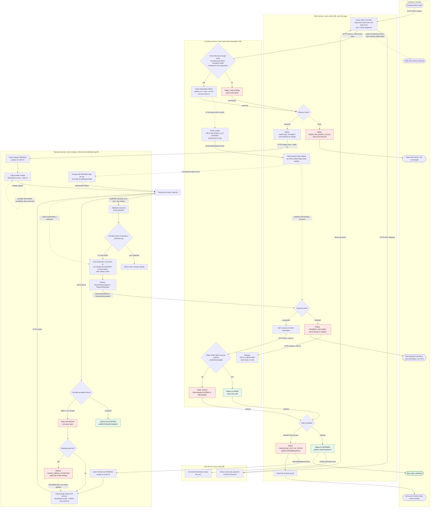

# Checkout across Cart, Inventory, Payment and Order

## What this is

Today checkout runs inside the monolith, as one program. This design moves checkout into four services: **Cart**, **Inventory**, **Payment** and **Order**. Each service has its own database, and no service reads another service's tables. Services talk over HTTP or through events on the message broker.

Checkout is a **saga**: a chain of steps across services. If a later step fails, earlier steps are undone by **compensating steps**, such as a release or a refund. The **Order service** runs the saga. The main flow goes like this. Order copies the cart and saves the order. Order asks Inventory to reserve the stock for 10 minutes. If every line is in stock, Order asks Payment to charge the customer. The payment provider reports success or decline by webhook, which can take up to 30 minutes. On decline, Order releases the stock. On success, Order claims the stock. If the claim is refused because the hold has already expired, Order cancels the order and Payment refunds the full amount. If the claim succeeds, the order is confirmed and Cart empties the cart.

The flow is shaped this way for two reasons. Stock is reserved before payment, so nobody is charged for stock that is not there. Stock is claimed only after payment succeeds, so a payment that arrives after the hold has lapsed is caught and refunded, not left holding stock forever.

## Terms

- **Service**: one of the four programs. Each service owns one database, and that database is its only store.
- **Saga**: a chain of steps across services. Failed steps are undone by later steps.
- **Compensating step**: a step that undoes an earlier one, such as a release or a refund.
- **Snapshot**: a read-only copy of the cart's lines and prices, taken at Place order.
- **Place order**: the customer's press of the Place order button. It starts checkout.
- **Client request id**: an id the browser makes for each press of Place order. A resent press sends the same id. It is the key for the order insert.
- **Order id**: the id Order generates when it inserts an order. Reservations and charges use it.
- **Reservation**: a hold on stock for one order. It is HELD while active, so other customers cannot take the stock. It lasts 10 minutes unless claimed. Stock counts as held only while the reservation is HELD and its expires_at is in the future.
- **Claim**: turns a HELD reservation into a sale. It works only while the reservation is still HELD and has not passed expires_at. The check and the update run as one conditional database update, so a claim and an expiry cannot both win.
- **Release**: ends a HELD reservation early and puts the stock back on sale.
- **Expiry**: after 10 minutes with no claim, a timer in Inventory marks the reservation EXPIRED. The stock goes back on sale.
- **Hold expired flag**: a flag on the order, set when the reservation expires while the order waits for payment. It does not change the outcome.
- **Charge**: Payment's record of one attempt to take money for an order. It is unique on order id.
- **Payment provider**: the outside company that takes the money. Only Payment talks to it.
- **Webhook**: a message from the payment provider that reports the outcome of a charge. The same webhook can arrive more than once.
- **Signature check**: a check that a webhook really comes from the provider. A webhook that fails it is rejected.
- **Webhook log**: Payment's record of the provider event ids it has already handled.
- **Refund row**: Payment's record of one refund. It is unique on order id. It is written before the provider is called, and it stays open until the provider confirms the refund.
- **Idempotency key**: a value sent with a request so that a retry has the same effect as the first call. Charges use the order id. Refunds use `refund:` plus the order id. The order insert uses the client request id.
- **Saved payment outcome**: Order's record of a PaymentSucceeded event for one order. Order writes it before it asks Inventory to claim, so recovery can repeat the claim after a crash.
- **Outbox**: a table in each service's database. An event is written to it in the same transaction as the state change. A **relay** (a background process) reads unsent rows and publishes them to the broker. So an event is never lost when a state changes.
- **Broker**: the shared message broker that carries events between services. Its name is not set yet (see Open questions). The design assumes **at-least-once** delivery, so an event can arrive more than once.
- **Consumer**: a service that receives events. It ignores repeats by event id.
- **Final state**: an order status the order does not leave. CONFIRMED, CANCELLED_OUT_OF_STOCK and PAYMENT_DECLINED are final.
- **Background worker**: a process in Order that picks up a new PLACING order and runs the reserve call.
- **Recovery job**: a job in Order that finds orders left part-way through after a crash, and repeats their current step.
- **Polling**: asking the provider, or the order status, again at set times.
- **Backoff**: waiting longer between each retry.
- **Ops**: the operations team, who are paged when a refund needs attention.
- **Reconciliation**: a daily check that compares the provider's refunds with the open refund rows.

## Flowchart

## How to read the diagram

- **Service**: each subgraph is one service. Its database is its only store. Services never read each other's tables.
- **Trigger**: a press of Place order, an HTTP call, a broker event, a provider webhook, or a timer (the 10-minute hold and the 45-minute wait).
- **Solid arrows** are the main path. **Dashed arrows** are timers, retries, or notes.
- **Red boxes** are failure branches. **Green boxes** are success endings.
- The background worker that runs the reserve call is part of Order. The diagram shows it as the arrow from the inserted order to Inventory.

## Steps in order

Each step says what starts it, what it does, which store keeps its data, and what happens when it goes wrong. The failure table below repeats the failure cases.

1. **Place order (browser to Order).** The customer presses Place order. The browser makes a new client request id for each press. If it resends that press, for example after a double-click, it sends the same id again. Order asks Cart for a snapshot of the cart's lines and prices. Then Order inserts the order with status PLACING, generates the order id, and copies the lines and prices into order lines. The copied lines never change after this, so later cart edits and price changes do not affect the order. The insert uses the client request id as its key, so a resent press returns the first order. The browser's request returns at once with the order id. It does not wait for the saga. A background worker in Order picks up the PLACING order and runs step 2. The browser shows a placing state while the order is PLACING, and it polls the order status until the order reaches a final state. If the snapshot call fails, no order is created, the browser shows an error, and the cart stays the same.

2. **Reserve stock (Order to Inventory).** The background worker starts this step when the order is inserted. Order sends the order id and the lines. Inventory checks every line in one transaction. It counts only HELD reservations whose expires_at is still in the future as holding stock. So a reservation that has run out does not block other customers, even before the expiry sweep marks it EXPIRED. If any line is short, Inventory reserves nothing and returns the short items. Otherwise it writes one HELD reservation for the order id, with expires_at set to now plus 10 minutes. Inventory returns the reserve result in its HTTP response. Then Order does one of two things:
   - If the reservation was refused, Order sets REJECTED_SHORT_STOCK, stores the short items and shows them to the customer. No payment is requested. The cart stays the same.
   - If the stock is reserved, Order goes on to step 3.

   If the response is lost, or the call fails or times out, the order stays PLACING. Order repeats the call with the same order id. If the order already has a reservation, the repeat returns it. If the first answer was short, nothing was written, so the repeat checks stock again. If the worker stops, the recovery job repeats this call (step 11).

3. **Request payment (Order to Payment).** Starts when the stock is reserved. Order sets status AWAITING_PAYMENT and sends Payment a charge request. The request carries the order id and the amount. The amount is the total of the order lines Order stored. Order never calls the provider. Only Payment does. Payment inserts a charge row with status PENDING. The row is unique on order id. Then Payment calls the provider with Idempotency-Key set to the order id. The charge request also carries the payment details the customer entered. Where those details are held until the charge is open is not set (see Open questions).
   - Payment's HTTP response returns once the provider has accepted the request. It does not wait for the money outcome. The order waits in AWAITING_PAYMENT.
   - If the provider call times out, Payment retries it with the same order id key. The provider returns the same result.
   - If the provider call fails before the provider accepts it, Payment answers Order's charge request with an error and does not return success. Payment then retries the provider call itself, in the background, with the same key. Order does not resend the request. The order stays AWAITING_PAYMENT and the hold keeps running. If the hold expires first, the late-success path (step 7) covers a charge that later succeeds. How soon recovery repeats the charge is not set (see Open questions).

4. **Hold may expire while the order waits (Inventory to Order).** This can happen while the order waits for the webhook. Starts when 10 minutes pass with no claim. Inventory's expiry timer marks the reservation EXPIRED, and the stock goes back on sale. Inventory publishes ReservationExpired. Order sets the hold expired flag and keeps waiting. The order status does not change, and the outcome still arrives by webhook. The flag exists only so the waiting screen can tell the customer what happens if the stock is gone. Nothing else reads it. The claim decides the outcome. A claim on an EXPIRED hold is refused, even if the sweep has not run yet, because the claim also checks expires_at.

5. **Provider reports the outcome (provider to Payment).** Starts when the provider sends a webhook. This can take seconds or up to 30 minutes. The same webhook can be sent more than once. Payment runs the signature check. If the check fails, Payment rejects the webhook and writes nothing. Otherwise Payment reads the order id that the provider sent back with the charge, and finds the charge by that id. Then Payment checks whether the provider's event id is already in its webhook log.
   - If it is, Payment returns 200 and changes nothing. A repeat is never processed twice.
   - If it is not, one transaction logs the event id, sets the charge to SUCCEEDED or DECLINED, and writes the event to the outbox. A charge is set only once. A later result that conflicts with it is logged and changes nothing. The relay then publishes PaymentSucceeded or PaymentDeclined.

6. **Charge outcome unknown (no webhook).** If no webhook arrives after 45 minutes, Payment polls the provider and treats the answer like a webhook. If the poll says the charge is still pending, Payment changes nothing and polls again later. It does not treat a pending charge as failed, because that could refund or cancel a charge that later succeeds. The end of this wait is not set (see Open questions).

7. **Order handles the payment event (broker to Order).** Starts when Order receives PaymentSucceeded or PaymentDeclined. Order ignores events for orders already in a final state, because the broker can redeliver. A repeat on a CONFIRMED or CANCELLED_OUT_OF_STOCK order changes nothing. For a cancelled order, the refund was already requested when the claim was refused.
   - **Declined.** Order sets PAYMENT_DECLINED and asks Inventory to release the reservation at once. The stock goes back on sale without waiting for the timer. The order is final. The customer sees the decline, and the cart stays the same. A retry is a new press of Place order (step 1). It gets a new client request id and so a new order id. It does not reuse the old key, because a retry with the old key would get the old declined answer from the provider.
   - **Succeeded.** Order saves the payment outcome, then asks Inventory to claim the reservation. The saved payment outcome is written before the claim, so recovery can repeat the claim after a crash. The order status stays AWAITING_PAYMENT until the claim is answered.
     - **Claim accepted.** Order sets CONFIRMED and writes OrderConfirmed to its outbox. Cart empties the cart on that event. The customer sees the order confirmed.
     - **Claim refused** (the reservation is EXPIRED or RELEASED). This is the late-success case. Order sets CANCELLED_OUT_OF_STOCK, writes RefundRequested to its outbox, and emails the customer that the item is out of stock. Payment refunds the full amount (step 9). The stock is not given back to this order. We never keep money for an order we cannot fulfil, and we do not ship partial orders. The cart stays the same, so the customer can try again.

8. **Release and claim calls (Order to Inventory).** Order retries a release or a claim with the same order id until Inventory answers. Both calls are safe to repeat, because a repeated call gets the same answer. Order stores each pending call until it is answered, so a restart does not lose it. If releases never succeed, the hold still expires after 10 minutes, so the stock goes back on sale. If the claim never succeeds and the hold expires first, the claim is refused and the late-success path (step 7) runs.

9. **Refund (Order to Payment to provider).** Starts when the RefundRequested event arrives. Payment inserts a refund row with status PENDING before it calls the provider. The row is unique on order id, so a crash cannot lose the request. Payment then asks the provider to refund the full amount, with Idempotency-Key set to `refund:` plus the order id.
   - If the provider accepts, the row becomes SUCCEEDED and Payment publishes RefundCompleted.
   - If the call fails or gets no answer, the row stays open and retries with backoff. The row is never deleted. After the attempt limit, the row becomes FAILED_NEEDS_ATTENTION, ops are paged, and retries continue.
   - A daily reconciliation compares the provider's refunds with the open rows.

10. **Refund completed (Payment to Order).** Order receives RefundCompleted and records it in the order's status history. The order status stays CANCELLED_OUT_OF_STOCK. The customer sees nothing new. The design sends no message to the customer at this point (see Open questions).

11. **Recovery after a crash in Order.** The recovery job runs in Order. It finds orders stuck in PLACING, in AWAITING_PAYMENT, or with a saved payment outcome that is not yet claimed. It repeats the step the order is on.
   - PLACING: repeat the reserve call. Each order id has only one reservation, so the call cannot reserve twice.
   - AWAITING_PAYMENT: repeat the charge request with the same key. Payment's charge is idempotent.
   - Saved payment outcome not yet claimed: repeat the claim.

   If Order crashes mid-saga, recovery finds the order and repeats its current step.

## Stored state per service

| Service | Stores | Key rules |
|---|---|---|
| Cart | carts, cart lines | Read-only for checkout. Emptied only on OrderConfirmed. |
| Inventory | stock per SKU (on hand, held), reservations (order id, lines, status, expires_at) | One reservation per order id. Statuses: HELD, CLAIMED, RELEASED, EXPIRED. |
| Payment | charges (order id unique, amount, status, provider ref), refunds (order id unique, amount, status, attempts), webhook log (provider event id unique), outbox | A webhook's status change and its log row commit together. |
| Order | orders (status, total, hold_expired flag), order lines (name, SKU, quantity, unit price as at Place order), status history, outbox, pending release and claim calls, saved payment outcomes not yet claimed | Lines are copied at Place order and never updated afterwards. |

Order statuses: PLACING, REJECTED_SHORT_STOCK, AWAITING_PAYMENT, PAYMENT_DECLINED, CONFIRMED, CANCELLED_OUT_OF_STOCK.

## What happens when things fail

| What fails | What happens |
|---|---|
| Cart snapshot call fails | No order is created. The browser shows an error. The cart stays the same. |
| Reserve call fails or times out | The order stays PLACING. Order repeats the reserve call, and recovery repeats it if the worker stops. |
| Short stock | Inventory reserves nothing. Order sets REJECTED_SHORT_STOCK, stores the short items and shows them to the customer. No payment is requested. The cart stays the same. |
| Charge call times out | Payment retries with the same order id key. The provider returns the same result. |
| Provider call fails before accepting the charge | Payment answers Order's charge request with an error. Payment retries the provider call in the background with the same order id key. Order does not resend. The order stays AWAITING_PAYMENT and the hold keeps running. |
| Declined payment | Payment records DECLINED and publishes it. Order releases the reservation at once. The order is final. The customer can retry, which creates a new order id. The cart stays the same. |
| Webhook signature check fails | Payment rejects the webhook and writes nothing. |
| No webhook after 45 minutes | Payment polls the provider and treats the answer like a webhook. |
| Charge still pending after a poll | Payment changes nothing and polls again. The order keeps waiting. |
| Duplicate webhook | Payment returns 200 and changes nothing. Order ignores events for orders already in a final state. |
| Late success after the hold lapsed | Order keeps waiting. The claim is refused. Order sets CANCELLED_OUT_OF_STOCK, publishes RefundRequested and emails the customer. Payment refunds the full amount. The cart stays the same. |
| Release call fails or times out | Order retries with the same order id. The hold also expires after 10 minutes, so the stock goes back on sale. |
| Claim call fails or times out | Order retries with the same order id. If the hold expires first, the claim is refused and the late-success path runs. |
| Refund call fails or gets no answer | The refund row stays open and retries with backoff. It is never deleted. After the attempt limit it becomes FAILED_NEEDS_ATTENTION, ops are paged, and retries continue. A daily reconciliation compares provider refunds with open rows. A refund is never silently dropped. |
| Order service crashes mid-saga | Recovery finds the order and repeats its current step. |
| Broker is down | Outbox rows wait and are published when the broker returns. Consumers ignore repeats by event id. |
| Double-click on Place order | The double-click is one press, so the browser sends the same client request id twice. The insert returns the first order. |

## Rules

1. Stock is reserved before any charge is requested. Order only charges while it holds a reservation.
2. Stock is claimed only after a successful payment. A claim before payment would remove the late-success case and force a release on every decline.
3. The cart is written only on OrderConfirmed. No other branch touches it. If checkout fails for any reason, the cart stays exactly as it was, so the customer can try again.
4. Every money movement has an idempotency key that is stored before the call. Charge uses the order id. Refund uses `refund:` plus the order id.
5. Every event is published through an outbox, and every consumer is idempotent by event id.
6. Any charge that succeeds on an order that does not end CONFIRMED has a refund row, and that row stays open until the provider confirms it.

## Open questions

1. **Hold length against the 30-minute webhook window.** With a 10-minute hold, any payment slower than the hold loses its stock and is refunded. The brief fixes the hold at 10 minutes, so this is accepted as written. Extending the hold while AWAITING_PAYMENT would reduce refunds, but it would hold stock for abandoned checkouts. This needs a product decision.
2. **Who sends the emails.** This design has Order send them. If there is a separate notifications service, the Order steps change to publishing an event.
3. **Refund attempt limit and alert route.** The limit, the backoff schedule, and who is paged are not set.
4. **Message broker.** The design assumes at-least-once delivery. The brief does not name the broker.
5. **Customer-facing copy for AWAITING_PAYMENT.** The customer may wait up to 30 minutes. The screen needs a waiting state that says what happens if the stock is gone.
6. **How the browser learns the outcome.** This design has the browser poll the order status. The brief does not set this method.
7. **Webhook contents and retries.** This design assumes the provider sends the order id back with each webhook, and that it retries a webhook that Payment rejected for a bad signature. Both need checking against the provider's documentation.
8. **Recovery of a PLACING order whose hold has expired.** The design does not say what the reserve call returns in this case.
9. **Customer message on refund completion.** This design sends no message when the refund completes. The brief does not say whether one is wanted.
10. **Payment details before the charge.** The design does not say where the customer's payment details are held between Place order and the charge, or how recovery repeats the charge without asking the customer again. The payment provider's options decide this.
11. **Recovery timing and a charge that is never accepted.** The design does not say how soon recovery repeats a charge. If the provider never accepts the charge, the order waits in AWAITING_PAYMENT with no end state, and no timeout is set.
12. **End of a pending charge.** If the provider keeps reporting the charge as pending after 45 minutes, Payment keeps polling. The design sets no end to that wait, so the order can wait with no outcome.