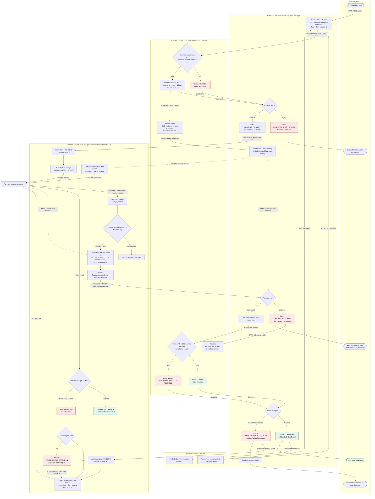

# Checkout across Cart, Inventory, Payment and Order

Checkout is a saga run by the **Order service**. It reserves stock, then requests payment, then waits for the provider's webhook. It claims the stock only after the payment succeeds, and it compensates with a release (on decline) or a full refund (when the stock is gone). The **Cart service** is read-only until the order is confirmed.

## Flowchart

## How to read it

- **Service**: each box is one service, and the box's database is its only store. Services never read each other's tables.
- **Trigger**: a press of Place order, an HTTP call, a broker event, a provider webhook, or a timer (the hold expiry).
- **Reservation**: a hold on stock that stops other customers from taking it. It lasts 10 minutes unless claimed.
- **Claim**: converts a held reservation into a sale. It succeeds only while the hold is still HELD. The check and update happen in one conditional database update, so a claim and an expiry cannot both win.
- **Idempotency key**: a value sent with a request so that a retry has the same effect as the first call. Charges use the order id. Refunds use `refund:` plus the order id.
- **Outbox**: the event is written in the same transaction as the state change and published from there. An event is never lost when a state changes.

## Stored state per service

| Service | Stores | Key rules |
|---|---|---|
| Cart | carts, cart lines | Read-only for checkout. Emptied only on OrderConfirmed. |
| Inventory | stock per SKU (on hand, held), reservations (order id, lines, status, expires_at) | One reservation per order id. Statuses: HELD, CLAIMED, RELEASED, EXPIRED. |
| Payment | charges (order id unique, amount, status, provider ref), refunds (order id unique, amount, status, attempts), webhook log (provider event id unique), outbox | A webhook's status change and its log row commit together. |
| Order | orders (status, total, hold_expired flag), order lines (name, SKU, quantity, unit price as at Place order), status history, outbox | Lines are copied at Place order and never updated afterwards. |

Order statuses: PLACING, REJECTED_SHORT_STOCK, AWAITING_PAYMENT, PAYMENT_DECLINED, CONFIRMED, CANCELLED_OUT_OF_STOCK.

## Failure branches

- **Short stock.** Inventory checks every line in one transaction and reserves nothing if any line is short. Order sets REJECTED_SHORT_STOCK, stores the short items, and tells the customer which items. No payment is requested. The cart is unchanged.
- **Declined payment.** Payment records DECLINED and publishes it. Order releases the reservation at once, so the stock goes back on sale without waiting for the timer. The order is terminal. A retry creates a new order id, because a retry with the old key would get the old declined answer back from the provider. The cart is unchanged.
- **Late success after the hold lapsed.** The hold can expire while the order waits for the webhook. Order keeps waiting, and the outcome still arrives by webhook. On success, Order asks Inventory to claim and is refused, since the reservation is EXPIRED. Order sets CANCELLED_OUT_OF_STOCK, publishes RefundRequested, and emails the customer. Payment refunds the full amount. The stock is not given back to this order, and the cart is unchanged, so the customer can try again.
- **Failed refund.** A refund row is written before the provider is called, so the request survives a crash. On a failed or unanswered call, the row stays open and retries with backoff. It is never deleted. After the attempt limit, it becomes FAILED_NEEDS_ATTENTION, ops are paged, and retries continue. A daily reconciliation compares provider refunds with open rows.
- **Duplicate webhook.** Payment checks the provider event id in the webhook log. A repeat returns 200 and changes nothing. The status change and the log row commit together, so a crash cannot leave one without the other. Order also ignores events for orders already in a final state, because the broker is at-least-once and can redeliver.
- **Charge outcome unknown.** If the charge call times out, Payment retries with the same order id key, and the provider returns the same result. If no webhook arrives after 45 minutes, Payment polls the provider and treats the answer like a webhook.
- **Double-click on Place order.** The client request id is the key for the order insert, so the second request returns the first order.

## Rules the diagram depends on

1. Stock is reserved before any charge is requested. Order only charges while it holds a reservation.
2. Stock is claimed only after a successful payment. A claim before payment would remove the late-success case and force a release on every decline.
3. The cart is written only on OrderConfirmed. No other branch touches it.
4. Every money movement has an idempotency key that is stored before the call: charge = order id, refund = refund plus order id.
5. Every event is published through an outbox, and every consumer is idempotent by event id.
6. Any charge that succeeds on an order that does not end CONFIRMED has a refund row, and that row stays open until the provider confirms it.

## Open decisions

1. **Hold length against the 30-minute webhook window.** With a 10-minute hold, any payment slower than the hold loses its stock and is refunded. The brief fixes the hold at 10 minutes, so this is accepted as written. Extending the hold while AWAITING_PAYMENT would reduce refunds but would hold stock for abandoned checkouts. This needs a product decision.
2. **Who sends the emails.** This design has Order send them. If there is a separate notifications service, the Order steps change to publishing an event.
3. **Refund attempt limit and alert route.** The limit, the backoff schedule, and who is paged are not set.
4. **Message broker.** The design assumes at-least-once delivery. The broker is not named in the brief.
5. **Customer-facing copy for AWAITING_PAYMENT.** The customer may wait up to 30 minutes. The screen needs a waiting state that says what happens if the stock is gone.