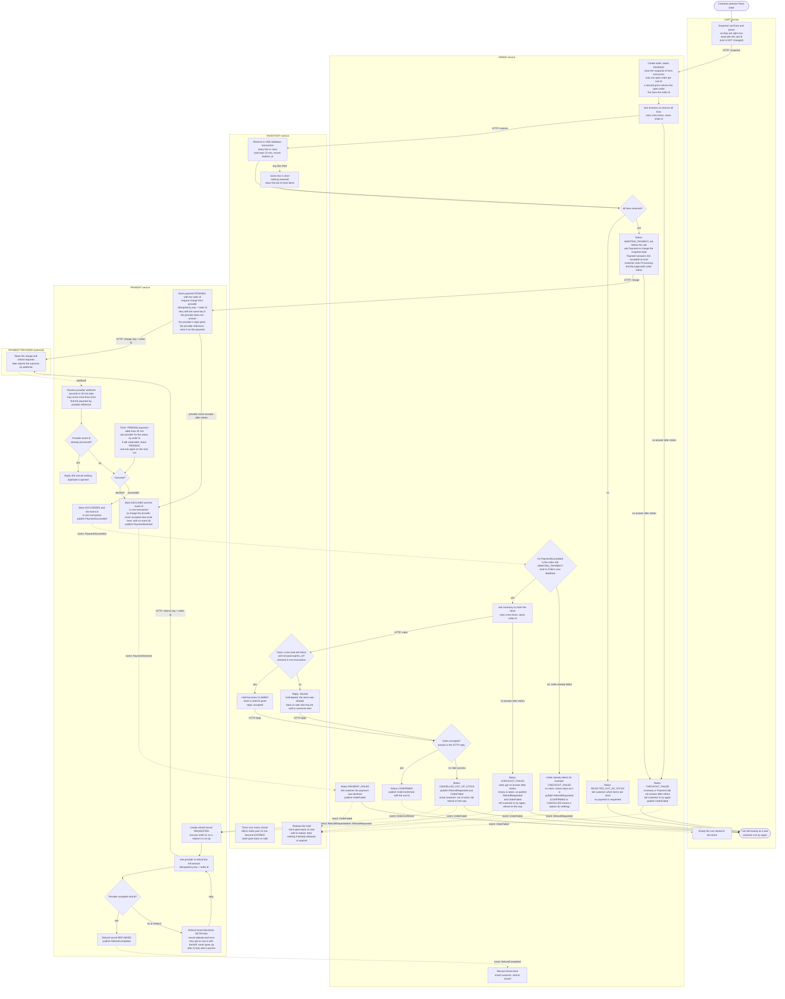

# Checkout across Cart, Inventory, Payment and Order

## What this is

Today checkout runs inside the monolith. We are moving it into four services that already exist as stubs: Cart, Inventory, Payment and Order.

The flow goes like this. The customer presses **Place order**. Order freezes a copy of the cart, asks Inventory to hold the stock (all lines or none), then asks Payment to charge. The payment provider reports the result later by webhook, which can take up to 30 minutes. On success, Order asks Inventory to claim the held stock, marks the order confirmed, and only then does Cart empty the cart. If anything fails, the cart stays exactly as it was and the customer can try again.

The flow has these steps in this order because stock is held before money is asked for, and the money is taken long before we know the stock is still ours. The bad case is a payment that succeeds after the 10-minute hold has lapsed and the stock has been sold on. Then we refund in full, cancel the order as out of stock and email the customer. We never keep money for an order we cannot fulfil, and we never ship partial orders.

## Terms

- **Service**: a separate program with its own database. It never reads another service's tables. Services talk by HTTP or by events on the shared message broker.
- **Order** is the coordinator. It decides what happens next. The other three do one job each and report back.
- **Hold (reservation)**: stock set aside for one order for 10 minutes. Statuses: `HELD`, `CLAIMED`, `EXPIRED`, `RELEASED`.
- **Claim**: turning a hold into a sale. It is allowed only while the hold is `HELD` and before its `expires_at`.
- **Release**: giving a hold's stock back on sale.
- **Snapshot**: the cart's lines and prices as they were when **Place order** was pressed. Later cart edits or price changes do not affect the order.
- **Idempotency key**: a value sent with a request so a repeat of that request has no second effect. Here it is always the order id.
- **Payment provider**: the outside company that charges and refunds cards. It talks only to Payment.
- **Webhook**: a call from the provider to Payment reporting an outcome, succeeded or declined. It can arrive more than once.
- **Event**: a message on the broker. Delivery is at least once, so a consumer may see the same event twice.
- **Outbox and relay**: each service writes its events to an outbox table in its own database, in the same transaction as the state change. The relay is a small background loop inside each service that publishes unsent rows to the broker and marks them sent. This avoids a state change with no event, or the reverse.
- **Retry job and timer**: background loops inside a service that scan that service's own tables.

## Flowchart

Solid arrows are HTTP calls. Dotted arrows are events. Diamonds are decisions. Each box is in the lane of the service that does the work.

Notes on the chart. The Inventory timer only marks old holds `EXPIRED`. It refuses nothing. The claim does the refusing: it reads the hold and refuses if it is `EXPIRED`, or if it is still `HELD` but past `expires_at` because the timer has not run yet. Order learns the claim result from the HTTP reply.

## Steps, in order

Every step that changes state also writes its event to the outbox.

1. **Place order.** Triggered by the customer. Cart takes the snapshot with its cart id and sends it to Order. Cart is not changed. If this fails, nothing exists yet and the customer retries.
2. **Create the order.** Order stores it as `PENDING` with the snapshot, total and cart id. Only one open order (`PENDING` or `AWAITING_PAYMENT`) is allowed per cart id, by a unique rule. A second press or double click returns the open order, so there is one hold and one charge per cart.
3. **Reserve.** Order asks Inventory to reserve all lines. Inventory does it in one transaction, every line or none, with `expires_at` set 10 minutes ahead. A repeat call with the same order id is treated as the same reservation. If any line is short, it reserves nothing and returns the short items. Order then sets `REJECTED_OUT_OF_STOCK`, tells the customer which items are short and never calls Payment. If Inventory does not answer after a few retries, Order sets `CHECKOUT_FAILED`.
4. **Charge.** Order sets `AWAITING_PAYMENT` first, so a failed call still leaves a known status. It then asks Payment to charge the snapshot total. Payment stores the payment as `PENDING` with the order id, answers 202 accepted at once (the real outcome comes later), and asks the provider to charge with the order id as idempotency key. The provider's reply gives a provider reference, which Payment stores. The customer sees Processing and the page polls the order status. A repeat charge call for the same order is treated as the same payment. If Payment does not answer Order after retries, Order sets `CHECKOUT_FAILED` and publishes `OrderFailed`.
5. **Provider does not accept the charge.** Order already has its 202, so Payment ends it. It retries with the same key. If the provider never accepts, Payment stores `DECLINED` and publishes `PaymentDeclined`. Go to step 7.
6. **Webhook arrives.** Payment finds the payment by provider reference. In one database transaction it inserts the provider's event id (unique constraint) and stores the outcome. If the insert fails, this is a repeat: Payment replies 200 and does nothing, so no second event and no second refund. Otherwise it publishes `PaymentSucceeded` or `PaymentDeclined`.
   - If no webhook comes about 35 minutes after the charge, a Payment timer asks the provider for the status by order id. If the charge is still undecided, the payment stays `PENDING` and the timer asks again on its next run. The customer keeps seeing Processing. A definite answer is handled like a webhook.
7. **Declined.** On `PaymentDeclined`, if the order is `AWAITING_PAYMENT`, Order sets `PAYMENT_FAILED`, tells the customer, and publishes `OrderFailed`. Inventory releases the hold at once. The customer can press **Place order** again. That makes a new order with a new id, so a fresh idempotency key.
8. **Succeeded.** On `PaymentSucceeded`, Order reads its own status.
   - `AWAITING_PAYMENT`: ask Inventory to claim (step 9).
   - Already failed, for example `CHECKOUT_FAILED`: no claim, status stays, publish `RefundRequested`. This covers a charge that succeeds after a failed attempt, including one Payment had stored as `DECLINED` (it then stores `SUCCEEDED` over `DECLINED`).
   - `CONFIRMED` or `CANCELLED_OUT_OF_STOCK`: a repeat, do nothing.
9. **Claim.** Order asks Inventory to claim, with the same order id. Inventory checks in one transaction that the hold is `HELD` and not past `expires_at`. Yes: the hold becomes `CLAIMED` and Order sets `CONFIRMED` and publishes `OrderConfirmed` with the cart id. No: this is the late success, step 10. If Inventory does not answer after a few retries, the money is already taken, so Order sets `CHECKOUT_FAILED`, publishes `RefundRequested` and `OrderFailed`, and tells the customer to try again with a refund on the way. This refunds even if Inventory did claim the stock, because we never keep money for an order we cannot confirm.
10. **Late success.** A lapsed hold is expected, not rare: the hold lasts 10 minutes but the provider can take up to 30 to report. Inventory has refused the claim, so Order sets `CANCELLED_OUT_OF_STOCK`, publishes `RefundRequested` and `OrderFailed` (the release does nothing if the hold is already expired), and emails the customer: out of stock, full refund on the way.
11. **Refund.** On `RefundRequested`, Payment writes one refund record `REQUESTED` per order id (a repeat is a no-op) before calling the provider, so the obligation exists even if the call fails. It asks the provider to refund the full amount with the order id as key, so a retry cannot refund twice. When the provider confirms, the record becomes `REFUNDED` and Payment publishes `RefundCompleted`. Order records it and emails the customer that the refund is issued. If the call fails or times out, the record becomes `RETRYING` with the attempt count and last error. Payment's retry job scans its own refunds for `REQUESTED` or `RETRYING` records that are due and re-runs them with backoff. It never gives up, and after N failures it also alerts a person. A refund is never silently dropped.
12. **Cart empties.** Cart empties the cart named in `OrderConfirmed`, and in no other case. Every failure path leaves the cart unchanged.
13. **Release.** Inventory releases a hold on `OrderFailed`. The 10-minute timer marks unclaimed `HELD` holds `EXPIRED` and puts the stock back on sale. Release is safe to repeat.

## When things fail

| What goes wrong | What happens | Cart |
|---|---|---|
| Short stock | Nothing reserved, no payment, `REJECTED_OUT_OF_STOCK`, short items shown | Unchanged |
| Reserve call or charge call gets no answer | Retries with the same order id, then `CHECKOUT_FAILED` | Unchanged |
| Provider never accepts the charge | Payment stores `DECLINED`, order becomes `PAYMENT_FAILED` | Unchanged |
| Payment declined | `PAYMENT_FAILED`, hold released | Unchanged |
| Success after the hold lapsed | `CANCELLED_OUT_OF_STOCK`, full refund, email | Unchanged |
| Claim call gets no answer | `CHECKOUT_FAILED`, refund | Unchanged |
| Success for an order already failed | Refund, no claim | Unchanged |
| Refund fails at the provider | `RETRYING` until it works, alert after N | Unchanged |
| Duplicate webhook | Event id insert fails, reply 200, nothing else | Unchanged |
| Silent provider | Status check after 35 minutes, repeated while undecided | Unchanged |
| Event for an order in the wrong status | Ignored, except `PaymentSucceeded` which triggers a refund. For example `PaymentDeclined` for a `CHECKOUT_FAILED` order does nothing, since `OrderFailed` already released the hold. | Unchanged |
| Event relay down or slow | Events wait in the outbox, nothing is lost, steps that need them wait, customer keeps seeing Processing | Unchanged |

## What each service stores

Each service also has an outbox table.

| Service | Its own database holds |
|---|---|
| **Cart** | Carts, lines and prices. Edited only by the customer, emptied only on `OrderConfirmed`. |
| **Order** | Orders with cart id, the frozen lines and prices, the total, and status: `PENDING`, `AWAITING_PAYMENT`, `CONFIRMED`, `REJECTED_OUT_OF_STOCK`, `PAYMENT_FAILED`, `CANCELLED_OUT_OF_STOCK`, `CHECKOUT_FAILED`. Unique rule: one open order per cart id. |
| **Inventory** | Stock per item. Reservations: order id, lines, `expires_at`, status `HELD`, `CLAIMED`, `EXPIRED` or `RELEASED`. |
| **Payment** | Payments: order id, amount, provider reference (filled in when the provider replies to the charge), status `PENDING`, `SUCCEEDED` or `DECLINED`. Refunds: order id, status `REQUESTED`, `RETRYING` or `REFUNDED`, attempt count, last error, next attempt time. Processed provider event ids, unique. |

## What the customer sees

The page polls the order status. While it is `PENDING` or `AWAITING_PAYMENT` it shows Processing, including the whole wait for a slow or silent provider.

| Status | Shown |
|---|---|
| `CONFIRMED` | Order placed |
| `REJECTED_OUT_OF_STOCK` | The items that are short; cart unchanged |
| `PAYMENT_FAILED` | Payment declined; cart unchanged, press **Place order** to try again |
| `CANCELLED_OUT_OF_STOCK` | Out of stock, full refund on the way; cart unchanged |
| `CHECKOUT_FAILED` | Something went wrong, try again; cart unchanged (if money was taken, a refund is on the way) |

## Rules that keep it safe

- Each service owns its database. No service reads another's tables.
- The order id is the idempotency key for every charge and every refund request.
- Inventory checks `expires_at` inside the claim transaction, so the claim does not depend on the timer. A hold is claimed in time or lost, never both.
- Every consumer is safe to run twice. Order updates an order only if its status is the one the handler expects (`AWAITING_PAYMENT` for `PaymentDeclined` and `PaymentSucceeded`). Claim and release are idempotent per order id. Payment dedupes webhooks by event id.
- The cart is emptied in exactly one place, the `OrderConfirmed` handler.

## Assumptions to confirm

- **Email.** Order sends emails through whatever mail service you already use. It is not one of the four services.
- **Lapsed hold, stock still free.** The claim still fails and the customer is refunded. This is simpler and predictable. The alternative is to re-reserve at claim time.
- **Silent provider.** The 35-minute interval is an assumption.
- **Webhook matching.** Payment stores the order id first, then the provider reference from the provider's reply to the charge. The webhook carries that reference and Payment finds the order id from it. If the provider can echo the order id, that works too.
- **Cart edits during checkout.** The cart is emptied on confirmation even if the customer added items after pressing Place order. Say if you would rather remove only the ordered lines.

## Open questions

- The 10-minute hold length comes from the brief. The reason for it is not known.
- The number of reserve, charge and claim retries, and the value of N before alerting a person, are not decided.
- Whether Payment should ever stop asking the provider about an undecided charge, or alert a person after some time, is not decided.
- What Payment does with a webhook that arrives before it has stored the provider reference is not decided.
