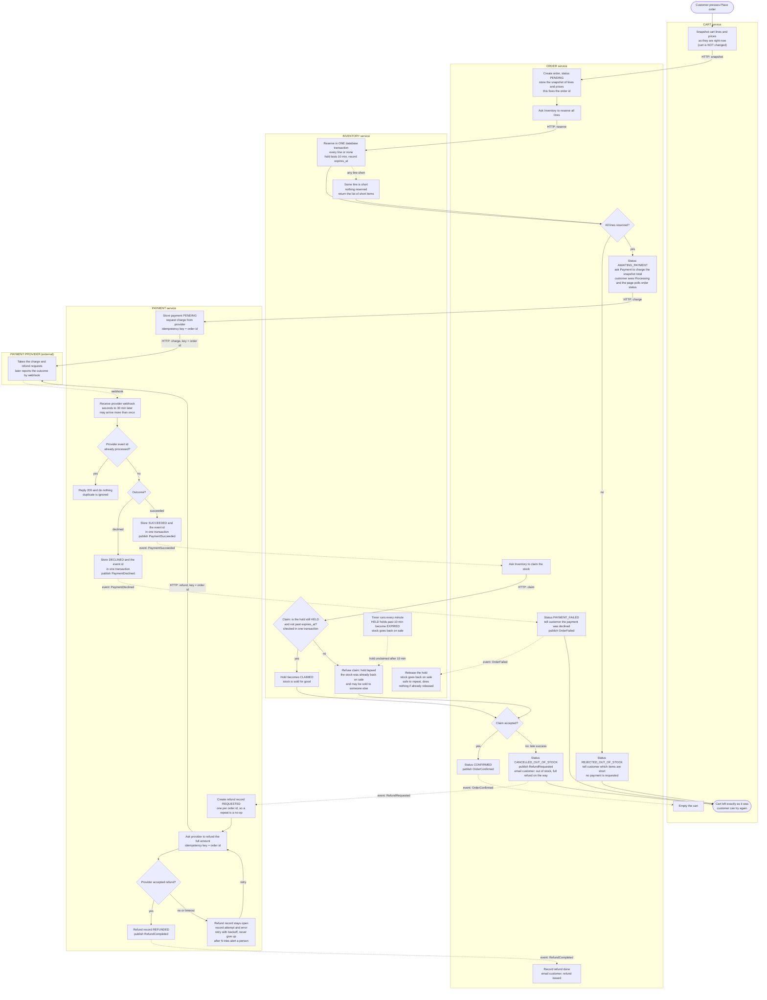

# Checkout across Cart, Inventory, Payment and Order

## How to read this

Four services. Each owns its own database and never reads another's tables. They talk in two ways:

- **Solid arrows** are synchronous HTTP calls.
- **Dotted arrows** are events on the shared message broker.
- **Diamonds** are decisions.
- Each box sits in the lane of the service that does the work.
- The payment provider is outside our system. It talks only to Payment.

The **Order** service is the coordinator. It decides what happens next at each step. The other three services do one job each and report back.

## Flowchart

The timer box (`I6`) feeds the lapsed-hold path. After a hold expires, the next claim for that order finds it EXPIRED and refuses.

## What triggers each step

| Step | Triggered by |
|---|---|
| Cart snapshots and sends to Order | Customer presses **Place order** |
| Order asks Inventory to reserve | Order created |
| Order asks Payment to charge | Inventory says every line is reserved |
| Payment starts processing an outcome | Provider webhook |
| Order marks the order failed | `PaymentDeclined` event |
| Order asks Inventory to claim | `PaymentSucceeded` event |
| Cart empties | `OrderConfirmed` event, and nothing else |
| Payment starts a refund | `RefundRequested` event |
| Inventory releases a hold | `OrderFailed` event, or the 10-minute timer |
| Order emails the customer | Out-of-stock cancellation, and again when `RefundCompleted` arrives |

## What each service stores

| Service | Its own database holds |
|---|---|
| **Cart** | Carts and their lines and prices. It is edited only by the customer, and emptied only on `OrderConfirmed`. |
| **Order** | Orders with a frozen copy of the lines and prices from the moment of **Place order**, the total, and the status: `PENDING`, `AWAITING_PAYMENT`, `CONFIRMED`, `REJECTED_OUT_OF_STOCK`, `PAYMENT_FAILED`, `CANCELLED_OUT_OF_STOCK`. It also holds an outbox of events waiting to be published. |
| **Inventory** | Stock levels per item. Reservations: order id, lines, `expires_at`, and status `HELD`, `CLAIMED`, `EXPIRED` or `RELEASED`. |
| **Payment** | Payments: order id, amount, provider reference, and status `PENDING`, `SUCCEEDED` or `DECLINED`. Refunds: order id, status `REQUESTED`, `REFUNDED` or a stuck-and-retrying state, attempt count, last error. Processed provider event ids, with a unique constraint. |

## The failure branches

1. **Short stock.** Inventory reserves all-or-nothing in one transaction. If any line is short, it reserves nothing and returns the short items. Order marks the order `REJECTED_OUT_OF_STOCK` and tells the customer which items are short. Payment is never called. The cart is untouched.
2. **Declined payment.** The provider's webhook says declined. Payment stores it and publishes `PaymentDeclined`. Order marks the order `PAYMENT_FAILED` and publishes `OrderFailed`, and Inventory releases the hold straight away. The cart is untouched. The customer can press **Place order** again. That creates a new order with a new id, so it gets a fresh idempotency key.
3. **Late success after the hold lapsed.** This is the bad case.
   - Payment succeeds, for example 20 minutes after Place order.
   - Order asks Inventory to claim the stock.
   - The hold expired at 10 minutes, so Inventory refuses.
   - Order marks the order `CANCELLED_OUT_OF_STOCK`, publishes `RefundRequested`, and emails the customer.
   - Payment refunds the full amount automatically.
   - No partial order is ever shipped. The cart is untouched.
4. **Failed refund.** The refund record is written to Payment's database before the provider is called, so the obligation exists even if the call fails. A failed or timed-out refund leaves the record open. A retry job re-attempts it with backoff and never gives up. After N failures it also alerts a person. Because the key is the order id, a retry cannot refund twice. The record becomes `REFUNDED` only when the provider confirms.
5. **Duplicate webhooks.** The provider's event id is inserted into the processed-events table in the same database transaction that updates the payment. A unique constraint means a repeat delivery fails the insert. Payment replies 200 and does nothing. No second event is published and no second refund is created.

## Design rules that make this safe

- **Idempotency key is the order id.** Every charge request carries it, so a retried request cannot charge twice. The refund request uses the same key.
- **The hold and the claim race is closed.** Inventory checks `expires_at` inside the claim transaction itself, so the claim does not depend on the timer having run. A hold is either claimed in time or lost, never both.
- **Events are published through an outbox.** Each service writes the event to its own database in the same transaction as the state change. A relay then publishes it. This avoids a state change with no event, or the reverse.
- **Every consumer is safe to run twice.** Brokers deliver at least once. Order only moves an order forward from the status it expects, Inventory release and claim are idempotent per order id, and Payment dedupes as above.
- **Cart is emptied in exactly one place.** That is the `OrderConfirmed` handler. Every failure path ends with the cart unchanged.

## Assumptions to confirm

- **Email.** Order sends the customer emails through whatever mail service you already use. This is not one of the four services.
- **Lapsed hold, stock still free.** If a hold has lapsed but nobody has bought the stock yet, the claim still fails and the customer is refunded. This is simpler and predictable. The alternative is to re-reserve at claim time.
- **Silent provider.** If no webhook arrives about 35 minutes after the charge, Payment should ask the provider for the status by order id. Otherwise the order would wait forever. This is not in the diagram.
- **Cart edits during checkout.** The cart is emptied on confirmation even if the customer added items after pressing Place order. Say if you would rather remove only the lines that were ordered.
