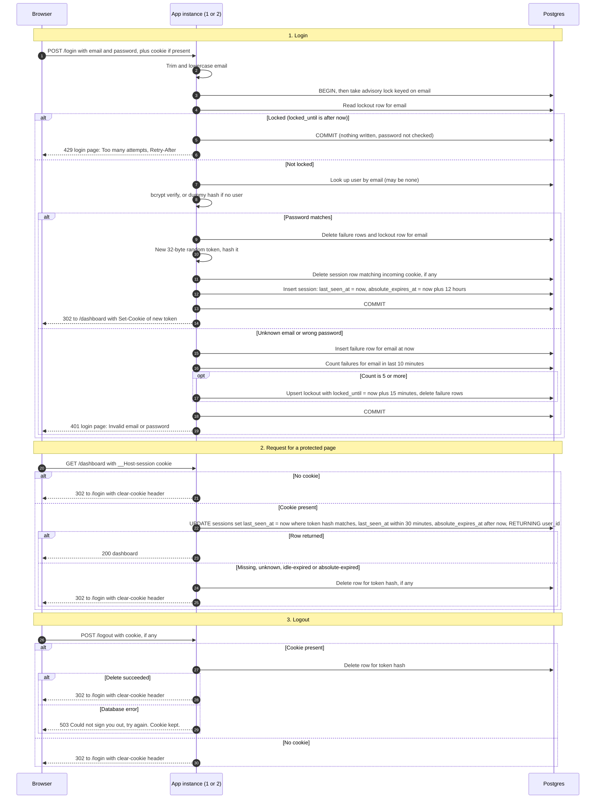

# Login with server-side sessions: design

## Summary

Today every page of the team-scheduling app is public. The app is server-rendered HTML, runs as two identical instances behind a load balancer, and shares one Postgres database. After this change, every page except `/login` needs a signed-in user: the browser holds only a random session ID in a cookie, and the server keeps the matching session in Postgres, so both instances see it and no sticky sessions are needed. A login checks a per-email lockout, verifies the password, and on success starts a new session; each later request checks that session on the server, and a session ends after 30 minutes with no requests or 12 hours after login, whichever comes first.

## Terms

- **Users table**: the existing table with `id`, `email` (stored lowercase, unique) and `password_hash` (a bcrypt hash). Sign-up and password reset are out of scope.
- **Session**: a row in the `sessions` table that says which user is signed in and when the session ends. The browser never sees this row.
- **Session ID (token)**: a random string the browser keeps in its cookie. The server stores only its SHA-256 hash.
- **Cookie**: a small value the server asks the browser to store and send back with each request.
- **HttpOnly**: the cookie cannot be read by page JavaScript.
- **Secure**: the browser sends the cookie only over HTTPS.
- **SameSite=Lax**: the browser does not send the cookie on most requests started from other sites.
- **`__Host-` prefix**: a cookie-name prefix that makes browsers require Secure, `Path=/` and no `Domain`.
- **Browser-session cookie**: a cookie with no expiry date, so the browser drops it when closed.
- **SHA-256 hash**: a one-way fingerprint of a value. A stored hash cannot be turned back into the token.
- **CSPRNG**: the operating system's cryptographically secure random number source.
- **bcrypt**: a deliberately slow password-hashing function. Its cost factor sets how slow it is.
- **Dummy bcrypt hash**: a fixed fake hash, checked when no account exists, so an unknown email takes as long as a real one.
- **Transaction**: a group of database changes that all save on COMMIT or all undo on ROLLBACK.
- **Advisory lock**: a lock that Postgres grants on a number the app chooses. Here the number comes from `hashtext(email)`.
- **hashtext**: a Postgres function that turns text into a number.
- **Lockout**: refusing logins for one email for a set time after too many failures.
- **Idempotent**: running it twice does the same as running it once.
- **Upsert**: insert the row, or update it if it already exists.
- **Retry-After**: an HTTP header giving the number of seconds until the client may try again.
- **Sticky session**: a load-balancer setting that sends one browser to the same instance every time. This design does not use it.
- **Redis**: an in-memory data store. It is not in the stack today.
- **Anti-enumeration**: making responses identical, so an attacker cannot tell whether an account exists.
- **Session fixation**: an attack where someone sets a known session ID in a victim's browser. A new ID at login defeats it.
- **Login CSRF**: a site tricking a victim's browser into submitting the login form.
- **Credential stuffing**: trying leaked email and password pairs across many accounts.
- **Mermaid**: a text notation for diagrams. The flow below is written in it.

## Flow



## Notes on the flow

- **The lock check comes before the password check.** A locked attempt writes nothing, so it does not add to the failure count.
- **The 5th failure still returns 401.** Attempts 6 and later during the lock return 429. The 15-minute lock starts at the 5th failure. Its failure rows are deleted when the lock is set, so the first attempt after the lock is counted from zero.
- **Retry-After** is the number of whole seconds from now until `locked_until`, rounded up, so it is at least 1. Every attempt during the lock gets 429, so a user can tell a lockout from a wrong password. This shows only that the email has had failed attempts. Unknown emails lock the same way, so it does not show whether an account exists.
- **A failed login with a valid cookie changes nothing.** The old session stays valid, and the response is the 401 login page. Only a successful login replaces the session.
- **Clear-cookie headers** repeat the same name, Path, Secure, HttpOnly and SameSite attributes as the original cookie, or the browser will not clear it.
- **Expired, unknown and missing sessions look the same to the client:** a redirect to `/login` with a cleared cookie. Nothing reveals which case applied.
- **Logout gives the same result with or without a session,** apart from the storage-failure case in the table below.
- **Session check scope.** One middleware runs the session check on every request. It skips only `/login`, `/logout` and static asset paths (CSS, JS, images). The login page must render without a session, and logout must work without one. Every other request, including form POSTs, must pass the check.

## Design choices

1. **Storage: Postgres, not Redis.** Both instances share one Postgres database, so sessions and failure counts are visible to both without sticky sessions. Postgres is already the system of record, so session and lockout writes can share a transaction with the `users` read. Redis would add a service to deploy, monitor, back up and secure, for a small team app. It would give native expiry timers and lower latency, so reconsider it if session writes become a measured bottleneck. Memory inside one app process is ruled out, because the other instance could not see those sessions.
2. **Session ID.** 32 random bytes from a CSPRNG, base64url encoded. The database stores only the SHA-256 hash of the ID, so a database leak does not yield live sessions. The cookie carries only the raw ID. No user data goes in the cookie.
3. **Cookie.** Name `__Host-session`, with `HttpOnly; Secure; SameSite=Lax; Path=/` and no `Domain`. The `__Host-` prefix forces Secure and `Path=/`, and it prevents a subdomain from setting the cookie. No `Max-Age`, so it is a browser-session cookie. The server enforces the time limits, not the browser.
4. **Expiry is checked and recorded in the database.** Each session row holds `last_seen_at` and `absolute_expires_at`. Every protected request sets `last_seen_at` to now, which restarts the 30-minute idle clock. `absolute_expires_at` is set once at login, to 12 hours later, and is never extended. Checks use the database clock (`now()`), so the two instances cannot disagree about time.
5. **Lockout rules.** `login_failures` holds one row per failed attempt. `login_lockouts` holds one row per active lock. An email locks when it has 5 failures in the last 10 minutes, counted back from each attempt, and the lock lasts 15 minutes. The email is trimmed and lowercased, and it is counted whether or not an account exists. A successful login clears that email's failure rows and its lockout row.
6. **Concurrency.** Each login runs in one transaction that first takes `pg_advisory_xact_lock(hashtext(email))`. The lock check, the password check and the failure recording all happen while that lock is held, so parallel guesses for one email cannot exceed 5. If two different emails hash to the same number, they only wait for each other. The lock is held until COMMIT or ROLLBACK, so bcrypt runs under it and other logins for the same email wait behind it. The design sets no wait limit (see Open questions).
7. **Anti-enumeration.** An unknown email is checked against the dummy bcrypt hash, at the same cost factor, so the timing matches. Unknown-email and wrong-password responses have the same status, body and headers. Lockout applies to unknown emails too.
8. **Session fixation.** Every successful login creates a new token and deletes the row for the incoming cookie, whatever that session was, even if the browser already had one.
9. **Removing abandoned sessions.** Expired rows are already rejected by the lookup, so cleanup only saves space. Each app instance runs the cleanup on a timer inside its own process, started at boot, every 10 minutes. The cleanup is idempotent, so two instances running it is harmless, and if one instance is down the other runs it. If both are down, expired rows stay, but lookups still reject them, so only table size grows. The cleanup runs these queries:

```sql
DELETE FROM sessions WHERE last_seen_at <= now() - 30 min OR absolute_expires_at <= now();
DELETE FROM login_failures WHERE failed_at < now() - 10 min;
DELETE FROM login_lockouts WHERE locked_until < now();
```

## What happens when things fail

| Failure | What the user sees | What is stored afterwards |
|---|---|---|
| Database error during login, before COMMIT | 503 with a generic message. Cookie unchanged. | Everything rolls back: no failure row, no session row, no lockout change, and the old session row is kept. If the connection drops, Postgres rolls back by itself. Login never fails open, because that would disable the lockout. |
| Database error on a protected page | 503. Cookie kept. No redirect, so there is no redirect loop. | No change. |
| Database error on logout | 503: Could not sign you out, try again. Cookie kept. | The session row may still exist. The cookie is kept so the browser and server still agree, and the user can retry. |
| Cleanup fails, or one instance is down | Nothing visible. | Expired rows remain, but lookups reject them, so only table size grows. |

## Database tables

```sql
CREATE TABLE sessions (
  token_hash          bytea PRIMARY KEY,           -- SHA-256 of the cookie token
  user_id             bigint NOT NULL REFERENCES users(id),
  created_at          timestamptz NOT NULL DEFAULT now(),
  last_seen_at        timestamptz NOT NULL DEFAULT now(),
  absolute_expires_at timestamptz NOT NULL
);
CREATE INDEX ON sessions (last_seen_at);
CREATE INDEX ON sessions (absolute_expires_at);

CREATE TABLE login_failures (
  email     text NOT NULL,                          -- normalized
  failed_at timestamptz NOT NULL DEFAULT now()
);
CREATE INDEX ON login_failures (email, failed_at);

CREATE TABLE login_lockouts (
  email        text PRIMARY KEY,
  locked_until timestamptz NOT NULL
);
```

## Open risks and follow-ups

- **Login CSRF.** `SameSite=Lax` does not stop an attacker from submitting a login form to the victim's browser. Add a token to the login form. This is not in the fixed requirements.
- **Credential stuffing across many emails.** The per-email lockout does not limit one attacker trying many accounts. A per-IP limit is a follow-up. It needs the real client IP behind the load balancer, and it must not trust a spoofable forwarded header.
- **Write per request.** Every protected request writes `last_seen_at`. This is one primary-key update, which is cheap at team scale. Measure it before optimizing.
- **Lockout table growth.** Unknown email strings create failure rows. The cleanup job bounds the growth, but a flood of distinct emails will still fill the table briefly.
- **Not measured.** The 10-minute cleanup interval and the timing equalization are design choices. They have not been tested.

## Open questions

- Confirm that "page" means HTML pages, so static assets (CSS, JS, images) can skip the session check. The brief does not say this.
- Who creates rows in `users`? This design does not say what creates accounts.
- How long may a queued login wait for the advisory lock? No wait limit is set, and bcrypt is the main time spent under the lock.