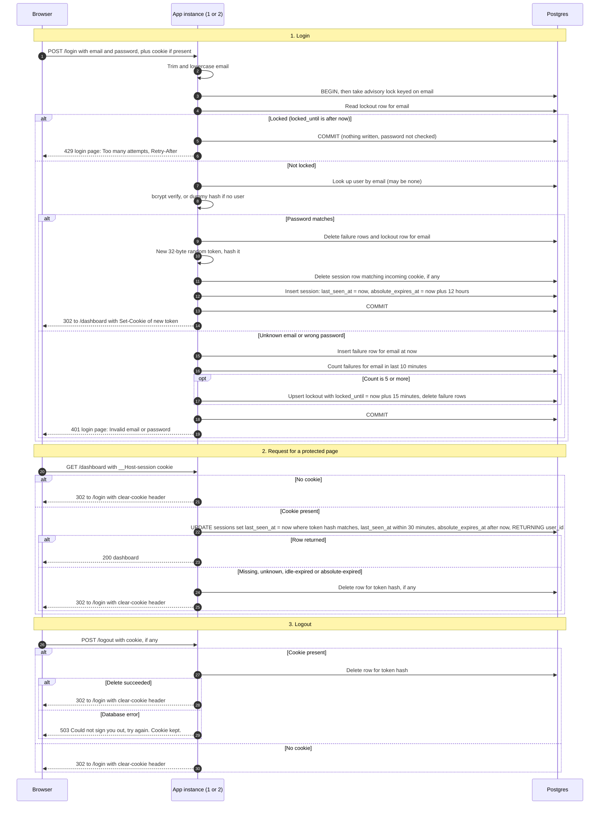

# Login with server-side sessions: design

## Decisions

1. **Where sessions live: Postgres, not Redis.** Both instances share the one Postgres database, so sessions and failure counts are visible to both with no sticky sessions. Postgres is already the system of record, so session and lockout writes can share a transaction with the `users` read. Adding Redis would mean a new service to deploy, monitor, back up and secure, for a small team app. Redis would give native TTLs and lower latency. Reconsider it if session writes become a measured bottleneck. Process memory is ruled out by the two-instance setup.
2. **Session token.** 32 bytes from a CSPRNG, base64url encoded. The database stores only its SHA-256 hash, so a database leak does not yield live sessions. The cookie carries only the raw token.
3. **Cookie.** Name `__Host-session`, with `HttpOnly; Secure; SameSite=Lax; Path=/` and no `Domain`. The `__Host-` prefix forces Secure and Path=/ and prevents subdomain injection. No `Max-Age`, so it is a browser-session cookie. The server enforces the 30-minute and 12-hour limits, not the browser.
4. **Expiry is checked and recorded in the database.** `sessions` holds `last_seen_at` and `absolute_expires_at`. `absolute_expires_at` is set once at login and never extended. Every protected request bumps `last_seen_at`. The check uses the database clock (`now()`), so the two app instances cannot disagree about time.
5. **Lockout state.** `login_failures(email, failed_at)` records each failed attempt. `login_lockouts(email, locked_until)` records active locks. The 10-minute window is rolling: the count is failures in the last 10 minutes. The email is normalized (trimmed, lowercased) and keyed whether or not an account exists.
6. **Concurrency.** Each login runs in one transaction that first takes `pg_advisory_xact_lock(hashtext(email))`. Checking the lock, verifying the password and recording the failure are serialized per email, so parallel guesses cannot exceed the limit of 5. A hash collision only serializes two unrelated emails.
7. **Anti-enumeration.** Unknown emails are verified against a dummy bcrypt hash with the same cost factor, so timing matches. Unknown and wrong-password responses have an identical status, body and headers. Lockout applies to unknown emails too.
8. **Session fixation.** Every successful login generates a new token and deletes the row for the incoming cookie, whatever that session was.
9. **Removing abandoned sessions.** Expired rows are already unusable because the lookup predicate rejects them. A cleanup query runs every 10 minutes from either instance. It is idempotent, so two instances running it is harmless. Logout deletes its row immediately.
10. **Storage failure.** Login returns 503 with a generic message and does not change the cookie. Protected pages return 503, keep the cookie and do not redirect, so there is no redirect loop. Logout returns 503 and keeps the cookie, so the browser and the server still agree and the user can retry. Login never fails open, because that would disable the lockout.

## Sequence diagram



## Rules that do not fit on the arrows

- **Lock check comes before the password check.** A locked attempt writes nothing, so it does not add to the failure count.
- **The 5th failure still returns 401.** Attempts 6 and later within the lock return 429. The 15-minute lock runs from the 5th failure. Deleting the failure rows at lock time restarts the count, so the first attempt after the lock is judged on a clean slate.
- **Successful login clears the email's failure rows and lockout row.**
- **Clear-cookie headers** repeat the same name, Path, Secure, HttpOnly and SameSite attributes as the original, or the browser will not clear the cookie.
- **Expired and missing sessions look identical to the client:** a redirect to `/login` with a cleared cookie. Nothing reveals which case applied.
- **Logout is the same with or without a session,** apart from the storage-failure case above.
- **Static assets (CSS, JS, images)** must be exempt from the session check, or the login page cannot render. This assumes "page" means HTML pages. Confirm this.
- **Cleanup job** (every 10 minutes, idempotent):
  - `DELETE FROM sessions WHERE last_seen_at <= now() - 30 min OR absolute_expires_at <= now()`
  - `DELETE FROM login_failures WHERE failed_at < now() - 10 min`
  - `DELETE FROM login_lockouts WHERE locked_until < now()`

## Schema

```sql
CREATE TABLE sessions (
  token_hash          bytea PRIMARY KEY,           -- SHA-256 of the cookie token
  user_id             bigint NOT NULL REFERENCES users(id),
  created_at          timestamptz NOT NULL DEFAULT now(),
  last_seen_at        timestamptz NOT NULL DEFAULT now(),
  absolute_expires_at timestamptz NOT NULL
);
CREATE INDEX ON sessions (last_seen_at);
CREATE INDEX ON sessions (absolute_expires_at);

CREATE TABLE login_failures (
  email     text NOT NULL,                          -- normalized
  failed_at timestamptz NOT NULL DEFAULT now()
);
CREATE INDEX ON login_failures (email, failed_at);

CREATE TABLE login_lockouts (
  email        text PRIMARY KEY,
  locked_until timestamptz NOT NULL
);
```

## Open risks and follow-ups

- **Login CSRF.** `SameSite=Lax` does not stop an attacker from submitting a login form to the victim's browser. Add a token to the login form. This is not in the fixed requirements.
- **Credential stuffing across many emails.** The per-email lockout does not limit one attacker trying many accounts. A per-IP limit is a follow-up. It needs the real client IP behind the load balancer, and must not trust a spoofable forwarded header.
- **Write per request.** Every protected request writes `last_seen_at`. This is one primary-key update, which is cheap at team scale. Measure it before optimizing.
- **Lockout table growth.** Unknown email strings create failure rows. The cleanup job bounds the growth, but a flood of distinct emails will still fill the table briefly.
- **Not measured.** The 10-minute cleanup interval and the timing equalization are design choices. They have not been tested.
