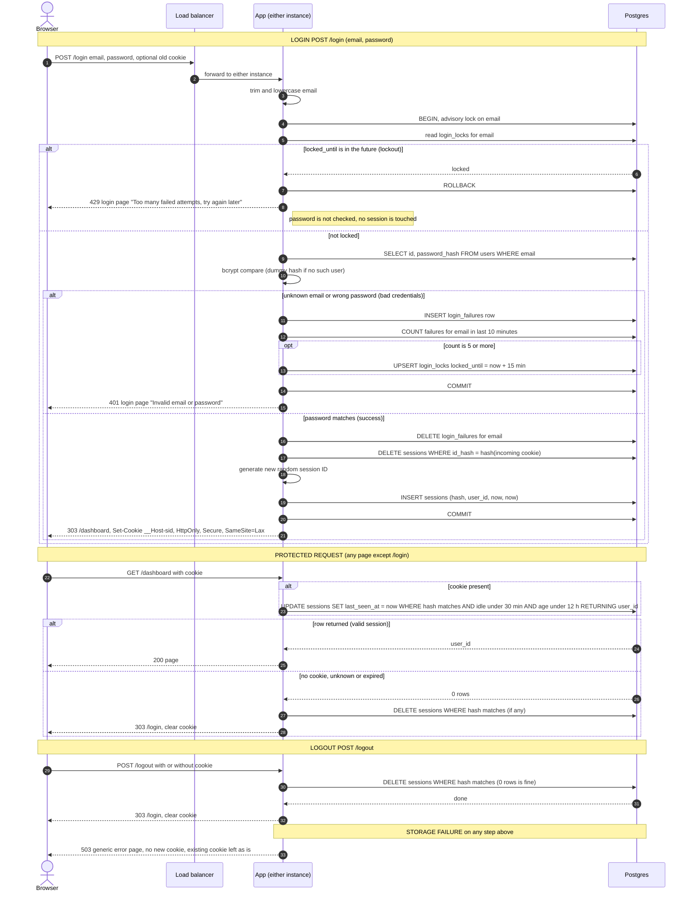

# Login with server-side sessions: design

This adds sign-in to a server-rendered scheduling app (HTML pages and form posts, no SPA or API clients). Today every page is public and the app runs as two identical instances behind a load balancer, with no sticky sessions and one Postgres database. After this change every page except `/login` needs a signed-in user. A browser logs in with email and password and gets a cookie holding only a random session ID. The session and the brute-force counters live in the existing Postgres, because both instances already share it and consecutive requests from one user may reach different instances.

## Terms

- **Session**: a row in `sessions` saying "this random ID belongs to this user". The cookie holds the ID and nothing else (no user data).
- **Protected request**: any request to a page other than `/login`.
- **Advisory lock**: a Postgres lock on an arbitrary number, here a hash of the email. It is held until the transaction ends. It lets us serialise work per email without locking table rows.
- **Fail closed**: when storage cannot be reached, deny the action instead of guessing.
- **`__Host-` prefix**: a cookie-name prefix that browsers enforce. The cookie must be Secure, have `Path=/` and have no `Domain`.
- **Lockout**: a 15-minute refusal of logins for one email after too many failures.

## Sequence diagram



The load balancer may send any request to either instance, so all state is in Postgres. All redirects after a POST use 303 so the browser follows them with GET.

## Decisions

| Question | Choice | Why |
|---|---|---|
| Where sessions and failure counts live | `sessions`, `login_failures` and `login_locks` tables in the existing Postgres | Both instances already share it, it adds no infrastructure, and login can update failures and sessions in one transaction. A small team makes one indexed primary-key read and write per request cheap. |
| Redis | **Not added** | It would be a second stateful service to run, secure, back up and monitor, with its own failure handling, and its only benefit is speed we do not need. If load grows, the session lookup is the one thing to move. |
| Session ID | 32 bytes from a CSPRNG, base64url encoded. Only its SHA-256 is stored (`id_hash`). | A leaked database or backup then yields no usable cookies. |
| Cookie | `__Host-sid=<id>; Path=/; HttpOnly; Secure; SameSite=Lax`, no `Domain`, no `Max-Age` | `__Host-` stops other subdomains overwriting it. With no `Max-Age`, the server decides when a session ends, not the browser. |
| How expiry is checked | On every protected request, on the server, with the database clock (`now()`) | Two instances can have skewed clocks. One time source avoids that. |
| How expiry is recorded | `created_at` (fixed) and `last_seen_at` (updated every request) on the session row | The 12-hour limit counts from `created_at`, the 30-minute idle limit from `last_seen_at`. A session is valid only if both hold. |
| Removing abandoned sessions | Cleanup sweep every 5 minutes. Correctness never depends on it. | Expired rows are rejected on read anyway. The sweep only keeps tables small. |
| When storage fails | Fail closed with a generic 503 page (see Failures) | Never serve protected content, never issue a session, never skip the lockout check. |

## State

```sql
CREATE TABLE sessions (
  id_hash      bytea       PRIMARY KEY,           -- sha256(session id)
  user_id      bigint      NOT NULL REFERENCES users(id),
  created_at   timestamptz NOT NULL DEFAULT now(),
  last_seen_at timestamptz NOT NULL DEFAULT now()
);
CREATE INDEX ON sessions (user_id);

CREATE TABLE login_failures (
  email     text        NOT NULL,                 -- lowercase, whether or not an account exists
  failed_at timestamptz NOT NULL DEFAULT now()
);
CREATE INDEX ON login_failures (email, failed_at);

CREATE TABLE login_locks (
  email        text        PRIMARY KEY,
  locked_until timestamptz NOT NULL
);
```

The existing `users` table has `id`, `email` (stored lowercase, unique) and `password_hash` (bcrypt). Sign-up, password reset and user creation are out of scope; users are provisioned outside this design.

## Steps

### 1. Login: `POST /login` with email and password

Started by the login form. Everything below runs in one transaction. Data: `login_locks`, `login_failures`, `sessions`, `users`.

1. Trim and lowercase the email. Use this value for every lookup, failure count and lock. An input over 254 characters counts as a failed attempt with no user lookup.
2. Take `pg_advisory_xact_lock(hashtext(email))`. Concurrent attempts on the same email wait in turn, so parallel requests cannot slip past the limit of 5. Different emails do not block each other. The lock is held across the bcrypt compare on purpose, because it slows guessing on one email.
3. Check the lockout first. If `login_locks.locked_until > now()`, return 429 with "Too many failed attempts, try again later" and stop. The user is not read, the password is not checked (even a correct one is refused), and no existing session is touched. The page does not show the end time. The only way out is to wait.
4. Read the user by email and run a bcrypt compare. If there is no such user, compare against a dummy hash so response time does not reveal whether the account exists. The dummy hash is made once at startup with the same cost as the real hashes.
5. On an unknown email or wrong password, both take this one path. Insert a `login_failures` row (for every email string, including ones with no account, so lockout and 429 reveal nothing either). Count that email's rows from the last 10 minutes. This sliding window is exactly "5 failures within any 10 minutes". If the count is 5 or more, upsert `login_locks.locked_until = now() + 15 minutes`. Commit and return 401 with the login page showing "Invalid email or password". The 5th failure still returns 401. The 6th attempt, and every attempt until the lock expires, returns 429. By the time the lock expires its failures are over 10 minutes old, so the user starts from zero. A 401 does not touch any existing session.
6. On a matching password, delete that email's `login_failures` rows. Delete the session row for the incoming cookie's hash if there is one, and insert a new row with a new random ID. The incoming ID is never reused, and an unknown or expired cookie is simply ignored. Commit, then reply 303 to `/dashboard` with `Set-Cookie`.

### 2. Protected request

Started by any request to a page other than `/login`. Static assets may skip this check only if they carry no user data. Data: `sessions`.

1. If there is no cookie, skip the query and go to step 3.
2. Run one atomic statement that validates and extends the session. No check-then-update race exists between instances.

```sql
UPDATE sessions
   SET last_seen_at = now()
 WHERE id_hash = $1
   AND last_seen_at > now() - interval '30 minutes'
   AND created_at   > now() - interval '12 hours'
RETURNING user_id;
```

   One returned row means the session is valid. Put that `user_id` on the request and serve the page. The app does not reload the user from `users`. A page query that needs user data does its own reads.
3. Zero rows, or no cookie, means missing, unknown or expired. Delete any row for that hash, clear the cookie (`Max-Age=0`, same attributes) and return 303 to `/login`.

Logging out in one tab ends the session for all tabs, because the session is shared. Other tabs get zero rows on their next request and go to `/login`.

### 3. Logout: `POST /logout`

Started by the logout form. It does not validate the session first. It deletes the session row for the cookie's hash, and zero rows (no session) counts as success. After the delete commits, clear the cookie and return 303 to `/login`. The response is the same whether or not a session existed. `SameSite=Lax` stops other sites forcing a logout with a cross-site POST.

### 4. Cleanup sweep

Started by a timer on each instance every 5 minutes. It is idempotent, so two instances running it does no harm.

- `DELETE FROM sessions WHERE last_seen_at < now() - interval '30 minutes' OR created_at < now() - interval '12 hours'`
- `DELETE FROM login_failures WHERE failed_at < now() - interval '10 minutes'`
- `DELETE FROM login_locks WHERE locked_until < now()`

If the sweep fails, it logs the error and retries on the next tick. Nothing user-facing breaks.

## Failures

If any Postgres call fails, the user sees a generic 503 page: "Something went wrong on our side. Please try again." It never says what failed. Errors are logged with a request ID. Credentials and session IDs are never logged.

| Where | What happens |
|---|---|
| `POST /login` storage failure | 503, no cookie issued. If the lock state could not be read, the password is not checked. Any failure before commit rolls the whole transaction back (a lost connection does this automatically), so that attempt is not counted and no session is created. The user can retry. |
| Protected page storage failure | 503. The app does not serve the page, does not redirect to `/login`, and does not clear the cookie. The session may still be valid, so an outage must not sign everyone out. A failure in a page's own query is also a 503. |
| `POST /logout` storage failure | 503, and the cookie is **not** cleared. The destroy could not be confirmed, so the user keeps the cookie and can retry. |
| Bad credentials, lockout, expired session | Not failures of storage. Handled in the steps above (401, 429, redirect to `/login`). |
| Cleanup sweep | Logged, retried next tick. |

## Open questions

- Bcrypt cost is not stated in the brief. The dummy hash must use the same cost as the real hashes. Check it before building.
- Whether the 429 page should show when the lock ends is undecided. The current choice is no.