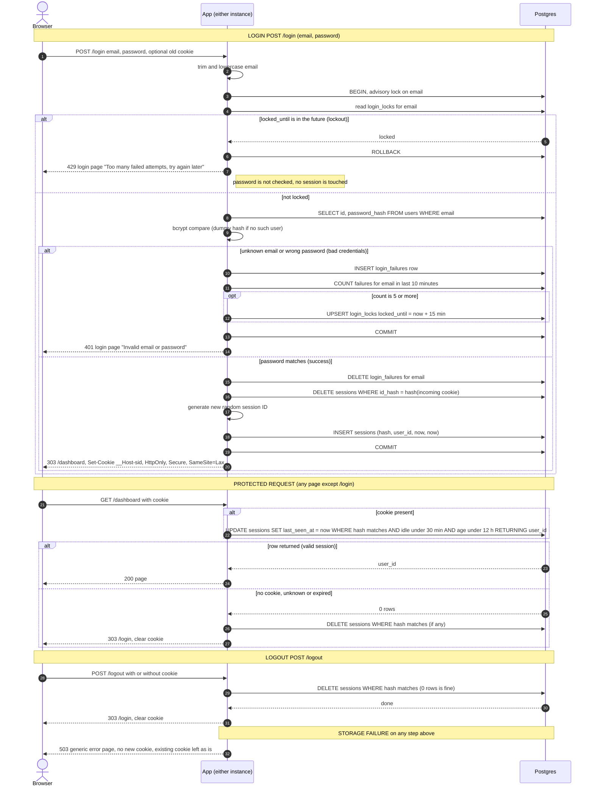

# Login with server-side sessions: design

## Decisions

| Question | Choice | Why |
|---|---|---|
| Where sessions live | A `sessions` table in the existing Postgres | Both instances already share it, and it adds no new infrastructure. Traffic is a small team, so one indexed primary-key read and write per request is cheap. |
| Where failure counts live | `login_failures` and `login_locks` tables in the same Postgres | Same reasoning. Keeping them in the same database as the sessions also means login can update both in one transaction. |
| Redis | **Not added** | It would be a second stateful service to run, secure, back up and monitor, and it would need its own failure handling. The only benefit is speed we don't need. If load grows, the session lookup is the one thing to move, and the rest of the design would not change. |
| Session ID | 32 bytes from a CSPRNG, base64url encoded. Only its SHA-256 is stored (`id_hash`). | A leaked database or backup then does not yield usable cookies. |
| Cookie | `__Host-sid=<id>; Path=/; HttpOnly; Secure; SameSite=Lax`, with no `Domain` and no `Max-Age` | This meets requirement 5. The `__Host-` prefix stops other subdomains from overwriting the cookie. The server decides when a session ends, not the browser. |
| How expiry is checked | On every protected request, on the server, using the database clock (`now()`). The instances' clocks are never used. | Two instances can have skewed clocks. A single time source avoids that. |
| How expiry is recorded | Two columns on the session row: `created_at` (fixed) and `last_seen_at` (updated on every request) | The 12-hour limit is measured from `created_at`. The 30-minute idle limit is measured from `last_seen_at`. A session is valid only if both limits hold. |
| Removing abandoned sessions | Cleanup sweep every 5 minutes. Correctness never depends on it. | Expired rows are rejected on read anyway. The sweep only keeps the table small. |
| When storage fails | Fail closed with a generic 503 page. Never serve protected content, never issue a session, and never skip the lockout check. | Details are in "Storage failure" below. |

## State

```sql
CREATE TABLE sessions (
  id_hash      bytea       PRIMARY KEY,           -- sha256(session id)
  user_id      bigint      NOT NULL REFERENCES users(id),
  created_at   timestamptz NOT NULL DEFAULT now(),
  last_seen_at timestamptz NOT NULL DEFAULT now()
);
CREATE INDEX ON sessions (user_id);

CREATE TABLE login_failures (
  email     text        NOT NULL,                 -- lowercase, whether or not an account exists
  failed_at timestamptz NOT NULL DEFAULT now()
);
CREATE INDEX ON login_failures (email, failed_at);

CREATE TABLE login_locks (
  email        text        PRIMARY KEY,
  locked_until timestamptz NOT NULL
);
```

## Rules that don't fit on the arrows

**Email handling (req. 1).** The app trims the email and lowercases it before any lookup, failure count or lock. The same normalised value is used everywhere. Inputs over 254 characters are treated as a failed attempt without a user lookup.

**Identical failure response (req. 2).**
- An unknown email and a wrong password take the same code path and return the same 401 and page body.
- For an unknown email the app still runs a bcrypt compare against a fixed dummy hash, so response time does not reveal whether the account exists.
- Failures are recorded for every email string, including ones with no account. Lockout therefore applies equally to real and nonexistent emails, and a 429 reveals nothing either.

**Lockout (req. 3).**
- Each login attempt runs in one transaction that first takes `pg_advisory_xact_lock(hashtext(email))`. Concurrent attempts on the same email are serialised, so parallel requests cannot slip past the limit of 5.
- The lock check comes first. If `login_locks.locked_until > now()`, the app returns 429 and never reads the user or checks the password.
- On a failed password, the app inserts a `login_failures` row and counts that email's rows from the last 10 minutes. If the count is 5 or more, it upserts `login_locks.locked_until = now() + 15 minutes`.
- The 5th failure itself still returns 401. The 6th attempt, and every attempt until the lock expires, returns 429.
- Counting rows over a sliding window handles "5 failures within any 10 minutes" exactly. It is not a fixed bucket.
- Failures made before the lock expires are more than 10 minutes old by the time it does, so the user starts from zero.
- A successful login deletes that email's `login_failures` rows. A locked email cannot reach the success path.
- The advisory lock is held across the bcrypt compare. This is intended, because it slows guessing on one email. Different emails do not block each other.

**Fresh session on login (req. 4).**
- On success, in the same transaction, the app deletes the session row for the incoming cookie's hash if there is one, and inserts a new row with a new random ID. It then sends `Set-Cookie`.
- The incoming ID is never reused. A cookie that was unknown or expired is simply ignored.
- A 401 or 429 response does not touch any existing session.

**Session check (reqs. 6 and 7).** Every protected request runs one atomic statement that validates and extends the session together:

```sql
UPDATE sessions
   SET last_seen_at = now()
 WHERE id_hash = $1
   AND last_seen_at > now() - interval '30 minutes'
   AND created_at   > now() - interval '12 hours'
RETURNING user_id;
```

- One returned row means the session is valid, and `user_id` identifies the caller. The idle clock restarts in the same step, so there is no check-then-update race between instances.
- Zero rows means the cookie was missing, unknown or expired. The app deletes any row for that hash, clears the cookie (`Max-Age=0`, same attributes) and returns a 303 to `/login`.
- A request with no cookie skips the query.
- Every page except `/login` goes through this check. Static assets can be exempt only if they carry no user data.

**Cleanup (the abandoned-session choice).**
- Each instance runs a sweep every 5 minutes. The sweep is idempotent, so two instances running it does no harm.
  - `DELETE FROM sessions WHERE last_seen_at < now() - interval '30 minutes' OR created_at < now() - interval '12 hours'`
  - `DELETE FROM login_failures WHERE failed_at < now() - interval '10 minutes'`
  - `DELETE FROM login_locks WHERE locked_until < now()`
- If the sweep fails, it logs the error and retries on the next tick. Nothing user-facing breaks.

**Logout (req. 8).** `POST /logout` deletes the session row for the cookie's hash. The delete matches zero rows when there is no session, and that counts as success. After the delete commits, the app clears the cookie and returns 303 to `/login`. The response is the same whether or not a session existed. `SameSite=Lax` stops other sites from forcing a logout with a cross-site POST.

**Redirect status.** All redirects after a POST use 303 so the browser follows them with GET.

**Storage failure (the user-facing choice).** If any Postgres call fails, the user sees a generic 503 page: "Something went wrong on our side. Please try again." The page never says what failed. The behavior differs by route:

| Route | Behavior when storage fails |
|---|---|
| `POST /login` | 503, no cookie issued, and the password is not checked if the lock state could not be read. The user can retry. |
| Protected page | 503. The app does not serve the page, does not redirect to `/login`, and does not clear the cookie. The session may still be valid, so an outage must not sign everyone out. |
| `POST /logout` | 503, and the cookie is **not** cleared. The server-side destroy could not be confirmed, so the user keeps the cookie and can retry. |

Errors are logged on the server with a request ID. Credentials and session IDs are never logged.

## Sequence diagram


