# Sign in with Google: flow design

Today, `POST /login` checks an email and password, and `start_session(user_id)` turns a good check into a `sessions` row and a `sid` cookie. This design adds Google as a second way to reach that same session. The login page and Account Settings share one start endpoint and one callback, so both entry points get the same checks. A short-lived Redis record saved at start says which entry the user came from, and the callback branches on it. Every successful Google sign-in ends in `start_session(user_id)`.

## Terms

- **sid**: the session cookie. Its value is the id of one row in `sessions`.
- **sessions row**: the database row for one signed-in session. It has a user id and an expiry time.
- **start_session(user_id)**: the existing function that signs a user in. It deletes the `sessions` row of any `sid` the browser already sent, inserts a new row, sets `sid` (HttpOnly, Secure, SameSite=Lax), and redirects to `next` if that is a relative path on our site, otherwise to `/home`. Password login and Google sign-in both end here.
- **next**: a query parameter holding the page to go to after sign-in.
- **Lockout**: after 5 wrong passwords, `locked_until` is set 15 minutes ahead and `failed_logins` goes back to 0. While locked, the password is not checked.
- **bcrypt**: the hash function that stores passwords in `users.password_hash`.
- **Reset email**: `POST /forgot` sends a link valid for one hour. Using it sets `password_hash`, marks the email verified and deletes all of the user's sessions.
- **Redis**: an in-memory store. Its keys can expire on their own. Redis is already used for rate limits.
- **TTL**: how long Redis keeps a key before it deletes it by itself.
- **GETDEL**: a Redis command that reads a key and deletes it in one step. A txn can be used only once.
- **OpenID Connect (OIDC)**: a sign-in layer on top of OAuth. Google's answer is an ID token.
- **ID token**: a signed statement from Google about who signed in. We read only `sub`, `email` and `email_verified` from it.
- **sub**: Google's permanent id for an account. We identify accounts by `sub`, never by email.
- **Authorization code**: a one-time code that Google gives the callback. The server swaps it for the ID token.
- **PKCE**: at start the app makes a random `code_verifier` and sends its SHA-256 hash (`code_challenge`) to Google. It sends the verifier itself at the code exchange, so a stolen code is useless alone.
- **state**: a random value sent to Google and returned unchanged. It ties the callback to the start that made it.
- **nonce**: a random value sent to Google and echoed in the ID token. It stops a token from another attempt being used here.
- **txn**: the Redis record of one sign-in attempt. It lives 600 seconds.
- **Link record**: the Redis record of one password-confirmed link. It lives 600 seconds from the callback.
- **Entry**: where the user started, `login` or `settings`.
- **Page the flow began on**: the login page for the login entry, or the Settings page for the settings entry.
- **Form CSRF token**: a token in each form that proves the POST came from our own page.
- **Unique violation**: a database error raised when an insert would duplicate a unique key.

## Flow

```mermaid
flowchart TD
    LP["Login page<br/>Sign in with Google"] --> START_L["GET /auth/google/start<br/>entry = login, next kept"]
    SP["Settings page<br/>Link Google"] --> SID{"Valid sid cookie?<br/>sid matches a live sessions row"}
    SID -- "no" --> LP
    SID -- "yes" --> START_S["GET /auth/google/start<br/>entry = settings, user_id and sid hash kept"]

    START_L --> TXN["Redis gauth:txn:state, TTL 600 s<br/>state, nonce, PKCE verifier, entry, next, user_id, sid hash<br/>Cookie gauth_txn = state"]
    START_S --> TXN
    TXN --> GOOG["Redirect to Google<br/>scope openid email profile<br/>state, nonce, code_challenge S256"]
    GOOG --> CB["GET /auth/google/callback"]

    CB --> ST{"Cookie gauth_txn and state parameter both present and equal,<br/>and Redis txn exists?"}
    ST -- "no: missing, mismatch, unknown, expired or used" --> E_STATE["Error page<br/>Nothing changed"]
    ST -- "yes: GETDEL txn" --> GERR{"Google sent an error?"}
    GERR -- "yes, e.g. Cancel" --> E_CANCEL["Back to the page the flow began on<br/>Neutral message: Google sign-in was cancelled<br/>Nothing changed"]
    GERR -- "no" --> EXCH["Server POSTs code and PKCE verifier<br/>to Google token endpoint"]
    EXCH --> IDV{"Exchange OK and ID token valid?<br/>signature, iss, aud, exp, nonce"}
    IDV -- "no: exchange error, timeout or bad token" --> E_EX["Back to the page the flow began on<br/>Neutral message: Google sign-in did not finish<br/>Nothing changed, code not reusable"]
    IDV -- "yes: read sub, email, email_verified only" --> ENT{"entry?"}

    ENT -- "settings" --> SSID{"Current sid hash equals txn sid hash,<br/>and session still valid?"}
    SSID -- "no" --> E_SESS["Login page<br/>Please sign in again<br/>Nothing changed"]
    SSID -- "yes" --> SLINK{"sub already linked?"}
    SLINK -- "to this user" --> S_NOOP["Settings page<br/>Already linked"]
    SLINK -- "to another user" --> S_REF1["Settings page<br/>Refused: Google account belongs to another user"]
    SLINK -- "no" --> SONE{"This user already has<br/>a different Google account?"}
    SONE -- "yes" --> S_REF2["Settings page<br/>Refused: unlink the current Google account first"]
    SONE -- "no" --> S_INS["Insert google_identities row<br/>Email not compared, stored email unchanged"]
    S_INS -- "unique violation" --> S_RACE["Settings page<br/>Refused after a race, nothing changed"]
    S_INS -- "ok" --> S_OK["Settings page<br/>Google linked"]

    ENT -- "login" --> LSUB{"sub linked to a user?"}
    LSUB -- "yes, even if locked" --> SIGN["Shared finish: start_session user_id<br/>Same session as password login"]
    LSUB -- "no" --> VER{"email_verified true?"}
    VER -- "no" --> L_UNV["Login page<br/>Verify with email and password first<br/>Nothing created"]
    VER -- "yes" --> MATCH{"Lowercased email matches a user?"}
    MATCH -- "no" --> CREATE["One DB transaction<br/>insert users row: password_hash NULL, email_verified_at now<br/>insert google_identities row"]
    CREATE -- "ok" --> SIGN
    CREATE -- "unique violation" --> L_RETRY["Login page<br/>Sign-in did not finish, try again<br/>Rolled back, nothing created"]
    MATCH -- "yes" --> OTHER{"That user already has<br/>a different Google account?"}
    OTHER -- "yes" --> L_REF["Login page<br/>Refused: account has another Google account<br/>Nothing changed"]
    OTHER -- "no" --> LINK["Redis gauth:link:id, TTL 600 s<br/>sub, user_id, next<br/>Cookie gauth_link = id"]
    LINK -- "Redis write fails" --> E_LINK["Error page<br/>Google sign-in did not finish. Start again.<br/>Nothing changed"]
    LINK -- "ok, 303 redirect" --> PROMPT["GET /auth/google/confirm<br/>Password prompt: Confirm your password to link Google"]

    PROMPT -- "Cancel: POST /auth/google/cancel" --> L_CANCEL["Delete link record and cookie<br/>Login page"]
    PROMPT --> SUBMIT["POST /auth/google/confirm<br/>password and CSRF token"]
    SUBMIT --> LREC{"Link record found,<br/>cookie matches?"}
    LREC -- "no: expired, used or cancelled" --> L_GONE["Login page<br/>This link request expired, start again<br/>Nothing changed"]
    LREC -- "yes" --> LOCK{"locked_until in the future?"}
    LOCK -- "yes" --> L_LOCK["Delete link record and cookie<br/>Login page: Account temporarily locked<br/>Password not checked"]
    LOCK -- "no" --> PW{"bcrypt password correct?"}
    PW -- "no" --> FAIL["failed_logins plus 1<br/>at 5: locked_until = now plus 15 min, failed_logins = 0"]
    FAIL --> LOCKED2{"Account now locked?"}
    LOCKED2 -- "yes" --> L_LOCK
    LOCKED2 -- "no" --> PROMPT
    PW -- "yes" --> CHK{"In the DB transaction: is sub already linked to this user?"}
    CHK -- "yes: an earlier commit whose Redis delete failed" --> SIGN
    CHK -- "no: sub linked to another user, or user has another Google account" --> L_RACE["Delete link record and cookie<br/>Refused, nothing changed"]
    CHK -- "no: neither" --> COMMIT["DB transaction: failed_logins = 0<br/>email_verified_at set if null<br/>insert google_identities row"]
    COMMIT -- "commit fails" --> L_COMMITFAIL["Password prompt again: Could not finish, try again<br/>Nothing changed, link record kept"]
    L_COMMITFAIL --> PROMPT
    COMMIT -- "commit ok" --> DEL["Delete link record and cookie in Redis<br/>A Redis error here is logged, sign-in still goes ahead"]
    DEL --> SIGN
    SIGN --> DONE["Set sid cookie, redirect to next if a relative path on our site, else /home"]

    classDef fail fill:#fde2e2,stroke:#b00020,color:#000
    classDef ok fill:#e2f5e6,stroke:#1b7a33,color:#000
    class E_STATE,E_CANCEL,E_EX,E_SESS,S_REF1,S_REF2,S_RACE,L_UNV,L_REF,L_GONE,L_LOCK,L_RACE,L_RETRY,L_COMMITFAIL,E_LINK fail
    class S_OK,DONE ok
```



## How the flow runs

1. **Start.** `GET /auth/google/start` runs when the user clicks Sign in with Google on the login page, or Link Google on the Settings page. The Settings entry needs a valid `sid`: the cookie must match a live `sessions` row that has not expired. Otherwise the user goes to the login page. The endpoint keeps `next` from its query string only if it is a relative path on our site. If `next` is missing or not relative, nothing is kept and the user lands on `/home`. The endpoint saves the txn under `gauth:txn:{state}` with a TTL of 600 s. The txn holds state, nonce, PKCE verifier, entry, next and, for Settings only, `user_id` and the SHA-256 hash of the sid. It stores a hash, not the sid, because the sid is a live credential: if Redis leaks, the hash cannot be used as a cookie. It sets cookie `gauth_txn` to the state, then redirects to Google with scope `openid email profile`, the state, the nonce and `code_challenge` (S256). If Redis fails, the user gets the error page and nothing changes.

2. **Callback checks.** Google redirects to `GET /auth/google/callback`. The callback needs the `gauth_txn` cookie and the `state` query parameter, both present and equal, and a txn under that state. A mismatch covers a missing cookie or parameter, two values that differ, and an unknown, expired or used txn. On a mismatch the user gets the error page. The callback does not run GETDEL, and it clears the cookie. Otherwise it runs GETDEL on the txn, so the txn cannot be used again. The callback clears `gauth_txn` on every response.

3. **Google error.** Google can send an error, for example when the user presses Cancel. The callback reads this only after step 2 passes. So a forged error redirect cannot cancel someone else's attempt. The txn is already used. The user goes back to the page the flow began on with "Google sign-in was cancelled." Nothing changes.

4. **Code exchange.** The server POSTs the code and the PKCE verifier to Google's token endpoint. It then checks the ID token's signature, `iss`, `aud`, `exp` and `nonce`. It reads only `sub`, `email` and `email_verified`. Any failure (a non-2xx reply, a timeout, a network error or a bad token) sends the user back to the page the flow began on with "Google sign-in did not finish. Try again, or use email and password." The details go to server logs only. The txn is already used, so the code cannot be retried.

5. **Settings branch (entry = settings).** The callback checks the sid again. The hash of the current cookie must equal the txn's hash, and the `sessions` row must still exist and not be expired. Without this check, an attacker could start a link with their own Google account. A victim who finished it would then link the attacker's account to the victim's user. If the check fails, the user goes to the login page with "Please sign in again." Nothing changes. If it passes, the branch looks at `sub`:
   - Linked to this user: "Already linked."
   - Linked to another user: refused.
   - This user already has a different Google account: refused. The user must unlink the current one first.
   - Otherwise: insert a `google_identities` row. Email is not compared or stored, so the emails need not match. A unique violation (a race) means "refused after a race, nothing changed." Success shows "Google linked." This path does not call `start_session`, so the user stays signed in on the same session.

6. **Login branch (entry = login).**
   - `sub` linked to a user: call `start_session(user_id)`. Email is not used here, so a changed Google email still reaches the same account. A locked account still signs in with Google, because lockout limits password guessing and Google does its own password check. Google sign-in does not clear the lock. Password login stays blocked until `locked_until` passes.
   - `sub` not linked, `email_verified` false: the login page says to verify with email and password first. Nothing is created.
   - `sub` not linked, verified email, no user with that lowercased email: in one DB transaction, insert a `users` row (`password_hash` NULL, `email_verified_at` now) and a `google_identities` row. Then call `start_session`. If the insert hits a unique violation (the same email or the same `sub` inserted at the same time), the whole transaction rolls back. The login page says "Sign-in did not finish, try again." Nothing is created.
   - `sub` not linked, verified email matching a user who already has a different Google account: refused. Nothing changes.
   - `sub` not linked, verified email matching a user with no other Google account: write the link record `gauth:link:{id}` to Redis with a TTL of 600 s, holding `sub`, `user_id` and `next`. Set cookie `gauth_link` to the id. Then send a 303 redirect to `GET /auth/google/confirm`. If the Redis write fails, the user gets "Google sign-in did not finish. Start again." Nothing changes. The txn is already used, so the user starts again.

7. **Password confirmation.** `GET /auth/google/confirm` shows a password form. It reads the `gauth_link` cookie, and it does not name a user. The password is checked only against `user_id` in the link record. The form posts to `POST /auth/google/confirm` with the password and the CSRF token. Each submit needs a matching record and cookie. If the record is missing, expired, used or cancelled, the user goes to the login page with "This link request expired, start again." Nothing changes. The 10 minutes run from the callback, and wrong passwords do not extend them. The loop never dead-ends. It ends at a right password, a lock, Cancel or expiry.
   - Lock active (`locked_until` in the future): delete the record and cookie, then show the login page "Account temporarily locked." The password is not checked.
   - Wrong password: `failed_logins` goes up by 1. At 5, set `locked_until` to now plus 15 minutes and reset `failed_logins` to 0. If the account is now locked, follow the lock path. Otherwise show the form again with "Wrong password."
   - Right password: go to step 8.
   - Cancel: `POST /auth/google/cancel` with the CSRF token deletes the record and cookie, then shows the login page. A plain link from another site cannot trigger it, because it is a POST.

8. **Commit.** Inside one DB transaction, first check whether `sub` is already linked to this user.
   - Already linked to this user: an earlier commit whose Redis delete failed. Sign in without changes (step 9).
   - Linked to another user, or this user has another Google account: delete the record and cookie. The login page says "refused." Nothing changes.
   - Neither: set `failed_logins` to 0, set `email_verified_at` if it is NULL, and insert the `google_identities` row. Then commit.

   If the commit fails, nothing changes. The prompt shows again with "Could not finish, try again." The record stays until its TTL. After a successful commit, delete the link record and cookie in Redis. Redis cannot join the DB transaction, so this runs after the commit. If that delete fails, log the error and still sign in. The leftover record expires by its TTL. If it is reused, the "already linked" check above makes it change nothing.

9. **Finish.** `start_session(user_id)` works as in password login. It deletes the `sessions` row of the browser's old `sid`, inserts a new row, sets `sid`, and redirects to `next` if it is a relative path on our site, otherwise to `/home`. The old session is replaced, not kept.

10. **Password login on a Google-only account.** A Google-only account has `password_hash` NULL. `POST /login` treats it exactly like a wrong password: the same generic message, `failed_logins` plus 1, and the same lockout. So the login page never shows which accounts have a password. Google-only users never reach the password prompt. Their account always has a `google_identities` row, because unlink needs a password, so they sign in through the linked branch in step 6.

## Unlink from Account Settings

`POST /auth/google/unlink` must carry the CSRF token. The caller comes from the `sid` cookie: its valid `sessions` row gives `user_id`. With no valid session, the user goes to the login page. The request runs this one statement:

```sql
DELETE FROM google_identities g
USING users u
WHERE g.user_id = u.id AND u.id = $1 AND u.password_hash IS NOT NULL;
```

If zero rows are deleted, the Settings page says one of two things. If the user has no password, it says "Set a password first. Use Forgot password to get a reset email." Otherwise it says "No Google account is linked." On success it says "Google account unlinked." Unlink touches only the `google_identities` row. It does not change sessions, because the user is already signed in.

## Where state lives

### Permanent

| Store | Change | Removed by |
|---|---|---|
| `google_identities` (new table) | One row per link. `sub` is the primary key, so one Google account links to at most one user. `user_id` is unique, so one user has at most one Google account. | Unlink, or the user row being deleted (`ON DELETE CASCADE`). |
| `users.password_hash` | Becomes nullable. NULL means a Google-only account. | Set by the reset email (`POST /forgot`). |
| `users.email_verified_at` | Set to now for accounts created by Google. Also set on a password-confirmed link when it is still NULL. | Not removed. |
| `users.email` | Never written by Google sign-in. | Not applicable. |

Google's email is never stored. Google access, refresh and ID tokens are never stored. The ID token is read only for `sub`, `email` and `email_verified`.

### Temporary (Redis, plus browser cookies)

| Item | Holds | Lifetime | Removed by |
|---|---|---|---|
| Redis `gauth:txn:{state}` | nonce, PKCE code_verifier, entry, next, `user_id` and SHA-256 of the sid (settings only) | TTL 600 s, the 10-minute round trip | GETDEL at callback (single use), or TTL expiry |
| Cookie `gauth_txn` | the state value | Max-Age 600 s; HttpOnly, Secure, SameSite=Lax, Path=/auth/google | Cleared on every callback response, or expiry |
| Redis `gauth:link:{id}` | sub, user_id, next | TTL 600 s, set at callback when a password is needed | Success (after commit), lockout, Cancel, a refused commit check, or TTL expiry |
| Cookie `gauth_link` | the link id | Same as the Redis record; HttpOnly, Secure, SameSite=Lax, Path=/auth/google | Cleared whenever the Redis record is deleted |

The Redis TTL is the authority for the 10-minute limits, so the app needs no clock check of its own. Redis holds this state because it expires by itself and leaves nothing permanent behind.

## What happens when things fail

| Case | What the user sees | What changes |
|---|---|---|
| Unknown, expired or used `state`, or the cookie or state parameter is missing or they differ | Error page | Nothing. The cookie is cleared. |
| Redis unavailable at start or callback | Error page | Nothing |
| Redis fails when the callback writes the link record (after GETDEL) | Error page: "Google sign-in did not finish. Start again." | Nothing. The txn is used, so the user starts again. |
| Redis unavailable at the password prompt | Error page | Nothing changes in PostgreSQL |
| Google returns an error, such as Cancel | Back to the page the flow began on: "Google sign-in was cancelled." | Nothing. The txn is already used. |
| Failed code exchange: non-2xx from the token endpoint, timeout, network error, bad signature, wrong `iss`, `aud` or `exp`, or nonce mismatch | Back to the page the flow began on: "Google sign-in did not finish. Try again, or use email and password." | Nothing. The txn is used, so the code cannot be retried. Details go to server logs. |
| Settings: sid hash mismatch, or session gone or expired | Login page: "Please sign in again." | Nothing |
| Settings: `sub` already linked to this user | Settings: "Already linked." | Nothing |
| Settings: Google account linked to another user | Settings: refused | Nothing |
| Settings: this user already has a different Google account | Settings: refused. Unlink first. | Nothing |
| Settings: insert hits a unique violation | Settings: refused after a race | Nothing |
| Login: unlinked `sub`, `email_verified` false | Login page: verify with email and password first | Nothing created |
| Login: verified email matches no user | Signed in as a new user | Users row and link row created in one transaction |
| Login: create hits a unique violation (same email or same `sub` inserted at the same time) | Login page: "Sign-in did not finish, try again." | Whole transaction rolled back. Nothing created. |
| Login: email matches a user who has another Google account | Login page: refused | Nothing |
| Password prompt: link record expired, used or cancelled | Login page: "This link request expired, start again." | Nothing |
| Password prompt: wrong password | "Wrong password" and the form again | `failed_logins` plus 1 |
| Password prompt: the fifth wrong password locks the account | Login page: "Account temporarily locked." | `locked_until` set, counter reset, link record and cookie deleted |
| Password prompt: lock already active at submit | Login page: "Account temporarily locked." The password is not checked. | Link record and cookie deleted |
| Password prompt: 10 minutes pass, or the user cancels | Login page | Link record and cookie deleted. Nothing else changed. |
| Password prompt: `sub` linked to another user, or the user has another Google account at commit | Login page: refused | Link record and cookie deleted |
| Password prompt: DB commit fails | Form again: "Could not finish, try again." | Nothing changed. Link record kept until its TTL. |
| Password prompt: Redis delete fails after a successful commit | Signed in | Link saved. The leftover record expires by TTL and changes nothing if reused. |
| Password login on a Google-only account (`password_hash` NULL) | The same generic message as a wrong password | `failed_logins` plus 1, same lockout rules |
| Unlink with no password | Settings: "Set a password first. Use Forgot password to get a reset email." | Nothing |
| Unlink with no Google account linked | Settings: "No Google account is linked." | Nothing |

## Build and rollout

Schema changes this design needs:

```sql
CREATE TABLE google_identities (
  sub        TEXT PRIMARY KEY,                       -- Google's stable subject id
  user_id    BIGINT NOT NULL UNIQUE REFERENCES users(id) ON DELETE CASCADE,
  linked_at  TIMESTAMPTZ NOT NULL DEFAULT now()
);

ALTER TABLE users ALTER COLUMN password_hash DROP NOT NULL;  -- NULL = Google-only account
```

## Open questions

1. `email_verified_at` on a password-confirmed link. Proposal: set it when it is NULL. Google verified the same email, and the password proves control of the account. Not decided.
2. CSRF on `POST /auth/google/confirm`, `POST /auth/google/cancel` and `POST /auth/google/unlink`. Proposal: use the app's existing form-token mechanism. The existing files do not describe one, so this needs confirming.