# Sign in with Google: flow design

Google sign-in is added beside email and password. Both entry points, the login page and Account Settings, share one start endpoint and one callback. The `entry` value saved at start decides which branch the callback takes. Every successful Google sign-in ends in `start_session(user_id)`, the same call password login uses, so the result is an ordinary `sessions` row and `sid` cookie.

Background from the existing files:
- `start_session(user_id)` deletes any old `sessions` row named by the `sid` cookie, inserts a new row, sets `sid` (HttpOnly, Secure, SameSite=Lax), and redirects to `next` if it is a relative path on our site, otherwise to `/home`.
- `failed_logins` and `locked_until` implement lockout: 5 wrong passwords set `locked_until` to now plus 15 minutes and reset the counter to 0. While locked, the password is not checked.
- Redis is already running, for rate limits. This design uses it for the short-lived state.

## Flowchart

```mermaid
flowchart TD
    LP["Login page<br/>Sign in with Google"] --> START_L["GET /auth/google/start<br/>entry = login, next kept"]
    SP["Settings page<br/>Link Google"] --> SID{"Valid sid cookie?"}
    SID -- "no" --> LP
    SID -- "yes" --> START_S["GET /auth/google/start<br/>entry = settings, user_id and sid hash kept"]

    START_L --> TXN["Redis gauth:txn:state, TTL 600 s<br/>state, nonce, PKCE verifier, entry, next, user_id, sid hash<br/>Cookie gauth_txn = state"]
    START_S --> TXN
    TXN --> GOOG["Redirect to Google<br/>scope openid email profile<br/>state, nonce, code_challenge S256"]
    GOOG --> CB["GET /auth/google/callback"]

    CB --> ST{"Cookie matches state,<br/>and txn still in Redis?"}
    ST -- "no: unknown, expired, used or mismatch" --> E_STATE["Error page<br/>Nothing changed"]
    ST -- "yes: GETDEL txn" --> GERR{"Google sent an error?"}
    GERR -- "yes, e.g. Cancel" --> E_CANCEL["Back to start page<br/>Neutral message: Google sign-in was cancelled<br/>Nothing changed"]
    GERR -- "no" --> EXCH["Server POSTs code and PKCE verifier<br/>to Google token endpoint"]
    EXCH --> IDV{"Exchange OK and ID token valid?<br/>signature, iss, aud, exp, nonce"}
    IDV -- "no: exchange error, timeout or bad token" --> E_EX["Back to start page<br/>Neutral message: Google sign-in did not finish<br/>Nothing changed, code not reusable"]
    IDV -- "yes: read sub, email, email_verified only" --> ENT{"entry?"}

    ENT -- "settings" --> SSID{"Current sid hash equals txn sid hash,<br/>and session still valid?"}
    SSID -- "no" --> E_SESS["Login page<br/>Please sign in again<br/>Nothing changed"]
    SSID -- "yes" --> SLINK{"sub already linked?"}
    SLINK -- "to this user" --> S_NOOP["Settings page<br/>Already linked"]
    SLINK -- "to another user" --> S_REF1["Settings page<br/>Refused: Google account belongs to another user"]
    SLINK -- "no" --> SONE{"This user already has<br/>a different Google account?"}
    SONE -- "yes" --> S_REF2["Settings page<br/>Refused: unlink the current Google account first"]
    SONE -- "no" --> S_INS["Insert google_identities row<br/>Email not compared, stored email unchanged"]
    S_INS -- "unique violation" --> S_RACE["Settings page<br/>Refused after a race, nothing changed"]
    S_INS -- "ok" --> S_OK["Settings page<br/>Google linked"]

    ENT -- "login" --> LSUB{"sub linked to a user?"}
    LSUB -- "yes" --> SIGN["Shared finish: start_session user_id<br/>Same session as password login"]
    LSUB -- "no" --> VER{"email_verified true?"}
    VER -- "no" --> L_UNV["Login page<br/>Verify with email and password first<br/>Nothing created"]
    VER -- "yes" --> MATCH{"Lowercased email matches a user?"}
    MATCH -- "no" --> CREATE["One DB transaction<br/>insert users row: password_hash NULL, email_verified_at now<br/>insert google_identities row"]
    CREATE --> SIGN
    MATCH -- "yes" --> OTHER{"That user already has<br/>a different Google account?"}
    OTHER -- "yes" --> L_REF["Login page<br/>Refused: account has another Google account<br/>Nothing changed"]
    OTHER -- "no" --> LINK["Redis gauth:link:id, TTL 600 s<br/>sub, user_id, next<br/>Cookie gauth_link = id"]
    LINK --> PROMPT["Password prompt<br/>Confirm your password to link Google"]

    PROMPT -- "Cancel" --> L_CANCEL["Delete link record and cookie<br/>Login page"]
    PROMPT --> SUBMIT["POST /auth/google/confirm<br/>password and CSRF token"]
    SUBMIT --> LREC{"Link record found,<br/>cookie matches?"}
    LREC -- "no: expired, used or cancelled" --> L_GONE["Login page<br/>This link request expired, start again<br/>Nothing changed"]
    LREC -- "yes" --> LOCK{"locked_until in the future?"}
    LOCK -- "yes" --> L_LOCK["Delete link record and cookie<br/>Login page: Account temporarily locked<br/>Password not checked"]
    LOCK -- "no" --> PW{"bcrypt password correct?"}
    PW -- "no" --> FAIL["failed_logins plus 1<br/>at 5: locked_until = now plus 15 min, failed_logins = 0"]
    FAIL --> LOCKED2{"Account now locked?"}
    LOCKED2 -- "yes" --> L_LOCK
    LOCKED2 -- "no" --> PROMPT
    PW -- "yes" --> CHK{"At commit: still unlinked, and user<br/>has no other Google account?"}
    CHK -- "no" --> L_RACE["Delete link record<br/>Refused, nothing changed"]
    CHK -- "yes" --> COMMIT["One DB transaction<br/>failed_logins = 0<br/>email_verified_at set if null<br/>insert google_identities row<br/>delete link record"]
    COMMIT --> SIGN
    SIGN --> DONE["Set sid cookie, redirect to next if a relative path on our site, else /home"]

    classDef fail fill:#fde2e2,stroke:#b00020,color:#000
    classDef ok fill:#e2f5e6,stroke:#1b7a33,color:#000
    class E_STATE,E_CANCEL,E_EX,E_SESS,S_REF1,S_REF2,S_RACE,L_UNV,L_REF,L_GONE,L_LOCK,L_RACE fail
    class S_OK,DONE ok
```



Notes on the diagram:
- The callback checks the state before it reads Google's result. An error from Google is only trusted after the state is valid, so a forged error redirect cannot cancel or alter someone else's attempt.
- The settings branch rechecks the `sid` cookie at callback. Without this, an attacker could start a link with their own Google account, and a victim who completes it would link the attacker's account to the victim's user.
- The password loop has no dead end. Each wrong password returns to the prompt, until either the password is right, the account locks, the user cancels, or the 10-minute record expires.

## Where state lives

### Permanent

| Store | Change | Removed by |
|---|---|---|
| `google_identities` (new table) | One row per link. `sub` is the primary key, so one Google account links to at most one user. `user_id` is unique, so one user has at most one Google account. | Unlink (below), or the user row being deleted (`ON DELETE CASCADE`). |
| `users.password_hash` | Becomes nullable. NULL means a Google-only account. | Set by the existing reset email (`POST /forgot`). |
| `users.email_verified_at` | Set to now for accounts created by Google. Also set when a password-confirmed link happens and the field is still NULL. | Not removed. |
| `users.email` | Never written by Google sign-in. | Not applicable. |

Google's email is not stored, and Google access, refresh and ID tokens are never stored. The ID token is read for `sub`, `email` and `email_verified` only.

```sql
CREATE TABLE google_identities (
  sub        TEXT PRIMARY KEY,                       -- Google's stable subject id
  user_id    BIGINT NOT NULL UNIQUE REFERENCES users(id) ON DELETE CASCADE,
  linked_at  TIMESTAMPTZ NOT NULL DEFAULT now()
);

ALTER TABLE users ALTER COLUMN password_hash DROP NOT NULL;  -- NULL = Google-only account
```

Unlink is one statement. It deletes the row only when the user has a password:

```sql
DELETE FROM google_identities g
USING users u
WHERE g.user_id = u.id AND u.id = $1 AND u.password_hash IS NOT NULL;
```

If zero rows are deleted, the settings page says: "Set a password first. Use Forgot password to get a reset email."

### Temporary (Redis, plus browser cookies)

| Item | Holds | Lifetime | Removed by |
|---|---|---|---|
| Redis `gauth:txn:{state}` | nonce, PKCE code_verifier, entry, next, user_id (settings only), SHA-256 of the sid (settings only) | TTL 600 s, which is the 10-minute round trip | `GETDEL` at callback (single use), or TTL expiry |
| Cookie `gauth_txn` | the state value | Max-Age 600 s; HttpOnly, Secure, SameSite=Lax, Path=/auth/google | Cleared on every callback response, or expiry |
| Redis `gauth:link:{id}` | sub, user_id, next | TTL 600 s, set at callback when a password is needed | Success (in the commit), lockout, Cancel, or TTL expiry |
| Cookie `gauth_link` | the link id | Same as the Redis record; HttpOnly, Secure, SameSite=Lax, Path=/auth/google | Cleared whenever the Redis record is deleted |

The Redis TTL is the authority for the 10-minute limits. The app does not need its own clock check. Redis state is used because it expires on its own and leaves nothing permanent behind.

## Failure cases

| Case | What the user sees | What changes |
|---|---|---|
| Unknown, expired or already-used `state`, or cookie mismatch | Error page | Nothing |
| Google returns an error, such as Cancel | Start page with: "Google sign-in was cancelled." | Nothing. The txn is already consumed. |
| Failed code exchange: non-2xx from the token endpoint, timeout, network error, bad signature, wrong `iss`, `aud` or `exp`, or nonce mismatch | Start page with: "Google sign-in did not finish. Try again, or use email and password." | Nothing. The txn is consumed, so the code cannot be retried. Details go to server logs, not the user. |
| Unlinked `sub`, `email_verified` false | Login page: verify with email and password first | Nothing created |
| Settings: sid hash mismatch or session gone | Login page: please sign in again | Nothing |
| Settings: Google account linked to another user | Settings: refused | Nothing |
| Settings: user already has a different Google account | Settings: refused | Nothing |
| Settings: insert hits a unique violation | Settings: refused | Nothing |
| Login: verified email matches no user | Signed in as a new user | Users row and link row created in one transaction |
| Login: email matches a user who has another Google account | Login page: refused | Nothing |
| Password prompt: wrong password | Prompt again: "Wrong password" | `failed_logins` plus 1 |
| Password prompt: the fifth wrong password locks the account | Login page: Account temporarily locked | `locked_until` set, counter reset, link record deleted |
| Password prompt: lock already active at submit | Login page: Account temporarily locked. The password is not checked. | Link record deleted |
| Password prompt: 10 minutes pass, or the user cancels | Login page: this link request expired, start again | Link record deleted. Nothing else changed. |
| Password prompt: the account is linked elsewhere by commit time | Login page: refused | Link record deleted |
| Unlink with no password | Settings: set a password first (reset email) | Nothing |

## Things to confirm

These are proposed defaults. They are not in the brief.
1. Google sign-in for a linked user whose account is locked. The proposal is to allow it, because lockout limits password guessing and Google does the checking. If you want lockout to block it too, add a `locked_until` check to the linked branch.
2. `password_hash` NULL at `POST /login`. The proposal is to treat it like a wrong password, with the same generic message and the same counter. That way the login page does not reveal whether an account has a password.
3. `email_verified_at` on a password-confirmed link. The proposal is to set it when it is NULL. Google verified the same email, and the password proves control of the account.
4. CSRF on `POST /auth/google/confirm`, `POST /auth/google/unlink` and Cancel. The existing files do not describe a CSRF mechanism. Use the app's existing form-token mechanism.
5. Redis outage. Start and callback return the error page, and no DB row changes, because each DB change is a single transaction.