# Sign in with Google: flow and state

## Summary

Today, one server-rendered service signs users in by email and password (`POST /login`), and `start_session(user_id)` creates the session. PostgreSQL holds the `users` and `sessions` tables, and Redis holds only short-lived data. This change adds Google (OpenID Connect) as a second way to reach the same `users` and `sessions` rows. Every successful Google sign-in calls the existing `start_session`, so there is no new session type. A Google account is identified only by `sub`. One new table stores the link. Everything else that is temporary lives in Redis for 10 minutes.

## Terms

- **`sub`:** Google's stable account id inside the ID token. Unlike email, it never changes. We never store Google's email or tokens. We read only `sub`, `email` and `email_verified` from the ID token.
- **Authorization-code flow with PKCE:** the browser goes to Google, Google sends it back with a one-time `code`, and our server swaps the code for an ID token. Scopes are `openid email profile`. We keep no access or refresh tokens.
- **`state`, `nonce`, `code_verifier`:** random values made at start. `state` ties the callback to the attempt. `nonce` must come back inside the ID token. `code_verifier` (PKCE) proves to Google that the same server is exchanging the code. The last two never leave the server.
- **`start_session(user_id)`:** the existing login finisher. If the browser sent a `sid` cookie, it deletes that `sessions` row (nothing happens if there is none). It inserts a new `sessions` row and sets the `sid` cookie (HttpOnly, Secure, SameSite=Lax; the value is `sessions.id`). It redirects to `next` if that is a relative path on our site, otherwise to `/home`.
- **Lockout:** the existing rule. A wrong password adds 1 to `failed_logins`. At 5, `locked_until` becomes now plus 15 minutes and `failed_logins` goes back to 0. While `locked_until` is in the future, the password is not checked.
- **Password reset email:** the existing `POST /forgot` link, valid for one hour. It sets `password_hash`, marks the email verified and deletes all the user's sessions. It works when `password_hash` is NULL, so a Google-created user uses it to get a password.
- **`next`:** the page to return to after login. It is kept at start only if it is a relative path on our site, otherwise dropped. It travels in the state record, then the pending record if there is one, then into `start_session`, which checks it again and falls back to `/home`.
- **Pending record:** a Redis record holding a half-finished link, made when Google proves an email that matches an existing account. The account's password must be entered before the link is made.

## Routes

| Route | Who calls it | Purpose |
|---|---|---|
| `GET /auth/google/start?next=<path>` | Login page button | Starts a login attempt (`mode=login`) |
| `POST /settings/google/link` | Account Settings button (needs a session and the CSRF token) | Starts a link attempt (`mode=link`) |
| `GET /auth/google/callback` | Google redirects the browser here | Handles every outcome |
| `GET/POST /auth/google/confirm` | Our password-confirmation page | Links an existing account after its password is checked |
| `POST /settings/google/unlink` | Account Settings button (needs a session and the CSRF token). The account must already have a password; the user does not type it. | Removes the link, then shows Settings with "Google unlinked" |

## Where state lives

**Permanent (PostgreSQL): one new table and one column change.**

```sql
CREATE TABLE user_google_accounts (
  user_id   BIGINT PRIMARY KEY REFERENCES users(id) ON DELETE CASCADE, -- a user has at most one Google account
  sub       TEXT   NOT NULL UNIQUE,                                    -- a Google account links to at most one user
  linked_at TIMESTAMPTZ NOT NULL DEFAULT now()
);
ALTER TABLE users ALTER COLUMN password_hash DROP NOT NULL;  -- NULL = user created by Google, no password yet
```

- **Removed by:** unlinking, or deleting the user (cascade). A password reset leaves it alone.
- **Users with no password** sign in with Google only, until they set a password with the password reset email. `POST /login` treats a NULL `password_hash` as a wrong password: same generic message, and it counts toward lockout.
- **Google never changes `users.email`.** Google's email touches `users` only when a new user is created. That INSERT sets `email` (lowercased), `email_verified_at` (now) and a NULL `password_hash`. Other columns use their defaults.

**Temporary (Redis and cookies): every key and cookie lasts 600 seconds (`EX 600`, Max-Age 600).**

| Key or cookie | Contents | Created | Removed by |
|---|---|---|---|
| `goauth:state:<state>` | `code_verifier`, `nonce`, `mode`, `user_id` (link mode only), `next` | At start | The callback's atomic `GETDEL`, so it is used once. Otherwise the TTL. |
| Cookie `oidc_state` (HttpOnly, Secure, SameSite=Lax, path `/auth/google`) | The `state` value. It must equal the `state` query parameter, so the callback is tied to the browser that started it. | At start | Cleared at the start of the callback on every outcome. |
| `goauth:pending:<token>` | `sub`, matched `user_id`, `next` (not Google's email) | When an unlinked `sub` with a verified email matches an existing user | Successful link, lockout, refusal, or a new Google attempt in the same browser. Otherwise the TTL. |
| Cookie `oidc_pending` (HttpOnly, Secure, SameSite=Lax, path `/auth/google`) | The random `<token>` | With the pending key | Together with the pending key. It is Lax, not Strict, because the browser reaches the confirm page through a redirect that began at Google, and a Strict cookie would not be sent. |

If Redis is down at start, the user gets the error page and nothing is created. If Redis is flushed mid-flow, the callback finds no state and shows the error page.

## Flowchart

```mermaid
flowchart TD
  subgraph START["1. Starting an attempt"]
    L["Login page: Sign in with Google<br/>GET /auth/google/start?next=..."]
    S["Account Settings: Link Google<br/>POST /settings/google/link, signed in"]
    L --> M1["mode = login<br/>next kept only if a relative path"]
    S --> HAS{"User already has a<br/>Google account linked?"}
    HAS -- yes --> HAS_END["Settings page: already linked<br/>nothing changes"]
    HAS -- no --> M2["mode = link<br/>user_id = current user"]
    M1 --> MK["Create state, nonce, code_verifier<br/>Delete any old pending record and cookie for this browser<br/>Redis SET goauth:state:STATE EX 600<br/>Set cookie oidc_state<br/>Redirect to Google: code flow, PKCE S256,<br/>state, nonce, scope openid email profile"]
    M2 --> MK
    MK -- Redis write fails --> ERRPAGE
  end

  MK --> G["User at Google<br/>signs in or presses Cancel"]
  G --> CB["GET /auth/google/callback"]

  subgraph CALLBACK["2. Callback"]
    CB --> ST{"Redis GETDEL goauth:state:STATE<br/>finds a record AND<br/>cookie oidc_state equals state?<br/>oidc_state is cleared in every case"}
    ST -- "no: unknown, expired,<br/>already used, wrong browser" --> ERRPAGE["Error page, link to /login:<br/>invalid or expired, or unavailable<br/>Nothing changed"]
    ST -- yes --> GE{"Google sent<br/>an error parameter?"}
    GE -- yes --> BACKN["Return to start page with<br/>neutral message: Google sign-in was not completed<br/>login: /login keeping next<br/>link: /settings"]
    GE -- no --> EX["Exchange code at Google token endpoint<br/>with code_verifier, 5 s timeout, no retry"]
    EX --> EXOK{"Exchange succeeded and ID token valid?<br/>signature, iss, aud, exp, nonce"}
    EXOK -- no --> BACKF["Return to start page with message:<br/>Google sign-in did not work, try again<br/>or use email and password<br/>Nothing changed. Log the reason."]
    EXOK -- yes --> RD["Read sub, email lowercased, email_verified<br/>Discard tokens"]
    RD --> MODE{"mode?"}
  end

  subgraph LOGIN["3a. mode = login"]
    MODE -- login --> LK{"sub already in<br/>user_google_accounts?"}
    LK -- yes --> SESS
    LK -- no --> VER{"email_verified<br/>true?"}
    VER -- no --> R1["Refuse: back to /login with message<br/>Use email and password<br/>Nothing created"]
    VER -- yes --> MATCH{"users.email equals<br/>Google email?"}
    MATCH -- no --> NEWU["One transaction:<br/>INSERT user: email, password_hash NULL,<br/>email_verified_at now<br/>INSERT user_google_accounts"]
    NEWU -- unique violation --> MATCH
    NEWU --> SESS
    MATCH -- yes --> OTHER{"That user already has<br/>a Google account linked?"}
    OTHER -- yes --> R2["Refuse: back to /login with message<br/>This account is linked to a different Google account<br/>Nothing changed"]
    OTHER -- no --> PEND["Redis SET goauth:pending:TOKEN EX 600<br/>sub, user_id, next<br/>Set cookie oidc_pending<br/>Redirect to /auth/google/confirm"]
  end

  subgraph CONFIRM["4. Password confirmation loop, 10 minutes"]
    PEND --> FORM["Confirm page: enter the password for this account<br/>to link Google"]
    FORM --> PW["POST /auth/google/confirm<br/>user and sub come only from the pending record"]
    PW --> PV{"Cookie oidc_pending present<br/>and Redis key still exists?"}
    PV -- no --> EXP["Back to /login: confirmation expired<br/>Clear cookie. Nothing linked."]
    PV -- yes --> LCK{"locked_until<br/>in the future?"}
    LCK -- yes --> DROP
    LCK -- no --> BC{"bcrypt password<br/>correct?"}
    BC -- no --> FL["failed_logins + 1<br/>If it reaches 5: locked_until = now + 15 min,<br/>failed_logins = 0"]
    FL --> NOWLOCK{"Account now locked?"}
    NOWLOCK -- no --> FORM
    NOWLOCK -- yes --> DROP["Delete goauth:pending:TOKEN, clear cookie<br/>Back to /login: Account temporarily locked<br/>Link discarded"]
    BC -- yes --> OK0["failed_logins = 0"]
    OK0 --> LINKTX["Transaction: INSERT user_google_accounts<br/>user_id, sub"]
    LINKTX -- unique violation --> R3["Delete pending, clear cookie<br/>Refuse: already linked<br/>Nothing changed"]
    LINKTX -- ok --> DELP["Delete goauth:pending:TOKEN, clear cookie"]
    DELP --> SESS
  end

  subgraph LINKMODE["3b. mode = link, from Account Settings"]
    MODE -- link --> SU{"Current session exists and<br/>its user equals stored user_id?"}
    SU -- no --> ERRPAGE
    SU -- yes --> SL{"sub already in<br/>user_google_accounts?"}
    SL -- "linked to someone else" --> R4["Settings: refuse<br/>This Google account is linked to another user<br/>Nothing changed"]
    SL -- "linked to this user" --> R5["Settings: already linked<br/>Nothing changed"]
    SL -- no --> UH{"This user has a<br/>different Google account?"}
    UH -- yes --> R6["Settings: refuse, unlink first<br/>Nothing changed"]
    UH -- no --> INS["INSERT user_google_accounts<br/>No password asked, emails need not match<br/>Existing session and sid cookie untouched"]
    INS -- unique violation --> R4
    INS --> OKL["Settings: Google linked"]
  end

  SESS["start_session user_id, same as password login<br/>Delete this browser's old sid row if any, insert sessions row,<br/>set sid cookie<br/>Redirect to next if relative path, else /home"]

  subgraph UNLINK["5. Unlink from Account Settings"]
    UL["POST /settings/google/unlink<br/>signed in, CSRF token checked"] --> UP{"password_hash<br/>is not NULL?"}
    UP -- no --> UR["Settings: refuse. Set a password first using<br/>the existing password reset email<br/>Nothing changed"]
    UP -- yes --> UD["DELETE user_google_accounts row for this user<br/>No password typed. Session untouched."]
    UD --> UOK["Settings: Google unlinked"]
  end
```



## Notes on the steps

1. **Start.** Triggered by a button. Login mode keeps `next`. Link mode needs a signed-in user and stores their id. Both save one state record and set `oidc_state`.
2. **Callback.** Google sends the browser back. The first action is the atomic `GETDEL` of the state, so a replayed, expired or unknown `state` reaches the error page and changes nothing. A failed token exchange cannot be retried with the same state; the user starts again. The ID token is checked for signature (Google's JWKS), `iss`, `aud`, `exp`, and a `nonce` equal to the stored one. The token call has a 5-second timeout and is not retried. Google's email is lowercased before it is compared with `users.email`.
3. **Login mode.** A linked `sub` signs in directly. Google sign-in for a linked user is not blocked by `locked_until`; lockout protects password guessing only. Create-and-link is one transaction. If the email unique constraint fails on create (a race), the match path runs again. If a `sub` or `user_id` unique constraint fails, refuse as "already linked".
4. **Password confirmation.** The pending record and `oidc_pending` alone decide the `sub` and the `user_id`. Any current `sid` session is ignored, and `start_session` replaces it on success. The matched user's own password is the proof of ownership, because Google's verified email does not prove the person owns that existing account, even if that account's own email is unverified. Wrong passwords use lockout. Confirm-and-link is one transaction. The matched user's `email_verified_at` is left unchanged. A match that already has a different Google account is refused before any password is asked.
5. **Link mode.** It starts no session and asks for no password. A changed or expired session gets the error page.
6. **Unlink.** It checks only that a password is set. It does not ask for it again.

## What happens on each failure

One error page serves Redis down at start, a bad `state` and a wrong session in link mode. Its message is "This Google sign-in link is invalid or expired, or Google sign-in is unavailable", with a link to `/login`. `oidc_pending` is cleared whenever its pending record is removed. Refusals before the pending step never set it.

| Failure | Result | State left behind |
|---|---|---|
| `state` unknown, expired (over 10 min), already used, or cookie mismatch | Error page | None |
| Google returns `error` (for example, Cancel) | Back to the start page, neutral message | None |
| Token exchange fails (network, timeout, rejected or reused code) | Back to the start page, "Google sign-in didn't work" | None. The state was already consumed. |
| ID token invalid | Same as a failed exchange | None |
| Unverified Google email, `sub` not linked | Refuse, point to email and password | Nothing created |
| Matching user already has a different Google account | Refuse | Nothing created |
| Wrong password, account not yet locked | Confirm page shown again, `failed_logins` increased | Pending record stays until its TTL, so the user can retry within 10 minutes |
| Account locks, or was already locked, during confirmation | "Account temporarily locked" | Pending record and cookie deleted |
| Confirmation open longer than 10 minutes | Back to `/login` | The TTL removed the pending record |
| Link-mode `sub` linked to another user | Refuse in Settings | None |
| Unlink with no password set | Settings refuses, points to the reset email | None |
| Database unique violation on link or create | Refuse as "already linked" (create retries the match path) | The transaction rolls back |

## Open questions

- Should Google sign-in bypass `locked_until` for linked users? This document assumes yes. The security owner must confirm.
- Linking to an existing user whose email is unverified leaves `email_verified_at` unchanged, because Google never changes `users`. Is that the wanted behaviour?
