# Sign in with Google: flow and state

## Summary

- Google becomes a second way to reach the existing `users` and `sessions` rows. No new session type is added. Every successful Google sign-in calls the existing `start_session(user_id)`.
- A Google account is identified only by `sub`. We keep only `sub` and the link to the user. We never store Google's email or tokens.
- The temporary state lives in Redis with a 600-second TTL. The only permanent state is one new table.

## Entry points and routes

| Route | Who calls it | Purpose |
|---|---|---|
| `GET /auth/google/start?next=<path>` | Login page button | Starts a login attempt (`mode=login`) |
| `POST /settings/google/link` | Account Settings button (needs a session and the CSRF token) | Starts a link attempt (`mode=link`) |
| `GET /auth/google/callback` | Google redirects the browser here | Handles every outcome |
| `GET/POST /auth/google/confirm` | Our password-confirmation page | Links an existing account after its password is checked |
| `POST /settings/google/unlink` | Account Settings | Removes the link (needs a password) |

## Where state lives

**Permanent (PostgreSQL), one new table plus one column change:**

```sql
CREATE TABLE user_google_accounts (
  user_id   BIGINT PRIMARY KEY REFERENCES users(id) ON DELETE CASCADE, -- a user has at most one Google account
  sub       TEXT   NOT NULL UNIQUE,                                    -- a Google account links to at most one user
  linked_at TIMESTAMPTZ NOT NULL DEFAULT now()
);
ALTER TABLE users ALTER COLUMN password_hash DROP NOT NULL;  -- NULL = user created by Google, no password yet
```

- **What removes the row:** unlinking, or deleting the user (cascade). A password reset leaves it alone.
- **Users with no password:** `POST /login` treats a NULL `password_hash` as a wrong password. It shows the same generic message, and the failure counts toward lockout like any other.
- **Google never changes `users.email`.** The only time Google's email touches `users` is when a new user is created.

**Temporary (Redis), both keys with `EX 600`:**

| Key and cookie | Contents | Created | Removed by |
|---|---|---|---|
| `goauth:state:<state>` | `code_verifier`, `nonce`, `mode`, `user_id` (link mode only), `next` (validated relative path) | At start | The callback runs `GETDEL`, so it is used once. The TTL removes it if the callback never arrives. |
| Cookie `oidc_state` (HttpOnly, Secure, SameSite=Lax, Max-Age 600, path `/auth/google`) | The `state` value. It must equal the `state` query parameter, so the callback is tied to the browser that started it. | At start | Cleared by the callback, whatever the outcome. |
| `goauth:pending:<token>` | `sub`, matched `user_id`, `next` | When the callback finds an unlinked `sub` with a verified email that matches an existing user | Deleted on successful link, on lockout, on refusal, and when a new Google attempt starts in the same browser. The TTL removes it after 10 minutes. |
| Cookie `oidc_pending` (HttpOnly, Secure, SameSite=Strict, Max-Age 600, path `/auth/google`) | The random `<token>` | With the pending key | Cleared together with it. |

- The Google email is not stored in the pending record. It is only used during the callback to find the matching user.
- `code_verifier` and `nonce` never leave the server.
- If Redis is down at start, the user gets an error page and nothing is created. If Redis is flushed mid-flow, the callback finds no state and shows the error page.

## Rules the diagram relies on

- **State is consumed first.** The callback's first action is an atomic `GETDEL` of the state. A replayed, expired or unknown `state` therefore reaches the error page and changes nothing. A failed token exchange does not allow a retry with the same state. The user starts again.
- **Cancel versus failure.** If Google returns `error=access_denied` (Cancel) or any other `error`, we send the user back to the page they started on with a neutral message. A failed code exchange or bad ID token also goes back to the start, but with "Google sign-in didn't work".
- **ID token checks.** Signature (Google's JWKS), `iss`, `aud`, `exp`, and `nonce` equal to the stored nonce. The token-endpoint call has a 5-second timeout and is not retried.
- **Email handling.** Lowercase Google's email before comparing it with `users.email`.
- **Existing-user match.** The matched user's own password is the proof of ownership. Wrong passwords use the existing counter (`failed_logins`, locks at 5 for 15 minutes). A match that already has a different Google account is refused before any password is asked.
- **Atomic writes.** Create-and-link and confirm-and-link run in one transaction. If a unique constraint fails (a race), refuse with the "already linked" message. If the email unique constraint fails on create, re-run the existing-user match path.
- **Locked accounts.** Google sign-in for an already-linked user is not blocked by `locked_until`. Lockout protects password guessing only. This is a judgement call, so confirm it with the security owner.
- **Link mode.** It does not start a session and does not ask for a password. It requires the current session's user to equal the `user_id` stored at start, so a changed or expired session gets the error page.

## Flowchart

```mermaid
flowchart TD
  subgraph START["1. Starting an attempt"]
    L["Login page: Sign in with Google<br/>GET /auth/google/start?next=..."]
    S["Account Settings: Link Google<br/>POST /settings/google/link, signed in"]
    L --> M1["mode = login"]
    S --> HAS{"User already has a<br/>Google account linked?"}
    HAS -- yes --> HAS_END["Settings page: already linked<br/>nothing changes"]
    HAS -- no --> M2["mode = link<br/>user_id = current user"]
    M1 --> MK["Create state, nonce, code_verifier<br/>Delete any old pending record for this browser<br/>Redis SET goauth:state:STATE EX 600<br/>Set cookie oidc_state<br/>Redirect to Google: code flow, PKCE S256,<br/>state, nonce, scope openid email profile"]
    M2 --> MK
    MK -- Redis write fails --> ERRPAGE
  end

  MK --> G["User at Google<br/>signs in or presses Cancel"]
  G --> CB["GET /auth/google/callback"]

  subgraph CALLBACK["2. Callback"]
    CB --> ST{"Redis GETDEL goauth:state:STATE<br/>finds a record AND<br/>cookie oidc_state equals state?"}
    ST -- "no: unknown, expired,<br/>already used, wrong browser" --> ERRPAGE["Error page: this sign-in link<br/>is invalid or expired<br/>Nothing changed. Clear oidc_state."]
    ST -- yes --> GE{"Google sent<br/>an error parameter?"}
    GE -- yes --> BACKN["Return to start page with<br/>neutral message: Google sign-in was not completed<br/>login: /login keeping next<br/>link: /settings"]
    GE -- no --> EX["Exchange code at Google token endpoint<br/>with code_verifier, 5 s timeout, no retry"]
    EX --> EXOK{"Exchange succeeded and ID token valid?<br/>signature, iss, aud, exp, nonce"}
    EXOK -- no --> BACKF["Return to start page with message:<br/>Google sign-in did not work, try again<br/>or use email and password<br/>Nothing changed. Log the reason."]
    EXOK -- yes --> RD["Read sub, email lowercased, email_verified<br/>Discard tokens"]
    RD --> MODE{"mode?"}
  end

  subgraph LOGIN["3a. mode = login"]
    MODE -- login --> LK{"sub already in<br/>user_google_accounts?"}
    LK -- yes --> SESS
    LK -- no --> VER{"email_verified<br/>true?"}
    VER -- no --> R1["Refuse: back to /login with message<br/>Use email and password<br/>Nothing created"]
    VER -- yes --> MATCH{"users.email equals<br/>Google email?"}
    MATCH -- no --> NEWU["One transaction:<br/>INSERT user: password_hash NULL,<br/>email_verified_at now<br/>INSERT user_google_accounts"]
    NEWU -- unique violation --> MATCH
    NEWU --> SESS
    MATCH -- yes --> OTHER{"That user already has<br/>a Google account linked?"}
    OTHER -- yes --> R2["Refuse: back to /login with message<br/>This account is linked to a different Google account<br/>Nothing changed"]
    OTHER -- no --> PEND["Redis SET goauth:pending:TOKEN EX 600<br/>sub, user_id, next<br/>Set cookie oidc_pending<br/>Redirect to /auth/google/confirm"]
  end

  subgraph CONFIRM["4. Password confirmation loop, 10 minutes"]
    PEND --> FORM["Confirm page: enter the password for this account<br/>to link Google"]
    FORM --> PW["POST /auth/google/confirm"]
    PW --> PV{"Cookie oidc_pending present<br/>and Redis key still exists?"}
    PV -- no --> EXP["Back to /login: confirmation expired<br/>Clear cookie. Nothing linked."]
    PV -- yes --> LCK{"locked_until<br/>in the future?"}
    LCK -- yes --> DROP
    LCK -- no --> BC{"bcrypt password<br/>correct?"}
    BC -- no --> FL["failed_logins + 1<br/>If it reaches 5: locked_until = now + 15 min,<br/>failed_logins = 0"]
    FL --> NOWLOCK{"Account now locked?"}
    NOWLOCK -- no --> FORM
    NOWLOCK -- yes --> DROP["Delete goauth:pending:TOKEN, clear cookie<br/>Back to /login: Account temporarily locked<br/>Link discarded"]
    BC -- yes --> OK0["failed_logins = 0"]
    OK0 --> LINKTX["Transaction: INSERT user_google_accounts<br/>user_id, sub"]
    LINKTX -- unique violation --> R3["Delete pending, clear cookie<br/>Refuse: already linked<br/>Nothing changed"]
    LINKTX -- ok --> DELP["Delete goauth:pending:TOKEN, clear cookie"]
    DELP --> SESS
  end

  subgraph LINKMODE["3b. mode = link, from Account Settings"]
    MODE -- link --> SU{"Current session exists and<br/>its user equals stored user_id?"}
    SU -- no --> ERRPAGE
    SU -- yes --> SL{"sub already in<br/>user_google_accounts?"}
    SL -- "linked to someone else" --> R4["Settings: refuse<br/>This Google account is linked to another user<br/>Nothing changed"]
    SL -- "linked to this user" --> R5["Settings: already linked<br/>Nothing changed"]
    SL -- no --> UH{"This user has a<br/>different Google account?"}
    UH -- yes --> R6["Settings: refuse, unlink first<br/>Nothing changed"]
    UH -- no --> INS["INSERT user_google_accounts<br/>No password asked, emails need not match<br/>Existing session and sid cookie untouched"]
    INS -- unique violation --> R4
    INS --> OKL["Settings: Google linked"]
  end

  SESS["start_session user_id, same as password login<br/>Delete old sid row, insert sessions row,<br/>set sid cookie, clear oidc_state<br/>Redirect to next if relative path, else /home"]

  subgraph UNLINK["5. Unlink from Account Settings"]
    UL["POST /settings/google/unlink"] --> UP{"password_hash<br/>is not NULL?"}
    UP -- no --> UR["Refuse: set a password first using<br/>the existing password reset email"]
    UP -- yes --> UD["DELETE user_google_accounts row for this user"]
  end
```



## What happens on each failure

| Failure | Result | State left behind |
|---|---|---|
| `state` unknown, expired (over 10 min), already used, or cookie mismatch | Error page | None. The record is removed by `GETDEL`, or was already gone. |
| Google returns `error` (for example, Cancel) | Back to the start page, neutral message | None |
| Token exchange fails (network, timeout, rejected or reused code) | Back to the start page, failure message, Google is not retried | None. The state was already consumed. |
| ID token invalid (signature, `iss`, `aud`, `exp`, `nonce`) | Same as a failed exchange | None |
| Unverified Google email, `sub` not linked | Refuse, point to email and password | Nothing created |
| Matching user already has a different Google account | Refuse | Nothing created |
| Wrong password in confirmation, account not yet locked | Confirm page shown again, `failed_logins` increased | Pending record stays until its TTL, so the user can retry within 10 minutes |
| Account locks, or was already locked, during confirmation | "Account temporarily locked" | Pending record and cookie deleted |
| Confirmation open longer than 10 minutes | Back to `/login` | Redis TTL removed the pending record |
| Link-mode `sub` linked to another user | Refuse in Settings | None |
| Unlink with no password | Refuse, point to the reset email | None |
| Database unique violation on link or create | Refuse as "already linked" (create retries the match path) | The transaction rolls back |
