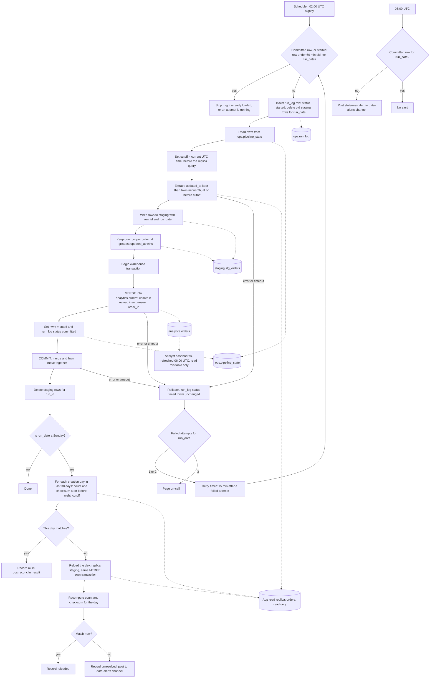

# Nightly orders ETL into the warehouse: pipeline flow

## Summary

Each night at 02:00 UTC, a job copies new and changed `orders` rows from the app's read replica into the warehouse table `analytics.orders`. It lands the rows in a staging table, then merges them and moves the high-water mark (HWM) in one warehouse transaction, so the data and the HWM commit together or not at all. Every Sunday, a reconciliation compares each of the last 30 days with the replica and reloads any day that differs.

## Terms

- **Read replica:** a read-only copy of the app's Postgres database. The job reads from it and never writes to it.
- **Warehouse:** the analytics database. All pipeline state lives here.
- **Bulk import:** a large app write that can stay open for up to 90 minutes. Each row gets `updated_at` when it is written, not when the import commits, so the row can appear in the replica up to 90 minutes after that time.
- **Soft delete:** the app sets `deleted_at` instead of removing a row. This is a write, so it also sets `updated_at`.
- **High-water mark (HWM):** the time up to which the warehouse has loaded data. Stored in `ops.pipeline_state`.
- **Cutoff:** the job's clock time, read before the replica query. It becomes the new HWM when the night commits.
- **Lookback:** the 2 hours before the HWM that each night reads again, to catch late rows.
- **Attempt:** one try at a night's load. Each attempt has its own `run_id`.
- **run_date:** the UTC date of the 02:00 start. Every attempt for that night stores it, so retries and the 06:00 check use the stored value, not the clock.
- **run_log:** a table with one row per attempt. Its status is `started`, `committed` or `failed`.
- **Staging:** `staging.stg_orders`. It holds one attempt's extracted rows. Dashboards never read it.
- **MERGE:** one SQL statement that updates rows that already exist and inserts rows that do not.
- **Creation day:** the UTC date of `created_at`.
- **Checksum:** for one creation day, the row count plus the wrapping sum of a 64-bit hash of each row's `order_id` and `updated_at`. The sum does not depend on row order.
- **On-call page:** an alert that wakes the on-call engineer.

## Diagram

## Where state lives

All pipeline state is in the warehouse. The app database is read only.

| Object | Holds | Written by |
|---|---|---|
| `ops.pipeline_state` | per job: `hwm`, `last_success_cutoff`, `last_success_run_id` | nightly job, inside the commit transaction only |
| `ops.run_log` | one row per attempt: `run_type` (nightly or reconcile), `run_date`, `attempt`, `cutoff`, `status` (started, committed, failed), row counts, error text | every attempt, including failed ones |
| `staging.stg_orders` | extracted rows for one `run_id`, with `run_date`; not read by dashboards | nightly job and reloads; rows deleted after use |
| `analytics.orders` | one row per `order_id`: source columns, `created_at`, `updated_at`, `deleted_at`, `is_deleted`, `loaded_run_id` | merge only |
| `ops.reconcile_result` | per creation day: replica and warehouse count and checksum; status (ok, reloaded, unresolved, skipped) | Sunday reconciliation |

## The nightly run

Each step starts when the one before it finishes. Steps 2 to 9 are one attempt's work. A failure before COMMIT rolls the attempt back; see the failure table.

1. **Start.** The 02:00 scheduler or the job's retry timer (15 minutes after a failed attempt) starts an attempt. Before any write, the job checks `run_log`. It stops if the night is already loaded (a committed row for `run_date`) or an attempt is still running (a started row under 60 minutes old). Otherwise it inserts a `started` row for this attempt and deletes staging rows left for `run_date` by earlier attempts. The attempt also sets its 60-minute deadline here. The attempt number is one more than the count of attempts for `run_date` that failed. An attempt failed if its row has status `failed`, or if its row is still `started` and more than 60 minutes old. A stale `started` row keeps its status, and the count reads it as failed. Counting from `run_log` means a scheduler restart cannot reset the count. Keeps its data in: `run_log`.
2. **Read the HWM.** Read `hwm` from `ops.pipeline_state`. The job is set up with `hwm = 1970-01-01`, so the first run loads the whole table. There is no separate backfill.
3. **Set the cutoff.** Read the UTC clock. Do this before the replica query, so a row written during the extract cannot fall between two windows.
4. **Extract.** Read from the replica every `orders` row with `updated_at > hwm - 2h` and `updated_at <= cutoff`. The 2-hour lookback covers the 90-minute bulk-import lag, with 30 minutes of margin. The job only reads.
5. **Land in staging.** Write the rows to `staging.stg_orders` with this attempt's `run_id` and `run_date`. Keeps its data in: staging, until step 10.
6. **Keep one row per order.** In staging, keep the row with the greatest `updated_at` for each `order_id`. This runs before the MERGE because a MERGE needs one source row per key. If two rows for one order have the same `updated_at` but different content, keep one and count a conflict in `run_log`. The rule for which one is kept is an open question.
7. **Merge.** Open one warehouse transaction. MERGE the staged rows into `analytics.orders` on `order_id`:
   - If the order exists and the incoming `updated_at` is newer, overwrite its columns, set `is_deleted = deleted_at IS NOT NULL`, and set `loaded_run_id = run_id`.
   - If the order is new, insert it with the same flag.
   - Otherwise, leave it alone.

   A stale copy never overwrites a newer one, so running the same extract again matches nothing new. A soft delete passes this rule like any write and sets `is_deleted = true`. Rows are never removed.
8. **Move the HWM and mark the attempt.** In the same transaction, set `hwm = cutoff` in `ops.pipeline_state` and set this attempt's `run_log` status to `committed`. The HWM is the cutoff, not `max(updated_at)`. On a quiet night the max would stop moving, and the window would grow every night.
9. **COMMIT.** The merge, the HWM and the run_log status commit together, or none of them does. Dashboards read only `analytics.orders`, so they see the whole previous night or the whole new one. If the warehouse cannot keep the MERGE and the ops writes isolated this way, build into a shadow table and swap it in with one atomic rename or view change.
10. **Clean staging.** Delete this `run_id`'s rows from staging. The data and HWM are already correct, so a failure here changes nothing. The next start for the same `run_date` removes any leftover rows.
11. **Sunday check.** If `run_date` is a Sunday, run the Sunday reconciliation below. It is a step in this same job, after COMMIT, not a separate scheduler entry.

## Manual rerun

An operator reruns a night by starting the job by hand. The rerun keeps that night's `run_date`, not the date of the rerun. This keeps the committed check, the attempt count and the 60-minute guard working for that night. A rerun then follows steps 1 to 11 like any scheduled start. How a rerun is started is an open question.

## The 06:00 check

A separate scheduled check runs at 06:00 UTC. It does not depend on the nightly job, so it still runs when the job has died. It looks in `run_log` for a committed row with the stored `run_date`. If there is none, it posts a staleness alert to #data-alerts. This happens even if on-call was already paged. In the worst case all attempts end before 06:00, so a missing commit means every attempt failed or the job died.

Dashboards refresh at 06:00 whether or not the night committed. They show the last committed night, which is consistent but stale. If the night commits later, the next refresh shows it, and the alert stays in the channel as the record.

## Sunday reconciliation

It runs only after a Sunday night commits. It has no time limit and no retry, and the 60-minute attempt limit does not cover it.

1. **Pin the cutoff.** `night_cutoff` is the cutoff of the Sunday attempt that committed. It is stored as `last_success_cutoff`. Both sides compare only rows with `updated_at` at or before `night_cutoff`. Pinning stops writes made during the comparison from causing false mismatches.
2. **Compare each creation day.** For each creation day in the last 30 days, compute the count and checksum on the replica and on `analytics.orders`, using the same rule on both sides. Soft-deleted rows count on both sides, because rows are never removed. Creation day is the UTC date of `created_at`, taken the same way on both sides.

   For each row, `h` is a 64-bit hash of `order_id || '|' || updated_at`, where `updated_at` is written as UTC microseconds in text. The day's checksum is `count(*)` plus the sum of all `h` values as a wrapping 64-bit integer. The sum does not depend on row order, so the two engines do not need matching sort orders. Both engines must build the same text and produce the same hash.
3. **Match: record ok.** If the count and checksum both match, write `ok` to `ops.reconcile_result`.
4. **Mismatch: reload the day.** Re-extract that creation day from the replica, bounded by `updated_at` at or before `night_cutoff`. Write the rows to staging, and MERGE them with the same guard, in the day's own transaction. Each day's reload is atomic, so a dashboard sees the day either before or after the reload. The reload does not move the HWM. Then recompute the count and checksum for that day, with the same `night_cutoff` bound.
5. **Recheck.** If the day now matches, record `reloaded`. If not, record `unresolved` and post to #data-alerts.

## Timing (worst case)

| UTC | Event |
|---|---|
| 02:00 | Attempt 1 starts. Ends by 03:00 with success, failure or timeout. |
| 15 min after failure | Attempt 2 starts. Ends by 04:15. |
| 15 min after failure | Attempt 3 starts. Ends by 05:30. If it fails, the job pages on-call. |
| 06:00 | Staleness check. Dashboards refresh regardless. |

## What happens when things fail

| When | What happens |
|---|---|
| Error, or the 60-minute deadline, before COMMIT | The attempt's process sets a 60-minute deadline when step 1 starts. It aborts the attempt when the deadline passes, whichever step is running. The open transaction rolls back. The same process sets the `run_log` row to `failed`. HWM is unchanged. The next attempt re-extracts the same window, so no data is lost. |
| Timeout or connection loss during COMMIT | The outcome is unknown. The next start checks `run_log`. A committed row means stop. Otherwise the attempt counts as failed. |
| Attempt 1 or 2 fails | After the row is set to `failed`, the job counts the failed attempts for `run_date` (step 1 rule). With a count of 1 or 2, it schedules the retry timer, which starts the next attempt 15 minutes later. |
| Attempt 3 fails | After the row is set to `failed`, the job counts the failed attempts for `run_date` (step 1 rule). The count is 3, so the job pages on-call instead of scheduling a retry. |
| Job dies with no retry scheduled | Nothing retries it, and nothing enforces the 60-minute limit while it is dead. Its started row counts as failed once it is over 60 minutes old, but only a later start for the same `run_date` reads that row. A manual rerun is needed, as described above. The 06:00 check still alerts. |
| No committed row at 06:00 | Post a staleness alert to #data-alerts, even if on-call was already paged. Dashboards refresh and show the last committed night. |
| Commit after 06:00 | The next dashboard refresh shows it. The alert stays as the record. |
| Sunday night's load never commits | Reconciliation is skipped for that week and recorded as `skipped`. The 06:00 alert and page already cover the failure. |
| Staging cleanup fails | Harmless. The data and HWM are correct, and the next start removes the leftover rows. |
| Replica lags, so a row is not visible when the extract runs | The row is missed that night. The next night's lookback picks it up if its `updated_at` falls inside that lookback. Otherwise the Sunday reconciliation finds it, if its creation day is in the last 30 days. Cutoff does not prevent this. |
| Reconciliation errors on a day before it is checked | Record that day `unresolved` and post to #data-alerts. The night's committed status does not change. Nothing retries. |
| Reloaded day still mismatches, or the reload fails | Record `unresolved` and post to #data-alerts. |

## Build and rollout

Not covered in this file.

## Open questions

- Can the first full load, which reads the whole table in one attempt, finish within 60 minutes? Measure the table size before the first run.
- The 60-minute timeout and the 2-hour lookback are proposals. Measure extract durations and bulk-import commit lags before fixing either.
- Does `orders` have child tables, such as line items, that need loading? The brief does not say.
- A row created more than 30 days ago that becomes visible late is not reconciled. It needs a wider window or a separate check.
- Which hash function gives identical output on Postgres and on the warehouse?
- Equal `updated_at` values for one order should be rare, and the conflict count in `run_log` will show if they are not. Which copy wins such a tie is not yet defined. The replica should also hold one row per order; this is not verified.
- The app never hard-deletes. If that changes, the merge needs a delete path and reconciliation must handle removed rows.
- Does the warehouse engine give snapshot isolation across a MERGE and ops writes? If not, the shadow-table fallback applies.
- A job that dies mid-attempt sets no retry timer. The brief asks for up to three attempts, so the scheduler may need its own retry. Not decided.
- Reconciliation has no time limit and no retry. The brief sets neither.
- What hosts the nightly job and the 06:00 check, and how does the on-call page reach a person? Not decided.
- How is a manual rerun started? Not decided.