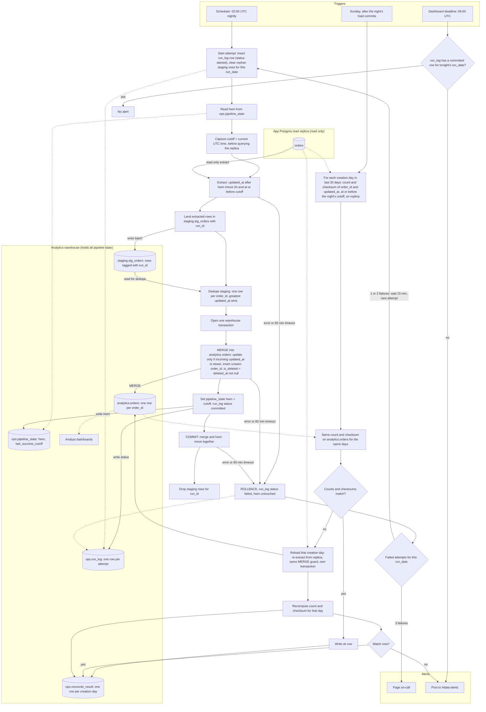

# Nightly orders ETL into the warehouse: pipeline flow

The job reads `orders` from the app's read replica, lands the extract in a warehouse staging table, and merges it into `analytics.orders` in one warehouse transaction. That transaction also moves the high-water mark (HWM), so the data and the HWM commit together or not at all. Every merge is guarded by `updated_at`, so re-running a night changes nothing. A 60-minute attempt timeout is a proposal chosen to fit three attempts before 06:00. Sunday reconciliation catches rows that become visible after the lookback has passed.



## Where state lives

All pipeline state is in the warehouse. The app database is read only.

| Object | Holds | Written by |
|---|---|---|
| `ops.pipeline_state` | one row per job: `hwm`, `last_success_cutoff`, `last_success_run_id` | nightly job, in the commit transaction only |
| `ops.run_log` | one row per attempt: `run_type` (nightly or reconcile), `run_date`, `attempt`, `cutoff`, `status` (started, committed, failed), row counts, error text | every attempt, including failed ones |
| `staging.stg_orders` | extracted rows for one `run_id`, not visible to dashboards | nightly job; rows deleted after commit |
| `analytics.orders` | one row per `order_id`: source columns, `created_at`, `updated_at`, `deleted_at`, `is_deleted`, `loaded_run_id` | merge only |
| `ops.reconcile_result` | per creation day: replica and warehouse count and checksum, status (ok, reloaded, unresolved) | Sunday reconciliation |

## Extract window and HWM

- The window is `updated_at > hwm - 2h AND updated_at <= cutoff`. The 2-hour lookback covers the 90-minute bulk-import visibility lag, with 30 minutes of margin.
- `cutoff` is read from the clock before the replica query runs. Capturing it after the query would let rows written during extraction fall between windows.
- The HWM is set to `cutoff` and not to `max(updated_at)`. Using `max(updated_at)` would make the window grow every night the app is quiet, because the HWM would stop moving.
- The HWM is written in the same transaction as the merge, so a failed or rolled-back attempt leaves it unchanged.

## Merge logic and idempotency

```
-- 1. latest version per order in this run
latest := staging.stg_orders WHERE run_id = :run
          keep one row per order_id with the greatest updated_at
          (equal updated_at with different content: keep one and count it as a conflict in run_log)

-- 2. guarded merge
MERGE INTO analytics.orders t USING latest s ON t.order_id = s.order_id
WHEN MATCHED AND s.updated_at > t.updated_at THEN UPDATE SET <all columns from s>,
                                                          is_deleted = s.deleted_at IS NOT NULL,
                                                          loaded_run_id = :run
WHEN NOT MATCHED THEN INSERT (...) VALUES (...)
```

- The guard means a stale copy never overwrites a newer one, and re-running the same extract matches nothing new.
- Deletes are ordinary writes that bump `updated_at`, so a soft delete passes the guard and sets `is_deleted = true`. Deleted orders are never removed from the warehouse.

## Atomicity for dashboards

- Dashboards read only `analytics.orders`, never staging.
- The merge and the HWM update share one transaction, so a dashboard query sees either the previous night or the full new night.
- If the warehouse engine cannot give snapshot isolation across a MERGE and an ops write, build into a shadow table and swap it in with one atomic rename or view change.

## Failure, retry and paging

| Time (UTC) | Event |
|---|---|
| 02:00 | Attempt 1 starts. Failure or timeout by 03:00 at the latest. |
| failure + 15 min | Attempt 2 starts. Ends by 04:15 at the latest. |
| failure + 15 min | Attempt 3 starts. Ends by 05:30 at the latest. |
| after attempt 3 fails | Page on-call. This happens before 06:00 even in the worst case. |
| 06:00 | Staleness check (below). |

- A failed attempt rolls back, records `status = failed` in `run_log`, and leaves the HWM where it was. The next attempt re-extracts the same window, so no data is lost and no extra logic is needed.
- The attempt count is read from `run_log`, not kept in memory, so a scheduler restart does not reset it.
- Before starting, an attempt checks for an existing committed row for its `run_date`. This stops a duplicate trigger from loading twice.

## 06:00 staleness check

- At 06:00 the job checks `run_log` for a committed row for tonight's `run_date`. If there is none, it posts a staleness alert to #data-alerts.
- Dashboards refresh at 06:00 regardless. They show the last committed night, which is consistent but stale.
- If a run commits after 06:00, the next dashboard refresh picks it up. The alert stays in the channel as the record.

## Sunday reconciliation

- It runs after Sunday night's load commits. If that load did not commit, it is skipped for the week, recorded in `ops.reconcile_result`, and the 06:00 alert and on-call page already cover the failure.
- For each `created_at` day in the last 30 days, it compares the replica and the warehouse with `updated_at <= night_cutoff` on both sides. Pinning the cutoff stops replica writes during the comparison from causing false mismatches.
- Checksum: for each row, `h = hash(order_id || '|' || updated_at in UTC microseconds as text)`. The day's checksum is `count(*)` plus the sum of `h` as a 64-bit wrapping integer. The sum is order independent, so the two engines don't need matching sort orders. The hash function must produce identical output on both engines. Compute the canonical text the same way on both sides.
- A mismatched day is reloaded from the replica with the same guarded MERGE, in its own transaction. Each day's reload is atomic, so a dashboard sees each day either before or after its reload. The reload does not touch the HWM. Every day is then recomputed. A day that still mismatches is logged as unresolved and posted to #data-alerts.

## Assumptions and open risks

- The source has `created_at` and `order_id`, and `updated_at` is set on every write, as the brief states. Equal `updated_at` values for one order should be rare. The conflict count in `run_log` will show if they are not.
- Rows that become visible more than 2 hours after their `updated_at` are covered only if their creation day is in the last 30 days. A row created more than 30 days ago that becomes visible late is not covered by any step. It needs a wider reconciliation window or a separate check.
- The 60-minute attempt timeout and the 2-hour lookback are proposals. Measure real extract durations and bulk-import commit lags before fixing them.
- The app never hard-deletes. If that changes, the merge needs an explicit delete path, and reconciliation counts would need to handle removed rows.
- The job must not run two attempts at once. Keep a lock or a `status = started` check in `run_log` so a manual rerun waits for an active attempt to finish.